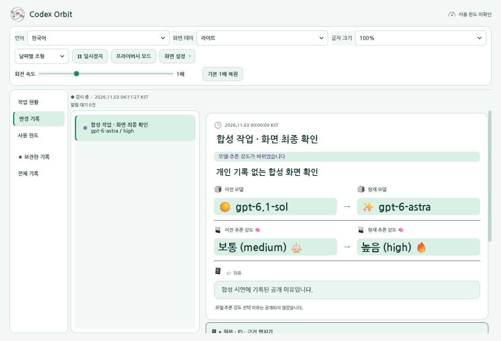
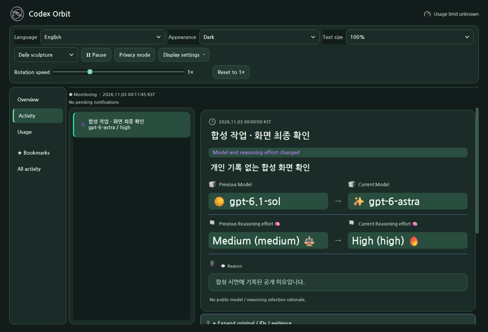
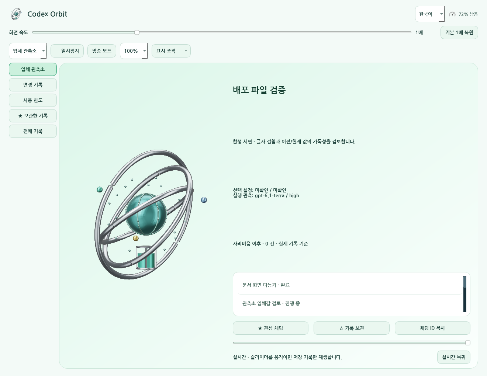
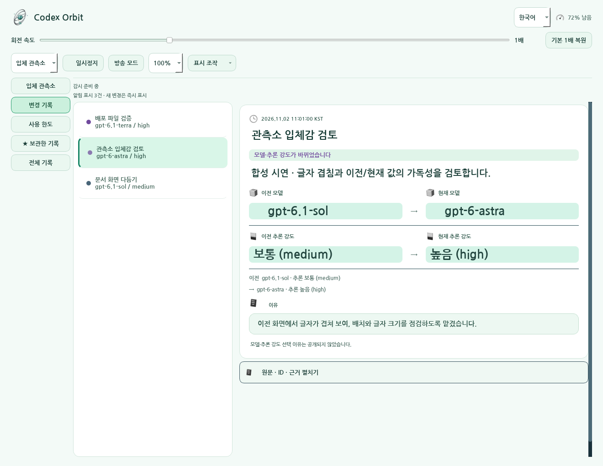
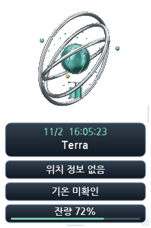

# 🪐 Codex Orbit 3.1.0

A Windows desktop app with the original date-based 3D calendar themes enabled by default. The observatory remains available as an explicit choice. Model-change notifications, account rate-limit percentages, time and weather are preserved.

[한국어](README.md) · [Downloads](docs/DOWNLOADS.md) · [User guide](docs/Usage.en.md) · [Validation scope](docs/공개검증_31차.md) · [All revisions](docs/REVISION_INDEX.md)

Three silver mesh rings surround model-specific sun, crystal, sphere or crescent cores. Explicitly recorded agent states appear as satellites. Pins, bookmarks, history replay and an away summary help navigate records. Unknown values remain unknown. Replay does not change model settings, and local observations do not certify the server's model identity.

Notifications compare the chat title, previous model/reasoning, current model/reasoning and recorded reason. Original IDs and records are preserved. Hover pauses dismissal; notifications can be pinned. Broadcast mode masks titles, tasks and tooltips. Local diagnostic ZIPs exclude conversations, credentials, paths and raw events. User-triggered updates accept official releases, verify SHA-256 and restore the previous executable if the replacement fails its startup check.

The mint/white interface uses Nanum Gothic Bold. Docking, text scale, pause, reduced motion and resource quality are available. Monitoring continues while motion is paused. Remaining limits are percentages, not token counts. The calendar mode preserves 888 monthly themes for 2026–2099 and daily procedural geometry. One GPU worker keeps the 3840×2160 render source; observatory quality caps are 20/30/60fps. These are not claims of a fixed 240fps or monitor refresh rate.

## Revision 31: synthetic screens from the packaged app

These screens use synthetic activity without personal records. Model and reasoning values are test examples, not claims about actual execution or account state.

## Version 3.1.0

Choose System, Light or Dark appearance with saved preferences. Language, text size and rotation speed share a settings area. Overview separates selected settings from observed execution. Display settings explains motion, docking, sound, quality, diagnostics and updates. Privacy mode masks titles and task descriptions while preserving stored records. Date-based artwork and notification behavior are retained. [Revision 31](history/31차/README.md)

## Version 3.0.1

Missing display-mode settings now select the calendar. Model events preserve the date title and geometry. The existing yearly, monthly and daily theme code and assets remain unchanged. [Revision 30](history/30차/README.md) · [Validation](docs/공개검증_30차.md)

## Revision history

| 차수 | 폴더 | 설명 | 직전 차수와 실제 비교 |
| --- | --- | --- | --- |
| 1차 | [폴더](history/01차/) | [설명](history/01차/README.md) | [비교 대상 없는 근거](history/01차/직전차수.diff) |
| 2차 | [폴더](history/02차/) | [설명](history/02차/README.md) | 1차 · [전체 차이](history/02차/직전차수.diff) |
| 3차 | [폴더](history/03차/) | [설명](history/03차/README.md) | 2차 · [전체 차이](history/03차/직전차수.diff) |
| 4차 | [폴더](history/04차/) | [설명](history/04차/README.md) | 3차 · [전체 차이](history/04차/직전차수.diff) |
| 5차 | [폴더](history/05차/) | [설명](history/05차/README.md) | 4차 · [전체 차이](history/05차/직전차수.diff) |
| 6차 | [폴더](history/06차/) | [설명](history/06차/README.md) | 5차 · [전체 차이](history/06차/직전차수.diff) |
| 7차 | [폴더](history/07차/) | [설명](history/07차/README.md) | 6차 · [전체 차이](history/07차/직전차수.diff) |
| 8차 | [폴더](history/08차/) | [설명](history/08차/README.md) | 7차 · [전체 차이](history/08차/직전차수.diff) |
| 9차 | [폴더](history/09차/) | [설명](history/09차/README.md) | 8차 · [전체 차이](history/09차/직전차수.diff) |
| 10차 | [폴더](history/10차/) | [설명](history/10차/README.md) | 9차 · [전체 차이](history/10차/직전차수.diff) |
| 11차 | [폴더](history/11차/) | [설명](history/11차/README.md) | 10차 · [전체 차이](history/11차/직전차수.diff) |
| 12차 | [폴더](history/12차/) | [설명](history/12차/README.md) | 11차 · [전체 차이](history/12차/직전차수.diff) |
| 13차 | [폴더](history/13차/) | [설명](history/13차/README.md) | 12차 · [전체 차이](history/13차/직전차수.diff) |
| 14차 | [폴더](history/14차/) | [설명](history/14차/README.md) | 13차 · [전체 차이](history/14차/직전차수.diff) |
| 15차 | [폴더](history/15차/) | [설명](history/15차/README.md) | 14차 · [전체 차이](history/15차/직전차수.diff) |
| 16차 | [폴더](history/16차/) | [설명](history/16차/README.md) | 15차 · [전체 차이](history/16차/직전차수.diff) |
| 17차 | [폴더](history/17차/) | [설명](history/17차/README.md) | 16차 · [전체 차이](history/17차/직전차수.diff) |
| 18차 | [폴더](history/18차/) | [설명](history/18차/README.md) | 17차 · [전체 차이](history/18차/직전차수.diff) |
| 19차 | [폴더](history/19차/) | [설명](history/19차/README.md) | 18차 · [전체 차이](history/19차/직전차수.diff) |
| 20차 | [폴더](docs/20차/) | [설명](docs/20차/README.md) | [비교 대상 없는 근거](docs/20차/README.md) |
| 21차 | [폴더](history/21차/) | [설명](history/21차/README.md) | 19차 · [전체 차이](history/21차/직전차수.diff) |
| 22차 | [폴더](history/22차/) | [설명](history/22차/README.md) | 21차 · [전체 차이](history/22차/직전차수.diff) |
| 23차 | [폴더](history/23차/) | [설명](history/23차/README.md) | 22차 · [전체 차이](history/23차/직전차수.diff) |
| 24차 | [폴더](history/24차/) | [설명](history/24차/README.md) | 23차 · [전체 차이](history/24차/직전차수.diff) |
| 25차 | [폴더](history/25/) | [설명](history/25/README.md) | 24차 · [전체 차이](history/25/직전차수.diff) |
| 26차 | [폴더](history/26/) | [설명](history/26/README.md) | 25차 · [전체 차이](history/26/직전차수.diff) |
| 27차 | [폴더](history/27/) | [설명](history/27/README.md) | 26차 · [전체 차이](docs/27차_전체변경.diff) |
| 28차 | [폴더](history/28/) | [설명](history/28/README.md) | 27차 · [전체 차이](docs/28차_전체변경.diff) |
| 29차 | [폴더](history/29차/) | [설명](history/29차/README.md) | 28차 · [전체 차이](history/29차/직전차수.diff) |
| 30차 | [폴더](history/30차/) | [설명](history/30차/README.md) | 29차 · [전체 차이](history/30차/직전차수.diff) |
| 31차 | [폴더](history/31차/) | [설명](history/31차/README.md) | 30차 · [전체 차이](history/31차/직전차수.diff) |
| 최종 | [폴더](docs/최종/) | [설명](docs/최종/README.md) | [비교 대상 없는 근거](docs/최종/README.md) |

Historical sources and supporting documents/assets are preserved with full comparisons, byte counts and SHA-256. [Archive manifests](docs/ARCHIVE_FILES.md) distinguish original copies, privacy edits and exclusions. Design images use synthetic examples. No private full-source ZIP, personal conversations, operating memories or credentials are published. Existing legal notices are preserved; no new license is assigned. This software work has no manuscript requiring a paper PDF.

## Synthetic examples

Actual Qt screens using synthetic events and example values; no private chats or real account readings.

