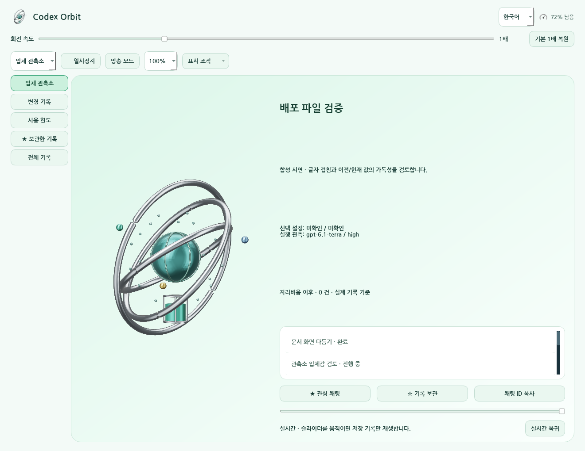
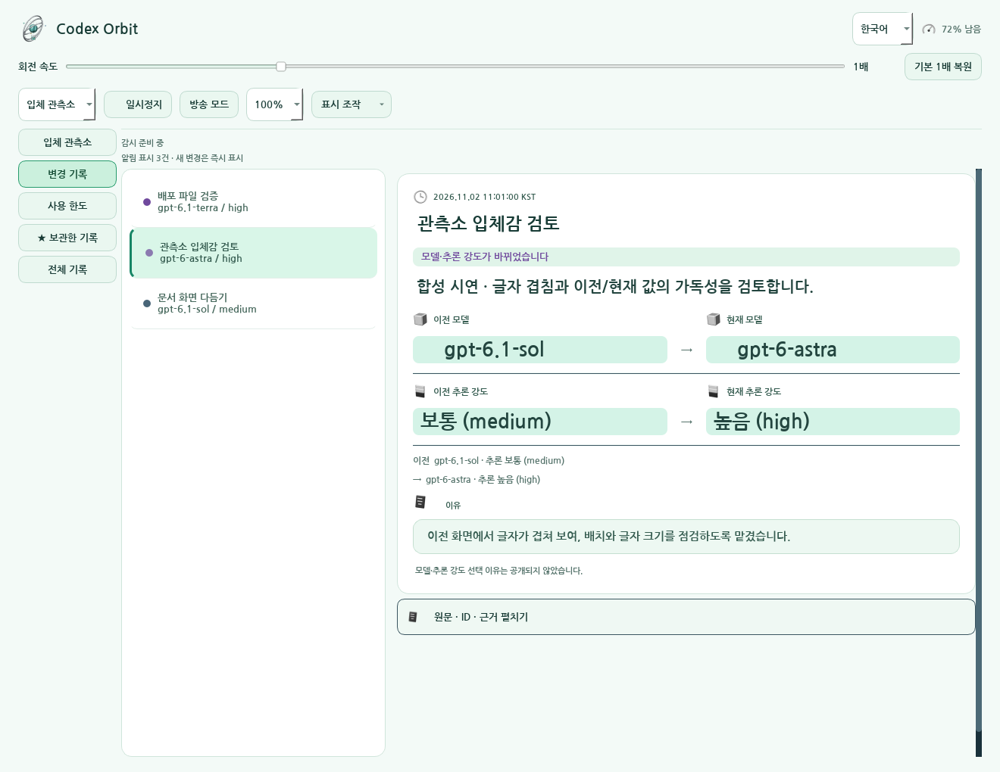
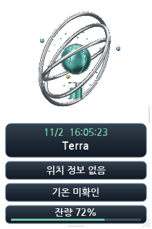

# 🪐 Codex Orbit 3.0.1

연도·월·일에 맞춘 3D 테마를 기본으로 보여 주는 Windows 바탕화면 앱입니다. 관측소는 명시적으로 선택해 사용할 수 있습니다. 로컬 기록에서 확인한 모델·추론 강도 변화와 작업 상태를 보여 주며, 실제 계정 사용 한도 비율·시계·기온을 함께 확인할 수 있습니다.

[English](README.en.md) · [다운로드](docs/DOWNLOADS.md) · [사용법](docs/사용법.md) · [검증 범위](docs/공개검증_30차.md) · [변경 기록](변경기록_30차.md) · [권리·공개 범위](공개범위.md)

## 30차 · 원래 날짜별 테마 기본 복원

설정에 표시 모드가 없는 경우에도 원래 날짜별 달력 조형을 표시합니다. 모델 변경 이벤트를 받아도 날짜 제목과 조형은 유지합니다. 888개 월 테마·일별 디자인·색·재질·날짜 규칙은 바꾸지 않았습니다. 이전/현재 모델·추론 강도·알림 기능도 유지합니다.

[30차 변경 기록](변경기록_30차.md) · [검증 범위](docs/공개검증_30차.md) · [29차와 전체 비교](docs/30차_전체변경.diff)

## 선택 가능한 29차 관측소 기능

- 은색 금속 링 세 개가 서로 다른 축에서 움직입니다. 솔의 태양·아스트라의 결정·테라의 구체·루나의 초승달 코어와 추론 강도별 입자 밀도를 구분합니다. 확인되지 않은 모델은 중립 조형으로 표시합니다.
- 위성은 기록에서 명시적으로 관측한 작업 상태를 표시합니다. 관심 채팅 고정·기록 북마크·자리비움 요약·시간 슬라이더 재생을 제공하며 재생은 실제 모델 설정을 바꾸지 않습니다.
- 알림은 채팅 제목·이전 모델과 추론 강도·현재 모델과 추론 강도·기록된 이유를 비교합니다. 정확한 모델 ID와 원문 기록은 보존하고 표시 제목의 장식 이모지를 정리합니다. 마우스를 올리면 자동 닫힘을 멈추고 알림을 고정할 수 있습니다.
- 방송 모드는 열린 알림·제목·작업·툴팁을 가립니다. 진단 ZIP은 대화·인증·경로·이벤트 원문을 제외한 항목만 로컬에 저장합니다. 업데이트는 사용자가 확인을 눌러 공식 릴리스를 조회하고 SHA-256 대조 후 준비하며, 교체 후 실행 확인 실패 시 이전 실행 파일로 복구합니다.
- 민트와 화이트 화면·나눔고딕 Bold를 사용합니다. 글자 크기·가장자리 도킹·펼침·재생/일시정지·모션 축소·자원 품질을 조절할 수 있으며 일시정지 중에도 알림 감시는 계속됩니다.

실제 한도는 **남은 사용 한도 비율**이며 남은 토큰 개수가 아닙니다. 미확인은 0%와 구분합니다. 선택 설정 관측과 실제 실행 기록 관측을 구분하며 로컬 기록이 서버 모델 신원을 보증하지 않습니다. 기록되지 않은 이유와 작업 상태를 만들어 내지 않습니다.

## 달력 모드와 기존 기능

2026~2099년의 [888개 월 테마](docs/연도별_월별_테마_전체.md)와 [CSV](docs/연도별_월별_테마_전체.csv), 날짜별 실제 메시 조형을 달력 모드로 보존합니다. 공통 생성 규칙을 재사용하므로 888개 수작업 모델을 뜻하지 않습니다. 한영 선택·날씨·IP 기반 지역·시계·속도 조절을 유지합니다. 하나의 GPU 작업자가 3840×2160 원본을 렌더하며 관측소 품질은 20/30/60fps 상한을 사용합니다. 실제 생성률과 모니터 표시율은 별개이고 고정 240fps 달성을 주장하지 않습니다.

## 모든 차수와 실제 자료

[전체 목차](docs/REVISION_INDEX.md) · [차수별 보조 자료·시안·제외 대응](docs/ARCHIVE_FILES.md)

<!-- 차수표 시작 -->
| 차수 | 폴더 | 설명 | 직전 차수와 실제 비교 |
| --- | --- | --- | --- |
| 1차 | [폴더](history/01차/) | [설명](history/01차/README.md) | [비교 대상 없는 근거](history/01차/직전차수.diff) |
| 2차 | [폴더](history/02차/) | [설명](history/02차/README.md) | 1차 · [전체 차이](history/02차/직전차수.diff) |
| 3차 | [폴더](history/03차/) | [설명](history/03차/README.md) | 2차 · [전체 차이](history/03차/직전차수.diff) |
| 4차 | [폴더](history/04차/) | [설명](history/04차/README.md) | 3차 · [전체 차이](history/04차/직전차수.diff) |
| 5차 | [폴더](history/05차/) | [설명](history/05차/README.md) | 4차 · [전체 차이](history/05차/직전차수.diff) |
| 6차 | [폴더](history/06차/) | [설명](history/06차/README.md) | 5차 · [전체 차이](history/06차/직전차수.diff) |
| 7차 | [폴더](history/07차/) | [설명](history/07차/README.md) | 6차 · [전체 차이](history/07차/직전차수.diff) |
| 8차 | [폴더](history/08차/) | [설명](history/08차/README.md) | 7차 · [전체 차이](history/08차/직전차수.diff) |
| 9차 | [폴더](history/09차/) | [설명](history/09차/README.md) | 8차 · [전체 차이](history/09차/직전차수.diff) |
| 10차 | [폴더](history/10차/) | [설명](history/10차/README.md) | 9차 · [전체 차이](history/10차/직전차수.diff) |
| 11차 | [폴더](history/11차/) | [설명](history/11차/README.md) | 10차 · [전체 차이](history/11차/직전차수.diff) |
| 12차 | [폴더](history/12차/) | [설명](history/12차/README.md) | 11차 · [전체 차이](history/12차/직전차수.diff) |
| 13차 | [폴더](history/13차/) | [설명](history/13차/README.md) | 12차 · [전체 차이](history/13차/직전차수.diff) |
| 14차 | [폴더](history/14차/) | [설명](history/14차/README.md) | 13차 · [전체 차이](history/14차/직전차수.diff) |
| 15차 | [폴더](history/15차/) | [설명](history/15차/README.md) | 14차 · [전체 차이](history/15차/직전차수.diff) |
| 16차 | [폴더](history/16차/) | [설명](history/16차/README.md) | 15차 · [전체 차이](history/16차/직전차수.diff) |
| 17차 | [폴더](history/17차/) | [설명](history/17차/README.md) | 16차 · [전체 차이](history/17차/직전차수.diff) |
| 18차 | [폴더](history/18차/) | [설명](history/18차/README.md) | 17차 · [전체 차이](history/18차/직전차수.diff) |
| 19차 | [폴더](history/19차/) | [설명](history/19차/README.md) | 18차 · [전체 차이](history/19차/직전차수.diff) |
| 20차 | [폴더](docs/20차/) | [설명](docs/20차/README.md) | [비교 대상 없는 근거](docs/20차/README.md) |
| 21차 | [폴더](history/21차/) | [설명](history/21차/README.md) | 19차 · [전체 차이](history/21차/직전차수.diff) |
| 22차 | [폴더](history/22차/) | [설명](history/22차/README.md) | 21차 · [전체 차이](history/22차/직전차수.diff) |
| 23차 | [폴더](history/23차/) | [설명](history/23차/README.md) | 22차 · [전체 차이](history/23차/직전차수.diff) |
| 24차 | [폴더](history/24차/) | [설명](history/24차/README.md) | 23차 · [전체 차이](history/24차/직전차수.diff) |
| 25차 | [폴더](history/25/) | [설명](history/25/README.md) | 24차 · [전체 차이](history/25/직전차수.diff) |
| 26차 | [폴더](history/26/) | [설명](history/26/README.md) | 25차 · [전체 차이](history/26/직전차수.diff) |
| 27차 | [폴더](history/27/) | [설명](history/27/README.md) | 26차 · [전체 차이](docs/27차_전체변경.diff) |
| 28차 | [폴더](history/28/) | [설명](history/28/README.md) | 27차 · [전체 차이](docs/28차_전체변경.diff) |
| 29차 | [폴더](history/29차/) | [설명](history/29차/README.md) | 28차 · [전체 차이](history/29차/직전차수.diff) |
| 30차 | [폴더](history/30차/) | [설명](history/30차/README.md) | 29차 · [전체 차이](history/30차/직전차수.diff) |
| 최종 | [폴더](docs/최종/) | [설명](docs/최종/README.md) | [비교 대상 없는 근거](docs/최종/README.md) |
<!-- 차수표 끝 -->

원본 소스 비교에는 주석·공백·개행과 신규·삭제 상태를 포함합니다. 20차는 실행 소스 없이 38개 시안, 21차는 110개 시안을 보존합니다. 최종 폴더의 개인 운영 검증 원문은 공개하지 않습니다. 역사 자료 2,281개 항목의 보존·정제·제외 사유와 원본/공개 SHA를 차수별로 연결했습니다.

## 실행·소스와 권리

Windows 10/11 x64와 OpenGL 3.3을 지원하는 그래픽 드라이버가 필요합니다. 단일 EXE는 Python 설치 없이 실행하고 설치본은 현재 사용자용 바로가기·제거를 제공합니다. GPU 준비/실패는 정적 표식 또는 오류 설명으로 구분합니다.

공개 소스는 GitHub 자동 Source code ZIP 또는 이 저장소에서 받습니다. 비공개 전체 개발 ZIP·개인 대화·지침·인증 자료는 배포하지 않습니다. 기존 라이선스 고지를 보존하며 새 소스 라이선스를 임의 부여하지 않습니다. 재빌드는 `python -B -X utf8 tools/build_distribution.py`를 사용합니다. 원고가 없는 앱 작업으로 논문 PDF를 만들지 않았습니다.

## 합성 예시 화면

다음 이미지는 실제 Qt 앱에 합성 이벤트와 예시 값을 넣은 화면이며 개인 채팅·실계정 수치가 아닙니다.

