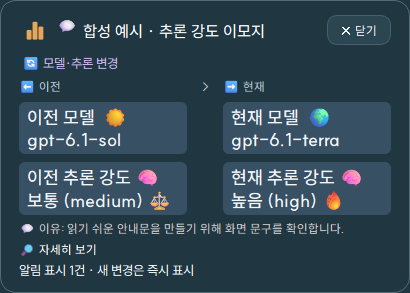

# 🪐 Codex Orbit · 2.11.0

투명한 Windows 바탕화면 위젯에서 날짜별 3D 조형과 시계·현재 기온·계정 사용 한도를 보여 주고, 로컬 Codex의 모델·추론 강도 변경 및 작업 배정·재개를 알립니다. Python · PySide6 · ModernGL 기반 데스크톱 앱입니다.

[English](README.en.md) · [다운로드 안내](docs/DOWNLOADS.md) · [사용법](docs/사용법.md) · [28차 검증 범위](docs/공개검증_28차.md) · [28차 변경 기록](변경기록_28차.md) · [전체 차수 목차](docs/REVISION_INDEX.md) · [소스 비교 수](VERSIONS.md) · [글꼴 라이선스](assets/SUIT-LICENSE.txt) · [배포 권리 고지](assets/Qt-LGPL-3.0-LICENSE.txt)

## 다운로드와 실행

28차는 알림을 채팅 제목·이전과 현재 모델/추론 강도·쉬운 이유로 정리하고 모델별 이모지를 표시합니다. 긴 알림의 글자 잘림과 열린 창의 한영 전환도 보완합니다. 단일 실행 파일과 현재 사용자용 설치본을 제공합니다.

- [단일 실행 파일 · CodexOrbit.exe](https://github.com/PUVKID/Codex-Orbit/releases/download/v2.11.0/CodexOrbit.exe): Windows 10/11 x64에서 설치 없이 실행합니다.
- [설치 프로그램 · CodexOrbit-Setup.exe](https://github.com/PUVKID/Codex-Orbit/releases/download/v2.11.0/CodexOrbit-Setup.exe): 현재 사용자용 설치·시작 메뉴·선택 바탕화면 바로가기·제거 프로그램입니다.
- [2.11.0 Release](https://github.com/PUVKID/Codex-Orbit/releases/tag/v2.11.0): 사용법·영문 안내·라이선스 묶음·SHA256SUMS와 실행 파일을 함께 제공합니다. 소스는 GitHub의 자동 소스 ZIP을 이용하며 비공개 전체 소스 ZIP은 게시하지 않습니다.

Python 별도 설치 없이 실행하며 3D 모션에는 OpenGL 3.3 지원 그래픽 드라이버가 필요합니다. 사용 한도는 설치된 Codex의 로그인 상태에서 읽으며 **남은 토큰 수가 아닌 계정 한도 비율**입니다. 사용자가 직접 선택한 언어·회전 속도는 저장됩니다. [실행·조작 안내](docs/사용법.md)와 [파일 크기·SHA-256](docs/DOWNLOADS.md)을 확인하십시오.

☀️ 솔 · ✨ 아스트라 · 🌍 테라 · 🌙 루나를 정확한 ID와 함께 보여 줍니다. 기록되지 않은 이유는 만들어 쓰지 않습니다. [888개 연월 테마](docs/연도별_월별_테마_전체.md) · [테마 CSV](docs/연도별_월별_테마_전체.csv) · [28차 전체 비교](docs/28차_전체변경.diff).

위 화면은 합성 예시입니다. 개인 채팅·계정 자료를 공개하지 않습니다.

<!-- 차수표 시작 -->
### 공개 보존 차수

각 비교는 공개 보존된 `src/`와 `requirements.txt`에 한정하며 원본 전체 비교가 아닙니다. 20차는 디자인 시안과 생성 작업 파일이 확인되나 이 공개 소스 이력에 포함되지 않았습니다. 최종 폴더에는 검증 기록이 확인되나 별도 공개 소스 스냅샷은 확인되지 않았습니다.

| 차수 | 공개 폴더 | 설명 | 직전 확인 차수 비교 |
| --- | --- | --- | --- |
| 1차 | [폴더](history/01차/) | [설명](history/01차/README.md) | 없음 · [전체 차이](history/01차/직전차수.diff) · [파일 목록](history/01차/공개파일_비교.json) |
| 2차 | [폴더](history/02차/) | [설명](history/02차/README.md) | 1차 · [전체 차이](history/02차/직전차수.diff) · [파일 목록](history/02차/공개파일_비교.json) |
| 3차 | [폴더](history/03차/) | [설명](history/03차/README.md) | 2차 · [전체 차이](history/03차/직전차수.diff) · [파일 목록](history/03차/공개파일_비교.json) |
| 4차 | [폴더](history/04차/) | [설명](history/04차/README.md) | 3차 · [전체 차이](history/04차/직전차수.diff) · [파일 목록](history/04차/공개파일_비교.json) |
| 5차 | [폴더](history/05차/) | [설명](history/05차/README.md) | 4차 · [전체 차이](history/05차/직전차수.diff) · [파일 목록](history/05차/공개파일_비교.json) |
| 6차 | [폴더](history/06차/) | [설명](history/06차/README.md) | 5차 · [전체 차이](history/06차/직전차수.diff) · [파일 목록](history/06차/공개파일_비교.json) |
| 7차 | [폴더](history/07차/) | [설명](history/07차/README.md) | 6차 · [전체 차이](history/07차/직전차수.diff) · [파일 목록](history/07차/공개파일_비교.json) |
| 8차 | [폴더](history/08차/) | [설명](history/08차/README.md) | 7차 · [전체 차이](history/08차/직전차수.diff) · [파일 목록](history/08차/공개파일_비교.json) |
| 9차 | [폴더](history/09차/) | [설명](history/09차/README.md) | 8차 · [전체 차이](history/09차/직전차수.diff) · [파일 목록](history/09차/공개파일_비교.json) |
| 10차 | [폴더](history/10차/) | [설명](history/10차/README.md) | 9차 · [전체 차이](history/10차/직전차수.diff) · [파일 목록](history/10차/공개파일_비교.json) |
| 11차 | [폴더](history/11차/) | [설명](history/11차/README.md) | 10차 · [전체 차이](history/11차/직전차수.diff) · [파일 목록](history/11차/공개파일_비교.json) |
| 12차 | [폴더](history/12차/) | [설명](history/12차/README.md) | 11차 · [전체 차이](history/12차/직전차수.diff) · [파일 목록](history/12차/공개파일_비교.json) |
| 13차 | [폴더](history/13차/) | [설명](history/13차/README.md) | 12차 · [전체 차이](history/13차/직전차수.diff) · [파일 목록](history/13차/공개파일_비교.json) |
| 14차 | [폴더](history/14차/) | [설명](history/14차/README.md) | 13차 · [전체 차이](history/14차/직전차수.diff) · [파일 목록](history/14차/공개파일_비교.json) |
| 15차 | [폴더](history/15차/) | [설명](history/15차/README.md) | 14차 · [전체 차이](history/15차/직전차수.diff) · [파일 목록](history/15차/공개파일_비교.json) |
| 16차 | [폴더](history/16차/) | [설명](history/16차/README.md) | 15차 · [전체 차이](history/16차/직전차수.diff) · [파일 목록](history/16차/공개파일_비교.json) |
| 17차 | [폴더](history/17차/) | [설명](history/17차/README.md) | 16차 · [전체 차이](history/17차/직전차수.diff) · [파일 목록](history/17차/공개파일_비교.json) |
| 18차 | [폴더](history/18차/) | [설명](history/18차/README.md) | 17차 · [전체 차이](history/18차/직전차수.diff) · [파일 목록](history/18차/공개파일_비교.json) |
| 19차 | [폴더](history/19차/) | [설명](history/19차/README.md) | 18차 · [전체 차이](history/19차/직전차수.diff) · [파일 목록](history/19차/공개파일_비교.json) |
| 20차 | [자료 상태](docs/20차/) | [설명](docs/20차/README.md) · 공개 소스 없음 | [비교 대상 없는 근거](docs/20차/README.md) |
| 21차 | [폴더](history/21차/) | [설명](history/21차/README.md) | 19차 · [전체 차이](history/21차/직전차수.diff) · [파일 목록](history/21차/공개파일_비교.json) |
| 22차 | [폴더](history/22차/) | [설명](history/22차/README.md) | 21차 · [전체 차이](history/22차/직전차수.diff) · [파일 목록](history/22차/공개파일_비교.json) |
| 23차 | [폴더](history/23차/) | [설명](history/23차/README.md) | 22차 · [전체 차이](history/23차/직전차수.diff) · [파일 목록](history/23차/공개파일_비교.json) |
| 24차 | [폴더](history/24차/) | [설명](history/24차/README.md) | 23차 · [전체 차이](history/24차/직전차수.diff) · [파일 목록](history/24차/공개파일_비교.json) |
| 25차 | [폴더](history/25/) | [설명](history/25/README.md) | 24차 · [전체 차이](history/25/직전차수.diff) · [파일 목록](history/25/공개파일_비교.json) |
| 26차 | [폴더](history/26/) | [설명](history/26/README.md) | 25차 · [전체 차이](history/26/직전차수.diff) · [파일 목록](history/26/공개파일_비교.json) |
| 27차 | [문서 폴더](history/27/) | [설명](history/27/README.md) · 별도 앱 소스 없는 문서 차수 | 26차 · [전체 공개 차이](docs/27차_전체변경.diff) · [변경 기록](변경기록_27차.md) |
| 28차 | [폴더](history/28/) | [설명](history/28/README.md) | 27차 공개본 · [전체 차이](docs/28차_전체변경.diff) · [소스 비교](history/28/직전차수.diff) · [파일 목록](history/28/공개파일_비교.json) |
| 최종 | [자료 상태](docs/최종/) | [설명](docs/최종/README.md) · 공개 소스 없음 | [비교 대상 없는 근거](docs/최종/README.md) |
<!-- 차수표 끝 -->

크기를 조절할 수 있는 투명 바탕화면 위젯에서 날짜별 3D 조형이 움직이고, 클릭하면 모델·추론 강도 변경과 작업 배정·재개 기록을 확인합니다. SUIT 글꼴과 잉크 네이비 화면을 사용합니다. 이전 차수는 보존했습니다.

## 전달 파일

- `CodexOrbit.exe`: Windows 10/11 x64용 단일 실행 파일.
- `CodexOrbit-Setup.exe`: 현재 사용자 설치·시작 메뉴·선택 바탕화면 바로가기·제거 프로그램.
- [사용법](docs/사용법.md)과 기존 라이선스 고지는 소스에 포함합니다. 비공개 전체 소스 ZIP은 공개 배포하지 않습니다.

Python을 별도로 설치하지 않아도 실행합니다. 날짜별 실제 3D 모션에는 OpenGL 3.3을 지원하는 그래픽 드라이버가 필요합니다. GPU 준비 중에는 해당 월의 정적 표식을 보여 주며, 실패하면 사유를 표시합니다. 이때 정적 표식을 3D 성공으로 기록하지 않습니다. 감시·계정 조회는 3D 렌더와 분리됩니다.

## 회전 속도 조절

상세창 위쪽의 **회전 속도** 슬라이더를 움직이면0.25~3배로 바뀝니다. **1배 복원**으로 기본 속도로 돌아갑니다. 바탕화면 위젯을 우클릭하고 **회전 속도**에서도0.25·0.5·1·1.5·2·3배를 선택할 수 있습니다. 선택은 저장되어 재실행 뒤에도 적용됩니다.

배율은 링과 조형의 재생 속도에만 적용되며 실제 시각·날짜·날씨·잔량의 갱신 주기는 그대로입니다. 변경 순간의 각도를 이어서 재생하며 프레임 목표240과 회전 배율은 별도로 처리합니다. 실제 생성률·GUI 그리기와 물리 모니터 표시율은 각각 확인해야 합니다.

## 매일 바뀌는 조형

한국 날짜 기준 2026-01-01부터 2099-12-31까지 27,028일을 지원합니다. 37개 주제 모티프와24개 동반 모티프의 서로 다른 쌍으로888개 연월 컬렉션을 구성하며 두 모티프와 날짜별 주연 대상을 실제 형상 규칙에 연결합니다. 같은12개 월 테마를 매년 반복하지 않습니다. 위젯에는 실제 대상 이름을 표시하며 월 테마는 카탈로그에 별도로 기록합니다. 공통 형상 생성기를 재사용하는 장식용 조형이며888개 수작업 모델이나 과학 도감 수준의 정확한 복제품이라는 뜻은 아닙니다. 전체 연월 목록은 함께 제공하는 `연도별_월_테마.md`와CSV, 원본은 [테마 설명](assets/calendar-art/themes.md) 및 [CSV](assets/calendar-art/themes.csv)에서 확인합니다.

자정 이후 다음 프레임에 한국 날짜를 다시 확인하고 조형과 도크를 바꿉니다. 절전에서 복귀하거나 시계를 되돌려도 날짜를 재확인합니다. 수만 개 영상을 넣지 않고 그날의 실제 삼각형 메시만 렌더합니다. 굵은 금속 링 세 개가 서로 다른 축에서 각각12초·6초·4초에 한 바퀴씩 연속 회전합니다. 바탕화면과 내부 모션은 한 GPU 작업자·한 컨텍스트·최신 이미지와 정적 준비 이미지 두 장을 공유하며 3840×2160 원본을 GPU에서 렌더하고 작은 위젯에 맞춰 축소 전달하며 초당 240프레임을 목표로 합니다. 실제 생성·전달 속도는 PC 부하와 그래픽 장치에 따라 달라지며 모니터의 실제 표시 주사율과는 구분합니다. 표시 대상이 없으면 렌더를 쉽니다. 날짜 카탈로그는 [assets/calendar-art/catalog.json](assets/calendar-art/catalog.json)에 있습니다.

## 변경 기록과 실제 한도

위젯에는 PC의 현지 시각을 초 단위로 표시하며, 인터넷 접속 IP의 대략적인 지역에서 현재 기온을 조회합니다. Windows 위치 서비스는 필요하지 않습니다. 지역 조회는 ipwho.is, 기온은 Open-Meteo의 최신 현재 기온 자료를 사용하며5분마다 자동 갱신합니다. 정확한 GPS 위치나 초 단위 현장 온도 센서 측정은 아니며 VPN·통신사망에서는 실제 지역과 다를 수 있습니다. IP로 추정한 전 세계 지역명을 선택한 한국어·영어로 표시하고, 번역이 없으면 실제 원래 지명을 표시합니다. 기온과 지역은 별도 줄로 표시하며 지명을 임의로 창작하지 않습니다. 긴 지역명은 말줄임하고 전체 지역명·출처·조회 시각은 툴팁에 표시하며, 조회 실패나 오래된 값은 정상 최신 기온으로 표시하지 않습니다. 앱은 IP·좌표·이동 이력을 저장하지 않습니다.

알림과 상세에서 모델 및 추론 강도를 각각 **이전 → 변경 후** 두 칸으로 표시합니다. 실제로 달라진 행만 강조합니다. 작업 배정·재개는 별도 종류이며 현재 설정을 표시합니다. 이전 기록이 없거나 필드가 미기록이면 사실대로 표시하고 과거 값을 추정하지 않습니다. 정확한 채팅 제목·맡긴 일·공개된 이유를 보존하며, 비공개 추론이나 확인되지 않은 선택 이유를 만들어 쓰지 않습니다.

잔량은 Codex App Server의 읽기 전용 `account/rateLimits/read`에서 조회한 계정 사용 한도 비율입니다. 남은 토큰 개수는 아닙니다. 30초마다 갱신하고 숫자·막대는 같은 실제 비율을 사용합니다. 0%는 빈 막대, 100%는 가득 찬 막대이며 최소 채움을 임의로 보태지 않습니다. 지연·미확인은 정상 잔량으로 채우지 않습니다. 사용 한도 화면은 큰 숫자, 비례 막대, 초기화·최종 조회 시각과 날짜별 입체 모션을 분리합니다.

## 사용 및 보존

위젯은 드래그로 이동하고 클릭하면 상세 기록을 엽니다. 오른쪽 가장자리를 끌면 폭, 아래쪽을 끌면 높이, 우하단 모서리를 끌면 두 크기를 함께 조절합니다. 크기와 위치는 저장되며 화면 밖에 있으면 복구합니다. 기본220×332·최소180×250이고, 조형과 이름·날짜·현재 시각·기온·실제 잔량은 독립 영역입니다. 기존에 저장한 크기는 보존합니다. 이름은 최소16픽셀로 유지하고 긴 이름은 줄을 바꿉니다. 로컬 선택 설정을 200ms 주기로 관측하며 알림은 각각 표시됩니다. 최대 8장 이후에는 오래된 창을 숨기고 기록은 보존합니다. 최초 실행은 기존 기록을 기준선으로 읽고 과거 알림을 쏟아내지 않습니다. 파일 수 4096개, 레코드 2MiB, 주기별 읽기 예산과 화면 이력 500건의 상한을 유지합니다. 원격·클라우드·서버 모델 신원·비공개 추론 또는 모든 부하에서 무지연을 보장하지 않습니다.

기본 데이터는 현재 사용자의 `%LOCALAPPDATA%/CodexOrbit`입니다. 기존 설정·사용자 MD·백업과 이력을 보존합니다. 설정·내 지침·도움말 탭은 사용자 요청에 따라 노출하지 않으며, 내장 MD를 몰래 적용하지 않습니다. 문서 저장은 계정 전역 메모리나 다른 채팅의 지침 재주입을 의미하지 않습니다. 인증·신뢰·보안 설정을 바꾸지 않습니다. 개인 대화·인증 파일은 배포본에 포함하지 않습니다.

## 재빌드

`requirements.txt`의 고정 의존성을 준비하고 `tools/build_distribution.py`를 실행합니다. `CODEX_ORBIT_ISCC`에 Inno Setup 컴파일러 경로를 지정합니다. 배포 파일의 SHA256.json과 라이선스를 보존하십시오. ModernGL·glcontext·NumPy·Pillow·PySide6는 EXE에 포함되며 별도 사용자 설치가 필요하지 않습니다. 공개 제작·검사 도구는 `tools/`에 있습니다. 공개본의 검사 범위는 [검증 안내](docs/공개검증_28차.md)를 확인하십시오. Windows 바로가기·트레이·실행파일 아이콘은 운영체제 형식상 정적이며, 실행 위젯과 내부 조형은 움직입니다.

22차 실행 자산 정리: 예전 원소 영상팩 31개는 이전 차수의 비공개 로컬 보존본에 남아 있으며 현재 달력 GUI에서 쓰지 않아 EXE와 공개 자동 소스 ZIP에는 포함하지 않습니다. 현재 assets/사용법.md와 docs/사용법.md는 모두 28차 배포 사용법입니다. 설치본은 실행 파일·사용법·라이선스·연도별 월 테마표를 설치합니다. 현재 달력과 원본 브랜드·기능 아이콘에 필요한 자산 검사는 유지합니다.

25차 성능 확인: 개발 환경의 실제 창 5초 측정에서 4K 생성은 약232.6~235.1fps, 화면별 고유 그리기는 약232.0~234.9fps였습니다. 240fps는 페이싱 목표이며 이 측정을 240 고정 달성으로 표시하지 않습니다. 물리 모니터의 스캔아웃 속도는 측정하지 않았고 표시 주사율이 낮으면 생성한 프레임 전체를 화면에 표시할 수 없습니다.

## 전 세계 지역과 한국어·영어

지역·기온 조회는 국내에 한정하지 않습니다. 인터넷 접속 위치의 국가·도시를 확인하고 Open-Meteo의 GeoNames 기반 지명 검색에서 국가 필터와 좌표 근접도를 대조합니다. 한국어·영어 번역이 제공되면 선택한 언어의 지명을 사용하고, 번역이나 검색 결과가 없으면 실제 원래 지명을 표시합니다. 동명 도시를 근거 없이 확정하지 않습니다. IP 추정 위치는 VPN·통신사망에 따라 실제 위치와 다를 수 있습니다.

상세창 상단 또는 위젯 우클릭 메뉴에서 한국어와 English를 선택하며 선택은 기존 설정에 저장됩니다. 앱이 제공하는 버튼·상태·알림 표시는 선택한 언어로 바뀌지만, 채팅 제목·정확한 모델 ID·역할 ID·공개된 이유와 작업 원문·사용자 MD는 자동 번역하거나 수정하지 않습니다. Windows 전체의 언어·위치 서비스·모니터 설정은 변경하지 않습니다. 지역명은 Open-Meteo/GeoNames, IP 기반 대략 위치는 ipwho.is, 현재 기온은 Open-Meteo가 제공합니다.

영문 사용 안내: [English guide](README.en.md). 설치 프로그램도 한국어·영어를 선택할 수 있습니다.

## 26차 회전 속도

상세창의 회전 속도 슬라이더 또는 위젯 우클릭 메뉴에서 0.25~3배로 조절합니다. 설정은 다시 실행해도 유지됩니다. 한국어·영어를 선택할 수 있습니다. 240fps 고정 달성은 사용자 요청에 따라 추가 개선 범위에서 제외했습니다. 최근 측정은 생성 약227~230fps, 고유 Qt 그리기 약214~229fps이며 물리 화면 표시율을 뜻하지 않습니다.

[26차 실제 변경 기록](변경기록_26차.md)

## 공개 소스 검사 준비

새 사본에서는 개인 빌드 산출물을 추적하지 않으므로 먼저 `work` 폴더를 만듭니다. PowerShell에서 `New-Item -ItemType Directory -Force work`를 실행한 뒤 고정 의존성을 준비하고 `python -B -X utf8 -m unittest discover -s tests`로 공개 검사만 실행합니다. `tools/build_distribution.py`는 검사·빌드 전에 작업 폴더를 자동으로 준비합니다. 공개108개와 비공개자료를 포함한 개발381개는 다른 범위입니다.

추론 강도는 값별로 ⚪ 없음 · 💧 최소 · 🌱 낮음 · ⚖️ 보통 · 🔥 높음 · 🚀 매우 높음 · ⚡ 최고로 구분하며 이전·현재 각각의 원래 값도 유지합니다. 미확인·미기록은 ❔로 표시합니다.
