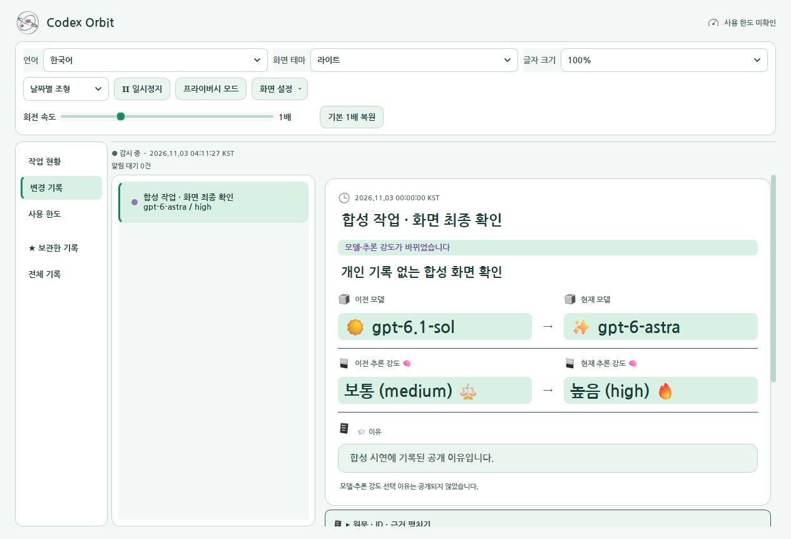
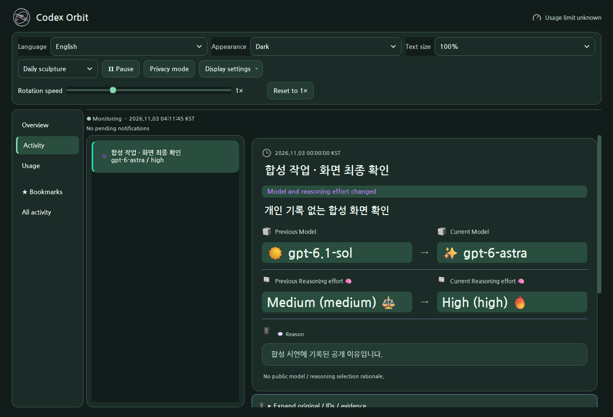

# 🪐 Codex Orbit 3.1.0

연도·월·일에 맞춘 3D 테마를 기본으로 보여 주는 Windows 바탕화면 앱입니다. 관측소는 명시적으로 선택해 사용할 수 있습니다. 로컬 기록에서 확인한 모델·추론 강도 변화와 작업 상태를 보여 주며, 실제 계정 사용 한도 비율·시계·기온을 함께 확인할 수 있습니다.

[English](README.en.md) · [다운로드](docs/DOWNLOADS.md) · [사용법](docs/사용법.md) · [검증 범위](docs/공개검증_31차.md) · [변경 기록](변경기록_31차.md) · [권리·공개 범위](공개범위.md)

## 31차 실제 배포본의 합성 화면

개인 기록 없이 만든 합성 작업입니다. 모델·추론 값은 화면 검사용 예시이며 실제 실행 모델이나 계정 상태를 뜻하지 않습니다.

## 31차 · 화면 마감과 테마 선택

시스템·라이트·다크 화면 테마를 즉시 적용하고 선택을 저장합니다. 언어·글자 크기·회전 속도는 같은 설정 영역에서 조절하고, 작업 현황에서 선택 설정과 최근 실행 관측을 구분합니다. 화면 설정 메뉴는 움직임 줄이기·가장자리 붙이기·알림 소리·성능과 화질·문제 확인용 파일 저장·새 버전 확인을 설명합니다. 프라이버시 모드는 화면의 제목과 작업 설명을 가리며 저장 원문을 유지합니다. 날짜별 과일·세 금속 링·날짜 규칙과 모델·추론 변경 알림은 유지합니다.

[31차 상세](history/31차/README.md) · [변경 기록](변경기록_31차.md)

## 🧩 감시·표시·저장·업데이트의 연결

30차 소스에서 `notifier.Watcher`는 로컬 JSONL을 읽어 설정 관측·실행 관측·공개 이유를 구분하고 `app.py`가 알림·위젯·상세 이력을 표시합니다. `core.py`는 JSONL 꼬리 읽기·채팅 제목·화면 위치와 Markdown 적용/복구를 담당합니다. `activity.py`의 작업 상태와 `notice_format.py`의 표현을 렌더러의 장식 상태와 구분합니다.

| 경계 | 실제 처리 |
|---|---|
| 기록 읽기 | 30차 notifier는 읽기 묶음512KiB·레코드2MiB·파일4096개·poll 총8MiB·대기256개·주기0.2초 상한을 둡니다. 최초 기준선과 새 기록 알림을 구분합니다. |
| 표시 | calendar가 기본이며 명시 선택한 관측소는 유지합니다. calendar_renderer·observatory_scene의 GPU 그림과 실제 모델/추론 기록은 별개입니다. |
| 계정 한도 | UsageClient가 codex.exe app-server를 QProcess 분리 파이프로 열고 읽기 요청합니다. 30초 갱신·12초 응답 제한·65초 이후 오래된 값 표시를 적용합니다. |
| 연결 실패 | 한도 조회 실패 때 이전값을 stale로 표시하고 최대3회,3/6/9초 지연으로 다시 연결합니다. 미확인을0%로 바꾸지 않습니다. |
| 종료 | UsageClient.close는 타이머와 pending을 정리하고 종료 요청 뒤500ms 대기, 필요하면 kill 후500ms 대기합니다. |
| 배포 교체 | safe_update의 check→stage→apply 단계로 공식 릴리스·자산·SHA·로컬 경계를 검사하고 실행 확인 실패 시 이전 EXE를 복구합니다. MAX_DOWNLOAD는512MiB입니다. |

사용자는 감시 경로·언어·표시 모드·모션/자원 품질을 고르고 새 알림의 이전/이후 값과 근거를 읽습니다. 날씨·사용 한도·업데이트는 네트워크 또는 App Server 기능이며 로컬 감시기의 기능 범위와 나눠 봅니다. 방송 모드와 진단 ZIP의 공개 제외 조건을 유지합니다. 실제 사용법·릴리스·빌드 안내와 차수별 함수/설정 참조는 아래에 연결되어 있습니다.

[🗂️ 각 차수의 코드·조건·관측·전체 비교](docs/REVISION_INDEX.md)

## 30차 · 원래 날짜별 테마 기본 복원

설정에 표시 모드가 없는 경우에도 원래 날짜별 달력 조형을 표시합니다. 모델 변경 이벤트를 받아도 날짜 제목과 조형은 유지합니다. 888개 월 테마·일별 디자인·색·재질·날짜 규칙은 바꾸지 않았습니다. 이전/현재 모델·추론 강도·알림 기능도 유지합니다.

[30차 변경 기록](변경기록_30차.md) · [검증 범위](docs/공개검증_30차.md) · [29차와 전체 비교](docs/30차_전체변경.diff)

## 선택 가능한 29차 관측소 기능

- 은색 금속 링 세 개가 서로 다른 축에서 움직입니다. 솔의 태양·아스트라의 결정·테라의 구체·루나의 초승달 코어와 추론 강도별 입자 밀도를 구분합니다. 확인되지 않은 모델은 중립 조형으로 표시합니다.
- 위성은 기록에서 명시적으로 관측한 작업 상태를 표시합니다. 관심 채팅 고정·기록 북마크·자리비움 요약·시간 슬라이더 재생을 제공하며 재생은 실제 모델 설정을 바꾸지 않습니다.
- 알림은 채팅 제목·이전 모델과 추론 강도·현재 모델과 추론 강도·기록된 이유를 비교합니다. 정확한 모델 ID와 원문 기록은 보존하고 표시 제목의 장식 이모지를 정리합니다. 마우스를 올리면 자동 닫힘을 멈추고 알림을 고정할 수 있습니다.
- 방송 모드는 열린 알림·제목·작업·툴팁을 가립니다. 진단 ZIP은 대화·인증·경로·이벤트 원문을 제외한 항목만 로컬에 저장합니다. 업데이트는 사용자가 확인을 눌러 공식 릴리스를 조회하고 SHA-256 대조 후 준비하며, 교체 후 실행 확인 실패 시 이전 실행 파일로 복구합니다.
- 민트와 화이트 화면·나눔고딕 Bold를 사용합니다. 글자 크기·가장자리 도킹·펼침·재생/일시정지·모션 축소·자원 품질을 조절할 수 있으며 일시정지 중에도 알림 감시는 계속됩니다.

실제 한도는 **남은 사용 한도 비율**이며 남은 토큰 개수가 아닙니다. 미확인은 0%와 구분합니다. 선택 설정 관측과 실제 실행 기록 관측을 구분하며 로컬 기록이 서버 모델 신원을 보증하지 않습니다. 기록되지 않은 이유와 작업 상태를 만들어 내지 않습니다.

## 달력 모드와 기존 기능

2026~2099년의 [888개 월 테마](docs/연도별_월별_테마_전체.md)와 [CSV](docs/연도별_월별_테마_전체.csv), 날짜별 실제 메시 조형을 달력 모드로 보존합니다. 공통 생성 규칙을 재사용하므로 888개 수작업 모델을 뜻하지 않습니다. 한영 선택·날씨·IP 기반 지역·시계·속도 조절을 유지합니다. 하나의 GPU 작업자가 3840×2160 원본을 렌더하며 관측소 품질은 20/30/60fps 상한을 사용합니다. 실제 생성률과 모니터 표시율은 별개이고 고정 240fps 달성을 주장하지 않습니다.

## 모든 차수와 실제 자료

[전체 목차](docs/REVISION_INDEX.md) · [차수별 보조 자료·시안·제외 대응](docs/ARCHIVE_FILES.md)

<!-- 차수표 시작 -->
| 차수·자료 | 자료 폴더·원본 | 상세 설명 | 직전 비교·범위 |
|---|---|---|---|
| 1차 | [자료 폴더](history/01%EC%B0%A8) | [상세 설명](history/01%EC%B0%A8/README.md) | [전체 비교·범위](history/01%EC%B0%A8/%EC%A7%81%EC%A0%84%EC%B0%A8%EC%88%98.diff) |
| 2차 | [자료 폴더](history/02%EC%B0%A8) | [상세 설명](history/02%EC%B0%A8/README.md) | [전체 비교·범위](history/02%EC%B0%A8/%EC%A7%81%EC%A0%84%EC%B0%A8%EC%88%98.diff) |
| 3차 | [자료 폴더](history/03%EC%B0%A8) | [상세 설명](history/03%EC%B0%A8/README.md) | [전체 비교·범위](history/03%EC%B0%A8/%EC%A7%81%EC%A0%84%EC%B0%A8%EC%88%98.diff) |
| 4차 | [자료 폴더](history/04%EC%B0%A8) | [상세 설명](history/04%EC%B0%A8/README.md) | [전체 비교·범위](history/04%EC%B0%A8/%EC%A7%81%EC%A0%84%EC%B0%A8%EC%88%98.diff) |
| 5차 | [자료 폴더](history/05%EC%B0%A8) | [상세 설명](history/05%EC%B0%A8/README.md) | [전체 비교·범위](history/05%EC%B0%A8/%EC%A7%81%EC%A0%84%EC%B0%A8%EC%88%98.diff) |
| 6차 | [자료 폴더](history/06%EC%B0%A8) | [상세 설명](history/06%EC%B0%A8/README.md) | [전체 비교·범위](history/06%EC%B0%A8/%EC%A7%81%EC%A0%84%EC%B0%A8%EC%88%98.diff) |
| 7차 | [자료 폴더](history/07%EC%B0%A8) | [상세 설명](history/07%EC%B0%A8/README.md) | [전체 비교·범위](history/07%EC%B0%A8/%EC%A7%81%EC%A0%84%EC%B0%A8%EC%88%98.diff) |
| 8차 | [자료 폴더](history/08%EC%B0%A8) | [상세 설명](history/08%EC%B0%A8/README.md) | [전체 비교·범위](history/08%EC%B0%A8/%EC%A7%81%EC%A0%84%EC%B0%A8%EC%88%98.diff) |
| 9차 | [자료 폴더](history/09%EC%B0%A8) | [상세 설명](history/09%EC%B0%A8/README.md) | [전체 비교·범위](history/09%EC%B0%A8/%EC%A7%81%EC%A0%84%EC%B0%A8%EC%88%98.diff) |
| 10차 | [자료 폴더](history/10%EC%B0%A8) | [상세 설명](history/10%EC%B0%A8/README.md) | [전체 비교·범위](history/10%EC%B0%A8/%EC%A7%81%EC%A0%84%EC%B0%A8%EC%88%98.diff) |
| 11차 | [자료 폴더](history/11%EC%B0%A8) | [상세 설명](history/11%EC%B0%A8/README.md) | [전체 비교·범위](history/11%EC%B0%A8/%EC%A7%81%EC%A0%84%EC%B0%A8%EC%88%98.diff) |
| 12차 | [자료 폴더](history/12%EC%B0%A8) | [상세 설명](history/12%EC%B0%A8/README.md) | [전체 비교·범위](history/12%EC%B0%A8/%EC%A7%81%EC%A0%84%EC%B0%A8%EC%88%98.diff) |
| 13차 | [자료 폴더](history/13%EC%B0%A8) | [상세 설명](history/13%EC%B0%A8/README.md) | [전체 비교·범위](history/13%EC%B0%A8/%EC%A7%81%EC%A0%84%EC%B0%A8%EC%88%98.diff) |
| 14차 | [자료 폴더](history/14%EC%B0%A8) | [상세 설명](history/14%EC%B0%A8/README.md) | [전체 비교·범위](history/14%EC%B0%A8/%EC%A7%81%EC%A0%84%EC%B0%A8%EC%88%98.diff) |
| 15차 | [자료 폴더](history/15%EC%B0%A8) | [상세 설명](history/15%EC%B0%A8/README.md) | [전체 비교·범위](history/15%EC%B0%A8/%EC%A7%81%EC%A0%84%EC%B0%A8%EC%88%98.diff) |
| 16차 | [자료 폴더](history/16%EC%B0%A8) | [상세 설명](history/16%EC%B0%A8/README.md) | [전체 비교·범위](history/16%EC%B0%A8/%EC%A7%81%EC%A0%84%EC%B0%A8%EC%88%98.diff) |
| 17차 | [자료 폴더](history/17%EC%B0%A8) | [상세 설명](history/17%EC%B0%A8/README.md) | [전체 비교·범위](history/17%EC%B0%A8/%EC%A7%81%EC%A0%84%EC%B0%A8%EC%88%98.diff) |
| 18차 | [자료 폴더](history/18%EC%B0%A8) | [상세 설명](history/18%EC%B0%A8/README.md) | [전체 비교·범위](history/18%EC%B0%A8/%EC%A7%81%EC%A0%84%EC%B0%A8%EC%88%98.diff) |
| 19차 | [자료 폴더](history/19%EC%B0%A8) | [상세 설명](history/19%EC%B0%A8/README.md) | [전체 비교·범위](history/19%EC%B0%A8/%EC%A7%81%EC%A0%84%EC%B0%A8%EC%88%98.diff) |
| 20차 | [자료 폴더](docs/20%EC%B0%A8) | [상세 설명](docs/20%EC%B0%A8/README.md) | [전체 비교·범위](docs/20%EC%B0%A8/README.md) |
| 21차 | [자료 폴더](history/21%EC%B0%A8) | [상세 설명](history/21%EC%B0%A8/README.md) | [전체 비교·범위](history/21%EC%B0%A8/%EC%A7%81%EC%A0%84%EC%B0%A8%EC%88%98.diff) |
| 22차 | [자료 폴더](history/22%EC%B0%A8) | [상세 설명](history/22%EC%B0%A8/README.md) | [전체 비교·범위](history/22%EC%B0%A8/%EC%A7%81%EC%A0%84%EC%B0%A8%EC%88%98.diff) |
| 23차 | [자료 폴더](history/23%EC%B0%A8) | [상세 설명](history/23%EC%B0%A8/README.md) | [전체 비교·범위](history/23%EC%B0%A8/%EC%A7%81%EC%A0%84%EC%B0%A8%EC%88%98.diff) |
| 24차 | [자료 폴더](history/24%EC%B0%A8) | [상세 설명](history/24%EC%B0%A8/README.md) | [전체 비교·범위](history/24%EC%B0%A8/%EC%A7%81%EC%A0%84%EC%B0%A8%EC%88%98.diff) |
| 25차 | [자료 폴더](history/25) | [상세 설명](history/25/README.md) | [전체 비교·범위](history/25/%EC%A7%81%EC%A0%84%EC%B0%A8%EC%88%98.diff) |
| 26차 | [자료 폴더](history/26) | [상세 설명](history/26/README.md) | [전체 비교·범위](history/26/%EC%A7%81%EC%A0%84%EC%B0%A8%EC%88%98.diff) |
| 27차 | [자료 폴더](history/27) | [상세 설명](history/27/README.md) | [전체 비교·범위](docs/27%EC%B0%A8_%EC%A0%84%EC%B2%B4%EB%B3%80%EA%B2%BD.diff) |
| 28차 | [자료 폴더](history/28) | [상세 설명](history/28/README.md) | [전체 비교·범위](docs/28%EC%B0%A8_%EC%A0%84%EC%B2%B4%EB%B3%80%EA%B2%BD.diff) |
| 최종 | [자료 폴더](docs/%EC%B5%9C%EC%A2%85) | [상세 설명](docs/%EC%B5%9C%EC%A2%85/README.md) | [전체 비교·범위](docs/%EC%B5%9C%EC%A2%85/README.md) |
| 29차 | [자료 폴더](history/29%EC%B0%A8) | [상세 설명](history/29%EC%B0%A8/README.md) | [전체 비교·범위](docs/29%EC%B0%A8_%EC%A0%84%EC%B2%B4%EB%B3%80%EA%B2%BD.diff) · [소스 비교](history/29%EC%B0%A8/%EC%A7%81%EC%A0%84%EC%B0%A8%EC%88%98.diff) |
| 30차 | [자료 폴더](history/30%EC%B0%A8) | [상세 설명](history/30%EC%B0%A8/README.md) | [전체 비교·범위](history/30%EC%B0%A8/%EC%A7%81%EC%A0%84%EC%B0%A8%EC%88%98.diff) |
| 31차 | [자료 폴더](history/31%EC%B0%A8) | [상세 설명](history/31%EC%B0%A8/README.md) | [전체 비교·범위](history/31%EC%B0%A8/%EC%A7%81%EC%A0%84%EC%B0%A8%EC%88%98.diff) |
<!-- 차수표 끝 -->

원본 소스 비교에는 주석·공백·개행과 신규·삭제 상태를 포함합니다. 20차는 실행 소스 없이 38개 시안, 21차는 110개 시안을 보존합니다. 최종 폴더의 개인 운영 검증 원문은 공개하지 않습니다. 역사 자료 2,281개 항목의 보존·정제·제외 사유와 원본/공개 SHA를 차수별로 연결했습니다.

## 실행·소스와 권리

Windows 10/11 x64와 OpenGL 3.3을 지원하는 그래픽 드라이버가 필요합니다. 단일 EXE는 Python 설치 없이 실행하고 설치본은 현재 사용자용 바로가기·제거를 제공합니다. GPU 준비/실패는 정적 표식 또는 오류 설명으로 구분합니다.

공개 소스는 GitHub 자동 Source code ZIP 또는 이 저장소에서 받습니다. 비공개 전체 개발 ZIP·개인 대화·지침·인증 자료는 배포하지 않습니다. 기존 라이선스 고지를 보존하며 새 소스 라이선스를 임의 부여하지 않습니다. 재빌드는 `python -B -X utf8 tools/build_distribution.py`를 사용합니다. 원고가 없는 앱 작업으로 논문 PDF를 만들지 않았습니다.

## 이전29차 합성 예시 화면

다음 이미지는 실제 Qt 앱에 합성 이벤트와 예시 값을 넣은 화면이며 개인 채팅·실계정 수치가 아닙니다.

