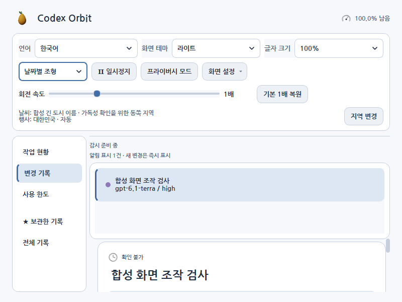
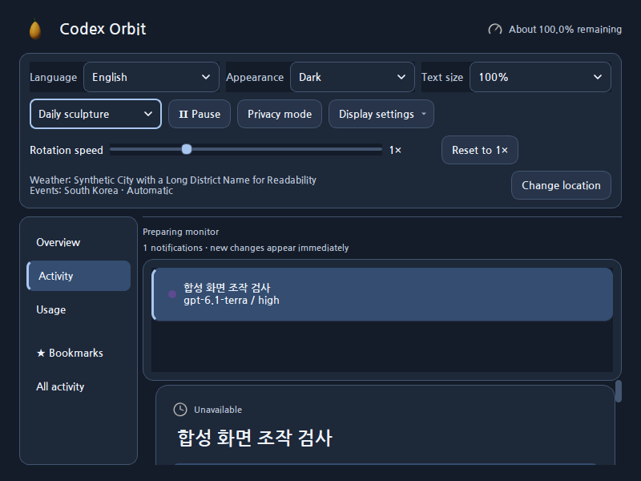

# 34차 검증 범위

## 가이드 보강 후 재빌드와 새 배포 확인

**가이드 추가 후 재빌드와 새 배포 검사를 확인했습니다.** 전체 653개 검사에서 실패 0·건너뜀 1, 빌 드 입력 843 파일 불변을 확인했습니다.

새 EXE의 한국어 가이드와 별도 한국어·영어 사용법에는 다섯 링크가 있으며, 영어 가이드까지 모두 EXE 안에 내장된 구조는 아닙니다.

새 실행 본의 네 합성 화면 조합·정적 227 검사·설치 본 47 파일 추출 대조를 확인했지만 실제 설치와 새 EXE의 행사 8 종 순회는 이 결과에 포함하지 않습니다.

| 항목 | 실제 범위 | 결과와 한계 |
| --- | --- | --- |
| 전체 개발 검사 | 앞 325개·119.095초/뒤 328개·130.054초 | 실패 0·건너뜀 1; 각 unittest 시간이며 입력 843 파일 불변 |
| 새 EXE 합성 화면 | 한국어·영어, 라이트·다크, 100%·150%의 네 조합 | QTest 합성 입력, 전체 프로세스 21.703초; 수동 사용자 클릭 검사가 아님 |
| 정적·기본 실행 | 227개 확인·실제 GPU 프레임 변화 | 통과; 모든 날짜·환경의 성능 보증이 아님 |
| 설치 본 내용 | 47 파일을 읽기 전용 추출해 선 언과 대조 | 실제 설치 실행은 하지 않음 |
| 행사 모티프 8 종 | 새 EXE 순회 시험은 실행하지 않음 | 아래 이전 배포의 관측과 구분 |

[현재 다운로드 메타데이터](DOWNLOADS.md) · [가이드 원문과 빌드 선택 범위](34차_배포사용법_수준안내.md)

## 가이드 보강 전 배포의 관측 기록

전체 개발 검사 653개를 앞·뒤 두 프로세스로 실행했습니다. 실패 0개, 건너뜀 1개입니다. 앞 그룹 325개·84.370초, 뒤 그룹 328개·117.643초입니다. 실제 중앙 영수증과 독립 전수 결과는 별도 기록으로 판단하며 이 빌드 결과로 대체하지 않습니다.

- 실제 EXE의 라이트·한국어 100%, 다크·영어 100%, 라이트·한국어 150%, 다크·영어 150%를 800×600에서 검사했습니다. 자동·수동 전환, 검색 취소, 콤보 마우스·키보드, 목록 선택·출처·갱신 버튼과 한 영 시 각 미확인 문구를 합성 자료로 확인했습니다.
- 강수량 0·양수·누락·오래된 값을 구분하고 집계 간격을 표시했습니다. 화면의 날씨·도시·행사는 합성 예시입니다. 실제 자동 네트워크 조회는 별도 비공개 시험이며 IP·좌표·응답 지명은 공개하지 않습니다. IP 추정은 GPS나 건물 주소 확인이 아닙니다.
- 합성 발표 일정으로 행사 종류 8 종의 실제 GPU 프레임 차이·투명 경계·서로 다른 형상과 자원 종료를 검사했습니다. 이는 모든 개별 행사의 독립 모델이나 모든 날짜 외관을 검토했다는 뜻이 아닙니다.
- 단일 EXE와 설치 본을 빌드하고 설치 본을 실행하지 않은 읽기 전용 추출로 포함 EXE의 해 시를 대조했습니다. 실제 설치 실행 검증으로 확대하지 않습니다.
- 정상 frozen EXE의 네 화면 조합과 종료 뒤 service·retiring 없음, 고정된 배 포 바이트 및 소스의 close 성공 조건을 함께 대조했습니다. 이 성공 조건은 소유 Job 잔존 0, 기록된 전체 구성원 확보, 각 핸들의 종료 신호, 핸들 회수와 IPC 닫힘을 요구합니다. 개별 PID 시각·실제 강제 회수 사용 여부·종료 벽시계 2초를 별도 측정한 결과로 확대하지 않습니다.
- 외부 소스 Python 부모가 onefile EXE의 내부 GPU 분기를 직접 시작한 혼합 경로 보조 진단은 최초 5초 응답 제한에 실패했습니다. 실패 뒤 소유 Job 회수와 잔존 0은 확인했지만 첫 프레임 성공은 확인하지 못했습니다. 정상 frozen 부모의 실행 환경과 같은 경로라고 단정하지 않으며 환경 위조·시간 상한 확대·재빌드로 실패를 숨기지 않았습니다. 이 실패는 위 정상 EXE 네 조합 통과와 별도로 보존합니다.

자동 날씨 첫 실 조회에서는 기온 요청 시간 초과를 관측했습니다.

보조기에 요청 시작·HTTP 상태·Qt 전송 오류·SSL 오류 관측을 추가한 뒤 허용된 새 클라이언트 한 회는 1.157초에 자동 모드·수동 지정 없음·최신 기온 수신으로 통과했습니다.

최초 시간 초과의 원인을 후속 성공만으로 확정하지 않습니다.

성공 기 온 수신 후 닫힌 부가 지명 검색 요청은 완료된 지명 교차 검증으로 세지 않습니다.

실제 응답 지역·좌표·IPC 세대·PID와 전송 원문은 공개하지 않습니다.

도시 자료의 실제 정규화 목록은 36019개 항목입니다.

근거 있는 시리즈 1059개, 개최 회차 592개, 미분류 34368개를 구분합니다.

목록과 발표된 날짜는 별도이며 미분류를 행사 없음으로 버리지 않습니다.

공식 API의 일치 날짜 또는 공식 페이지에서 개별 확인한 날짜만 적용합니다.

시각 충돌이 있는 교차 확인 날짜는 시간 미확인을 유지합니다.

전 세계 모든 도시 행사·미발표 미래 개최일의 완전성을 보장하지 않습니다.

이번 동봉 자료는 Wikidata CC0 목록과 공식 발표 날짜 사실표이며 각각 원문 출처와 고지를 제공합니다.

Paris 원문 데이터베이스는 이번 자료에 동봉하지 않았습니다.

수록 자료 갱신은 사용자 명시 요청 뒤 검증된 국가 자료만 적용합니다.

게시 전 새 원격 경로의 실제 갱신 성공을 주장하지 않습니다.

GPU 작업은 별도 소유 프로세스가 실행하며 orbit_entry가 일반 앱과 내부 GPU 요청을 GUI 가져오기 전에 분기합니다.

자식은 계 정·날씨 조회나 사용자 설정 저장을 시작하지 않습니다.

최대 5초 준비와 준비 완료 뒤 표시 프레임의 기존 2초 수락 기준을 구분합니다.

종료는 정상 회 수를 먼저 요청하고 필요한 경우 같은 종료 예산 안에서 소유 Job만 강제로 회수합니다.

강제 회수로 잔존 0을 확인한 결과를 renderer.close의 정상 완료로 부풀리지 않으며 OS의 모든 정지에 대한 절대 시간 보장은 하지 않습니다.

이 구조 설명은 실제 frozen 자 식·Job 회수 검증을 대신하지 않습니다. [GPU 격리 설계와 한계](34차_그래픽프로세스격리.md)에서 범위를 확인할 수 있습니다.

픽셀 표현은 실제 3D 메시를 96×96 GPU 타깃으로 렌더하고 최근접 확대하는 방식입니다.

큐브를 쌓은 복 셀 메시나 4K 세부 묘사로 구현했다고 주장하지 않습니다.

글자와 일반 화면은 픽셀 처리하지 않습니다.

기존 고해상도 타깃·버퍼 할당은 유지되므로 픽셀 표현만으로 GPU 메모리 절감이나 고정 240fps를 달성했다고 주장하지 않습니다.

33차 국 소 18 검사에서는 GPU 정리 단언이 한 번 실패했고 격리 1 검사는 통과했습니다.

최초 지연 원인은 확정하지 못했으며 해당 실패를 뒤의 통과로 덮지 않습니다.

위 34차 결과는 별도의 현재 소스·실행 결과입니다. 33차는 별도 릴리스 없이 진행하던 차수였으며 이번 공개에 진행 원문을 보존하고 34차에 통합했습니다.

현재 history/33차 폴더가 보이는 사실과 당시 33차 단독 배포가 없었던 사실을 구분합니다.

[34차 상세](../history/34차/README.md) · [전체 변경](34%EC%B0%A8_%EC%A0%84%EC%B2%B4%EB%B3%80%EA%B2%BD-%EC%97%B4%EB%9E%8C.md) · [다운로드](DOWNLOADS.md) · [이전32차 검증](공개검증_32차.md)

## 이전 후 독립 검사

중앙 검증 두 회의 시간 초과와 별도 GPU 접근 위반을 보존했습니다. 제품·검사 명세와 시간 기준은 유지하고 새 독립 검증자가 C 기본 Python 호스트에서 재검증했습니다. 원인 미확정과 전체 환경 차이를 포함한 [실패와 후속 실제 결과](34차_이전후_추가검증.md)를 함께 확인할 수 있습니다.
