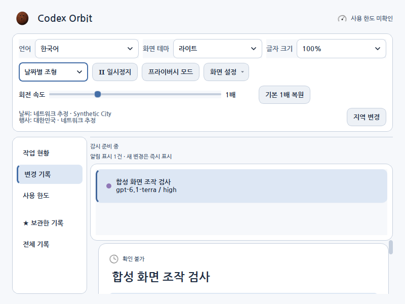

# Codex Orbit · LEVEL 1 - Beginner

[LEVEL 1 - Beginner](%EB%A0%88%EB%B2%A81.md) · [LEVEL 2 - Explorer](%EB%A0%88%EB%B2%A82.md) · [LEVEL 3 - Practitioner](%EB%A0%88%EB%B2%A83.md) · [LEVEL 4 - Advanced](%EB%A0%88%EB%B2%A84.md) · [LEVEL 5 - Expert](%EB%A0%88%EB%B2%A85.md)

[같은 수준의 프로필](https://github.com/PUVKID/PUVKID/blob/main/docs/읽기안내/레벨1.md) · [프로젝트 첫 화면](../../README.md)

## LEVEL 1 · 기능과 확인 조건

| 기능 | 입력·조건 | 확인할 내용 |
| --- | --- | --- |
| 알림 | 기록에 있는 모델·추론 강도 변화 | 이전 값과 현재 값, 공개된 이유를 구분합니다. |
| 날짜별 모형 | 날짜·국가와 확인된 행사 날짜 | 그날의 입체 대상을 보여 주며 글자는 또렷하게 유지합니다. |
| 지역과 날씨 | 자동 추정 또는 직접 고른 검색 결과 | 기온·강수량과 집계 간격을 읽고 미확인 값을 구분합니다. |
| 사용 한도 | 로그인된 Codex가 제공하는 계정 비율 | 남은 토큰 개수가 아니며 원값을 툴팁에서 확인합니다. |

## LEVEL 1 · 프로젝트 소개와 읽는 방법

날짜에 맞는 입체 모형을 바탕화면에 보여 주고 로컬 Codex 기록에서 바뀐 모델·추론 강도·작업 상태를 알려 주는 Windows 앱입니다. 실제 사용 한도 비율·시계·날씨도 확인할 수 있습니다. **화면의 모형과 기록에 남은 관측값은 다른 종류의 정보**입니다.

## LEVEL 1 · 실제 기능과 동작 범위

| 확인할 항목 (Checklist) | 본문의 핵심 조건 |
| --- | --- |
| 기능·동작 | 위젯을 열어 변경 기록·현재 한도를 보고 설정에서 언어·테마·크기·속도를 바꿉니다. 날짜별 모형을 모델 아이콘으로 자동 교체하는 것이 아니며 관측소는 명시 선택입니다. |
| 입력·처리·출력 | 입력은 이 컴퓨터의 새 기록과 날짜·선택 설정입니다. 날씨와 한도는 별도 조회로 받습니다. 출력은 입체 위젯·알림·상세 이력이며 없는 이유나 과거값은 만들어 넣지 않습니다. |
| 결과·한계 | 배포본 화면의 기온·습도·한도·모델 값이 합성 예시인 경우 실제 계정·날씨 결과가 아닙니다. 그림이 움직이거나 한도가0%로 보인다고 서버 모델이나 정확한 토큰 수를 확인한 것은 아닙니다. |

위젯을 열어 변경 기록·현재 한도를 보고 설정에서 언어·테마·크기·속도를 바꿉니다. 날짜별 모형을 모델 아이콘으로 자동 교체하는 것이 아니며 관측소는 명시 선택입니다.

사용자가 보는 동작을 먼저 설명하고 아래 실제 기능표의 이름과 연결합니다.

**기능별 공통 근거**

## LEVEL 1 · 입력에서 처리와 출력까지

입력은 이 컴퓨터의 새 기록과 날짜·선택 설정입니다. 날씨와 한도는 별도 조회로 받습니다. 출력은 입체 위젯·알림·상세 이력이며 없는 이유나 과거값은 만들어 넣지 않습니다.

## LEVEL 1 · 사용·실험 순서와 확인 방법

단일 EXE 또는 설치본으로 실행하고 위젯을 눌러 기록을 엽니다. 드래그로 옮기고 설정에서 테마·글자·모션을 조절합니다. 지역 표시를 누르면 날씨 위치를 검색할 수 있습니다.

## LEVEL 1 · 결과와 한계를 해석하는 기준

배포본 화면의 기온·습도·한도·모델 값이 합성 예시인 경우 실제 계정·날씨 결과가 아닙니다. 그림이 움직이거나 한도가0%로 보인다고 서버 모델이나 정확한 토큰 수를 확인한 것은 아닙니다.

## LEVEL 1 · 구현과 핵심 파일을 연결해 읽기

처음에는 사용법·다운로드·검증 범위를 읽고 기능이 궁금한 차수로 이동합니다. 감시 파일은 기록 읽기,화면 파일은 표시,렌더 파일은 그림,조회 파일은 한도·날씨를 맡습니다.

## LEVEL 1 · 용어와 실수하기 쉬운 구분

위젯은 바탕화면에 작게 띄우는 화면입니다. JSONL은 기록 한 건을 한 줄씩 저장하는 형식이고 감시는 그 파일의 새 기록을 읽는 일입니다. 모델·추론 강도는 기록에 담긴 설정·실행 관측 값이며 로컬 표시가 서버 신원을 증명하지는 않습니다. 렌더는 입체 모형을 화면 그림으로 만드는 계산이고 GPU는 그 그림 계산 장치입니다. 합성 화면은 검사용 예시 자료를 넣어 만든 화면입니다.

**설정 관측·실행 관측·기록된 공개 이유를 구분합니다.** 기록되지 않은 과거값·동기·작업 상태를 만들지 않습니다. 실제 계정 한도는 남은 비율이며 토큰 개수가 아닙니다. 합성 예시·목표 프레임·과거 렌더를 실제 계정 상태·서버 모델 신원·실측 성능으로 읽지 않습니다.

## LEVEL 1 · 전체 차수와 같은 수준의 상세 설명

차수 이름은 실제 보관 단위를 따릅니다. 부분본·시험 도구·최종 안내는 제품 버전과 구분하며, 폴더와 직전 비교를 함께 연결합니다.

| 차수 | 핵심 변경 | 자료 |
| --- | --- | --- |
| 1차 | Codex Orbit · 1차 | **자료 폴더:** [자료](../../history/01%EC%B0%A8) · **이 수준의 차수 설명:** [LEVEL 1 - Beginner](../../history/01%EC%B0%A8/README.md#reading-level-1) · **직전 비교·범위:** [전체 비교](../../history/01%EC%B0%A8/%EC%A7%81%EC%A0%84%EC%B0%A8%EC%88%98.diff) |
| 2차 | Codex Orbit · 2차 | **자료 폴더:** [자료](../../history/02%EC%B0%A8) · **이 수준의 차수 설명:** [LEVEL 1 - Beginner](../../history/02%EC%B0%A8/README.md#reading-level-1) · **직전 비교·범위:** [전체 비교](../../history/02%EC%B0%A8/%EC%A7%81%EC%A0%84%EC%B0%A8%EC%88%98.diff) |
| 3차 | Codex Orbit · 3차 | **자료 폴더:** [자료](../../history/03%EC%B0%A8) · **이 수준의 차수 설명:** [LEVEL 1 - Beginner](../../history/03%EC%B0%A8/README.md#reading-level-1) · **직전 비교·범위:** [전체 비교](../../history/03%EC%B0%A8/%EC%A7%81%EC%A0%84%EC%B0%A8%EC%88%98.diff) |
| 4차 | Codex Orbit · 4차 | **자료 폴더:** [자료](../../history/04%EC%B0%A8) · **이 수준의 차수 설명:** [LEVEL 1 - Beginner](../../history/04%EC%B0%A8/README.md#reading-level-1) · **직전 비교·범위:** [전체 비교](../../history/04%EC%B0%A8/%EC%A7%81%EC%A0%84%EC%B0%A8%EC%88%98.diff) |
| 5차 | Codex Orbit · 5차 | **자료 폴더:** [자료](../../history/05%EC%B0%A8) · **이 수준의 차수 설명:** [LEVEL 1 - Beginner](../../history/05%EC%B0%A8/README.md#reading-level-1) · **직전 비교·범위:** [전체 비교](../../history/05%EC%B0%A8/%EC%A7%81%EC%A0%84%EC%B0%A8%EC%88%98.diff) |
| 6차 | Codex Orbit · 6차 | **자료 폴더:** [자료](../../history/06%EC%B0%A8) · **이 수준의 차수 설명:** [LEVEL 1 - Beginner](../../history/06%EC%B0%A8/README.md#reading-level-1) · **직전 비교·범위:** [전체 비교](../../history/06%EC%B0%A8/%EC%A7%81%EC%A0%84%EC%B0%A8%EC%88%98.diff) |
| 7차 | Codex Orbit · 7차 | **자료 폴더:** [자료](../../history/07%EC%B0%A8) · **이 수준의 차수 설명:** [LEVEL 1 - Beginner](../../history/07%EC%B0%A8/README.md#reading-level-1) · **직전 비교·범위:** [전체 비교](../../history/07%EC%B0%A8/%EC%A7%81%EC%A0%84%EC%B0%A8%EC%88%98.diff) |
| 8차 | Codex Orbit · 8차 | **자료 폴더:** [자료](../../history/08%EC%B0%A8) · **이 수준의 차수 설명:** [LEVEL 1 - Beginner](../../history/08%EC%B0%A8/README.md#reading-level-1) · **직전 비교·범위:** [전체 비교](../../history/08%EC%B0%A8/%EC%A7%81%EC%A0%84%EC%B0%A8%EC%88%98.diff) |
| 9차 | Codex Orbit · 9차 | **자료 폴더:** [자료](../../history/09%EC%B0%A8) · **이 수준의 차수 설명:** [LEVEL 1 - Beginner](../../history/09%EC%B0%A8/README.md#reading-level-1) · **직전 비교·범위:** [전체 비교](../../history/09%EC%B0%A8/%EC%A7%81%EC%A0%84%EC%B0%A8%EC%88%98.diff) |
| 10차 | Codex Orbit · 10차 | **자료 폴더:** [자료](../../history/10%EC%B0%A8) · **이 수준의 차수 설명:** [LEVEL 1 - Beginner](../../history/10%EC%B0%A8/README.md#reading-level-1) · **직전 비교·범위:** [전체 비교](../../history/10%EC%B0%A8/%EC%A7%81%EC%A0%84%EC%B0%A8%EC%88%98.diff) |
| 11차 | Codex Orbit · 11차 | **자료 폴더:** [자료](../../history/11%EC%B0%A8) · **이 수준의 차수 설명:** [LEVEL 1 - Beginner](../../history/11%EC%B0%A8/README.md#reading-level-1) · **직전 비교·범위:** [전체 비교](../../history/11%EC%B0%A8/%EC%A7%81%EC%A0%84%EC%B0%A8%EC%88%98.diff) |
| 12차 | Codex Orbit · 12차 | **자료 폴더:** [자료](../../history/12%EC%B0%A8) · **이 수준의 차수 설명:** [LEVEL 1 - Beginner](../../history/12%EC%B0%A8/README.md#reading-level-1) · **직전 비교·범위:** [전체 비교](../../history/12%EC%B0%A8/%EC%A7%81%EC%A0%84%EC%B0%A8%EC%88%98.diff) |
| 13차 | Codex Orbit · 13차 | **자료 폴더:** [자료](../../history/13%EC%B0%A8) · **이 수준의 차수 설명:** [LEVEL 1 - Beginner](../../history/13%EC%B0%A8/README.md#reading-level-1) · **직전 비교·범위:** [전체 비교](../../history/13%EC%B0%A8/%EC%A7%81%EC%A0%84%EC%B0%A8%EC%88%98.diff) |
| 14차 | Codex Orbit · 14차 | **자료 폴더:** [자료](../../history/14%EC%B0%A8) · **이 수준의 차수 설명:** [LEVEL 1 - Beginner](../../history/14%EC%B0%A8/README.md#reading-level-1) · **직전 비교·범위:** [전체 비교](../../history/14%EC%B0%A8/%EC%A7%81%EC%A0%84%EC%B0%A8%EC%88%98.diff) |
| 15차 | Codex Orbit · 15차 | **자료 폴더:** [자료](../../history/15%EC%B0%A8) · **이 수준의 차수 설명:** [LEVEL 1 - Beginner](../../history/15%EC%B0%A8/README.md#reading-level-1) · **직전 비교·범위:** [전체 비교](../../history/15%EC%B0%A8/%EC%A7%81%EC%A0%84%EC%B0%A8%EC%88%98.diff) |
| 16차 | Codex Orbit · 16차 | **자료 폴더:** [자료](../../history/16%EC%B0%A8) · **이 수준의 차수 설명:** [LEVEL 1 - Beginner](../../history/16%EC%B0%A8/README.md#reading-level-1) · **직전 비교·범위:** [전체 비교](../../history/16%EC%B0%A8/%EC%A7%81%EC%A0%84%EC%B0%A8%EC%88%98.diff) |
| 17차 | Codex Orbit · 17차 | **자료 폴더:** [자료](../../history/17%EC%B0%A8) · **이 수준의 차수 설명:** [LEVEL 1 - Beginner](../../history/17%EC%B0%A8/README.md#reading-level-1) · **직전 비교·범위:** [전체 비교](../../history/17%EC%B0%A8/%EC%A7%81%EC%A0%84%EC%B0%A8%EC%88%98.diff) |
| 18차 | Codex Orbit · 18차 | **자료 폴더:** [자료](../../history/18%EC%B0%A8) · **이 수준의 차수 설명:** [LEVEL 1 - Beginner](../../history/18%EC%B0%A8/README.md#reading-level-1) · **직전 비교·범위:** [전체 비교](../../history/18%EC%B0%A8/%EC%A7%81%EC%A0%84%EC%B0%A8%EC%88%98.diff) |
| 19차 | Codex Orbit · 19차 | **자료 폴더:** [자료](../../history/19%EC%B0%A8) · **이 수준의 차수 설명:** [LEVEL 1 - Beginner](../../history/19%EC%B0%A8/README.md#reading-level-1) · **직전 비교·범위:** [전체 비교](../../history/19%EC%B0%A8/%EC%A7%81%EC%A0%84%EC%B0%A8%EC%88%98.diff) |
| 20차 | Codex Orbit · 20차 | **자료 폴더:** [자료](../20%EC%B0%A8) · **이 수준의 차수 설명:** [LEVEL 1 - Beginner](../20%EC%B0%A8/README.md#reading-level-1) · **직전 비교·범위:** [전체 비교](../20%EC%B0%A8/README.md) |
| 21차 | Codex Orbit · 21차 | **자료 폴더:** [자료](../../history/21%EC%B0%A8) · **이 수준의 차수 설명:** [LEVEL 1 - Beginner](../../history/21%EC%B0%A8/README.md#reading-level-1) · **직전 비교·범위:** [전체 비교](../../history/21%EC%B0%A8/%EC%A7%81%EC%A0%84%EC%B0%A8%EC%88%98.diff) |
| 22차 | Codex Orbit · 22차 | **자료 폴더:** [자료](../../history/22%EC%B0%A8) · **이 수준의 차수 설명:** [LEVEL 1 - Beginner](../../history/22%EC%B0%A8/README.md#reading-level-1) · **직전 비교·범위:** [전체 비교](../../history/22%EC%B0%A8/%EC%A7%81%EC%A0%84%EC%B0%A8%EC%88%98.diff) |
| 23차 | Codex Orbit · 23차 | **자료 폴더:** [자료](../../history/23%EC%B0%A8) · **이 수준의 차수 설명:** [LEVEL 1 - Beginner](../../history/23%EC%B0%A8/README.md#reading-level-1) · **직전 비교·범위:** [전체 비교](../../history/23%EC%B0%A8/%EC%A7%81%EC%A0%84%EC%B0%A8%EC%88%98.diff) |
| 24차 | Codex Orbit · 24차 | **자료 폴더:** [자료](../../history/24%EC%B0%A8) · **이 수준의 차수 설명:** [LEVEL 1 - Beginner](../../history/24%EC%B0%A8/README.md#reading-level-1) · **직전 비교·범위:** [전체 비교](../../history/24%EC%B0%A8/%EC%A7%81%EC%A0%84%EC%B0%A8%EC%88%98.diff) |
| 25차 | Codex Orbit · 25차 | **자료 폴더:** [자료](../../history/25) · **이 수준의 차수 설명:** [LEVEL 1 - Beginner](../../history/25/README.md#reading-level-1) · **직전 비교·범위:** [전체 비교](../../history/25/%EC%A7%81%EC%A0%84%EC%B0%A8%EC%88%98.diff) |
| 26차 | Codex Orbit · 26차 | **자료 폴더:** [자료](../../history/26) · **이 수준의 차수 설명:** [LEVEL 1 - Beginner](../../history/26/README.md#reading-level-1) · **직전 비교·범위:** [전체 비교](../../history/26/%EC%A7%81%EC%A0%84%EC%B0%A8%EC%88%98.diff) |
| 27차 | Codex Orbit · 27차 | **자료 폴더:** [자료](../../history/27) · **이 수준의 차수 설명:** [LEVEL 1 - Beginner](../../history/27/README.md#reading-level-1) · **직전 비교·범위:** [전체 비교](../27%EC%B0%A8_%EC%A0%84%EC%B2%B4%EB%B3%80%EA%B2%BD.diff) |
| 28차 | Codex Orbit · 28차 | **자료 폴더:** [자료](../../history/28) · **이 수준의 차수 설명:** [LEVEL 1 - Beginner](../../history/28/README.md#reading-level-1) · **직전 비교·범위:** [전체 비교](../28%EC%B0%A8_%EC%A0%84%EC%B2%B4%EB%B3%80%EA%B2%BD.diff) |
| 최종 | Codex Orbit · 최종 | **자료 폴더:** [자료](../%EC%B5%9C%EC%A2%85) · **이 수준의 차수 설명:** [LEVEL 1 - Beginner](../%EC%B5%9C%EC%A2%85/README.md#reading-level-1) · **직전 비교·범위:** [전체 비교](../%EC%B5%9C%EC%A2%85/README.md) |
| 29차 | Codex Orbit · 29차 | **자료 폴더:** [자료](../../history/29%EC%B0%A8) · **이 수준의 차수 설명:** [LEVEL 1 - Beginner](../../history/29%EC%B0%A8/README.md#reading-level-1) · **직전 비교·범위:** [전체 비교](../29%EC%B0%A8_%EC%A0%84%EC%B2%B4%EB%B3%80%EA%B2%BD.diff) |
| 30차 | Codex Orbit · 30차 | **자료 폴더:** [자료](../../history/30%EC%B0%A8) · **이 수준의 차수 설명:** [LEVEL 1 - Beginner](../../history/30%EC%B0%A8/README.md#reading-level-1) · **직전 비교·범위:** [전체 비교](../../history/30%EC%B0%A8/%EC%A7%81%EC%A0%84%EC%B0%A8%EC%88%98.diff) |
| 31차 | 화면 마감과 테마 선택 | **자료 폴더:** [자료](../../history/31%EC%B0%A8) · **이 수준의 차수 설명:** [LEVEL 1 - Beginner](../../history/31%EC%B0%A8/README.md#reading-level-1) · **직전 비교·범위:** [전체 비교](../../history/31%EC%B0%A8/%EC%A7%81%EC%A0%84%EC%B0%A8%EC%88%98.diff) |
| 32차 | 지역 검색과 날짜별 입체 조형 | **자료 폴더:** [자료](../../history/32%EC%B0%A8) · **이 수준의 차수 설명:** [LEVEL 1 - Beginner](../../history/32%EC%B0%A8/README.md#reading-level-1) · **직전 비교·범위:** [전체 비교](../32%EC%B0%A8_%EC%A0%84%EC%B2%B4%EB%B3%80%EA%B2%BD.diff) |
| 33차 | 자동 위치·강수량·도시 행사 진행 자료 | **자료 폴더:** [자료 폴더](../../history/33차) · **상세 설명:** [상세 설명](../../history/33차/README.md#reading-level-1) · **직전 비교·범위:** [전체 비교·범위](../../history/33차/직전차수.diff) |
| 34차 | 픽셀 입체 조형과 도시 행사 | **자료 폴더:** [자료 폴더](../../history/34차) · **상세 설명:** [상세 설명](../../history/34차/README.md#reading-level-1) · **직전 비교·범위:** [전체 비교·범위](../34차_전체변경.diff) |

## LEVEL 1 · 논문·원고와 원본 자료의 범위

앱 소스·릴리스·설계·사용법·실제 배포본의 합성 검증 화면을 연결합니다. 20차 시안·21차 시안과 최종 상태 안내의 보존 범위를 구분하며 없는 소스·원고·제품 버전을 만들지 않습니다. 권리·공개 범위 원문을 함께 확인합니다.

## LEVEL 1 · 원래 모든 세부 설명으로 이동하기

설정값·코드 예제·실패 조건·측정 범위·화면과 파일별 안내를 생략하지 않도록 첫 화면의 전체 본문을 아래에 함께 둡니다. 각 항목은 이 페이지의 공통 근거로 바로 이동합니다. 원문에 담긴 이전 차수 조건을 현재 실행 조건으로 자동 적용하지 않습니다.

| 기존 항목 | 전체 근거 |
| --- | --- |
| Codex Orbit 3.2.0 | [원문 보기](#source-section-1) |
| 32차 · 지역 검색과 당일 입체 조형 | [원문 보기](#source-section-2) |
| 32차 실제 배포본의 합성 화면 | [원문 보기](#source-section-3) |
| 이전 31차 실제 배포본의 합성 화면 | [원문 보기](#source-section-4) |
| 31차 · 화면 마감과 테마 선택 | [원문 보기](#source-section-5) |
| 감시·표시·저장·업데이트의 연결 | [원문 보기](#source-section-6) |
| 30차 · 원래 날짜별 테마 기본 복원 | [원문 보기](#source-section-7) |
| 선택 가능한 29차 관측소 기능 | [원문 보기](#source-section-8) |
| 달력 모드와 기존 기능 | [원문 보기](#source-section-9) |
| 모든 차수와 실제 자료 | [원문 보기](#source-section-10) |
| 실행·소스와 권리 | [원문 보기](#source-section-11) |
| 이전29차 합성 예시 화면 | [원문 보기](#source-section-12) |

## LEVEL 1 · 항목별 자세한 풀이와 확인 지점

### LEVEL 1 · 32차 · 지역 검색과 당일 입체 조형

이 항목은 다음 실제 조건으로 동작합니다. 용어는 앞선 설명과 연결하고 값·입력·출력이 무엇을 가리키는지 함께 읽습니다.

날짜 위젯은 고리와 좌우 장식 없이 당일 대상 하나를 표시합니다. 기존 888개 월별 주제와 일반일 대상을 보존하고, 250개 국가·지역의 공휴일·지원 기념일에는 실제 행사명과 특집 조형을 적용합니다. 미래 법 개정과 모든 도시 축제까지 확정한 자료는 아닙니다.

지역 표시를 눌러 도시·주소·장소·국가를 직접 검색합니다. 선택 지점의 기온·날씨·습도·일출·일몰을 받아오며, 자동 IP 위치는 추정임을 표시합니다.

알림은 이전·현재 모델과 추론 강도를 나란히 비교하고 짧은 설명과 접을 수 있는 원문으로 정리했습니다. 화면은 흰색·슬레이트 블루와 다크 테마를 제공합니다.

날짜별 대상 하나와 직접 검색한 지역의 날씨를 보여 줍니다. 당일 조형·지역 선택·IP 추정·전후 알림과 화면 테마를 확인합니다.

**오해하지 않을 점:** 888월 주제·250국가/지역의 지원 행사와 미래 법·모든 도시 축제의 미확정 범위를 구분합니다.

[이 항목의 전체 조건·원문](#source-section-2)

### LEVEL 1 · 32차 실제 배포본의 합성 화면

이 항목은 다음 실제 조건으로 동작합니다. 용어는 앞선 설명과 연결하고 값·입력·출력이 무엇을 가리키는지 함께 읽습니다.

실제 배포 EXE에서 개인 기록·네트워크 없이 검사한 화면입니다. 기온·습도·잔량과 모델 값은 합성 예시입니다. [검증 범위](../%EA%B3%B5%EA%B0%9C%EA%B2%80%EC%A6%9D_32%EC%B0%A8.md)

실제 배포 EXE에 검사용 예시를 넣어 만든 화면입니다. 기온·습도·잔량·모델 값의 합성 표기와 공개 검증 범위를 읽습니다.

**오해하지 않을 점:** 실제 프로그램 렌더와 실제 계정·날씨·모델 관측값은 다른 증거입니다.

[이 항목의 전체 조건·원문](#source-section-3)

### LEVEL 1 · 이전 31차 실제 배포본의 합성 화면

이 항목은 다음 실제 조건으로 동작합니다. 용어는 앞선 설명과 연결하고 값·입력·출력이 무엇을 가리키는지 함께 읽습니다.

개인 기록 없이 만든 합성 작업입니다. 모델·추론 값은 화면 검사용 예시이며 실제 실행 모델이나 계정 상태를 뜻하지 않습니다.

이전 배포본에 개인 기록 없이 만든 작업 예시입니다. 31차의 화면 형태와 합성 모델·추론 값을 구분합니다.

**오해하지 않을 점:** 예시를 현재 계정·실행 모델이나32차의 모든 상태 검증으로 확대하지 않습니다.

[이 항목의 전체 조건·원문](#source-section-4)

### LEVEL 1 · 31차 · 화면 마감과 테마 선택

이 항목은 다음 실제 조건으로 동작합니다. 용어는 앞선 설명과 연결하고 값·입력·출력이 무엇을 가리키는지 함께 읽습니다.

시스템·라이트·다크 화면 테마를 즉시 적용하고 선택을 저장합니다. 언어·글자 크기·회전 속도는 같은 설정 영역에서 조절하고, 작업 현황에서 선택 설정과 최근 실행 관측을 구분합니다. 화면 설정 메뉴는 움직임 줄이기·가장자리 붙이기·알림 소리·성능과 화질·문제 확인용 파일 저장·새 버전 확인을 설명합니다. 프라이버시 모드는 화면의 제목과 작업 설명을 가리며 저장 원문을 유지합니다. 날짜별 과일·세 금속 링·날짜 규칙과 모델·추론 변경 알림은 유지합니다.

시스템·라이트·다크와 언어·글자·회전 설정을 정리합니다. 선택 저장·실제 관측 구분과 프라이버시 모드의 가림 범위를 확인합니다.

**오해하지 않을 점:** 표시를 가리는 기능과 저장 원문 삭제·모델 전환은 다릅니다.

[이 항목의 전체 조건·원문](#source-section-5)

### LEVEL 1 · 감시·표시·저장·업데이트의 연결

이 항목은 다음 실제 조건으로 동작합니다. 용어는 앞선 설명과 연결하고 값·입력·출력이 무엇을 가리키는지 함께 읽습니다.

30차 소스에서 `notifier.Watcher`는 로컬 JSONL을 읽어 설정 관측·실행 관측·공개 이유를 구분하고 `app.py`가 알림·위젯·상세 이력을 표시합니다. `core.py`는 JSONL 꼬리 읽기·채팅 제목·화면 위치와 Markdown 적용/복구를 담당합니다. `activity.py`의 작업 상태와 `notice_format.py`의 표현을 렌더러의 장식 상태와 구분합니다.

기록 읽기 — 30차 notifier는 읽기 묶음512KiB·레코드2MiB·파일4096개·poll 총8MiB·대기256개·주기0.2초 상한을 둡니다. 최초 기준선과 새 기록 알림을 구분합니다.

표시 — calendar가 기본이며 명시 선택한 관측소는 유지합니다. calendar_renderer·observatory_scene의 GPU 그림과 실제 모델/추론 기록은 별개입니다.

계정 한도 — UsageClient가 codex.exe app-server를 QProcess 분리 파이프로 열고 읽기 요청합니다. 30초 갱신·12초 응답 제한·65초 이후 오래된 값 표시를 적용합니다.

연결 실패 — 한도 조회 실패 때 이전값을 stale로 표시하고 최대3회,3/6/9초 지연으로 다시 연결합니다. 미확인을0%로 바꾸지 않습니다.

종료 — UsageClient.close는 타이머와 pending을 정리하고 종료 요청 뒤500ms 대기, 필요하면 kill 후500ms 대기합니다.

배포 교체 — safe_update의 check→stage→apply 단계로 공식 릴리스·자산·SHA·로컬 경계를 검사하고 실행 확인 실패 시 이전 EXE를 복구합니다. MAX_DOWNLOAD는512MiB입니다.

사용자는 감시 경로·언어·표시 모드·모션/자원 품질을 고르고 새 알림의 이전/이후 값과 근거를 읽습니다.

날씨·사용 한도·업데이트는 네트워크 또는 App Server 기능이며 로컬 감시기의 기능 범위와 나눠 봅니다. 방송 모드와 진단 ZIP의 공개 제외 조건을 유지합니다. 실제 사용법·릴리스·빌드 안내와 차수별 함수/설정 참조는 아래에 연결되어 있습니다.

기록 읽기·작업 상태·표시·한도 조회·배포 교체는 다른 처리입니다. Watcher·core·activity·notice_format·UsageClient·safe_update의 실제 경계를 따라갑니다.

**오해하지 않을 점:** 자원 상한·stale·재연결·종료·SHA 복구 조건과 로컬/서버 증거 수준을 분리합니다.

[이 항목의 전체 조건·원문](#source-section-6)

### LEVEL 1 · 30차 · 원래 날짜별 테마 기본 복원

이 항목은 다음 실제 조건으로 동작합니다. 용어는 앞선 설명과 연결하고 값·입력·출력이 무엇을 가리키는지 함께 읽습니다.

설정에 표시 모드가 없는 경우에도 원래 날짜별 달력 조형을 표시합니다. 모델 변경 이벤트를 받아도 날짜 제목과 조형은 유지합니다. 888개 월 테마·일별 디자인·색·재질·날짜 규칙은 바꾸지 않았습니다. 이전/현재 모델·추론 강도·알림 기능도 유지합니다.

모드를 선택하지 않은 경우 원래 날짜별 조형을 보여 주도록 되돌립니다. 새 설정·모드 없는 기존 설정·모델 이벤트 후 날짜 유지와 명시 관측소를 확인합니다.

**오해하지 않을 점:** 기본값 복원을 월·일 자산 재제작이나 모델 변경 기능으로 읽지 않습니다.

[이 항목의 전체 조건·원문](#source-section-7)

### LEVEL 1 · 선택 가능한 29차 관측소 기능

이 항목은 다음 실제 조건으로 동작합니다. 용어는 앞선 설명과 연결하고 값·입력·출력이 무엇을 가리키는지 함께 읽습니다.

은색 금속 링 세 개가 서로 다른 축에서 움직입니다. 솔의 태양·아스트라의 결정·테라의 구체·루나의 초승달 코어와 추론 강도별 입자 밀도를 구분합니다. 확인되지 않은 모델은 중립 조형으로 표시합니다.

위성은 기록에서 명시적으로 관측한 작업 상태를 표시합니다. 관심 채팅 고정·기록 북마크·자리비움 요약·시간 슬라이더 재생을 제공하며 재생은 실제 모델 설정을 바꾸지 않습니다.

알림은 채팅 제목·이전 모델과 추론 강도·현재 모델과 추론 강도·기록된 이유를 비교합니다. 정확한 모델 ID와 원문 기록은 보존하고 표시 제목의 장식 이모지를 정리합니다. 마우스를 올리면 자동 닫힘을 멈추고 알림을 고정할 수 있습니다.

방송 모드는 열린 알림·제목·작업·툴팁을 가립니다. 진단 ZIP은 대화·인증·경로·이벤트 원문을 제외한 항목만 로컬에 저장합니다. 업데이트는 사용자가 확인을 눌러 공식 릴리스를 조회하고 SHA-256 대조 후 준비하며, 교체 후 실행 확인 실패 시 이전 실행 파일로 복구합니다.

민트와 화이트 화면·나눔고딕 Bold를 사용합니다. 글자 크기·가장자리 도킹·펼침·재생/일시정지·모션 축소·자원 품질을 조절할 수 있으며 일시정지 중에도 알림 감시는 계속됩니다.

실제 한도는 **남은 사용 한도 비율**이며 남은 토큰 개수가 아닙니다. 미확인은 0%와 구분합니다. 선택 설정 관측과 실제 실행 기록 관측을 구분하며 로컬 기록이 서버 모델 신원을 보증하지 않습니다. 기록되지 않은 이유와 작업 상태를 만들어 내지 않습니다.

링·모델별 코어·추론 입자·작업 위성으로 기록을 볼 수 있는 선택 화면입니다. 관심 고정·보관·자리비움·재생·방송·한도·업데이트와 모션 설정을 확인합니다.

**오해하지 않을 점:** 슬라이더는 기록 재생이며 실제 모델 복귀가 아니고 미확인 모델·한도를 확정값으로 채우지 않습니다.

[이 항목의 전체 조건·원문](#source-section-8)

### LEVEL 1 · 달력 모드와 기존 기능

이 항목은 다음 실제 조건으로 동작합니다. 용어는 앞선 설명과 연결하고 값·입력·출력이 무엇을 가리키는지 함께 읽습니다.

2026~2099년의 [888개 월 테마](../%EC%97%B0%EB%8F%84%EB%B3%84_%EC%9B%94%EB%B3%84_%ED%85%8C%EB%A7%88_%EC%A0%84%EC%B2%B4.md)와 [CSV](../%EC%97%B0%EB%8F%84%EB%B3%84_%EC%9B%94%EB%B3%84_%ED%85%8C%EB%A7%88_%EC%A0%84%EC%B2%B4.csv), 날짜별 실제 메시 조형을 달력 모드로 보존합니다. 공통 생성 규칙을 재사용하므로 888개 수작업 모델을 뜻하지 않습니다. 한영 선택·날씨·IP 기반 지역·시계·속도 조절을 유지합니다. 하나의 GPU 작업자가 3840×2160 원본을 렌더하며 관측소 품질은 20/30/60fps 상한을 사용합니다. 실제 생성률과 모니터 표시율은 별개이고 고정 240fps 달성을 주장하지 않습니다.

날짜별 규칙으로 조형을 만들고 날씨·시계·언어·속도를 함께 제공합니다. 2026~2099·888테마·공통 생성 규칙과 GPU 렌더·품질 상한을 읽습니다.

**오해하지 않을 점:** 수작업 모델 수·목표 생성률·실제 표시율·240fps 달성을 구분합니다.

[이 항목의 전체 조건·원문](#source-section-9)

### LEVEL 1 · 모든 차수와 실제 자료

코드·시안·설계·제외 자료와 각 차수 비교를 모아 연결합니다. 20차 소스 부재·21차 시안·최종 상태 안내와 원본/공개SHA를 확인합니다.

**오해하지 않을 점:** 확인되지 않은 제품 버전·src·diff를 만들거나 비공개 검증 원문을 게시하지 않습니다.

[이 항목의 전체 조건·원문](#source-section-10)

### LEVEL 1 · 실행·소스와 권리

이 항목은 다음 실제 조건으로 동작합니다. 용어는 앞선 설명과 연결하고 값·입력·출력이 무엇을 가리키는지 함께 읽습니다.

Windows 10/11 x64와 OpenGL 3.3을 지원하는 그래픽 드라이버가 필요합니다. 단일 EXE는 Python 설치 없이 실행하고 설치본은 현재 사용자용 바로가기·제거를 제공합니다. GPU 준비/실패는 정적 표식 또는 오류 설명으로 구분합니다.

공개 소스는 GitHub 자동 Source code ZIP 또는 이 저장소에서 받습니다. 비공개 전체 개발 ZIP·개인 대화·지침·인증 자료는 배포하지 않습니다. 기존 라이선스 고지를 보존하며 새 소스 라이선스를 임의 부여하지 않습니다. 재빌드는 `python -B -X utf8 tools/build_distribution.py`를 사용합니다. 원고가 없는 앱 작업으로 논문 PDF를 만들지 않았습니다.

실행 환경·단일EXE/설치·원본과 공개 자료·권리 범위를 설명합니다. Windows10/11x64·OpenGL3.3과 릴리스·소스·사용법·공개 범위를 대조합니다.

**오해하지 않을 점:** 로컬 기록·진단·인증·참조 자산의 제외와 사용 조건을 제품 기능과 분리합니다.

[이 항목의 전체 조건·원문](#source-section-11)

### LEVEL 1 · 이전29차 합성 예시 화면

이 항목은 다음 실제 조건으로 동작합니다. 용어는 앞선 설명과 연결하고 값·입력·출력이 무엇을 가리키는지 함께 읽습니다.

다음 이미지는 실제 Qt 앱에 합성 이벤트와 예시 값을 넣은 화면이며 개인 채팅·실계정 수치가 아닙니다.

이전 관측소의 예시 상태를 넣어 만든 화면입니다. 그림의 기능·합성 데이터와 실제 기기의 운영 관측을 나눕니다.

**오해하지 않을 점:** 예시 화면을 계정 한도·서버 모델 신원·새 성능의 증거로 사용하지 않습니다.

[이 항목의 전체 조건·원문](#source-section-12)

## LEVEL 1 · 다음에 읽을 곳

같은 관점의 [프로필](https://github.com/PUVKID/PUVKID/blob/main/docs/읽기안내/레벨1.md)에서 다른 프로젝트로 이동하거나 위 차수표에서 구현의 변화를 읽습니다. 다른 깊이가 필요하면 페이지 위의 수준 선택을 이용합니다. 수치·예제 명령·비교 파일은 아래 전체 근거와 차수별 원문에서 함께 확인합니다.

## LEVEL 1 · 공통 근거 · 첫 화면의 원래 전체 설명

## Codex Orbit 3.2.0

연도·월·일에 맞춘 3D 테마를 기본으로 보여 주는 Windows 바탕화면 앱입니다. 관측소는 명시적으로 선택해 사용할 수 있습니다.

로컬 기록에서 확인한 모델·추론 강도 변화와 작업 상태를 보여 주며, 실제 계정 사용 한도 비율·시계·기온을 함께 확인할 수 있습니다.

[English](../../README.en.md) · [다운로드](../DOWNLOADS.md) · [사용법](../%EC%82%AC%EC%9A%A9%EB%B2%95.md) · [검증 범위](../%EA%B3%B5%EA%B0%9C%EA%B2%80%EC%A6%9D_32%EC%B0%A8.md) · [변경 기록](../../%EB%B3%80%EA%B2%BD%EA%B8%B0%EB%A1%9D_32%EC%B0%A8.md) · [권리·공개 범위](../../%EA%B3%B5%EA%B0%9C%EB%B2%94%EC%9C%84.md)

## 32차 · 지역 검색과 당일 입체 조형

날짜 위젯은 고리와 좌우 장식 없이 당일 대상 하나를 표시합니다. 기존 888개 월별 주제와 일반일 대상을 보존하고, 250개 국가·지역의 공휴일·지원 기념일에는 실제 행사명과 특집 조형을 적용합니다. 미래 법 개정과 모든 도시 축제까지 확정한 자료는 아닙니다.

지역 표시를 눌러 도시·주소·장소·국가를 직접 검색합니다. 선택 지점의 기온·날씨·습도·일출·일몰을 받아오며, 자동 IP 위치는 추정임을 표시합니다.

알림은 이전·현재 모델과 추론 강도를 나란히 비교하고 짧은 설명과 접을 수 있는 원문으로 정리했습니다. 화면은 흰색·슬레이트 블루와 다크 테마를 제공합니다.

[32차 상세](../../history/32%EC%B0%A8/README.md#reading-level-1) · [변경 기록](../../%EB%B3%80%EA%B2%BD%EA%B8%B0%EB%A1%9D_32%EC%B0%A8.md) · [지역·행사 범위](../2026-11-10_32%EC%B0%A8_%EC%A7%80%EC%97%AD%EA%B2%80%EC%83%89%EA%B3%BC%EA%B5%AD%EA%B0%80%EB%B3%84%ED%96%89%EC%82%AC_%EC%B6%94%EA%B0%80%EB%AA%85%EC%84%B8.md)

## 32차 실제 배포본의 합성 화면

실제 배포 EXE에서 개인 기록·네트워크 없이 검사한 화면입니다. 기온·습도·잔량과 모델 값은 합성 예시입니다. [검증 범위](../%EA%B3%B5%EA%B0%9C%EA%B2%80%EC%A6%9D_32%EC%B0%A8.md)

## 이전 31차 실제 배포본의 합성 화면

개인 기록 없이 만든 합성 작업입니다. 모델·추론 값은 화면 검사용 예시이며 실제 실행 모델이나 계정 상태를 뜻하지 않습니다.

## 31차 · 화면 마감과 테마 선택

시스템·라이트·다크 화면 테마를 즉시 적용하고 선택을 저장합니다. 언어·글자 크기·회전 속도는 같은 설정 영역에서 조절하고, 작업 현황에서 선택 설정과 최근 실행 관측을 구분합니다. 화면 설정 메뉴는 움직임 줄이기·가장자리 붙이기·알림 소리·성능과 화질·문제 확인용 파일 저장·새 버전 확인을 설명합니다. 프라이버시 모드는 화면의 제목과 작업 설명을 가리며 저장 원문을 유지합니다. 날짜별 과일·세 금속 링·날짜 규칙과 모델·추론 변경 알림은 유지합니다.

[31차 상세](../../history/31%EC%B0%A8/README.md#reading-level-1) · [변경 기록](../../%EB%B3%80%EA%B2%BD%EA%B8%B0%EB%A1%9D_32%EC%B0%A8.md)

## 감시·표시·저장·업데이트의 연결

30차 소스에서 `notifier.Watcher`는 로컬 JSONL을 읽어 설정 관측·실행 관측·공개 이유를 구분하고 `app.py`가 알림·위젯·상세 이력을 표시합니다. `core.py`는 JSONL 꼬리 읽기·채팅 제목·화면 위치와 Markdown 적용/복구를 담당합니다. `activity.py`의 작업 상태와 `notice_format.py`의 표현을 렌더러의 장식 상태와 구분합니다.

**경계:** 기록 읽기

**실제 처리:** 30차 notifier는 읽기 묶음512KiB·레코드2MiB·파일4096개·poll 총8MiB·대기256개·주기0.2초 상한을 둡니다. 최초 기준선과 새 기록 알림을 구분합니다.

**경계:** 표시

**실제 처리:** calendar가 기본이며 명시 선택한 관측소는 유지합니다. calendar_renderer·observatory_scene의 GPU 그림과 실제 모델/추론 기록은 별개입니다.

**경계:** 계정 한도

**실제 처리:** UsageClient가 codex.exe app-server를 QProcess 분리 파이프로 열고 읽기 요청합니다. 30초 갱신·12초 응답 제한·65초 이후 오래된 값 표시를 적용합니다.

**경계:** 연결 실패

**실제 처리:** 한도 조회 실패 때 이전값을 stale로 표시하고 최대3회,3/6/9초 지연으로 다시 연결합니다. 미확인을0%로 바꾸지 않습니다.

**경계:** 종료

**실제 처리:** UsageClient.close는 타이머와 pending을 정리하고 종료 요청 뒤500ms 대기, 필요하면 kill 후500ms 대기합니다.

**경계:** 배포 교체

**실제 처리:** safe_update의 check→stage→apply 단계로 공식 릴리스·자산·SHA·로컬 경계를 검사하고 실행 확인 실패 시 이전 EXE를 복구합니다. MAX_DOWNLOAD는512MiB입니다.

사용자는 감시 경로·언어·표시 모드·모션/자원 품질을 고르고 새 알림의 이전/이후 값과 근거를 읽습니다.

날씨·사용 한도·업데이트는 네트워크 또는 App Server 기능이며 로컬 감시기의 기능 범위와 나눠 봅니다. 방송 모드와 진단 ZIP의 공개 제외 조건을 유지합니다. 실제 사용법·릴리스·빌드 안내와 차수별 함수/설정 참조는 아래에 연결되어 있습니다.

[각 차수의 코드·조건·관측·전체 비교](../REVISION_INDEX.md)

## 30차 · 원래 날짜별 테마 기본 복원

설정에 표시 모드가 없는 경우에도 원래 날짜별 달력 조형을 표시합니다. 모델 변경 이벤트를 받아도 날짜 제목과 조형은 유지합니다. 888개 월 테마·일별 디자인·색·재질·날짜 규칙은 바꾸지 않았습니다. 이전/현재 모델·추론 강도·알림 기능도 유지합니다.

[30차 변경 기록](../../%EB%B3%80%EA%B2%BD%EA%B8%B0%EB%A1%9D_30%EC%B0%A8.md) · [검증 범위](../%EA%B3%B5%EA%B0%9C%EA%B2%80%EC%A6%9D_30%EC%B0%A8.md) · [29차와 전체 비교](../30%EC%B0%A8_%EC%A0%84%EC%B2%B4%EB%B3%80%EA%B2%BD.diff)

## 선택 가능한 29차 관측소 기능

- 은색 금속 링 세 개가 서로 다른 축에서 움직입니다. 솔의 태양·아스트라의 결정·테라의 구체·루나의 초승달 코어와 추론 강도별 입자 밀도를 구분합니다. 확인되지 않은 모델은 중립 조형으로 표시합니다.
- 위성은 기록에서 명시적으로 관측한 작업 상태를 표시합니다. 관심 채팅 고정·기록 북마크·자리비움 요약·시간 슬라이더 재생을 제공하며 재생은 실제 모델 설정을 바꾸지 않습니다.
- 알림은 채팅 제목·이전 모델과 추론 강도·현재 모델과 추론 강도·기록된 이유를 비교합니다. 정확한 모델 ID와 원문 기록은 보존하고 표시 제목의 장식 이모지를 정리합니다. 마우스를 올리면 자동 닫힘을 멈추고 알림을 고정할 수 있습니다.
- 방송 모드는 열린 알림·제목·작업·툴팁을 가립니다. 진단 ZIP은 대화·인증·경로·이벤트 원문을 제외한 항목만 로컬에 저장합니다. 업데이트는 사용자가 확인을 눌러 공식 릴리스를 조회하고 SHA-256 대조 후 준비하며, 교체 후 실행 확인 실패 시 이전 실행 파일로 복구합니다.
- 민트와 화이트 화면·나눔고딕 Bold를 사용합니다. 글자 크기·가장자리 도킹·펼침·재생/일시정지·모션 축소·자원 품질을 조절할 수 있으며 일시정지 중에도 알림 감시는 계속됩니다.

실제 한도는 **남은 사용 한도 비율**이며 남은 토큰 개수가 아닙니다. 미확인은 0%와 구분합니다. 선택 설정 관측과 실제 실행 기록 관측을 구분하며 로컬 기록이 서버 모델 신원을 보증하지 않습니다. 기록되지 않은 이유와 작업 상태를 만들어 내지 않습니다.

## 달력 모드와 기존 기능

2026~2099년의 [888개 월 테마](../%EC%97%B0%EB%8F%84%EB%B3%84_%EC%9B%94%EB%B3%84_%ED%85%8C%EB%A7%88_%EC%A0%84%EC%B2%B4.md)와 [CSV](../%EC%97%B0%EB%8F%84%EB%B3%84_%EC%9B%94%EB%B3%84_%ED%85%8C%EB%A7%88_%EC%A0%84%EC%B2%B4.csv), 날짜별 실제 메시 조형을 달력 모드로 보존합니다. 공통 생성 규칙을 재사용하므로 888개 수작업 모델을 뜻하지 않습니다. 한영 선택·날씨·IP 기반 지역·시계·속도 조절을 유지합니다. 하나의 GPU 작업자가 3840×2160 원본을 렌더하며 관측소 품질은 20/30/60fps 상한을 사용합니다. 실제 생성률과 모니터 표시율은 별개이고 고정 240fps 달성을 주장하지 않습니다.

## 모든 차수와 실제 자료

[전체 목차](../REVISION_INDEX.md) · [차수별 보조 자료·시안·제외 대응](../ARCHIVE_FILES.md)

<!-- 차수표 시작 -->
| 차수 | 핵심 변경 | 자료 |
| --- | --- | --- |
| 1차 | Codex Orbit · 1차 | **자료 폴더·원본:** [자료 폴더](../../history/01%EC%B0%A8) · **상세 설명:** [상세 설명](../../history/01%EC%B0%A8/README.md#reading-level-1) · **직전 비교·범위:** [전체 비교·범위](../../history/01%EC%B0%A8/%EC%A7%81%EC%A0%84%EC%B0%A8%EC%88%98.diff) |
| 2차 | Codex Orbit · 2차 | **자료 폴더·원본:** [자료 폴더](../../history/02%EC%B0%A8) · **상세 설명:** [상세 설명](../../history/02%EC%B0%A8/README.md#reading-level-1) · **직전 비교·범위:** [전체 비교·범위](../../history/02%EC%B0%A8/%EC%A7%81%EC%A0%84%EC%B0%A8%EC%88%98.diff) |
| 3차 | Codex Orbit · 3차 | **자료 폴더·원본:** [자료 폴더](../../history/03%EC%B0%A8) · **상세 설명:** [상세 설명](../../history/03%EC%B0%A8/README.md#reading-level-1) · **직전 비교·범위:** [전체 비교·범위](../../history/03%EC%B0%A8/%EC%A7%81%EC%A0%84%EC%B0%A8%EC%88%98.diff) |
| 4차 | Codex Orbit · 4차 | **자료 폴더·원본:** [자료 폴더](../../history/04%EC%B0%A8) · **상세 설명:** [상세 설명](../../history/04%EC%B0%A8/README.md#reading-level-1) · **직전 비교·범위:** [전체 비교·범위](../../history/04%EC%B0%A8/%EC%A7%81%EC%A0%84%EC%B0%A8%EC%88%98.diff) |
| 5차 | Codex Orbit · 5차 | **자료 폴더·원본:** [자료 폴더](../../history/05%EC%B0%A8) · **상세 설명:** [상세 설명](../../history/05%EC%B0%A8/README.md#reading-level-1) · **직전 비교·범위:** [전체 비교·범위](../../history/05%EC%B0%A8/%EC%A7%81%EC%A0%84%EC%B0%A8%EC%88%98.diff) |
| 6차 | Codex Orbit · 6차 | **자료 폴더·원본:** [자료 폴더](../../history/06%EC%B0%A8) · **상세 설명:** [상세 설명](../../history/06%EC%B0%A8/README.md#reading-level-1) · **직전 비교·범위:** [전체 비교·범위](../../history/06%EC%B0%A8/%EC%A7%81%EC%A0%84%EC%B0%A8%EC%88%98.diff) |
| 7차 | Codex Orbit · 7차 | **자료 폴더·원본:** [자료 폴더](../../history/07%EC%B0%A8) · **상세 설명:** [상세 설명](../../history/07%EC%B0%A8/README.md#reading-level-1) · **직전 비교·범위:** [전체 비교·범위](../../history/07%EC%B0%A8/%EC%A7%81%EC%A0%84%EC%B0%A8%EC%88%98.diff) |
| 8차 | Codex Orbit · 8차 | **자료 폴더·원본:** [자료 폴더](../../history/08%EC%B0%A8) · **상세 설명:** [상세 설명](../../history/08%EC%B0%A8/README.md#reading-level-1) · **직전 비교·범위:** [전체 비교·범위](../../history/08%EC%B0%A8/%EC%A7%81%EC%A0%84%EC%B0%A8%EC%88%98.diff) |
| 9차 | Codex Orbit · 9차 | **자료 폴더·원본:** [자료 폴더](../../history/09%EC%B0%A8) · **상세 설명:** [상세 설명](../../history/09%EC%B0%A8/README.md#reading-level-1) · **직전 비교·범위:** [전체 비교·범위](../../history/09%EC%B0%A8/%EC%A7%81%EC%A0%84%EC%B0%A8%EC%88%98.diff) |
| 10차 | Codex Orbit · 10차 | **자료 폴더·원본:** [자료 폴더](../../history/10%EC%B0%A8) · **상세 설명:** [상세 설명](../../history/10%EC%B0%A8/README.md#reading-level-1) · **직전 비교·범위:** [전체 비교·범위](../../history/10%EC%B0%A8/%EC%A7%81%EC%A0%84%EC%B0%A8%EC%88%98.diff) |
| 11차 | Codex Orbit · 11차 | **자료 폴더·원본:** [자료 폴더](../../history/11%EC%B0%A8) · **상세 설명:** [상세 설명](../../history/11%EC%B0%A8/README.md#reading-level-1) · **직전 비교·범위:** [전체 비교·범위](../../history/11%EC%B0%A8/%EC%A7%81%EC%A0%84%EC%B0%A8%EC%88%98.diff) |
| 12차 | Codex Orbit · 12차 | **자료 폴더·원본:** [자료 폴더](../../history/12%EC%B0%A8) · **상세 설명:** [상세 설명](../../history/12%EC%B0%A8/README.md#reading-level-1) · **직전 비교·범위:** [전체 비교·범위](../../history/12%EC%B0%A8/%EC%A7%81%EC%A0%84%EC%B0%A8%EC%88%98.diff) |
| 13차 | Codex Orbit · 13차 | **자료 폴더·원본:** [자료 폴더](../../history/13%EC%B0%A8) · **상세 설명:** [상세 설명](../../history/13%EC%B0%A8/README.md#reading-level-1) · **직전 비교·범위:** [전체 비교·범위](../../history/13%EC%B0%A8/%EC%A7%81%EC%A0%84%EC%B0%A8%EC%88%98.diff) |
| 14차 | Codex Orbit · 14차 | **자료 폴더·원본:** [자료 폴더](../../history/14%EC%B0%A8) · **상세 설명:** [상세 설명](../../history/14%EC%B0%A8/README.md#reading-level-1) · **직전 비교·범위:** [전체 비교·범위](../../history/14%EC%B0%A8/%EC%A7%81%EC%A0%84%EC%B0%A8%EC%88%98.diff) |
| 15차 | Codex Orbit · 15차 | **자료 폴더·원본:** [자료 폴더](../../history/15%EC%B0%A8) · **상세 설명:** [상세 설명](../../history/15%EC%B0%A8/README.md#reading-level-1) · **직전 비교·범위:** [전체 비교·범위](../../history/15%EC%B0%A8/%EC%A7%81%EC%A0%84%EC%B0%A8%EC%88%98.diff) |
| 16차 | Codex Orbit · 16차 | **자료 폴더·원본:** [자료 폴더](../../history/16%EC%B0%A8) · **상세 설명:** [상세 설명](../../history/16%EC%B0%A8/README.md#reading-level-1) · **직전 비교·범위:** [전체 비교·범위](../../history/16%EC%B0%A8/%EC%A7%81%EC%A0%84%EC%B0%A8%EC%88%98.diff) |
| 17차 | Codex Orbit · 17차 | **자료 폴더·원본:** [자료 폴더](../../history/17%EC%B0%A8) · **상세 설명:** [상세 설명](../../history/17%EC%B0%A8/README.md#reading-level-1) · **직전 비교·범위:** [전체 비교·범위](../../history/17%EC%B0%A8/%EC%A7%81%EC%A0%84%EC%B0%A8%EC%88%98.diff) |
| 18차 | Codex Orbit · 18차 | **자료 폴더·원본:** [자료 폴더](../../history/18%EC%B0%A8) · **상세 설명:** [상세 설명](../../history/18%EC%B0%A8/README.md#reading-level-1) · **직전 비교·범위:** [전체 비교·범위](../../history/18%EC%B0%A8/%EC%A7%81%EC%A0%84%EC%B0%A8%EC%88%98.diff) |
| 19차 | Codex Orbit · 19차 | **자료 폴더·원본:** [자료 폴더](../../history/19%EC%B0%A8) · **상세 설명:** [상세 설명](../../history/19%EC%B0%A8/README.md#reading-level-1) · **직전 비교·범위:** [전체 비교·범위](../../history/19%EC%B0%A8/%EC%A7%81%EC%A0%84%EC%B0%A8%EC%88%98.diff) |
| 20차 | Codex Orbit · 20차 | **자료 폴더·원본:** [자료 폴더](../20%EC%B0%A8) · **상세 설명:** [상세 설명](../20%EC%B0%A8/README.md#reading-level-1) · **직전 비교·범위:** [전체 비교·범위](../20%EC%B0%A8/README.md) |
| 21차 | Codex Orbit · 21차 | **자료 폴더·원본:** [자료 폴더](../../history/21%EC%B0%A8) · **상세 설명:** [상세 설명](../../history/21%EC%B0%A8/README.md#reading-level-1) · **직전 비교·범위:** [전체 비교·범위](../../history/21%EC%B0%A8/%EC%A7%81%EC%A0%84%EC%B0%A8%EC%88%98.diff) |
| 22차 | Codex Orbit · 22차 | **자료 폴더·원본:** [자료 폴더](../../history/22%EC%B0%A8) · **상세 설명:** [상세 설명](../../history/22%EC%B0%A8/README.md#reading-level-1) · **직전 비교·범위:** [전체 비교·범위](../../history/22%EC%B0%A8/%EC%A7%81%EC%A0%84%EC%B0%A8%EC%88%98.diff) |
| 23차 | Codex Orbit · 23차 | **자료 폴더·원본:** [자료 폴더](../../history/23%EC%B0%A8) · **상세 설명:** [상세 설명](../../history/23%EC%B0%A8/README.md#reading-level-1) · **직전 비교·범위:** [전체 비교·범위](../../history/23%EC%B0%A8/%EC%A7%81%EC%A0%84%EC%B0%A8%EC%88%98.diff) |
| 24차 | Codex Orbit · 24차 | **자료 폴더·원본:** [자료 폴더](../../history/24%EC%B0%A8) · **상세 설명:** [상세 설명](../../history/24%EC%B0%A8/README.md#reading-level-1) · **직전 비교·범위:** [전체 비교·범위](../../history/24%EC%B0%A8/%EC%A7%81%EC%A0%84%EC%B0%A8%EC%88%98.diff) |
| 25차 | Codex Orbit · 25차 | **자료 폴더·원본:** [자료 폴더](../../history/25) · **상세 설명:** [상세 설명](../../history/25/README.md#reading-level-1) · **직전 비교·범위:** [전체 비교·범위](../../history/25/%EC%A7%81%EC%A0%84%EC%B0%A8%EC%88%98.diff) |
| 26차 | Codex Orbit · 26차 | **자료 폴더·원본:** [자료 폴더](../../history/26) · **상세 설명:** [상세 설명](../../history/26/README.md#reading-level-1) · **직전 비교·범위:** [전체 비교·범위](../../history/26/%EC%A7%81%EC%A0%84%EC%B0%A8%EC%88%98.diff) |
| 27차 | Codex Orbit · 27차 | **자료 폴더·원본:** [자료 폴더](../../history/27) · **상세 설명:** [상세 설명](../../history/27/README.md#reading-level-1) · **직전 비교·범위:** [전체 비교·범위](../27%EC%B0%A8_%EC%A0%84%EC%B2%B4%EB%B3%80%EA%B2%BD.diff) |
| 28차 | Codex Orbit · 28차 | **자료 폴더·원본:** [자료 폴더](../../history/28) · **상세 설명:** [상세 설명](../../history/28/README.md#reading-level-1) · **직전 비교·범위:** [전체 비교·범위](../28%EC%B0%A8_%EC%A0%84%EC%B2%B4%EB%B3%80%EA%B2%BD.diff) |
| 최종 | Codex Orbit · 최종 | **자료 폴더·원본:** [자료 폴더](../%EC%B5%9C%EC%A2%85) · **상세 설명:** [상세 설명](../%EC%B5%9C%EC%A2%85/README.md#reading-level-1) · **직전 비교·범위:** [전체 비교·범위](../%EC%B5%9C%EC%A2%85/README.md) |
| 29차 | Codex Orbit · 29차 | **자료 폴더·원본:** [자료 폴더](../../history/29%EC%B0%A8) · **상세 설명:** [상세 설명](../../history/29%EC%B0%A8/README.md#reading-level-1) · **직전 비교·범위:** [전체 비교·범위](../29%EC%B0%A8_%EC%A0%84%EC%B2%B4%EB%B3%80%EA%B2%BD.diff) · [소스 비교](../../history/29%EC%B0%A8/%EC%A7%81%EC%A0%84%EC%B0%A8%EC%88%98.diff) |
| 30차 | Codex Orbit · 30차 | **자료 폴더·원본:** [자료 폴더](../../history/30%EC%B0%A8) · **상세 설명:** [상세 설명](../../history/30%EC%B0%A8/README.md#reading-level-1) · **직전 비교·범위:** [전체 비교·범위](../../history/30%EC%B0%A8/%EC%A7%81%EC%A0%84%EC%B0%A8%EC%88%98.diff) |
| 31차 | 화면 마감과 테마 선택 | **자료 폴더·원본:** [자료 폴더](../../history/31%EC%B0%A8) · **상세 설명:** [상세 설명](../../history/31%EC%B0%A8/README.md#reading-level-1) · **직전 비교·범위:** [전체 비교·범위](../../history/31%EC%B0%A8/%EC%A7%81%EC%A0%84%EC%B0%A8%EC%88%98.diff) |
| 32차 | 지역 검색과 날짜별 입체 조형 | **자료 폴더·원본:** [자료 폴더](../../history/32%EC%B0%A8) · **상세 설명:** [상세 설명](../../history/32%EC%B0%A8/README.md#reading-level-1) · **직전 비교·범위:** [전체 비교·범위](../32%EC%B0%A8_%EC%A0%84%EC%B2%B4%EB%B3%80%EA%B2%BD.diff) |
| 33차 | 자동 위치·강수량·도시 행사 진행 자료 | **자료 폴더:** [자료 폴더](../../history/33차) · **상세 설명:** [상세 설명](../../history/33차/README.md#reading-level-1) · **직전 비교·범위:** [전체 비교·범위](../../history/33차/직전차수.diff) |
| 34차 | 픽셀 입체 조형과 도시 행사 | **자료 폴더:** [자료 폴더](../../history/34차) · **상세 설명:** [상세 설명](../../history/34차/README.md#reading-level-1) · **직전 비교·범위:** [전체 비교·범위](../34차_전체변경.diff) |
<!-- 차수표 끝 -->

원본 소스 비교에는 주석·공백·개행과 신규·삭제 상태를 포함합니다. 20차는 실행 소스 없이 38개 시안, 21차는 110개 시안을 보존합니다. 최종 폴더의 개인 운영 검증 원문은 공개하지 않습니다. 역사 자료 2,281개 항목의 보존·정제·제외 사유와 원본/공개 SHA를 차수별로 연결했습니다.

## 실행·소스와 권리

Windows 10/11 x64와 OpenGL 3.3을 지원하는 그래픽 드라이버가 필요합니다. 단일 EXE는 Python 설치 없이 실행하고 설치본은 현재 사용자용 바로가기·제거를 제공합니다. GPU 준비/실패는 정적 표식 또는 오류 설명으로 구분합니다.

공개 소스는 GitHub 자동 Source code ZIP 또는 이 저장소에서 받습니다. 비공개 전체 개발 ZIP·개인 대화·지침·인증 자료는 배포하지 않습니다. 기존 라이선스 고지를 보존하며 새 소스 라이선스를 임의 부여하지 않습니다. 재빌드는 `python -B -X utf8 tools/build_distribution.py`를 사용합니다. 원고가 없는 앱 작업으로 논문 PDF를 만들지 않았습니다.

## 이전29차 합성 예시 화면

다음 이미지는 실제 Qt 앱에 합성 이벤트와 예시 값을 넣은 화면이며 개인 채팅·실계정 수치가 아닙니다.

## LEVEL 1 · 34차까지의 자세한 사용과 검토

### LEVEL 1 추가 해설 · 앱의 목적과 사용

Codex Orbit은 Windows 바탕화면에서 날짜에 맞는 입체 모형과 시계·날씨·사용 한도 등을 보여 주고, 컴퓨터에 남은 Codex 작업 기록을 읽어 변화가 있을 때 알려 주는 앱입니다. **입체 모형**은 평면 그림이 아니라 깊이가 있는 형상입니다. 관측소는 사용자가 선택할 때 열리는 별도 화면입니다.

위젯을 누르면 기록과 사용 한도 화면을 열 수 있습니다. 드래그하여 위치를 바꾸고 가장자리에서 크기를 조절합니다. 지역을 직접 검색할 수 있으며 자동 위치는 인터넷 기반의 대략적인 추정입니다. 날씨의 미확인 값은 0과 다릅니다. 잔량은 **계정 사용 한도 비율**이며 남은 토큰 개수가 아닙니다.

### LEVEL 1 추가 해설 · 처음 시작하고 화면 읽기

1. Windows 10 또는 11의 64비트 컴퓨터와 OpenGL 3.3을 지원하는 그래픽 드라이버를 준비합니다. 단일 `CodexOrbit.exe`를 열거나 설치본을 사용할 수 있습니다. 두 실행본을 같은 데이터 폴더에서 동시에 열지 않습니다.
2. 위젯을 누르면 기록과 한도 화면이 열립니다. 끌어서 위치를 바꾸고 오른쪽·아래 가장자리에서 크기를 조절합니다. 처음 읽은 예전 기록은 기준으로 삼으며 그 뒤 새로 기록된 변화를 알립니다.
3. 지역 표시를 눌러 도시·주소·장소·국가를 검색하고 결과를 고릅니다. 자동 위치는 IP라는 인터넷 연결 정보에 따른 추정이어서 VPN이나 통신망에 따라 다른 도시가 나올 수 있습니다. 국가만 고르면 행사 디자인의 국가가 바뀌며 날씨 지역은 그대로입니다.
4. 기온·습도·강수량과 일출·일몰을 봅니다. 강수량은 몇 시간 동안 모은 양인지 함께 확인합니다. 자료가 없는 표시 `—`는 비가 전혀 오지 않은 0과 다르고, 오래된 자료에는 이전 정보라는 표시가 붙습니다.

### LEVEL 1 추가 해설 · 알림과 관측소

알림은 기록된 이전과 현재 모델·추론 강도를 나란히 표시하고, 기록된 공개 이유가 있으면 함께 보여 줍니다. 알림에 마우스를 올리면 자동 닫힘이 멈추고 고정하거나 기록을 보관할 수 있습니다. 기록되지 않은 이유나 이전값을 추측하지 않습니다. 화면에 표시할 새 알림 수를 넘긴 이력은 기록에서 확인합니다.

관측소를 선택하면 모델별 코어와 기록에서 확인한 작업 상태를 위성으로 표시합니다. 확인되지 않은 모델에는 중립 모형을 사용하고 위성은 최대 24개이며 나머지는 목록에 있습니다. 진행·완료·대기·오류·중단은 기록에 명시된 경우에만 표시합니다. 시간 조절 막대로 과거 기록을 다시 보는 것은 실제 모델 설정을 되돌리는 기능이 아닙니다. 직접 채팅 이동 지원이 확인되지 않아 ID 복사를 제공합니다.

### LEVEL 1 추가 해설 · 조정과 개인 정보

언어·화면 테마·글자 크기·회전 속도와 날짜 화면 또는 관측소를 선택할 수 있습니다. 글자 크기는 위젯 크기와 별도로 조절합니다. 움직임을 멈춰도 감시·알림·시계는 계속됩니다. 절전·균형·고화질은 자원 사용 상한을 조정하며 초당 240장 달성을 보장하지 않습니다. 가장자리 붙이기를 켜면 화면 끝에서 손잡이로 접고 마우스를 올려 펼칠 수 있습니다.

프라이버시 모드는 화면의 제목·작업 설명을 가리지만 저장된 기록을 지우지 않습니다. 문제 확인용 파일에는 허용된 항목만 로컬에 저장하며 자동 전송하지 않습니다. 대화 원문·인증값·개인 경로는 제외 대상입니다. 개인 지침 문서는 다른 사람에게 보내기 전 민감한 내용을 확인해야 합니다.

### LEVEL 1 추가 해설 · 한도·날짜·업데이트의 한계

사용 한도는 로그인된 Codex 계정에서 받은 비율입니다. 조회가 되지 않았다는 뜻의 미확인과 실제 0%는 다르며 오래된 값은 상태와 함께 표시됩니다. 2026~2099년 888개 연월 주제는 공통 규칙을 이용하므로 888개 모형을 사람이 각각 만들었다는 뜻이 아닙니다. 현지 시간대를 확인할 수 없는 국가 선택에서는 한국 날짜 기준을 안내합니다.

업데이트는 공식 릴리스를 조회하고 내려받은 파일의 SHA-256을 대조합니다. SHA-256은 파일이 예상한 내용과 같은지 확인하는 긴 지문입니다. 재시작 검사에 실패하면 이전 실행 파일을 복구하도록 설계돼 있습니다. 모든 컴퓨터에서 업데이트가 성공한다고 확인한 것은 아닙니다. 실제 검사 조건은 검증 문서에서 확인합니다.

### LEVEL 1 추가 해설 · 지역 선택과 행사 목록을 실제로 쓰는 순서

지역 선택 창에서 **자동 또는 수동**을 고릅니다. 자동은 인터넷 연결 정보로 도시를 추정하며 GPS나 건물 주소를 측정하는 방식이 아닙니다. Windows 위치 서비스를 켤 필요는 없습니다. 수동으로 검색만 하거나 취소한 경우에는 위치를 저장하지 않습니다. 자동으로 되돌리면 전에 고른 수동 위치를 해제하고 다시 조회합니다. 주소 검색어는 공개 검색 서버로 보내며 자료 출처는 OpenStreetMap입니다. 모든 장소나 건물 단위 정확도를 보장하지 않습니다.

도시·장소를 선택하면 그 좌표 주변의 날씨를 읽습니다. 예를 들어 국가만 선택한 경우에는 행사 디자인의 국가만 달라지고, 날씨는 기존 지역을 기준으로 유지됩니다. 선택 도시와 디자인 국가가 같고 날씨 자료에 시차가 있으면 현지 날짜를 쓰며, 국가만 선택해 시간대를 알 수 없으면 한국 날짜 기준을 알립니다.

‘축제 목록·출처’를 열면 등록된 행사 항목과 실제 발표된 날짜를 나누어 볼 수 있습니다. **시리즈**는 여러 해 이어지는 행사 이름, **개최분**은 그중 특정 회차를 뜻합니다. 아직 분류하지 못한 항목도 있으므로 목록 행 수를 모두 서로 다른 시리즈 수로 세지 않습니다. 검증된 도시 식별자가 없는 주소는 지원 여부가 미확인일 수 있습니다. 이름이 같거나 가까이 있다고 임의로 같은 도시로 연결하지 않습니다.

발표된 정확한 날짜에만 음악·영화·눈·빛·카니발·꽃·문화·열기구의 여덟 모형 주제를 적용합니다. 각 축제를 별도 수작업 모형으로 만든 것은 아니며 주요 고정 특집은 유지합니다. ‘일정 새로고침’은 검증된 국가 자료를 받아 같은 도시·날짜에도 새 일정을 반영합니다. 연결이나 자료 검증에 실패하면 이전 자료를 유지하고 실패 상태를 표시합니다. 출처·날짜·라이선스와 수록 범위를 함께 확인합니다.

### LEVEL 1 추가 해설 · 화면을 조절하고 기록을 해석하는 예

언어·시스템/라이트/다크 테마·글자 크기는 선택 즉시 반영하고 저장합니다. 시스템 테마는 운영체제의 테마 변화를 따릅니다. 작은 창에서는 왼쪽에서 관측소·변경 기록·사용 한도를 골라 넓게 볼 수 있고, 모니터 연결이 달라지면 위젯 위치를 보이는 영역으로 옮깁니다. 알림음은 기본 꺼짐이며 종류별 짧은 운영체제 소리를 선택할 수 있습니다.

관측소에서는 Sol은 태양, Astra는 결정, Terra는 구체, Luna는 초승달이며 모르는 모델은 중립 모양입니다. 모형과 작업 목록을 누르면 앱 안의 해당 기록을 읽습니다. 관심 채팅은 우선 표시하며 닫은 알림도 이력에서 볼 수 있습니다. 알림 제목에서 장식 그림 문자를 없애는 것은 표시 정리이며 Codex의 원래 제목을 바꾸지 않습니다. 강도 표시도 기록에 적힌 없음·최소·낮음·보통·높음·매우 높음·최고를 구분하는 것으로 실제 모델 신원을 보증하지 않습니다.

### LEVEL 1 추가 해설 · 처리 과정과 실패를 읽는 방법

앱은 파일 읽기 → 새 변화 분류 → 알림·이력 표시 순서로 동작합니다. 감시가 중단되거나 복구되면 상태가 바뀔 때 한 번 알립니다. 오래된 설정 자료가 잘못됐다고 자동으로 빈 자료로 덮어쓰지 않습니다. 계정 한도와 날씨는 로컬 기록 읽기와 별도의 조회입니다. 30차 소스 설명의 한도 조회는 30초마다 갱신하고 12초 응답 제한, 65초 뒤 오래된 자료 표시를 사용합니다. 연결 실패 시 3·6·9초 간격으로 최대 세 번 재연결하며 실패를 0%로 바꾸지 않습니다.

34차의 입체 계산은 앱이 소유한 별도 프로세스, 곧 따로 실행되는 계산 프로그램에서 합니다. 첫 그림 준비는 최대 5초이고, 준비 뒤 화면에 그림이 도착하는 기존 2초 검사는 별개입니다. 닫을 때 정상 종료를 먼저 요청하고 필요하면 앱이 소유한 작업 묶음만 종료합니다. Windows의 모든 멈춤을 이 시간 안에 해결한다는 보장은 없습니다.

### LEVEL 1 추가 해설 · 소스·권리와 논문 여부

단일 EXE는 Python 설치 없이 실행하며 설치본은 현재 사용자용 바로가기와 제거 기능을 제공합니다. 제거할 때 사용자 AppData의 개인 기록을 임의로 지우지 않습니다. 공개 소스는 저장소나 GitHub의 Source code ZIP에서 받습니다. 소스를 직접 다시 만들려면 해당 버전의 도구·자산·라이선스를 먼저 준비한 뒤 `python -B -X utf8 tools/build_distribution.py`를 사용합니다. 이 명령이 있다는 것과 현재 컴퓨터에서 빌드가 성공한 것은 별개입니다.

배포의 `기본_지침.md`는 시작 자료이며 개인 문서는 대화·연락처·인증값을 확인하고 공유합니다. 프로젝트가 지원하는 지침 파일로 적용해야 하며 모든 열린 채팅에 강제로 넣거나 비공개 추론을 읽지 않습니다. 개인 대화·지침·인증 자료와 비공개 전체 개발 ZIP은 배포하지 않습니다. 기존 라이선스를 보존하며 새 라이선스를 임의 부여하지 않습니다. **이 앱 작업에는 논문·원고가 없어 논문 PDF를 만들지 않았습니다.**

[현재 사용법](../사용법.md) · [공개·보존 범위](../../공개범위.md) · [전체 차수 목차](../REVISION_INDEX.md) · [34차 검증](../공개검증_34차.md)

### LEVEL 1 추가 해설 · 34차의 변화와 검증

**목적과 변화:** 날짜에 어울리는 과일·꽃·기념일이나 도시 행사 모양을 바탕화면에 보여 줍니다. 입체 모형을 작은 점처럼 표현하는 픽셀 방식으로 그리며, 모형이 세로축을 중심으로 한 바퀴 돕니다. 위치·날씨와 남은 사용 한도 글자는 알아보기 쉽게 따로 표시합니다.

**준비와 사용:** Windows 10 또는 11의 64비트 환경과 OpenGL 3.3을 지원하는 그래픽 드라이버가 필요합니다. 단일 실행 파일을 열거나 설치본을 사용할 수 있습니다. 위젯을 누르면 기록과 한도 화면을 볼 수 있고, 지역 표시를 눌러 자동 추정이나 직접 검색한 지역을 선택할 수 있습니다. 자동 위치는 인터넷 주소에 따른 추정이어서 실제 건물 위치와 다를 수 있습니다.

**무엇을 확인하나요:** 강수량은 제공된 집계 간격을 함께 읽고 실제 0과 확인되지 않은 값을 구분합니다. 백분율은 소수 첫째 자리로 반올림해 보여 주며 원값은 툴팁에서 확인합니다. 도시 행사는 발표된 정확한 날짜에만 해당 모티프를 적용합니다.

**주의:** 모든 도시 행사나 발표되지 않은 미래 날짜가 수록된 것은 아닙니다. 33차는 별도 출시 없이 진행한 기록이고, 34차 검증 결과와 구분해 읽어야 합니다. 한도 비율은 남은 토큰 개수가 아닙니다.

**검증 범위:** 검사에서는 총 653개 중 실패가 없었고 1개는 건너뛰었습니다. 실제 프로그램의 네 화면 조합에는 예시 날씨와 도시 자료를 사용했습니다. 설치 파일은 실행 설치가 아니라 내용만 꺼내 확인했습니다. 날씨 조회에는 8초 제한이 있으며 처음 조회가 시간 초과된 뒤 다시 한 번 성공했지만, 첫 실패 이유는 확인되지 않았습니다. 다른 방식의 보조 GPU 진단에서는 첫 화면을 제시간에 받지 못했고 종료 뒤 남은 작업이 없음을 확인했습니다.

### LEVEL 1 추가 해설 · 실제 차수와 비교

비교 파일에는 추가·수정·삭제뿐 아니라 주석·공백·개행도 포함될 수 있습니다. 바이너리의 크기와 해시는 파일 일치 확인 자료이며 내용을 대신 설명하지 않습니다. 20차와 최종 자료는 비교 대상 부재를 명시합니다. 표의 수준별 상세를 열면 해당 차수 설명의 같은 읽기 수준으로 이동합니다.

| 차수 | 핵심 변경 | 자료 |
| --- | --- | --- |
| 1차 | Codex Orbit · 1차 | [자료 폴더](../../history/01차) · **해당 수준 설명:** [같은 수준 상세](../../history/01차/README.md#reading-level-1) · **직전 비교 또는 범위:** [비교 또는 보존 범위](../../history/01차/직전차수.diff) |
| 2차 | Codex Orbit · 2차 | [자료 폴더](../../history/02차) · **해당 수준 설명:** [같은 수준 상세](../../history/02차/README.md#reading-level-1) · **직전 비교 또는 범위:** [비교 또는 보존 범위](../../history/02차/직전차수.diff) |
| 3차 | Codex Orbit · 3차 | [자료 폴더](../../history/03차) · **해당 수준 설명:** [같은 수준 상세](../../history/03차/README.md#reading-level-1) · **직전 비교 또는 범위:** [비교 또는 보존 범위](../../history/03차/직전차수.diff) |
| 4차 | Codex Orbit · 4차 | [자료 폴더](../../history/04차) · **해당 수준 설명:** [같은 수준 상세](../../history/04차/README.md#reading-level-1) · **직전 비교 또는 범위:** [비교 또는 보존 범위](../../history/04차/직전차수.diff) |
| 5차 | Codex Orbit · 5차 | [자료 폴더](../../history/05차) · **해당 수준 설명:** [같은 수준 상세](../../history/05차/README.md#reading-level-1) · **직전 비교 또는 범위:** [비교 또는 보존 범위](../../history/05차/직전차수.diff) |
| 6차 | Codex Orbit · 6차 | [자료 폴더](../../history/06차) · **해당 수준 설명:** [같은 수준 상세](../../history/06차/README.md#reading-level-1) · **직전 비교 또는 범위:** [비교 또는 보존 범위](../../history/06차/직전차수.diff) |
| 7차 | Codex Orbit · 7차 | [자료 폴더](../../history/07차) · **해당 수준 설명:** [같은 수준 상세](../../history/07차/README.md#reading-level-1) · **직전 비교 또는 범위:** [비교 또는 보존 범위](../../history/07차/직전차수.diff) |
| 8차 | Codex Orbit · 8차 | [자료 폴더](../../history/08차) · **해당 수준 설명:** [같은 수준 상세](../../history/08차/README.md#reading-level-1) · **직전 비교 또는 범위:** [비교 또는 보존 범위](../../history/08차/직전차수.diff) |
| 9차 | Codex Orbit · 9차 | [자료 폴더](../../history/09차) · **해당 수준 설명:** [같은 수준 상세](../../history/09차/README.md#reading-level-1) · **직전 비교 또는 범위:** [비교 또는 보존 범위](../../history/09차/직전차수.diff) |
| 10차 | Codex Orbit · 10차 | [자료 폴더](../../history/10차) · **해당 수준 설명:** [같은 수준 상세](../../history/10차/README.md#reading-level-1) · **직전 비교 또는 범위:** [비교 또는 보존 범위](../../history/10차/직전차수.diff) |
| 11차 | Codex Orbit · 11차 | [자료 폴더](../../history/11차) · **해당 수준 설명:** [같은 수준 상세](../../history/11차/README.md#reading-level-1) · **직전 비교 또는 범위:** [비교 또는 보존 범위](../../history/11차/직전차수.diff) |
| 12차 | Codex Orbit · 12차 | [자료 폴더](../../history/12차) · **해당 수준 설명:** [같은 수준 상세](../../history/12차/README.md#reading-level-1) · **직전 비교 또는 범위:** [비교 또는 보존 범위](../../history/12차/직전차수.diff) |
| 13차 | Codex Orbit · 13차 | [자료 폴더](../../history/13차) · **해당 수준 설명:** [같은 수준 상세](../../history/13차/README.md#reading-level-1) · **직전 비교 또는 범위:** [비교 또는 보존 범위](../../history/13차/직전차수.diff) |
| 14차 | Codex Orbit · 14차 | [자료 폴더](../../history/14차) · **해당 수준 설명:** [같은 수준 상세](../../history/14차/README.md#reading-level-1) · **직전 비교 또는 범위:** [비교 또는 보존 범위](../../history/14차/직전차수.diff) |
| 15차 | Codex Orbit · 15차 | [자료 폴더](../../history/15차) · **해당 수준 설명:** [같은 수준 상세](../../history/15차/README.md#reading-level-1) · **직전 비교 또는 범위:** [비교 또는 보존 범위](../../history/15차/직전차수.diff) |
| 16차 | Codex Orbit · 16차 | [자료 폴더](../../history/16차) · **해당 수준 설명:** [같은 수준 상세](../../history/16차/README.md#reading-level-1) · **직전 비교 또는 범위:** [비교 또는 보존 범위](../../history/16차/직전차수.diff) |
| 17차 | Codex Orbit · 17차 | [자료 폴더](../../history/17차) · **해당 수준 설명:** [같은 수준 상세](../../history/17차/README.md#reading-level-1) · **직전 비교 또는 범위:** [비교 또는 보존 범위](../../history/17차/직전차수.diff) |
| 18차 | Codex Orbit · 18차 | [자료 폴더](../../history/18차) · **해당 수준 설명:** [같은 수준 상세](../../history/18차/README.md#reading-level-1) · **직전 비교 또는 범위:** [비교 또는 보존 범위](../../history/18차/직전차수.diff) |
| 19차 | Codex Orbit · 19차 | [자료 폴더](../../history/19차) · **해당 수준 설명:** [같은 수준 상세](../../history/19차/README.md#reading-level-1) · **직전 비교 또는 범위:** [비교 또는 보존 범위](../../history/19차/직전차수.diff) |
| 20차 | Codex Orbit · 20차 | [자료 폴더](../20차) · **해당 수준 설명:** [같은 수준 상세](../../docs/20차/README.md#reading-level-1) · **직전 비교 또는 범위:** 비교 대상 없음: 공개 실행 소스 미확인 |
| 21차 | Codex Orbit · 21차 | [자료 폴더](../../history/21차) · **해당 수준 설명:** [같은 수준 상세](../../history/21차/README.md#reading-level-1) · **직전 비교 또는 범위:** [비교 또는 보존 범위](../../history/21차/직전차수.diff) |
| 22차 | Codex Orbit · 22차 | [자료 폴더](../../history/22차) · **해당 수준 설명:** [같은 수준 상세](../../history/22차/README.md#reading-level-1) · **직전 비교 또는 범위:** [비교 또는 보존 범위](../../history/22차/직전차수.diff) |
| 23차 | Codex Orbit · 23차 | [자료 폴더](../../history/23차) · **해당 수준 설명:** [같은 수준 상세](../../history/23차/README.md#reading-level-1) · **직전 비교 또는 범위:** [비교 또는 보존 범위](../../history/23차/직전차수.diff) |
| 24차 | Codex Orbit · 24차 | [자료 폴더](../../history/24차) · **해당 수준 설명:** [같은 수준 상세](../../history/24차/README.md#reading-level-1) · **직전 비교 또는 범위:** [비교 또는 보존 범위](../../history/24차/직전차수.diff) |
| 25차 | Codex Orbit · 25차 | [자료 폴더](../../history/25) · **해당 수준 설명:** [같은 수준 상세](../../history/25/README.md#reading-level-1) · **직전 비교 또는 범위:** [비교 또는 보존 범위](../../history/25/직전차수.diff) |
| 26차 | Codex Orbit · 26차 | [자료 폴더](../../history/26) · **해당 수준 설명:** [같은 수준 상세](../../history/26/README.md#reading-level-1) · **직전 비교 또는 범위:** [비교 또는 보존 범위](../../history/26/직전차수.diff) |
| 27차 | Codex Orbit · 27차 | [자료 폴더](../../history/27) · **해당 수준 설명:** [같은 수준 상세](../../history/27/README.md#reading-level-1) · **직전 비교 또는 범위:** [비교 또는 보존 범위](../../docs/27차_전체변경.diff) |
| 28차 | Codex Orbit · 28차 | [자료 폴더](../../history/28) · **해당 수준 설명:** [같은 수준 상세](../../history/28/README.md#reading-level-1) · **직전 비교 또는 범위:** [비교 또는 보존 범위](../../docs/28차_전체변경.diff) |
| 29차 | Codex Orbit · 29차 | [자료 폴더](../../history/29차) · **해당 수준 설명:** [같은 수준 상세](../../history/29차/README.md#reading-level-1) · **직전 비교 또는 범위:** [비교 또는 보존 범위](../../history/29차/직전차수.diff) |
| 30차 | Codex Orbit · 30차 | [자료 폴더](../../history/30차) · **해당 수준 설명:** [같은 수준 상세](../../history/30차/README.md#reading-level-1) · **직전 비교 또는 범위:** [비교 또는 보존 범위](../../history/30차/직전차수.diff) |
| 31차 | 화면 마감과 테마 선택 | [자료 폴더](../../history/31차) · **해당 수준 설명:** [같은 수준 상세](../../history/31차/README.md#reading-level-1) · **직전 비교 또는 범위:** [비교 또는 보존 범위](../../history/31차/직전차수.diff) |
| 최종 | Codex Orbit · 최종 | [자료 폴더](../최종) · **해당 수준 설명:** [같은 수준 상세](../../docs/최종/README.md#reading-level-1) · **직전 비교 또는 범위:** 비교 대상 없음: 별도 최종 소스 미확인 |
| 32차 | 지역 검색과 날짜별 입체 조형 | [자료 폴더](../../history/32차) · **해당 수준 설명:** [같은 수준 상세](../../history/32차/README.md#reading-level-1) · **직전 비교 또는 범위:** [비교 또는 보존 범위](../../docs/32차_전체변경.diff) |
| 33차 | 자동 위치·강수량·도시 행사 진행 자료 | [자료 폴더](../../history/33차) · **해당 수준 설명:** [같은 수준 상세](../../history/33차/README.md#reading-level-1) · **직전 비교 또는 범위:** [비교 또는 보존 범위](../../history/33차/직전차수.diff) |
| 34차 | 픽셀 입체 조형과 도시 행사 | [자료 폴더](../../history/34차) · **해당 수준 설명:** [같은 수준 상세](../../history/34차/README.md#reading-level-1) · **직전 비교 또는 범위:** [비교 또는 보존 범위](../../docs/34차_전체변경.diff) |

## LEVEL 1 · 배포 사용법의 수준 안내 추가

**가이드 추가 후 재빌드와 새 배포 검사를 확인했습니다.** 전체 653개 검사에서 실패 0·건너뜀 1, 빌드 입력 843파일 불변을 확인했습니다. 새 EXE의 한국어 가이드와 별도 한국어·영어 사용법에는 다섯 링크가 있으며, 영어 가이드까지 모두 EXE 안에 내장된 구조는 아닙니다. 새 실행본의 네 합성 화면 조합·정적 227검사·설치본 47파일 추출 대조를 확인했지만 실제 설치와 새 EXE의 행사 8종 순회는 이 결과에 포함하지 않습니다.

[34차의 같은 수준 설명](../../history/34차/README.md#reading-level-1) · [가이드 원문과 변경 범위](../34차_배포사용법_수준안내.md)
