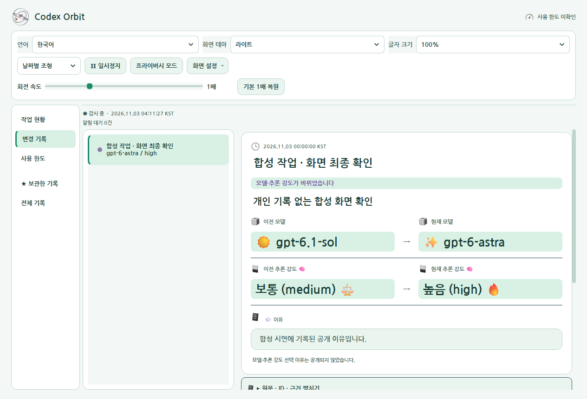

# Codex Orbit · LEVEL 2 - Explorer

[40차 · 이모지와 알림](#level-2--40차-안내) · [40차 같은 수준 상세](../../history/40차/README.md#user-content-reading-level-2)

[39차 · 그림 알림](#level-2--39차-그림-알림) · [39차 같은 수준 상세](../../history/39차/README.md#user-content-reading-level-2)

[**38차 · 알림 가독성과 연도 포함 날짜**](#level-2--38차-알림-가독성) · [38차 같은 수준 상세](../../history/38차/README.md#user-content-reading-level-2)

다른 읽기 수준 선택

| 읽기 수준 | 설명의 초점 |
| --- | --- |
| [LEVEL 1 · Beginner](%EB%A0%88%EB%B2%A81.md) | 목적과 동작부터 |
| [LEVEL 2 · Explorer](%EB%A0%88%EB%B2%A82.md) 현재 | 구성과 연결 원리 |
| [LEVEL 3 · Practitioner](%EB%A0%88%EB%B2%A83.md) | 준비·실행·결과 확인 |
| [LEVEL 4 · Advanced](%EB%A0%88%EB%B2%A84.md) | 구현·설계·실패 처리 |
| [LEVEL 5 · Expert](%EB%A0%88%EB%B2%A85.md) | 근거·프로토콜·한계 검토 |

[같은 수준의 프로필](https://github.com/PUVKID/PUVKID/blob/main/docs/읽기안내/레벨2.md) · [프로젝트 첫 화면](../../README.md)

## 기능과 확인 조건

| 기능 | 입력·조건 | 확인할 내용 |
| --- | --- | --- |
| 알림 흐름 | 로컬 변경 기록 → 이벤트 표시 | 선택 설정과 실행 관측을 별개로 읽습니다. |
| 달력과 행사 | 날짜·국가·검증된 도시 및 발표 일정 | 월별·날짜별 주제를 유지하고 확정 날짜에 행사 모티프를 연결합니다. |
| 지역과 날씨 | 자동 IP 추정 또는 수동 검색 선택 | 국가만 고르면 디자인 국가와 날씨 기준 지역이 분리됩니다. |
| 계정 한도 | 공식 계정 비율과 조회 상태 | 비율·이전 정보·미확인을 함께 표시합니다. |

## 프로젝트 소개와 읽는 방법

기록 감시 → 변경 구분 → 알림·이력 → 위젯 표시를 중심으로 날짜·날씨·한도·업데이트의 별도 흐름을 연결합니다. 달력 모드가 기본이고 관측소는 사용자가 선택합니다.

## 실제 기능과 동작 범위

설정에서 선택한 값, 실제 실행 기록의 값, 공개된 배정 이유는 서로 구분합니다.

| 역할·조건 | 동작과 확인할 내용 |
| --- | --- |
| 명시 작업 상태와 재생 | 위성 작업 상태도 기록에 명시된 경우에만 표시하고 재생 슬라이더는 기록을 보여 줄 뿐 실제 모델을 되돌리지 않습니다. |
| 사용 자료 |  |

## 입력에서 처리와 출력까지

| 확인 지점 | 설명·조건·해석 |
| --- | --- |
| 입력별 독립 경로 | 로컬 파일 감시와 네트워크 날씨,App Server 한도,GPU 그림은 별도 입력·실패 경로입니다. |
| 미확인 값의 처리 | 하나가 실패해도 미확인을 0% 같은 확정 값으로 바꾸지 않습니다. |

## 사용·실험 순서와 확인 방법

| 역할·조건 | 동작과 확인할 내용 |
| --- | --- |
| 기록 확인 | 기준선 읽기→새 기록→이전/현재 비교→알림·이력으로 따라갑니다. |
| 날짜 조건 | 날짜 모형·관측소·위성·한도·날씨의 의미를 나눈 뒤 같은 수준 차수 설명으로 변화를 읽습니다. |

## 결과와 한계를 해석하는 기준

| 확인 지점 | 설명·조건·해석 |
| --- | --- |
| 월 테마의 생성 방식 | 888개 월 테마는 공통 생성 규칙을 쓰므로 888개 수작업 모델이 아닙니다. |
| 행사·IP 위치의 범위 | 공휴일·지원 기념일과 미래 법·모든 도시 축제는 범위가 다르고 자동 IP 위치는 추정입니다. |

## 구현과 핵심 파일을 연결해 읽기

| 역할·조건 | 동작과 확인할 내용 |
| --- | --- |
| 기록·상태·알림 모듈 | notifier는 기록 변화,core는 읽기·제목·위치·지침 적용/복구,activity는 작업 상태,notice_format은 알림 표현을 맡습니다. |
| 모델 확인 | 그래픽 렌더와 실제 모델 관측값의 역할은 다릅니다. |

## 용어와 실수하기 쉬운 구분

| 역할·조건 | 동작과 확인할 내용 |
| --- | --- |
| 위젯과 날짜 조형 | 위젯은 바탕 화면에 작게 띄우는 화면입니다. |
| JSONL 기록 형식 | JSONL은 기록 한 건을 한 줄씩 저장하는 형식이고 감시는 그 파일의 새 기록을 읽는 일입니다. |
| 모델 확인 | 모델·추론 강도는 기록에 담긴 설정·실행 관측 값이며 로컬 표시가 서버 신원을 증명하지는 않습니다. |
| 렌더·GPU | 렌더는 입체 모형을 화면 그림으로 만드는 계산이고 GPU는 그 그림 계산 장치입니다. |
| 합성 화면의 의미 | 합성 화면은 검사용 예시 자료를 넣어 만든 화면입니다. |

**설정 관측·실행 관측·기록된 공개 이유를 구분합니다.** 기록되지 않은 과거값·동기·작업 상태를 만들지 않습니다.

실제 계정 한도는 남은 비율이며 토큰 개수가 아닙니다.

합성 예시·목표 프레임·과거 렌더를 실제 계정 상태·서버 모델 신원·실측 성능으로 읽지 않습니다.

## 전체 차수와 같은 수준의 상세 설명

차수 이름은 실제 보관 단위를 따릅니다. 부분본·시험 도구·최종 안내는 제품 버전과 구분하며, 폴더와 직전 비교를 함께 연결합니다.

| 차수 | 핵심 변경 | 자료 |
| --- | --- | --- |
| 1차 | Codex Orbit·1차 | 자료 폴더: [자료](../../history/01%EC%B0%A8) · 이 수준의 차수 설명: [LEVEL 2 - Explorer](../../history/01%EC%B0%A8/README.md#user-content-reading-level-2) · 직전 비교·범위: [전체 비교](../../history/01%EC%B0%A8/%EC%A7%81%EC%A0%84%EC%B0%A8%EC%88%98.diff) |
| 2차 | Codex Orbit·2차 | 자료 폴더: [자료](../../history/02%EC%B0%A8) · 이 수준의 차수 설명: [LEVEL 2 - Explorer](../../history/02%EC%B0%A8/README.md#user-content-reading-level-2) · 직전 비교·범위: [전체 비교](../../history/02%EC%B0%A8/%EC%A7%81%EC%A0%84%EC%B0%A8%EC%88%98.diff) |
| 3차 | Codex Orbit·3차 | 자료 폴더: [자료](../../history/03%EC%B0%A8) · 이 수준의 차수 설명: [LEVEL 2 - Explorer](../../history/03%EC%B0%A8/README.md#user-content-reading-level-2) · 직전 비교·범위: [전체 비교](../../history/03%EC%B0%A8/%EC%A7%81%EC%A0%84%EC%B0%A8%EC%88%98.diff) |
| 4차 | Codex Orbit·4차 | 자료 폴더: [자료](../../history/04%EC%B0%A8) · 이 수준의 차수 설명: [LEVEL 2 - Explorer](../../history/04%EC%B0%A8/README.md#user-content-reading-level-2) · 직전 비교·범위: [전체 비교](../../history/04%EC%B0%A8/%EC%A7%81%EC%A0%84%EC%B0%A8%EC%88%98.diff) |
| 5차 | Codex Orbit·5차 | 자료 폴더: [자료](../../history/05%EC%B0%A8) · 이 수준의 차수 설명: [LEVEL 2 - Explorer](../../history/05%EC%B0%A8/README.md#user-content-reading-level-2) · 직전 비교·범위: [전체 비교](../../history/05%EC%B0%A8/%EC%A7%81%EC%A0%84%EC%B0%A8%EC%88%98.diff) |
| 6차 | Codex Orbit·6차 | 자료 폴더: [자료](../../history/06%EC%B0%A8) · 이 수준의 차수 설명: [LEVEL 2 - Explorer](../../history/06%EC%B0%A8/README.md#user-content-reading-level-2) · 직전 비교·범위: [전체 비교](../../history/06%EC%B0%A8/%EC%A7%81%EC%A0%84%EC%B0%A8%EC%88%98-%EC%97%B4%EB%9E%8C.md) |
| 7차 | Codex Orbit·7차 | 자료 폴더: [자료](../../history/07%EC%B0%A8) · 이 수준의 차수 설명: [LEVEL 2 - Explorer](../../history/07%EC%B0%A8/README.md#user-content-reading-level-2) · 직전 비교·범위: [전체 비교](../../history/07%EC%B0%A8/%EC%A7%81%EC%A0%84%EC%B0%A8%EC%88%98.diff) |
| 8차 | Codex Orbit·8차 | 자료 폴더: [자료](../../history/08%EC%B0%A8) · 이 수준의 차수 설명: [LEVEL 2 - Explorer](../../history/08%EC%B0%A8/README.md#user-content-reading-level-2) · 직전 비교·범위: [전체 비교](../../history/08%EC%B0%A8/%EC%A7%81%EC%A0%84%EC%B0%A8%EC%88%98.diff) |
| 9차 | Codex Orbit·9차 | 자료 폴더: [자료](../../history/09%EC%B0%A8) · 이 수준의 차수 설명: [LEVEL 2 - Explorer](../../history/09%EC%B0%A8/README.md#user-content-reading-level-2) · 직전 비교·범위: [전체 비교](../../history/09%EC%B0%A8/%EC%A7%81%EC%A0%84%EC%B0%A8%EC%88%98.diff) |
| 10차 | Codex Orbit·10차 | 자료 폴더: [자료](../../history/10%EC%B0%A8) · 이 수준의 차수 설명: [LEVEL 2 - Explorer](../../history/10%EC%B0%A8/README.md#user-content-reading-level-2) · 직전 비교·범위: [전체 비교](../../history/10%EC%B0%A8/%EC%A7%81%EC%A0%84%EC%B0%A8%EC%88%98.diff) |
| 11차 | Codex Orbit·11차 | 자료 폴더: [자료](../../history/11%EC%B0%A8) · 이 수준의 차수 설명: [LEVEL 2 - Explorer](../../history/11%EC%B0%A8/README.md#user-content-reading-level-2) · 직전 비교·범위: [전체 비교](../../history/11%EC%B0%A8/%EC%A7%81%EC%A0%84%EC%B0%A8%EC%88%98.diff) |
| 12차 | Codex Orbit·12차 | 자료 폴더: [자료](../../history/12%EC%B0%A8) · 이 수준의 차수 설명: [LEVEL 2 - Explorer](../../history/12%EC%B0%A8/README.md#user-content-reading-level-2) · 직전 비교·범위: [전체 비교](../../history/12%EC%B0%A8/%EC%A7%81%EC%A0%84%EC%B0%A8%EC%88%98.diff) |
| 13차 | Codex Orbit·13차 | 자료 폴더: [자료](../../history/13%EC%B0%A8) · 이 수준의 차수 설명: [LEVEL 2 - Explorer](../../history/13%EC%B0%A8/README.md#user-content-reading-level-2) · 직전 비교·범위: [전체 비교](../../history/13%EC%B0%A8/%EC%A7%81%EC%A0%84%EC%B0%A8%EC%88%98.diff) |
| 14차 | Codex Orbit·14차 | 자료 폴더: [자료](../../history/14%EC%B0%A8) · 이 수준의 차수 설명: [LEVEL 2 - Explorer](../../history/14%EC%B0%A8/README.md#user-content-reading-level-2) · 직전 비교·범위: [전체 비교](../../history/14%EC%B0%A8/%EC%A7%81%EC%A0%84%EC%B0%A8%EC%88%98.diff) |
| 15차 | Codex Orbit·15차 | 자료 폴더: [자료](../../history/15%EC%B0%A8) · 이 수준의 차수 설명: [LEVEL 2 - Explorer](../../history/15%EC%B0%A8/README.md#user-content-reading-level-2) · 직전 비교·범위: [전체 비교](../../history/15%EC%B0%A8/%EC%A7%81%EC%A0%84%EC%B0%A8%EC%88%98.diff) |
| 16차 | Codex Orbit·16차 | 자료 폴더: [자료](../../history/16%EC%B0%A8) · 이 수준의 차수 설명: [LEVEL 2 - Explorer](../../history/16%EC%B0%A8/README.md#user-content-reading-level-2) · 직전 비교·범위: [전체 비교](../../history/16%EC%B0%A8/%EC%A7%81%EC%A0%84%EC%B0%A8%EC%88%98.diff) |
| 17차 | Codex Orbit·17차 | 자료 폴더: [자료](../../history/17%EC%B0%A8) · 이 수준의 차수 설명: [LEVEL 2 - Explorer](../../history/17%EC%B0%A8/README.md#user-content-reading-level-2) · 직전 비교·범위: [전체 비교](../../history/17%EC%B0%A8/%EC%A7%81%EC%A0%84%EC%B0%A8%EC%88%98.diff) |
| 18차 | Codex Orbit·18차 | 자료 폴더: [자료](../../history/18%EC%B0%A8) · 이 수준의 차수 설명: [LEVEL 2 - Explorer](../../history/18%EC%B0%A8/README.md#user-content-reading-level-2) · 직전 비교·범위: [전체 비교](../../history/18%EC%B0%A8/%EC%A7%81%EC%A0%84%EC%B0%A8%EC%88%98-%EC%97%B4%EB%9E%8C.md) |
| 19차 | Codex Orbit·19차 | 자료 폴더: [자료](../../history/19%EC%B0%A8) · 이 수준의 차수 설명: [LEVEL 2 - Explorer](../../history/19%EC%B0%A8/README.md#user-content-reading-level-2) · 직전 비교·범위: [전체 비교](../../history/19%EC%B0%A8/%EC%A7%81%EC%A0%84%EC%B0%A8%EC%88%98.diff) |
| 20차 | Codex Orbit·20차 | 자료 폴더: [자료](../20%EC%B0%A8) · 이 수준의 차수 설명: [LEVEL 2 - Explorer](../20%EC%B0%A8/README.md#user-content-reading-level-2) · 직전 비교·범위: [전체 비교](../20%EC%B0%A8/README.md) |
| 21차 | Codex Orbit·21차 | 자료 폴더: [자료](../../history/21%EC%B0%A8) · 이 수준의 차수 설명: [LEVEL 2 - Explorer](../../history/21%EC%B0%A8/README.md#user-content-reading-level-2) · 직전 비교·범위: [전체 비교](../../history/21%EC%B0%A8/%EC%A7%81%EC%A0%84%EC%B0%A8%EC%88%98.diff) |
| 22차 | Codex Orbit·22차 | 자료 폴더: [자료](../../history/22%EC%B0%A8) · 이 수준의 차수 설명: [LEVEL 2 - Explorer](../../history/22%EC%B0%A8/README.md#user-content-reading-level-2) · 직전 비교·범위: [전체 비교](../../history/22%EC%B0%A8/%EC%A7%81%EC%A0%84%EC%B0%A8%EC%88%98-%EC%97%B4%EB%9E%8C.md) |
| 23차 | Codex Orbit·23차 | 자료 폴더: [자료](../../history/23%EC%B0%A8) · 이 수준의 차수 설명: [LEVEL 2 - Explorer](../../history/23%EC%B0%A8/README.md#user-content-reading-level-2) · 직전 비교·범위: [전체 비교](../../history/23%EC%B0%A8/%EC%A7%81%EC%A0%84%EC%B0%A8%EC%88%98-%EC%97%B4%EB%9E%8C.md) |
| 24차 | Codex Orbit·24차 | 자료 폴더: [자료](../../history/24%EC%B0%A8) · 이 수준의 차수 설명: [LEVEL 2 - Explorer](../../history/24%EC%B0%A8/README.md#user-content-reading-level-2) · 직전 비교·범위: [전체 비교](../../history/24%EC%B0%A8/%EC%A7%81%EC%A0%84%EC%B0%A8%EC%88%98.diff) |
| 25차 | Codex Orbit·25차 | 자료 폴더: [자료](../../history/25) · 이 수준의 차수 설명: [LEVEL 2 - Explorer](../../history/25/README.md#user-content-reading-level-2) · 직전 비교·범위: [전체 비교](../../history/25/%EC%A7%81%EC%A0%84%EC%B0%A8%EC%88%98-%EC%97%B4%EB%9E%8C.md) |
| 26차 | Codex Orbit·26차 | 자료 폴더: [자료](../../history/26) · 이 수준의 차수 설명: [LEVEL 2 - Explorer](../../history/26/README.md#user-content-reading-level-2) · 직전 비교·범위: [전체 비교](../../history/26/%EC%A7%81%EC%A0%84%EC%B0%A8%EC%88%98.diff) |
| 27차 | Codex Orbit·27차 | 자료 폴더: [자료](../../history/27) · 이 수준의 차수 설명: [LEVEL 2 - Explorer](../../history/27/README.md#user-content-reading-level-2) · 직전 비교·범위: [전체 비교](../27%EC%B0%A8_%EC%A0%84%EC%B2%B4%EB%B3%80%EA%B2%BD.diff) |
| 28차 | Codex Orbit·28차 | 자료 폴더: [자료](../../history/28) · 이 수준의 차수 설명: [LEVEL 2 - Explorer](../../history/28/README.md#user-content-reading-level-2) · 직전 비교·범위: [전체 비교](../28%EC%B0%A8_%EC%A0%84%EC%B2%B4%EB%B3%80%EA%B2%BD-%EC%97%B4%EB%9E%8C.md) |
| 최종 | Codex Orbit · 최종 | 자료 폴더: [자료](../%EC%B5%9C%EC%A2%85) · 이 수준의 차수 설명: [LEVEL 2 - Explorer](../%EC%B5%9C%EC%A2%85/README.md#user-content-reading-level-2) · 직전 비교·범위: [전체 비교](../%EC%B5%9C%EC%A2%85/README.md) |
| 29차 | Codex Orbit·29차 | 자료 폴더: [자료](../../history/29%EC%B0%A8) · 이 수준의 차수 설명: [LEVEL 2 - Explorer](../../history/29%EC%B0%A8/README.md#user-content-reading-level-2) · 직전 비교·범위: [전체 비교](../29%EC%B0%A8_%EC%A0%84%EC%B2%B4%EB%B3%80%EA%B2%BD-%EC%97%B4%EB%9E%8C.md) |
| 30차 | Codex Orbit·30차 | 자료 폴더: [자료](../../history/30%EC%B0%A8) · 이 수준의 차수 설명: [LEVEL 2 - Explorer](../../history/30%EC%B0%A8/README.md#user-content-reading-level-2) · 직전 비교·범위: [전체 비교](../../history/30%EC%B0%A8/%EC%A7%81%EC%A0%84%EC%B0%A8%EC%88%98.diff) |
| 31차 | 화면 마감과 테마 선택 | 자료 폴더: [자료](../../history/31%EC%B0%A8) · 이 수준의 차수 설명: [LEVEL 2 - Explorer](../../history/31%EC%B0%A8/README.md#user-content-reading-level-2) · 직전 비교·범위: [전체 비교](../../history/31%EC%B0%A8/%EC%A7%81%EC%A0%84%EC%B0%A8%EC%88%98.diff) |
| 32차 | 지역 검색과 날짜별 입체 조형 | 자료 폴더: [자료](../../history/32%EC%B0%A8) · 이 수준의 차수 설명: [LEVEL 2 - Explorer](../../history/32%EC%B0%A8/README.md#user-content-reading-level-2) · 직전 비교·범위: [전체 비교](../32%EC%B0%A8_%EC%A0%84%EC%B2%B4%EB%B3%80%EA%B2%BD-%EC%97%B4%EB%9E%8C.md) |
| 33차 | 자동 위치·강수량·도시 행사 진행 자료 | 자료 폴더: [자료 폴더](../../history/33차) · 상세 설명: [상세 설명](../../history/33차/README.md#user-content-reading-level-2) · 직전 비교·범위: [전체 비교·범위](../../history/33%EC%B0%A8/%EC%A7%81%EC%A0%84%EC%B0%A8%EC%88%98-%EC%97%B4%EB%9E%8C.md) |
| 34차 | 픽셀 입체 조형과 도시 행사 | 자료 폴더: [자료 폴더](../../history/34차) · 상세 설명: [상세 설명](../../history/34차/README.md#user-content-reading-level-2) · 직전 비교·범위: [전체 비교·범위](../34%EC%B0%A8_%EC%A0%84%EC%B2%B4%EB%B3%80%EA%B2%BD-%EC%97%B4%EB%9E%8C.md) |
| 35차 | 개발자용 색상과 조명 | 자료 폴더: [자료 폴더](../../history/35차) · 해당 수준 설명: [같은 수준 상세](../../history/35차/README.md#user-content-reading-level-2) · 직전 비교 또는 범위: [34차 이후 전체 변경](../35%EC%B0%A8_%EC%A0%84%EC%B2%B4%EB%B3%80%EA%B2%BD-%EC%97%B4%EB%9E%8C.md) |
| 36차 | 설치 선택 항목 정리 | 자료 폴더: [자료 폴더](../../history/36차) · 해당 수준 설명: [같은 수준 상세](../../history/36차/README.md#user-content-reading-level-2) · 직전 비교 또는 범위: [35차 이후 전체 변경](../../history/36차/직전차수.diff) |
| 37차 | 알림 센터·감시 상태·업데이트 안내 | 자료 폴더: [자료 폴더](../../history/37차) · 해당 수준 설명: [같은 수준 상세](../../history/37차/README.md#user-content-reading-level-2) · 직전 비교 또는 범위: [36차 이후 전체 변경](../../history/37차/비교/README.md) |
| 38차 | 알림 가독성·연도 포함 날짜 | 자료 폴더: [자료 폴더](../../history/38차) · 해당 수준 설명: [같은 수준 상세](../../history/38차/README.md#user-content-reading-level-2) · 직전 비교 또는 범위: [37차 이후 전체 변경](../../history/38차/비교.md) |
| 39차 | 그림 아이콘·선명한 변경 알림 | 자료 폴더: [자료 폴더](../../history/39차) · 해당 수준 설명: [같은 수준 상세](../../history/39차/README.md#user-content-reading-level-2) · 직전 비교 또는 범위: [38차 이후 전체 변경](../../history/39차/비교.md) |
| 40차 | 이모지 복원·읽기 쉬운 변경 이유 | 자료 폴더: [자료 폴더](../../history/40차) · 해당 수준 설명: [같은 수준 상세](../../history/40차/README.md#user-content-reading-level-2) · 직전 비교 또는 범위: [39차 이후 전체 변경](../../history/40차/비교.md) |

## 논문·원고와 원본 자료의 범위

앱 소스·릴리스·설계·사용법·실제 배포 본의 합성 검증 화면을 연결합니다. 20차 시안·21차 시안과 최종 상태 안내의 보존 범위를 구분하며 없는 소스·원고·제품 버전을 만들지 않습니다. 권리·공개 범위 원문을 함께 확인합니다.

## 원래 모든 세부 설명으로 이동하기

설정값·코드 예제·실패 조건·측정 범위·화면과 파일별 안내를 생략하지 않도록 첫 화면의 전체 본문을 아래에 함께 둡니다. 각 항목은 이 페이지의 공통 근거로 바로 이동합니다. 원문에 담긴 이전 차수 조건을 현재 실행 조건으로 자동 적용하지 않습니다.

| 기존 항목 | 전체 근거 |
| --- | --- |
| Codex Orbit 3.2.0 | [원문 보기](#source-section-1) |
| 32차·지역 검색과 당일 입체 조형 | [원문 보기](#source-section-2) |
| 32차 실제 배포 본의 합성 화면 | [원문 보기](#source-section-3) |
| 이전 31차 실제 배포 본의 합성 화면 | [원문 보기](#source-section-4) |
| 31차·화면 마감과 테마 선택 | [원문 보기](#source-section-5) |
| 감시·표시·저장·업데이트의 연결 | [원문 보기](#source-section-6) |
| 30차·원래 날짜별 테마 기본 복원 | [원문 보기](#source-section-7) |
| 선택 가능한 29차 관측소 기능 | [원문 보기](#source-section-8) |
| 달력 모드와 기존 기능 | [원문 보기](#source-section-9) |
| 모든 차수와 실제 자료 | [원문 보기](#source-section-10) |
| 실행·소스와 권리 | [원문 보기](#source-section-11) |
| 이전 29차 합성 예시 화면 | [원문 보기](#source-section-12) |

## 항목별 자세한 풀이와 확인 지점

### 32차·지역 검색과 당일 입체 조형

이 항목의 설정과 자료 흐름은 다음 조건으로 연결됩니다.

같은 이름이 있어도 서로 다른 차수의 구성과 합치지 않습니다.

날짜 위젯은 고리와 좌우 장식 없이 당일 대상 하나를 표시합니다.

기존 888개 월별 주제와 일반 일 대상을 보존하고, 250개 국가·지역의 공휴일·지원 기념일에는 실제 행사 명과 특집 조형을 적용합니다.

미래 법 개정과 모든 도시 축제까지 확정한 자료는 아닙니다.

| 역할·조건 | 동작과 확인할 내용 |
| --- | --- |
| 지역과 날씨 | 지역 표시를 눌러 도시·주소·장소·국가를 직접 검색합니다. |
| 지역과 날씨 | 선택 지점의 기온·날씨·습도·일출·일몰을 받아오며, 자동 IP 위치는 추정임을 표시합니다. |
| 변경 알림과 상태 | 알림은 이전·현재 모델과 추론 강도를 나란히 비교하고 짧은 설명과 접을 수 있는 원문으로 정리했습니다. |
| 화면 표시 | 화면은 흰색·슬레이트 블루와 다크 테마를 제공합니다. |
| 위젯과 날짜 조형 | 날짜별 대상 하나와 직접 검색한 지역의 날씨를 보여 줍니다. |
| 화면 확인 | **흐름과 개념:** 당일 조형·지역 선택·IP 추정·전후 알림과 화면 테마를 확인합니다. |

888월 주제·250 국가/지역의 지원 행사와 미래 법·모든 도시 축제의 미확정 범위를 구분합니다.

**이 항목에서 연결되는 실제 설명**

날짜 위젯은 고리와 좌우 장식 없이 당일 대상 하나를 표시합니다.

기존 888개 월별 주제와 일반 일 대상을 보존하고, 250개 국가·지역의 공휴일·지원 기념일에는 실제 행사 명과 특집 조형을 적용합니다.

미래 법 개정과 모든 도시 축제까지 확정한 자료는 아닙니다.

| 역할·조건 | 동작과 확인할 내용 |
| --- | --- |
| 지역과 날씨 | 지역 표시를 눌러 도시·주소·장소·국가를 직접 검색합니다. |
| 지역과 날씨 | 선택 지점의 기온·날씨·습도·일출·일몰을 받아오며, 자동 IP 위치는 추정임을 표시합니다. |
| 변경 알림과 상태 | 알림은 이전·현재 모델과 추론 강도를 나란히 비교하고 짧은 설명과 접을 수 있는 원문으로 정리했습니다. |
| 화면 표시 | 화면은 흰색·슬레이트 블루와 다크 테마를 제공합니다. |

[이 항목의 전체 조건·원문](#source-section-2)

### 32차 실제 배포 본의 합성 화면

이 항목의 설정과 자료 흐름은 다음 조건으로 연결됩니다.

같은 이름이 있어도 서로 다른 차수의 구성과 합치지 않습니다.

| 역할·조건 | 동작과 확인할 내용 |
| --- | --- |
| 합성 검사 범위 | 실제 배포 EXE에서 개인 기록·네트워크 없이 검사한 화면입니다. |
| 모델 확인 | 기온·습도·잔량과 모델 값은 합성 예시입니다. |
| 검증 확인 | [검증 범위](../%EA%B3%B5%EA%B0%9C%EA%B2%80%EC%A6%9D_32%EC%B0%A8.md) |

| 역할·조건 | 동작과 확인할 내용 |
| --- | --- |
| 합성 검사 자료 | 실제 배포 EXE에 검사용 예시를 넣어 만든 화면입니다. |
| 검증 확인 | **흐름과 개념:** 기온·습도·잔량·모델 값의 합성 표기와 공개 검증 범위를 읽습니다. |
| 모델 확인 | 실제 프로그램 렌더와 실제 계정·날씨·모델 관측값은 다른 증거입니다. |

**이 항목에서 연결되는 실제 설명**

| 역할·조건 | 동작과 확인할 내용 |
| --- | --- |
| 합성 검사 범위 | 실제 배포 EXE에서 개인 기록·네트워크 없이 검사한 화면입니다. |
| 모델 확인 | 기온·습도·잔량과 모델 값은 합성 예시입니다. |
| 검증 확인 | [검증 범위](../%EA%B3%B5%EA%B0%9C%EA%B2%80%EC%A6%9D_32%EC%B0%A8.md) |

[이 항목의 전체 조건·원문](#source-section-3)

### 이전 31차 실제 배포 본의 합성 화면

이 항목의 설정과 자료 흐름은 다음 조건으로 연결됩니다.

같은 이름이 있어도 서로 다른 차수의 구성과 합치지 않습니다.

개인 기록 없이 만든 합성 작업입니다.

모델·추론 값은 화면 검사용 예시이며 실제 실행 모델이나 계정 상태를 뜻하지 않습니다.

이전 배포본에 개인 기록 없이 만든 작업 예시입니다.

**흐름과 개념:** 31차의 화면 형태와 합성 모델·추론 값을 구분합니다.

예시를 현재 계정·실행 모델이나 32차의 모든 상태 검증으로 확대하지 않습니다.

**이 항목에서 연결되는 실제 설명**

개인 기록 없이 만든 합성 작업입니다.

모델·추론 값은 화면 검사용 예시이며 실제 실행 모델이나 계정 상태를 뜻하지 않습니다.

[이 항목의 전체 조건·원문](#source-section-4)

### 31차·화면 마감과 테마 선택

이 항목의 설정과 자료 흐름은 다음 조건으로 연결됩니다.

같은 이름이 있어도 서로 다른 차수의 구성과 합치지 않습니다.

시스템·라이트·다크 화면 테마를 즉시 적용하고 선택을 저장합니다.

언어·글자 크기·회전 속도는 같은 설정 영역에서 조절하고, 작업 현황에서 선택 설정과 최근 실행 관측을 구분합니다.

| 역할·조건 | 동작과 확인할 내용 |
| --- | --- |
| 테마와 화면 설정 | 화면 설정 메뉴는 움직임 줄이기·가장자리 붙이기·알림 소리·성능과 화질·문제 확인용 파일 저장·새 버전 확인을 설명합니다. |
| 가림과 진단 자료 | 프라이버시 모드는 화면의 제목과 작업 설명을 가리며 저장 원문을 유지합니다. |
| 위젯과 날짜 조형 | 날짜별 과일·세 금속 링·날짜 규칙과 모델·추론 변경 알림은 유지합니다. |
| 테마와 화면 설정 | 시스템·라이트·다크와 언어·글자·회전 설정을 정리합니다. |
| 저장 확인 | **흐름과 개념:** 선택 저장·실제 관측 구분과 프라이버시 모드의 가림 범위를 확인합니다. |
| 저장 확인 | 표시를 가리는 기능과 저장 원문 삭제·모델 전환은 다릅니다. |

**이 항목에서 연결되는 실제 설명**

시스템·라이트·다크 화면 테마를 즉시 적용하고 선택을 저장합니다.

언어·글자 크기·회전 속도는 같은 설정 영역에서 조절하고, 작업 현황에서 선택 설정과 최근 실행 관측을 구분합니다.

| 역할·조건 | 동작과 확인할 내용 |
| --- | --- |
| 테마와 화면 설정 | 화면 설정 메뉴는 움직임 줄이기·가장자리 붙이기·알림 소리·성능과 화질·문제 확인용 파일 저장·새 버전 확인을 설명합니다. |
| 가림과 진단 자료 | 프라이버시 모드는 화면의 제목과 작업 설명을 가리며 저장 원문을 유지합니다. |
| 위젯과 날짜 조형 | 날짜별 과일·세 금속 링·날짜 규칙과 모델·추론 변경 알림은 유지합니다. |

[이 항목의 전체 조건·원문](#source-section-5)

### 감시·표시·저장·업데이트의 연결

이 항목의 설정과 자료 흐름은 다음 조건으로 연결됩니다.

같은 이름이 있어도 서로 다른 차수의 구성과 합치지 않습니다.

| 역할·조건 | 동작과 확인할 내용 |
| --- | --- |
| 로컬 기록 읽기 | 30차 소스에서 `notifier.Watcher`는 로컬 JSONL을 읽어 설정 관측·실행 관측·공개 이유를 구분하고 `app.py`가 알림·위젯·상세 이력을 표시합니다. |
| 위치 확인 | `core.py`는 JSONL 꼬리 읽기·채팅 제목·화면 위치와 Markdown 적용/복구를 담당합니다. |

`activity.py`의 작업 상태와 `notice_format.py`의 표현을 렌더러의 장식 상태와 구분합니다.

기록 읽기 — 30차 notifier는 읽기 묶음 512KiB·레코드 2MiB·파일 4096개·poll 총 8MiB·대기 256개·주기 0.2초 상한을 둡니다.

최초 기준 선과 새 기록 알림을 구분합니다.

| 역할·조건 | 동작과 확인할 내용 |
| --- | --- |
| 표시 | 표시 — calendar가 기본이며 명시 선택한 관측소는 유지합니다. |
| 모델 확인 | calendar_renderer·observatory_scene의 GPU 그림과 실제 모델/추론 기록은 별개입니다. |
| 계정 한도 | 계정 한도 — UsageClient가 codex.exe app-server를 QProcess 분리 파이프로 열고 읽기 요청합니다. |

30초 갱신·12초 응답 제한·65초 이후 오래된 값 표시를 적용합니다.

연결 실패 — 한도 조회 실패 때 이전 값을 stale로 표시하고 최대 3회,3/6/9초 지연으로 다시 연결합니다.

미확인을 0%로 바꾸지 않습니다.

종료 — UsageClient.close는 타이머와 pending을 정리하고 종료 요청 뒤 500ms 대기, 필요하면 kill 후 500ms 대기합니다.

배포 교체 — safe_update의 check →stage →apply 단계로 공식 릴리스·자산·SHA·로컬 경계를 검사하고 실행 확인 실패 시 이전 EXE를 복구합니다.

MAX_DOWNLOAD는 512MiB입니다.

사용자는 감시 경로·언어·표시 모드·모션/자원 품질을 고르고 새 알림의 이전/이후 값과 근거를 읽습니다.

| 역할·조건 | 동작과 확인할 내용 |
| --- | --- |
| 범위 확인 | 날씨·사용 한도·업데이트는 네트워크 또는 App Server 기능이며 로컬 감시기의 기능 범위와 나눠 봅니다. |
| 가림과 진단 자료 | 방송 모드와 진단 ZIP의 공개 제외 조건을 유지합니다. |
| 설정 확인 | 실제 사용 법·릴리스·빌드 안내와 차수별 함수/설정 참조는 아래에 연결되어 있습니다. |
| 로컬 기록 읽기 | 기록 읽기·작업 상태·표시·한도 조회·배포 교체는 다른 처리입니다. |

**흐름과 개념:** Watcher·core·activity·notice_format·UsageClient·safe_update의 실제 경계를 따라갑니다.

자원 상한·stale·재연결·종료·SHA 복구 조건과 로컬/서버 증거 수준을 분리합니다.

**이 항목에서 연결되는 실제 설명**

| 역할·조건 | 동작과 확인할 내용 |
| --- | --- |
| 로컬 기록 읽기 | 30차 소스에서 `notifier.Watcher`는 로컬 JSONL을 읽어 설정 관측·실행 관측·공개 이유를 구분하고 `app.py`가 알림·위젯·상세 이력을 표시합니다. |
| 위치 확인 | `core.py`는 JSONL 꼬리 읽기·채팅 제목·화면 위치와 Markdown 적용/복구를 담당합니다. |

`activity.py`의 작업 상태와 `notice_format.py`의 표현을 렌더러의 장식 상태와 구분합니다.

사용자는 감시 경로·언어·표시 모드·모션/자원 품질을 고르고 새 알림의 이전/이후 값과 근거를 읽습니다.

| 역할·조건 | 동작과 확인할 내용 |
| --- | --- |
| 범위 확인 | 날씨·사용 한도·업데이트는 네트워크 또는 App Server 기능이며 로컬 감시기의 기능 범위와 나눠 봅니다. |
| 가림과 진단 자료 | 방송 모드와 진단 ZIP의 공개 제외 조건을 유지합니다. |
| 설정 확인 | 실제 사용 법·릴리스·빌드 안내와 차수별 함수/설정 참조는 아래에 연결되어 있습니다. |

[이 항목의 전체 조건·원문](#source-section-6)

### 30차·원래 날짜별 테마 기본 복원

이 항목의 설정과 자료 흐름은 다음 조건으로 연결됩니다.

같은 이름이 있어도 서로 다른 차수의 구성과 합치지 않습니다.

| 역할·조건 | 동작과 확인할 내용 |
| --- | --- |
| 미설정 기본 모드 | 설정에 표시 모드가 없는 경우에도 원래 날짜별 달력 조형을 표시합니다. |
| 모델 이벤트 뒤 표시 | 모델 변경 이벤트를 받아도 날짜 제목과 조형은 유지합니다. |
| 기존 테마 보존 | 888개 월 테마·일별 디자인·색·재질·날짜 규칙은 바꾸지 않았습니다. |
| 모델 확인 | 이전/현재 모델·추론 강도·알림 기능도 유지합니다. |
| 미선택 기본 모드 | 모드를 선택하지 않은 경우 원래 날짜별 조형을 보여 주도록 되돌립니다. |
| 날짜 조건 | **흐름과 개념:** 새 설정·모드 없는 기존 설정·모델 이벤트 후 날짜 유지와 명시 관측소를 확인합니다. |
| 모델 확인 | 기본값 복원을 월·일 자산 재제작이나 모델 변경 기능으로 읽지 않습니다. |

**이 항목에서 연결되는 실제 설명**

| 역할·조건 | 동작과 확인할 내용 |
| --- | --- |
| 미설정 기본 모드 | 설정에 표시 모드가 없는 경우에도 원래 날짜별 달력 조형을 표시합니다. |
| 모델 이벤트 뒤 표시 | 모델 변경 이벤트를 받아도 날짜 제목과 조형은 유지합니다. |
| 기존 테마 보존 | 888개 월 테마·일별 디자인·색·재질·날짜 규칙은 바꾸지 않았습니다. |
| 모델 확인 | 이전/현재 모델·추론 강도·알림 기능도 유지합니다. |

[이 항목의 전체 조건·원문](#source-section-7)

### 선택 가능한 29차 관측소 기능

이 항목의 설정과 자료 흐름은 다음 조건으로 연결됩니다.

같은 이름이 있어도 서로 다른 차수의 구성과 합치지 않습니다.

은색 금속 링 세 개가 서로 다른 축에서 움직입니다.

솔의 태양·아스트라의 결정·테라의 구체·루나의 초승달 코어와 추론 강도별 입자 밀도를 구분합니다.

확인되지 않은 모델은 중립 조형으로 표시합니다.

| 역할·조건 | 동작과 확인할 내용 |
| --- | --- |
| 변경 알림과 상태 | 위성은 기록에서 명시적으로 관측한 작업 상태를 표시합니다. |
| 모델 확인 | 관심 채팅 고정·기록 북마크·자리비움 요약·시간 슬라이더 재생을 제공하며 재생은 실제 모델 설정을 바꾸지 않습니다. |
| 변경 알림과 상태 | 알림은 채팅 제목·이전 모델과 추론 강도·현재 모델과 추론 강도·기록된 이유를 비교합니다. |
| 모델 확인 | 정확한 모델 ID와 원문 기록은 보존하고 표시 제목의 장식 이모지를 정리합니다. |

마우스를 올리면 자동 닫힘을 멈추고 알림을 고정할 수 있습니다.

| 역할·조건 | 동작과 확인할 내용 |
| --- | --- |
| 가림과 진단 자료 | 방송 모드는 열린 알림·제목·작업·툴팁을 가립니다. |
| 가림과 진단 자료 | 진단 ZIP은 대화·인증·경로·이벤트 원문을 제외한 항목만 로컬에 저장합니다. |

업데이트는 사용자가 확인을 눌러 공식 릴리스를 조회하고 SHA-256 대조 후 준비하며, 교체 후 실행 확인 실패 시 이전 실행 파일로 복구합니다.

민트와 화이트 화면·나눔고딕 Bold를 사용합니다.

글자 크기·가장자리 도킹·펼침·재생/일시 정지·모션 축소·자원 품질을 조절할 수 있으며 일시 정지 중에도 알림 감시는 계속됩니다.

실제 한도는 **남은 사용 한도 비율**이며 남은 토큰 개수가 아닙니다.

미확인은 0%와 구분합니다.

선택 설정 관측과 실제 실행 기록 관측을 구분하며 로컬 기록이 서버 모델 신원을 보증하지 않습니다.

| 역할·조건 | 동작과 확인할 내용 |
| --- | --- |
| 기록 확인 | 기록되지 않은 이유와 작업 상태를 만들어 내지 않습니다. |
| 모델 확인 | 링·모델별 코어·추론 입자·작업 위성으로 기록을 볼 수 있는 선택 화면입니다. |
| 설정 확인 | **흐름과 개념:** 관심 고정·보관·자리비움·재생·방송·한도·업데이트와 모션 설정을 확인합니다. |

슬라이더는 기록 재생이며 실제 모델 복귀가 아니고 미확인 모델·한도를 확정값으로 채우지 않습니다.

**이 항목에서 연결되는 실제 설명**

- 은색 금속 링 세 개가 서로 다른 축에서 움직입니다.

솔의 태양·아스트라의 결정·테라의 구체·루나의 초승달 코어와 추론 강도별 입자 밀도를 구분합니다.

확인되지 않은 모델은 중립 조형으로 표시합니다.

| 역할·조건 | 동작과 확인할 내용 |
| --- | --- |
| 기록 확인 | - 위성은 기록에서 명시적으로 관측한 작업 상태를 표시합니다. |
| 모델 확인 | 관심 채팅 고정·기록 북마크·자리비움 요약·시간 슬라이더 재생을 제공하며 재생은 실제 모델 설정을 바꾸지 않습니다. |
| 모델 확인 | - 알림은 채팅 제목·이전 모델과 추론 강도·현재 모델과 추론 강도·기록된 이유를 비교합니다. |
| 모델 확인 | 정확한 모델 ID와 원문 기록은 보존하고 표시 제목의 장식 이모지를 정리합니다. |

마우스를 올리면 자동 닫힘을 멈추고 알림을 고정할 수 있습니다.

- 방송 모드는 열린 알림·제목·작업·툴팁을 가립니다.

진단 ZIP은 대화·인증·경로·이벤트 원문을 제외한 항목만 로컬에 저장합니다.

업데이트는 사용자가 확인을 눌러 공식 릴리스를 조회하고 SHA-256 대조 후 준비하며, 교체 후 실행 확인 실패 시 이전 실행 파일로 복구합니다.

- 민트와 화이트 화면·나눔고딕 Bold를 사용합니다.

글자 크기·가장자리 도킹·펼침·재생/일시 정지·모션 축소·자원 품질을 조절할 수 있으며 일시 정지 중에도 알림 감시는 계속됩니다.

실제 한도는 **남은 사용 한도 비율**이며 남은 토큰 개수가 아닙니다.

미확인은 0%와 구분합니다.

선택 설정 관측과 실제 실행 기록 관측을 구분하며 로컬 기록이 서버 모델 신원을 보증하지 않습니다.

기록되지 않은 이유와 작업 상태를 만들어 내지 않습니다.

[이 항목의 전체 조건·원문](#source-section-8)

### 달력 모드와 기존 기능

이 항목의 설정과 자료 흐름은 다음 조건으로 연결됩니다.

같은 이름이 있어도 서로 다른 차수의 구성과 합치지 않습니다.

2026~2099년의 [888개 월 테마](../%EC%97%B0%EB%8F%84%EB%B3%84_%EC%9B%94%EB%B3%84_%ED%85%8C%EB%A7%88_%EC%A0%84%EC%B2%B4.md)와 [CSV](../%EC%97%B0%EB%8F%84%EB%B3%84_%EC%9B%94%EB%B3%84_%ED%85%8C%EB%A7%88_%EC%A0%84%EC%B2%B4.csv), 날짜별 실제 메시 조형을 달력 모드로 보존합니다.

공통 생성 규칙을 재사용하므로 888개 수작업 모델을 뜻하지 않습니다.

한영 선 택·날씨·IP 기반 지역·시계·속도 조절을 유지합니다.

하나의 GPU 작업자가 3840×2160 원본을 렌더하며 관측소 품질은 20/30/60fps 상한을 사용합니다.

실제 생성률과 모니터 표시율은 별개이고 고정 240fps 달성을 주장하지 않습니다.

날짜별 규칙으로 조형을 만들고 날씨·시계·언어·속도를 함께 제공합니다.

**흐름과 개념:** 2026~2099·888 테마·공통 생성 규칙과 GPU 렌더·품질 상한을 읽습니다.

수작업 모델 수·목 표 생성률·실제 표시율·240fps 달성을 구분합니다.

**이 항목에서 연결되는 실제 설명**

2026~2099년의 [888개 월 테마](../%EC%97%B0%EB%8F%84%EB%B3%84_%EC%9B%94%EB%B3%84_%ED%85%8C%EB%A7%88_%EC%A0%84%EC%B2%B4.md)와 [CSV](../%EC%97%B0%EB%8F%84%EB%B3%84_%EC%9B%94%EB%B3%84_%ED%85%8C%EB%A7%88_%EC%A0%84%EC%B2%B4.csv), 날짜별 실제 메시 조형을 달력 모드로 보존합니다.

공통 생성 규칙을 재사용하므로 888개 수작업 모델을 뜻하지 않습니다.

한영 선 택·날씨·IP 기반 지역·시계·속도 조절을 유지합니다.

하나의 GPU 작업자가 3840×2160 원본을 렌더하며 관측소 품질은 20/30/60fps 상한을 사용합니다.

실제 생성률과 모니터 표시율은 별개이고 고정 240fps 달성을 주장하지 않습니다.

[이 항목의 전체 조건·원문](#source-section-9)

### 모든 차수와 실제 자료

코드·시안·설계·제외 자료와 각 차수 비교를 모아 연결합니다.

**흐름과 개념:** 20차 소스 부재·21차 시안·최종 상태 안내와 원본/공개 SHA를 확인합니다. 확인되지 않은 제품 버전·src·diff를 만들거나 비공개 검증 원문을 게시하지 않습니다.

**이 항목에서 연결되는 실제 설명**

원본 소스 비교에는 주석·공백·개행과 신규·삭제 상태를 포함합니다. 20차는 실행 소스 없이 38개 시 안, 21차는 110개 시안을 보존합니다. 최종 폴더의 개인 운영 검증 원문은 공개하지 않습니다. 역사 자료 2,281개 항목의 보존·정제·제외 사유와 원본/공개 SHA를 차수별로 연결했습니다.

[이 항목의 전체 조건·원문](#source-section-10)

### 실행·소스와 권리

이 항목의 설정과 자료 흐름은 다음 조건으로 연결됩니다.

같은 이름이 있어도 서로 다른 차수의 구성과 합치지 않습니다.

| 역할·조건 | 동작과 확인할 내용 |
| --- | --- |
| 실행과 빌드 준비 | Windows 10/11 x64와 OpenGL 3.3을 지원하는 그래픽 드라이버가 필요합니다. |
| 실행과 빌드 준비 | 단일 EXE는 Python 설치 없이 실행하고 설치 본은 현재 사용자용 바로 가기·제 거를 제공합니다. |

GPU 준비/실패는 정적 표식 또는 오류 설명으로 구분합니다.

공개 소스는 GitHub 자동 Source code ZIP 또는 이 저장소에서 받습니다.

비공개 전체 개발 ZIP·개인 대화·지침·인증 자료는 배포하지 않습니다.

기존 라이선스 고지를 보존하며 새 소스 라이선스를 임의 부여하지 않습니다.

재빌드는 `python -B -X utf8 tools/build_distribution.py`를 사용합니다.

원고가 없는 앱 작업으로 논문 PDF를 만들지 않았습니다.

| 역할·조건 | 동작과 확인할 내용 |
| --- | --- |
| 실행 확인 | 실행 환경·단일 EXE/설치·원본과 공개 자료·권리 범위를 설명합니다. |
| 범위 확인 | **흐름과 개념:** Windows10/11x64·OpenGL3.3과 릴리스·소스·사용법·공개 범위를 대조합니다. |
| 기록 확인 | 로컬 기록·진단·인증·참조 자산의 제외와 사용 조건을 제품 기능과 분리합니다. |

**이 항목에서 연결되는 실제 설명**

| 역할·조건 | 동작과 확인할 내용 |
| --- | --- |
| 실행과 빌드 준비 | Windows 10/11 x64와 OpenGL 3.3을 지원하는 그래픽 드라이버가 필요합니다. |
| 실행과 빌드 준비 | 단일 EXE는 Python 설치 없이 실행하고 설치 본은 현재 사용자용 바로 가기·제 거를 제공합니다. |

GPU 준비/실패는 정적 표식 또는 오류 설명으로 구분합니다.

공개 소스는 GitHub 자동 Source code ZIP 또는 이 저장소에서 받습니다.

비공개 전체 개발 ZIP·개인 대화·지침·인증 자료는 배포하지 않습니다.

기존 라이선스 고지를 보존하며 새 소스 라이선스를 임의 부여하지 않습니다.

재빌드는 `python -B -X utf8 tools/build_distribution.py`를 사용합니다.

원고가 없는 앱 작업으로 논문 PDF를 만들지 않았습니다.

[이 항목의 전체 조건·원문](#source-section-11)

### 이전 29차 합성 예시 화면

이 항목의 설정과 자료 흐름은 다음 조건으로 연결됩니다.

같은 이름이 있어도 서로 다른 차수의 구성과 합치지 않습니다.

다음 이미지는 실제 Qt 앱에 합성 이벤트와 예시 값을 넣은 화면이며 개인 채팅·실계정 수치가 아닙니다.

| 역할·조건 | 동작과 확인할 내용 |
| --- | --- |
| 화면 확인 | 이전 관측소의 예시 상태를 넣어 만든 화면입니다. |
| 관측 확인 | **흐름과 개념:** 그림의 기능·합성 데이터와 실제 기기의 운영 관측을 나눕니다. |

예시 화면을 계정 한도·서버 모델 신원·새 성능의 증거로 사용하지 않습니다.

**이 항목에서 연결되는 실제 설명**

다음 이미지는 실제 Qt 앱에 합성 이벤트와 예시 값을 넣은 화면이며 개인 채팅·실계정 수치가 아닙니다.

[이 항목의 전체 조건·원문](#source-section-12)

## 40차 · 이모지와 알림 가독성

### 기능과 표시

| 항목 | 동작·의미 |
| --- | --- |
| 입력 | 이벤트 종류와 before·after의 모델·추론 강도, 공개 설명을 사용합니다. |
| 처리 | 종류별 아이콘을 실제로 표시하고 모델·추론 값에서 이모지를 제거하지 않습니다. |
| 출력 | 전후 값을 같은 행에 표시하고 바뀐 현재 값만 강조합니다. |
| 원문 | 짧은 이유와 별개로 전체 공개 원문과 정확한 모델 ID·강도 원값을 유지합니다. |

### 설정과 보존

| 조건 | 처리 |
| --- | --- |
| 이전 기록 없음 | 이전 값을 추측하지 않고 기록 부재를 표시합니다. |
| 테마·언어 | 한영·라이트/다크·사용자 색상·글자 배율을 유지합니다. |
| 공개 이유 | 기록된 설명만 표시하며 비공개 추론이나 원인을 만들지 않습니다. |
| 기존 기능 | 날짜별 과일·꽃 픽셀 모션, 감시·날씨·한도 기능은 유지합니다. |

### 확인과 한계

| 근거 | 범위·주의 |
| --- | --- |
| 화면 | 실제 Qt 알림을 합성 이벤트로 촬영해 전후 값과 이유 영역을 확인합니다. |
| 독립 확인 | 앱에 사용된 이모지와 작은 화면·명시적 버튼 동작을 별도로 확인합니다. |
| 기존 근거 | 변경하지 않은 기능은 기존 유효한 검사 결과를 재사용합니다. |
| 지원 한계 | 운영체제에 없는 미래 이모지나 모든 환경의 무결함을 보장하지 않습니다. |
| 모델 정보 | 로컬 관측이며 서버 모델 신원·비공개 추론의 증명이 아닙니다. |

[40차 같은 수준](../../history/40차/README.md#user-content-reading-level-2)

## 다음에 읽을 곳

같은 관점의 [프로필](https://github.com/PUVKID/PUVKID/blob/main/docs/읽기안내/레벨2.md)에서 다른 프로젝트로 이동하거나 위 차수표에서 구현의 변화를 읽습니다.

다른 깊이가 필요하면 페이지 위의 수준 선택을 이용합니다.

수치·예제 명령·비교 파일은 아래 전체 근거와 차수별 원문에서 함께 확인합니다.

## LEVEL 2 · 공통 근거 · 첫 화면의 원래 전체 설명

## Codex Orbit 3.2.0

연도·월·일에 맞춘 3D 테마를 기본으로 보여 주는 Windows 바탕화면 앱입니다. 관측소는 명시적으로 선택해 사용할 수 있습니다.

로컬 기록에서 확인한 모델·추론 강도 변화와 작업 상태를 보여 주며, 실제 계정 사용 한도 비율·시계·기온을 함께 확인할 수 있습니다.

[English](../../README.en.md) · [다운로드](../DOWNLOADS.md) · [사용법](../%EC%82%AC%EC%9A%A9%EB%B2%95.md) · [검증 범위](../%EA%B3%B5%EA%B0%9C%EA%B2%80%EC%A6%9D_32%EC%B0%A8.md) · [변경 기록](../../%EB%B3%80%EA%B2%BD%EA%B8%B0%EB%A1%9D_32%EC%B0%A8.md) · [권리·공개 범위](../../%EA%B3%B5%EA%B0%9C%EB%B2%94%EC%9C%84.md)

## 32차·지역 검색과 당일 입체 조형

날짜 위젯은 고리와 좌우 장식 없이 당일 대상 하나를 표시합니다. 기존 888개 월별 주제와 일반 일 대상을 보존하고, 250개 국가·지역의 공휴일·지원 기념일에는 실제 행사 명과 특집 조형을 적용합니다. 미래 법 개정과 모든 도시 축제까지 확정한 자료는 아닙니다.

지역 표시를 눌러 도시·주소·장소·국가를 직접 검색합니다. 선택 지점의 기온·날씨·습도·일출·일몰을 받아오며, 자동 IP 위치는 추정임을 표시합니다.

알림은 이전·현재 모델과 추론 강도를 나란히 비교하고 짧은 설명과 접을 수 있는 원문으로 정리했습니다. 화면은 흰색·슬레이트 블루와 다크 테마를 제공합니다.

[32차 상세](../../history/32%EC%B0%A8/README.md#reading-level-2) · [변경 기록](../../%EB%B3%80%EA%B2%BD%EA%B8%B0%EB%A1%9D_32%EC%B0%A8.md) · [지역·행사 범위](../2026-11-10_32%EC%B0%A8_%EC%A7%80%EC%97%AD%EA%B2%80%EC%83%89%EA%B3%BC%EA%B5%AD%EA%B0%80%EB%B3%84%ED%96%89%EC%82%AC_%EC%B6%94%EA%B0%80%EB%AA%85%EC%84%B8.md)

## 32차 실제 배포 본의 합성 화면

실제 배포 EXE에서 개인 기록·네트워크 없이 검사한 화면입니다. 기온·습도·잔량과 모델 값은 합성 예시입니다. [검증 범위](../%EA%B3%B5%EA%B0%9C%EA%B2%80%EC%A6%9D_32%EC%B0%A8.md)

## 이전 31차 실제 배포 본의 합성 화면

개인 기록 없이 만든 합성 작업입니다. 모델·추론 값은 화면 검사용 예시이며 실제 실행 모델이나 계정 상태를 뜻하지 않습니다.

## 31차·화면 마감과 테마 선택

시스템·라이트·다크 화면 테마를 즉시 적용하고 선택을 저장합니다.

언어·글자 크기·회전 속도는 같은 설정 영역에서 조절하고, 작업 현황에서 선택 설정과 최근 실행 관측을 구분합니다.

화면 설정 메뉴는 움직임 줄이기·가장자리 붙이기·알림 소리·성능과 화질·문제 확인용 파일 저장·새 버전 확인을 설명합니다.

프라이버시 모드는 화면의 제목과 작업 설명을 가리며 저장 원문을 유지합니다.

날짜별 과일·세 금속 링·날짜 규칙과 모델·추론 변경 알림은 유지합니다.

[31차 상세](../../history/31%EC%B0%A8/README.md#reading-level-2) · [변경 기록](../../%EB%B3%80%EA%B2%BD%EA%B8%B0%EB%A1%9D_32%EC%B0%A8.md)

## 감시·표시·저장·업데이트의 연결

30차 소스에서 `notifier.Watcher`는 로컬 JSONL을 읽어 설정 관측·실행 관측·공개 이유를 구분하고 `app.py`가 알림·위젯·상세 이력을 표시합니다. `core.py`는 JSONL 꼬리 읽기·채팅 제목·화면 위치와 Markdown 적용/복구를 담당합니다. `activity.py`의 작업 상태와 `notice_format.py`의 표현을 렌더러의 장식 상태와 구분합니다.

**경계:** 기록 읽기

**실제 처리:** 30차 notifier는 읽기 묶음 512KiB·레코드 2MiB·파일 4096개·poll 총 8MiB·대기 256개·주기 0.2초 상한을 둡니다. 최초 기준 선과 새 기록 알림을 구분합니다.

**경계:** 표시

**실제 처리:** calendar가 기본이며 명시 선택한 관측소는 유지합니다. calendar_renderer·observatory_scene의 GPU 그림과 실제 모델/추론 기록은 별개입니다.

**경계:** 계정 한도

**실제 처리:** UsageClient가 codex.exe app-server를 QProcess 분리 파이프로 열고 읽기 요청합니다. 30초 갱신·12초 응답 제한·65초 이후 오래된 값 표시를 적용합니다.

**경계:** 연결 실패

**실제 처리:** 한도 조회 실패 때 이전 값을 stale로 표시하고 최대 3회,3/6/9초 지연으로 다시 연결합니다. 미확인을 0%로 바꾸지 않습니다.

**경계:** 종료

**실제 처리:** UsageClient.close는 타이머와 pending을 정리하고 종료 요청 뒤 500ms 대기, 필요하면 kill 후 500ms 대기합니다.

**경계:** 배포 교체

**실제 처리:** safe_update의 check →stage →apply 단계로 공식 릴리스·자산·SHA·로컬 경계를 검사하고 실행 확인 실패 시 이전 EXE를 복구합니다. MAX_DOWNLOAD는 512MiB입니다.

사용자는 감시 경로·언어·표시 모드·모션/자원 품질을 고르고 새 알림의 이전/이후 값과 근거를 읽습니다.

날씨·사용 한도·업데이트는 네트워크 또는 App Server 기능이며 로컬 감시기의 기능 범위와 나눠 봅니다. 방송 모드와 진단 ZIP의 공개 제외 조건을 유지합니다. 실제 사용 법·릴리스·빌드 안내와 차수별 함수/설정 참조는 아래에 연결되어 있습니다.

[각 차수의 코드·조건·관측·전체 비교](../REVISION_INDEX.md)

## 30차·원래 날짜별 테마 기본 복원

설정에 표시 모드가 없는 경우에도 원래 날짜별 달력 조형을 표시합니다. 모델 변경 이벤트를 받아도 날짜 제목과 조형은 유지합니다. 888개 월 테마·일별 디자인·색·재질·날짜 규칙은 바꾸지 않았습니다. 이전/현재 모델·추론 강도·알림 기능도 유지합니다.

[30차 변경 기록](../../%EB%B3%80%EA%B2%BD%EA%B8%B0%EB%A1%9D_30%EC%B0%A8.md) · [검증 범위](../%EA%B3%B5%EA%B0%9C%EA%B2%80%EC%A6%9D_30%EC%B0%A8.md) · [29차와 전체 비교](../30%EC%B0%A8_%EC%A0%84%EC%B2%B4%EB%B3%80%EA%B2%BD-%EC%97%B4%EB%9E%8C.md)

## 선택 가능한 29차 관측소 기능

- 은색 금속 링 세 개가 서로 다른 축에서 움직입니다. 솔의 태양·아스트라의 결정·테라의 구체·루나의 초승달 코어와 추론 강도별 입자 밀도를 구분합니다. 확인되지 않은 모델은 중립 조형으로 표시합니다.
- 위성은 기록에서 명시적으로 관측한 작업 상태를 표시합니다. 관심 채팅 고정·기록 북마크·자리비움 요약·시간 슬라이더 재생을 제공하며 재생은 실제 모델 설정을 바꾸지 않습니다.
- 알림은 채팅 제목·이전 모델과 추론 강도·현재 모델과 추론 강도·기록된 이유를 비교합니다. 정확한 모델 ID와 원문 기록은 보존하고 표시 제목의 장식 이모지를 정리합니다. 마우스를 올리면 자동 닫힘을 멈추고 알림을 고정할 수 있습니다.
- 방송 모드는 열린 알림·제목·작업·툴팁을 가립니다. 진단 ZIP은 대화·인증·경로·이벤트 원문을 제외한 항목만 로컬에 저장합니다. 업데이트는 사용자가 확인을 눌러 공식 릴리스를 조회하고 SHA-256 대조 후 준비하며, 교체 후 실행 확인 실패 시 이전 실행 파일로 복구합니다.
- 민트와 화이트 화면·나눔고딕 Bold를 사용합니다. 글자 크기·가장자리 도킹·펼침·재생/일시 정지·모션 축소·자원 품질을 조절할 수 있으며 일시 정지 중에도 알림 감시는 계속됩니다.

실제 한도는 **남은 사용 한도 비율**이며 남은 토큰 개수가 아닙니다. 미확인은 0%와 구분합니다. 선택 설정 관측과 실제 실행 기록 관측을 구분하며 로컬 기록이 서버 모델 신원을 보증하지 않습니다. 기록되지 않은 이유와 작업 상태를 만들어 내지 않습니다.

## 달력 모드와 기존 기능

2026~2099년의 [888개 월 테마](../%EC%97%B0%EB%8F%84%EB%B3%84_%EC%9B%94%EB%B3%84_%ED%85%8C%EB%A7%88_%EC%A0%84%EC%B2%B4.md)와 [CSV](../%EC%97%B0%EB%8F%84%EB%B3%84_%EC%9B%94%EB%B3%84_%ED%85%8C%EB%A7%88_%EC%A0%84%EC%B2%B4.csv), 날짜별 실제 메시 조형을 달력 모드로 보존합니다.

공통 생성 규칙을 재사용하므로 888개 수작업 모델을 뜻하지 않습니다.

한영 선 택·날씨·IP 기반 지역·시계·속도 조절을 유지합니다.

하나의 GPU 작업자가 3840×2160 원본을 렌더하며 관측소 품질은 20/30/60fps 상한을 사용합니다.

실제 생성률과 모니터 표시율은 별개이고 고정 240fps 달성을 주장하지 않습니다.

## 모든 차수와 실제 자료

[전체 목차](../REVISION_INDEX.md) · [차수별 보조 자료·시안·제외 대응](../ARCHIVE_FILES.md)

<!-- 차수표 시작 -->
| 차수 | 핵심 변경 | 자료 |
| --- | --- | --- |
| 1차 | Codex Orbit·1차 | **자료 폴더·원본:** [자료 폴더](../../history/01%EC%B0%A8) · **상세 설명:** [상세 설명](../../history/01%EC%B0%A8/README.md#reading-level-2) · **직전 비교·범위:** [전체 비교·범위](../../history/01%EC%B0%A8/%EC%A7%81%EC%A0%84%EC%B0%A8%EC%88%98.diff) |
| 2차 | Codex Orbit·2차 | **자료 폴더·원본:** [자료 폴더](../../history/02%EC%B0%A8) · **상세 설명:** [상세 설명](../../history/02%EC%B0%A8/README.md#reading-level-2) · **직전 비교·범위:** [전체 비교·범위](../../history/02%EC%B0%A8/%EC%A7%81%EC%A0%84%EC%B0%A8%EC%88%98.diff) |
| 3차 | Codex Orbit·3차 | **자료 폴더·원본:** [자료 폴더](../../history/03%EC%B0%A8) · **상세 설명:** [상세 설명](../../history/03%EC%B0%A8/README.md#reading-level-2) · **직전 비교·범위:** [전체 비교·범위](../../history/03%EC%B0%A8/%EC%A7%81%EC%A0%84%EC%B0%A8%EC%88%98.diff) |
| 4차 | Codex Orbit·4차 | **자료 폴더·원본:** [자료 폴더](../../history/04%EC%B0%A8) · **상세 설명:** [상세 설명](../../history/04%EC%B0%A8/README.md#reading-level-2) · **직전 비교·범위:** [전체 비교·범위](../../history/04%EC%B0%A8/%EC%A7%81%EC%A0%84%EC%B0%A8%EC%88%98.diff) |
| 5차 | Codex Orbit·5차 | **자료 폴더·원본:** [자료 폴더](../../history/05%EC%B0%A8) · **상세 설명:** [상세 설명](../../history/05%EC%B0%A8/README.md#reading-level-2) · **직전 비교·범위:** [전체 비교·범위](../../history/05%EC%B0%A8/%EC%A7%81%EC%A0%84%EC%B0%A8%EC%88%98.diff) |
| 6차 | Codex Orbit·6차 | **자료 폴더·원본:** [자료 폴더](../../history/06%EC%B0%A8) · **상세 설명:** [상세 설명](../../history/06%EC%B0%A8/README.md#reading-level-2) · **직전 비교·범위:** [전체 비교·범위](../../history/06%EC%B0%A8/%EC%A7%81%EC%A0%84%EC%B0%A8%EC%88%98-%EC%97%B4%EB%9E%8C.md) |
| 7차 | Codex Orbit·7차 | **자료 폴더·원본:** [자료 폴더](../../history/07%EC%B0%A8) · **상세 설명:** [상세 설명](../../history/07%EC%B0%A8/README.md#reading-level-2) · **직전 비교·범위:** [전체 비교·범위](../../history/07%EC%B0%A8/%EC%A7%81%EC%A0%84%EC%B0%A8%EC%88%98.diff) |
| 8차 | Codex Orbit·8차 | **자료 폴더·원본:** [자료 폴더](../../history/08%EC%B0%A8) · **상세 설명:** [상세 설명](../../history/08%EC%B0%A8/README.md#reading-level-2) · **직전 비교·범위:** [전체 비교·범위](../../history/08%EC%B0%A8/%EC%A7%81%EC%A0%84%EC%B0%A8%EC%88%98.diff) |
| 9차 | Codex Orbit·9차 | **자료 폴더·원본:** [자료 폴더](../../history/09%EC%B0%A8) · **상세 설명:** [상세 설명](../../history/09%EC%B0%A8/README.md#reading-level-2) · **직전 비교·범위:** [전체 비교·범위](../../history/09%EC%B0%A8/%EC%A7%81%EC%A0%84%EC%B0%A8%EC%88%98.diff) |
| 10차 | Codex Orbit·10차 | **자료 폴더·원본:** [자료 폴더](../../history/10%EC%B0%A8) · **상세 설명:** [상세 설명](../../history/10%EC%B0%A8/README.md#reading-level-2) · **직전 비교·범위:** [전체 비교·범위](../../history/10%EC%B0%A8/%EC%A7%81%EC%A0%84%EC%B0%A8%EC%88%98.diff) |
| 11차 | Codex Orbit·11차 | **자료 폴더·원본:** [자료 폴더](../../history/11%EC%B0%A8) · **상세 설명:** [상세 설명](../../history/11%EC%B0%A8/README.md#reading-level-2) · **직전 비교·범위:** [전체 비교·범위](../../history/11%EC%B0%A8/%EC%A7%81%EC%A0%84%EC%B0%A8%EC%88%98.diff) |
| 12차 | Codex Orbit·12차 | **자료 폴더·원본:** [자료 폴더](../../history/12%EC%B0%A8) · **상세 설명:** [상세 설명](../../history/12%EC%B0%A8/README.md#reading-level-2) · **직전 비교·범위:** [전체 비교·범위](../../history/12%EC%B0%A8/%EC%A7%81%EC%A0%84%EC%B0%A8%EC%88%98.diff) |
| 13차 | Codex Orbit·13차 | **자료 폴더·원본:** [자료 폴더](../../history/13%EC%B0%A8) · **상세 설명:** [상세 설명](../../history/13%EC%B0%A8/README.md#reading-level-2) · **직전 비교·범위:** [전체 비교·범위](../../history/13%EC%B0%A8/%EC%A7%81%EC%A0%84%EC%B0%A8%EC%88%98.diff) |
| 14차 | Codex Orbit·14차 | **자료 폴더·원본:** [자료 폴더](../../history/14%EC%B0%A8) · **상세 설명:** [상세 설명](../../history/14%EC%B0%A8/README.md#reading-level-2) · **직전 비교·범위:** [전체 비교·범위](../../history/14%EC%B0%A8/%EC%A7%81%EC%A0%84%EC%B0%A8%EC%88%98.diff) |
| 15차 | Codex Orbit·15차 | **자료 폴더·원본:** [자료 폴더](../../history/15%EC%B0%A8) · **상세 설명:** [상세 설명](../../history/15%EC%B0%A8/README.md#reading-level-2) · **직전 비교·범위:** [전체 비교·범위](../../history/15%EC%B0%A8/%EC%A7%81%EC%A0%84%EC%B0%A8%EC%88%98.diff) |
| 16차 | Codex Orbit·16차 | **자료 폴더·원본:** [자료 폴더](../../history/16%EC%B0%A8) · **상세 설명:** [상세 설명](../../history/16%EC%B0%A8/README.md#reading-level-2) · **직전 비교·범위:** [전체 비교·범위](../../history/16%EC%B0%A8/%EC%A7%81%EC%A0%84%EC%B0%A8%EC%88%98.diff) |
| 17차 | Codex Orbit·17차 | **자료 폴더·원본:** [자료 폴더](../../history/17%EC%B0%A8) · **상세 설명:** [상세 설명](../../history/17%EC%B0%A8/README.md#reading-level-2) · **직전 비교·범위:** [전체 비교·범위](../../history/17%EC%B0%A8/%EC%A7%81%EC%A0%84%EC%B0%A8%EC%88%98.diff) |
| 18차 | Codex Orbit·18차 | **자료 폴더·원본:** [자료 폴더](../../history/18%EC%B0%A8) · **상세 설명:** [상세 설명](../../history/18%EC%B0%A8/README.md#reading-level-2) · **직전 비교·범위:** [전체 비교·범위](../../history/18%EC%B0%A8/%EC%A7%81%EC%A0%84%EC%B0%A8%EC%88%98-%EC%97%B4%EB%9E%8C.md) |
| 19차 | Codex Orbit·19차 | **자료 폴더·원본:** [자료 폴더](../../history/19%EC%B0%A8) · **상세 설명:** [상세 설명](../../history/19%EC%B0%A8/README.md#reading-level-2) · **직전 비교·범위:** [전체 비교·범위](../../history/19%EC%B0%A8/%EC%A7%81%EC%A0%84%EC%B0%A8%EC%88%98.diff) |
| 20차 | Codex Orbit·20차 | **자료 폴더·원본:** [자료 폴더](../20%EC%B0%A8) · **상세 설명:** [상세 설명](../20%EC%B0%A8/README.md#reading-level-2) · **직전 비교·범위:** [전체 비교·범위](../20%EC%B0%A8/README.md) |
| 21차 | Codex Orbit·21차 | **자료 폴더·원본:** [자료 폴더](../../history/21%EC%B0%A8) · **상세 설명:** [상세 설명](../../history/21%EC%B0%A8/README.md#reading-level-2) · **직전 비교·범위:** [전체 비교·범위](../../history/21%EC%B0%A8/%EC%A7%81%EC%A0%84%EC%B0%A8%EC%88%98.diff) |
| 22차 | Codex Orbit·22차 | **자료 폴더·원본:** [자료 폴더](../../history/22%EC%B0%A8) · **상세 설명:** [상세 설명](../../history/22%EC%B0%A8/README.md#reading-level-2) · **직전 비교·범위:** [전체 비교·범위](../../history/22%EC%B0%A8/%EC%A7%81%EC%A0%84%EC%B0%A8%EC%88%98-%EC%97%B4%EB%9E%8C.md) |
| 23차 | Codex Orbit·23차 | **자료 폴더·원본:** [자료 폴더](../../history/23%EC%B0%A8) · **상세 설명:** [상세 설명](../../history/23%EC%B0%A8/README.md#reading-level-2) · **직전 비교·범위:** [전체 비교·범위](../../history/23%EC%B0%A8/%EC%A7%81%EC%A0%84%EC%B0%A8%EC%88%98-%EC%97%B4%EB%9E%8C.md) |
| 24차 | Codex Orbit·24차 | **자료 폴더·원본:** [자료 폴더](../../history/24%EC%B0%A8) · **상세 설명:** [상세 설명](../../history/24%EC%B0%A8/README.md#reading-level-2) · **직전 비교·범위:** [전체 비교·범위](../../history/24%EC%B0%A8/%EC%A7%81%EC%A0%84%EC%B0%A8%EC%88%98.diff) |
| 25차 | Codex Orbit·25차 | **자료 폴더·원본:** [자료 폴더](../../history/25) · **상세 설명:** [상세 설명](../../history/25/README.md#reading-level-2) · **직전 비교·범위:** [전체 비교·범위](../../history/25/%EC%A7%81%EC%A0%84%EC%B0%A8%EC%88%98-%EC%97%B4%EB%9E%8C.md) |
| 26차 | Codex Orbit·26차 | **자료 폴더·원본:** [자료 폴더](../../history/26) · **상세 설명:** [상세 설명](../../history/26/README.md#reading-level-2) · **직전 비교·범위:** [전체 비교·범위](../../history/26/%EC%A7%81%EC%A0%84%EC%B0%A8%EC%88%98.diff) |
| 27차 | Codex Orbit·27차 | **자료 폴더·원본:** [자료 폴더](../../history/27) · **상세 설명:** [상세 설명](../../history/27/README.md#reading-level-2) · **직전 비교·범위:** [전체 비교·범위](../27%EC%B0%A8_%EC%A0%84%EC%B2%B4%EB%B3%80%EA%B2%BD.diff) |
| 28차 | Codex Orbit·28차 | **자료 폴더·원본:** [자료 폴더](../../history/28) · **상세 설명:** [상세 설명](../../history/28/README.md#reading-level-2) · **직전 비교·범위:** [전체 비교·범위](../28%EC%B0%A8_%EC%A0%84%EC%B2%B4%EB%B3%80%EA%B2%BD-%EC%97%B4%EB%9E%8C.md) |
| 최종 | Codex Orbit · 최종 | **자료 폴더·원본:** [자료 폴더](../%EC%B5%9C%EC%A2%85) · **상세 설명:** [상세 설명](../%EC%B5%9C%EC%A2%85/README.md#reading-level-2) · **직전 비교·범위:** [전체 비교·범위](../%EC%B5%9C%EC%A2%85/README.md) |
| 29차 | Codex Orbit·29차 | **자료 폴더·원본:** [자료 폴더](../../history/29%EC%B0%A8) · **상세 설명:** [상세 설명](../../history/29%EC%B0%A8/README.md#reading-level-2) · **직전 비교·범위:** [전체 비교·범위](../29%EC%B0%A8_%EC%A0%84%EC%B2%B4%EB%B3%80%EA%B2%BD-%EC%97%B4%EB%9E%8C.md) · [소스 비교](../../history/29%EC%B0%A8/%EC%A7%81%EC%A0%84%EC%B0%A8%EC%88%98-%EC%97%B4%EB%9E%8C.md) |
| 30차 | Codex Orbit·30차 | **자료 폴더·원본:** [자료 폴더](../../history/30%EC%B0%A8) · **상세 설명:** [상세 설명](../../history/30%EC%B0%A8/README.md#reading-level-2) · **직전 비교·범위:** [전체 비교·범위](../../history/30%EC%B0%A8/%EC%A7%81%EC%A0%84%EC%B0%A8%EC%88%98.diff) |
| 31차 | 화면 마감과 테마 선택 | **자료 폴더·원본:** [자료 폴더](../../history/31%EC%B0%A8) · **상세 설명:** [상세 설명](../../history/31%EC%B0%A8/README.md#reading-level-2) · **직전 비교·범위:** [전체 비교·범위](../../history/31%EC%B0%A8/%EC%A7%81%EC%A0%84%EC%B0%A8%EC%88%98.diff) |
| 32차 | 지역 검색과 날짜별 입체 조형 | **자료 폴더·원본:** [자료 폴더](../../history/32%EC%B0%A8) · **상세 설명:** [상세 설명](../../history/32%EC%B0%A8/README.md#reading-level-2) · **직전 비교·범위:** [전체 비교·범위](../32%EC%B0%A8_%EC%A0%84%EC%B2%B4%EB%B3%80%EA%B2%BD-%EC%97%B4%EB%9E%8C.md) |
| 33차 | 자동 위치·강수량·도시 행사 진행 자료 | **자료 폴더:** [자료 폴더](../../history/33차) · **상세 설명:** [상세 설명](../../history/33차/README.md#reading-level-2) · **직전 비교·범위:** [전체 비교·범위](../../history/33%EC%B0%A8/%EC%A7%81%EC%A0%84%EC%B0%A8%EC%88%98-%EC%97%B4%EB%9E%8C.md) |
| 34차 | 픽셀 입체 조형과 도시 행사 | **자료 폴더:** [자료 폴더](../../history/34차) · **상세 설명:** [상세 설명](../../history/34차/README.md#reading-level-2) · **직전 비교·범위:** [전체 비교·범위](../34%EC%B0%A8_%EC%A0%84%EC%B2%B4%EB%B3%80%EA%B2%BD-%EC%97%B4%EB%9E%8C.md) |
| 35차 | 개발자용 색상과 조명 | **자료 폴더:** [자료 폴더](../../history/35차) · **해당 수준 설명:** [같은 수준 상세](../../history/35차/README.md#reading-level-2) · **직전 비교 또는 범위:** [34차 이후 전체 변경](../35%EC%B0%A8_%EC%A0%84%EC%B2%B4%EB%B3%80%EA%B2%BD-%EC%97%B4%EB%9E%8C.md) |
| 36차 | 설치 선택 항목 정리 | **자료 폴더:** [자료 폴더](../../history/36차) · **해당 수준 설명:** [같은 수준 상세](../../history/36차/README.md#reading-level-2) · **직전 비교 또는 범위:** [35차 이후 전체 변경](../../history/36차/직전차수.diff) |
| 37차 | 알림 센터·감시 상태·업데이트 안내 | **자료 폴더:** [자료 폴더](../../history/37차) · **해당 수준 설명:** [같은 수준 상세](../../history/37차/README.md#reading-level-2) · **직전 비교 또는 범위:** [36차 이후 전체 변경](../../history/37차/비교/README.md) |
| 38차 | 알림 가독성·연도 포함 날짜 | **자료 폴더:** [자료 폴더](../../history/38차) · **해당 수준 설명:** [같은 수준 상세](../../history/38차/README.md#reading-level-2) · **직전 비교 또는 범위:** [36차 이후 전체 변경](../../history/38차/비교.md) |
| 39차 | 그림 아이콘·선명한 변경 알림 | **자료 폴더:** [자료 폴더](../../history/39차) · **해당 수준 설명:** [같은 수준 상세](../../history/39차/README.md#reading-level-2) · **직전 비교 또는 범위:** [36차 이후 전체 변경](../../history/39차/비교.md) |
| 40차 | 이모지 복원·읽기 쉬운 변경 이유 | **자료 폴더:** [자료 폴더](../../history/40차) · **해당 수준 설명:** [같은 수준 상세](../../history/40차/README.md#reading-level-2) · **직전 비교 또는 범위:** [36차 이후 전체 변경](../../history/40차/비교.md) |
<!-- 차수표 끝 -->

원본 소스 비교에는 주석·공백·개행과 신규·삭제 상태를 포함합니다. 20차는 실행 소스 없이 38개 시 안, 21차는 110개 시안을 보존합니다. 최종 폴더의 개인 운영 검증 원문은 공개하지 않습니다. 역사 자료 2,281개 항목의 보존·정제·제외 사유와 원본/공개 SHA를 차수별로 연결했습니다.

## 실행·소스와 권리

Windows 10/11 x64와 OpenGL 3.3을 지원하는 그래픽 드라이버가 필요합니다. 단일 EXE는 Python 설치 없이 실행하고 설치 본은 현재 사용자용 바로 가기·제 거를 제공합니다. GPU 준비/실패는 정적 표식 또는 오류 설명으로 구분합니다.

공개 소스는 GitHub 자동 Source code ZIP 또는 이 저장소에서 받습니다.

비공개 전체 개발 ZIP·개인 대화·지침·인증 자료는 배포하지 않습니다.

기존 라이선스 고지를 보존하며 새 소스 라이선스를 임의 부여하지 않습니다.

재빌드는 `python -B -X utf8 tools/build_distribution.py`를 사용합니다.

원고가 없는 앱 작업으로 논문 PDF를 만들지 않았습니다.

## 이전 29차 합성 예시 화면

다음 이미지는 실제 Qt 앱에 합성 이벤트와 예시 값을 넣은 화면이며 개인 채팅·실계정 수치가 아닙니다.

## LEVEL 2·34차까지의 자세한 사용과 검토

### LEVEL 2 추가 해설 · 앱의 목적과 사용

| 역할·조건 | 동작과 확인할 내용 |
| --- | --- |
| **입력과 처리** | 이 앱은 날짜·지역·기상 자료와 로컬 작업 기록이라는 서로 다른 입력을 화면에 결합합니다. |
| **날짜 조건** | 날짜 조형은 기본 화면이고 관측소는 선택 화면입니다. |
| **위치 확인** | 위치가 네트워크 추정인지 사용자가 선택한 지역인지, 설정값인지 실행 기록에서 관측한 값인지 구별합니다. |

로컬 기록은 선택한 설정과 실제 실행에서 관측된 값을 구분합니다.

잔량 요청 실패 시 이전 값을 오래된 값으로 표시합니다.

날씨는 선택 지점 주변 자료이며 GPS나 건물 내부 측정 값이 아닙니다.

날짜 주제 888개는 생성 규칙을 공유하며 888개의 수작업 입체 파일을 뜻하지 않습니다.

### LEVEL 2 추가 해설 · 입력에서 결과까지

앱은 로컬 JSONL 기록을 기준선과 새 기록으로 나눠 모델·추론 강도 변화와 명시된 작업 상태를 표시합니다.

원문에서 확인된 공개 이유만 사용하며 설정으로 선택된 값과 실행 기록에서 관측된 값은 같은 증거가 아닙니다.

감시기의 로컬 읽기와 계정 한도·날씨의 별도 조회는 서로 다른 기능입니다.

| 역할·조건 | 동작과 확인할 내용 |
| --- | --- |
| **위치 확인** | 위치에는 IP 기반 자동 추정과 사용자가 검색 결과에서 선택한 수동 위치가 있습니다. |
| **위치 확인** | 국가만 고르면 행사 디자인 국가와 날씨 위치가 달라질 수 있습니다. |
| **날짜 조건** | 선택 도시와 디자인 국가가 일치하고 날씨 응답에서 시간대를 확인한 경우 현지 날짜를 사용합니다. |
| **날짜 조건** | 시간대가 정해지지 않은 국가 선택에는 한국 날짜 기준을 안내합니다. |

강수량은 밀리미터 수치와 제공된 직전 집계 간격으로 읽고, 미확인과 실제 0, 오래된 값을 구분합니다.

사용 한도도 미확인·이전 값·현재 비율이 다릅니다.

2026~2099년 888개 월 주제는 공통 생성 규칙을 쓰며 날짜별로 사람이 독립 조형을 만든 수를 뜻하지 않습니다.

### LEVEL 2 추가 해설 · 조작과 실패 시 동작

알림의 이전·현재 모델과 강도, 기록된 이유를 비교하고 원문을 펼칩니다.

자동 닫힘은 마우스 오버에서 멈추고 고정·보관이 가능합니다.

관측소의 위성은 확인된 상태만 표현하며 최대 24개를 표시하고 나머지는 목록에 둡니다.

타임 슬라이더는 기록 재생이지 실제 모델 변경이 아닙니다.

화면 테마·글자 크기·회전·모션 축소·도킹·품질을 조절할 수 있습니다.

정지해도 감시와 알림·시계는 이어집니다.

프라이버시 모드는 화면 표시에 적용되고 저장 원문을 지우지 않습니다.

진단 파일은 허용된 항목만 로컬에 보관하고 자동 전송하지 않습니다.

업데이트는 공식 릴리스와 SHA를 확인하고 재시작 검사 실패 시 이전 실행 파일로 복구합니다.

### LEVEL 2 추가 해설 · 위치·날짜·행사 자료가 이어지는 조건

| 역할·조건 | 동작과 확인할 내용 |
| --- | --- |
| **설정 확인** | 지역 설정은 자동 네트워크 추정과 수동 선택 상태를 분리합니다. |
| **저장 확인** | 검색하거나 취소하는 동작은 저장 선택과 같지 않습니다. |
| **위치 확인** | 자동으로 돌아가면 수동 위치를 해제하고 다시 조회합니다. |

IP 추정은 GPS나 건물 주소가 아니고 Windows 위치 서비스를 요구하지 않습니다.

주소·장소 검색은 공개 서버에 검색어를 보내며 OpenStreetMap 자료를 사용하므로 모든 장소와 건물 단위 정확도를 보장하지 않습니다.

날씨 좌표와 디자인 국가는 서로 다른 설정입니다.

국가만 고르면 행사 국가만 바뀌고 날씨는 기존 좌표를 유지합니다.

| 역할·조건 | 동작과 확인할 내용 |
| --- | --- |
| **날짜 조건** | 선택 도시와 국가가 일치하고 날씨 응답의 시차가 확인될 때 현지 날짜를 사용합니다. |
| **날짜 조건** | 시간대를 특정하지 못하는 국가 선택에는 한국 날짜 기준을 안내합니다. |
| **시간 조건** | 강수량도 수치와 제공 집계 간격이 한 묶음이며 일출·일몰은 제공 지역 시간대를 유지합니다. |

도시 식별자는 이름·거리로 임의 추정하지 않습니다.

주소에 검증된 도시 ID가 없으면 목록 지원이 미확인일 수 있습니다.

‘축제 목록·출처’는 행사 시리즈·특정 개최 분·미분류 항목 및 발표 일정을 분리하므로 전체 목록 행 수가 시리즈 수는 아닙니다.

정확하게 발표된 날짜에 음악·영화·눈·빛·카니발·꽃·문화·열 기구의 8 종 모티프를 적용하고 주요 고정 특집은 유지합니다.

독립 수작업 축제 모델이나 미발표 미래 날짜를 보장하지 않습니다.

일정 새로 고침은 검증된 국가 자료를 받아 같은 도시·날짜의 새 자료도 반영하되 실패 때 기존 자료와 오류 상태를 보존합니다.

### LEVEL 2 추가 해설 · 표시 설정과 기록 보존의 관계

시스템·라이트·다크 테마는 즉시 적용·저장되며 시스템 선택은 운영체제 변화를 따릅니다.

글자 크기는 창 크기와 독립적입니다.

| 역할·조건 | 동작과 확인할 내용 |
| --- | --- |
| **관측 확인** | 작은 창은 왼쪽 탐색으로 관측소·이력·한도 중 하나를 넓게 보여 줍니다. |
| **위치 확인** | 모니터 구성이 바뀌면 보이는 영역으로 위치를 보정합니다. |

알림음은 기본 꺼짐이며 종류별 운영체제 소리를 선택합니다.

모션 일시정지는 실제 시계와 감시를 멈추지 않고 품질 선택은 자원 상한을 조정합니다.

Sol/태양·Astra/결정·Terra/구 체·Luna/초승달과 중립 코어는 시각 식별 수단입니다.

관심 채팅의 우선 궤도와 24개 위성 상한, 나머지 기록 목록을 구분합니다.

위성·목록은 앱 내부 기록을 열며 직접 Codex 채팅 이동은 확인되지 않아 ID 복사를 제공합니다.

이모지 제거는 제목 표시만 정리합니다.

정확한 모델 ID와 기록된 강도 없음·최소·낮음·보통·높음·매우 높음·최고를 유지하고 기록 없는 값은 만들지 않습니다.

### LEVEL 2 추가 해설 · 감시와 외부 조회·종료의 관계

로컬 JSONL은 줄마다 기록을 담는 파일이며 최초 읽기는 기준선, 이후 변화는 새 이벤트로 분류합니다.

감시 중단·복구는 상태 전환 때 한 번 알립니다.

30차 기록 읽기의 상한은 묶음 512KiB·기록 하나 2MiB·파일 4096개·주기 전체 8MiB·대기 256개·주기 0.2초입니다.

이는 자원 제한이며 실제 처리율 성과가 아닙니다.

계정 조회는 별도 파이프로 Codex app-server에 읽기 요청합니다.

30차 소스의 30초 갱신·12초 응답 제한·65초 후 오래된 값 표시와 최대 세 번 3/6/9초 재연결을 구분합니다.

종료에서는 요청을 정리하고 500ms 기다린 뒤 필요하면 강제 종료 후 다시 500ms 기다립니다.

날씨는 네트워크, 감시는 로컬 읽기이므로 한 쪽 실패가 다른 기능의 성공을 뜻하지 않습니다.

34차는 입체 계산을 소유한 별도 프로세스에 둡니다.

최대 5초 준비와 준비 뒤 기존 2초 표시 검사는 다른 단계입니다.

정상 회 수를 먼저 요청하고 필요한 경우 소유 Job, 곧 앱이 만든 프로세스 묶음만 강제 회수합니다.

운영 체제의 모든 정지를 기한 안에 해결한다는 보장은 없습니다.

### LEVEL 2 추가 해설 · 공개 소스와 문서·권리

배포 EXE는 Python 없이 실행하고 현재 사용자용 설치·제거를 제공합니다.

제거 프로그램은 AppData 개인 기록을 임의 삭제하지 않습니다.

저장소와 Source code ZIP의 공개 소스는 비공개 전체 개발 ZIP과 구분합니다.

버전별 의존성·자산·라이선스를 준비한 소스 재빌드 명령은 `python -B -X utf8 tools/build_distribution.py`이며 실제 재현 여부는 검증 근거를 읽습니다.

공유 가능한 기본 MD와 개인 MD를 구분하고 개인 대화·연락처·인증 값은 제외합니다.

지침 파일은 해당 프로젝트가 지원하는 방식으로 적용하며 모든 채팅 자동 주입이나 비공개 추론 열람을 제공하지 않습니다.

진단은 허용 항목의 로컬 저장, 업데이트는 공식 릴리스 확인·SHA-256 지문 대조·실행 검사·실패 복구의 연결입니다.

개인 설정과 MD는 보존하며 소스 실행이 설치 EXE 교체를 대신하지 않습니다.

기존 라이선스를 유지하고 임의로 새 라이선스를 붙이지 않습니다.

**원고 없는 소프트웨어 작업이므로 논문 PDF는 없습니다.**

[현재 사용법](../사용법.md) · [공개·보존 범위](../../공개범위.md) · [전체 차수 목차](../REVISION_INDEX.md) · [34차 검증](../공개검증_34차.md)

### LEVEL 2 추가 해설·34차의 변화와 검증

**목적과 변화:** 날짜와 지역에 따른 주제를 입체 메시로 만들고 픽셀 표현과 회전을 적용합니다.

정보 글자는 조형과 분리해 가독성을 유지합니다.

자동 위치는 네트워크 기반 추정이며, 수동 지역은 검색 결과 선택으로 정합니다.

국가만 고를 때는 디자인 국가가 바뀌고 날씨 기준 지역은 유지됩니다.

| 역할·조건 | 동작과 확인할 내용 |
| --- | --- |
| **조건 확인** | **조건과 절차:** 행사 목록에는 행사 시리즈, 개최 회차, 미분류 항목이 함께 들어갑니다. |
| **날짜 조건** | 정확히 발표된 날짜에만 음악·영화·눈·빛·카니발·꽃·문화·열기구의 여덟 모티프를 연결합니다. |

일정 새로고침이 실패하거나 검증되지 않으면 기존 자료와 상태를 확인합니다.

**확인과 주의:** 강수량은 수치와 집계 간격을 함께 표시하고 미확인·오래된 정보를 구분합니다.

33차 진행 원문은 34차에 통합됐지만 당시 진행 상태를 34차의 결과로 바꿔 해석하지 않습니다.

목록이 세계 모든 행사와 미래 일정을 포괄한다고 가정할 수 없습니다.

| 역할·조건 | 동작과 확인할 내용 |
| --- | --- |
| **검증 확인** | **검증 범위:** 검사 653개는 앞 325개와 뒤 328개로 나눴고 1개는 건너뛰었습니다. |
| **화면 확인** | 화면과 행사 모티프 검사는 합성 자료이며, 설치 본은 읽기 전용 추출만 확인했습니다. |

자동 날씨 조회의 제한은 8초이며 첫 기온 요청이 시간 초과됐고 다음 한 회에서 1.157초에 수신했으나 원인은 확정하지 않았습니다.

별도 혼합 실행 경로는 5초 응답에 실패했고 회수 후 잔존 0이었습니다.

### LEVEL 2 추가 해설 · 실제 차수와 비교

비교 파일에는 추가·수정·삭제뿐 아니라 주석·공백·개행도 포함될 수 있습니다.

바이너리의 크기와 해시는 파일 일치 확인 자료이며 내용을 대신 설명하지 않습니다.

20차와 최종 자료는 비교 대상 부재를 명시합니다.

표의 수준별 상세를 열면 해당 차수 설명의 같은 읽기 수준으로 이동합니다.

| 차수 | 핵심 변경 | 자료 |
| --- | --- | --- |
| 1차 | Codex Orbit·1차 | [자료 폴더](../../history/01차) · **해당 수준 설명:** [같은 수준 상세](../../history/01차/README.md#reading-level-2) · **직전 비교 또는 범위:** [비교 또는 보존 범위](../../history/01차/직전차수.diff) |
| 2차 | Codex Orbit·2차 | [자료 폴더](../../history/02차) · **해당 수준 설명:** [같은 수준 상세](../../history/02차/README.md#reading-level-2) · **직전 비교 또는 범위:** [비교 또는 보존 범위](../../history/02차/직전차수.diff) |
| 3차 | Codex Orbit·3차 | [자료 폴더](../../history/03차) · **해당 수준 설명:** [같은 수준 상세](../../history/03차/README.md#reading-level-2) · **직전 비교 또는 범위:** [비교 또는 보존 범위](../../history/03차/직전차수.diff) |
| 4차 | Codex Orbit·4차 | [자료 폴더](../../history/04차) · **해당 수준 설명:** [같은 수준 상세](../../history/04차/README.md#reading-level-2) · **직전 비교 또는 범위:** [비교 또는 보존 범위](../../history/04차/직전차수.diff) |
| 5차 | Codex Orbit·5차 | [자료 폴더](../../history/05차) · **해당 수준 설명:** [같은 수준 상세](../../history/05차/README.md#reading-level-2) · **직전 비교 또는 범위:** [비교 또는 보존 범위](../../history/05차/직전차수.diff) |
| 6차 | Codex Orbit·6차 | [자료 폴더](../../history/06차) · **해당 수준 설명:** [같은 수준 상세](../../history/06차/README.md#reading-level-2) · **직전 비교 또는 범위:** [비교 또는 보존 범위](../../history/06%EC%B0%A8/%EC%A7%81%EC%A0%84%EC%B0%A8%EC%88%98-%EC%97%B4%EB%9E%8C.md) |
| 7차 | Codex Orbit·7차 | [자료 폴더](../../history/07차) · **해당 수준 설명:** [같은 수준 상세](../../history/07차/README.md#reading-level-2) · **직전 비교 또는 범위:** [비교 또는 보존 범위](../../history/07차/직전차수.diff) |
| 8차 | Codex Orbit·8차 | [자료 폴더](../../history/08차) · **해당 수준 설명:** [같은 수준 상세](../../history/08차/README.md#reading-level-2) · **직전 비교 또는 범위:** [비교 또는 보존 범위](../../history/08차/직전차수.diff) |
| 9차 | Codex Orbit·9차 | [자료 폴더](../../history/09차) · **해당 수준 설명:** [같은 수준 상세](../../history/09차/README.md#reading-level-2) · **직전 비교 또는 범위:** [비교 또는 보존 범위](../../history/09차/직전차수.diff) |
| 10차 | Codex Orbit·10차 | [자료 폴더](../../history/10차) · **해당 수준 설명:** [같은 수준 상세](../../history/10차/README.md#reading-level-2) · **직전 비교 또는 범위:** [비교 또는 보존 범위](../../history/10차/직전차수.diff) |
| 11차 | Codex Orbit·11차 | [자료 폴더](../../history/11차) · **해당 수준 설명:** [같은 수준 상세](../../history/11차/README.md#reading-level-2) · **직전 비교 또는 범위:** [비교 또는 보존 범위](../../history/11차/직전차수.diff) |
| 12차 | Codex Orbit·12차 | [자료 폴더](../../history/12차) · **해당 수준 설명:** [같은 수준 상세](../../history/12차/README.md#reading-level-2) · **직전 비교 또는 범위:** [비교 또는 보존 범위](../../history/12차/직전차수.diff) |
| 13차 | Codex Orbit·13차 | [자료 폴더](../../history/13차) · **해당 수준 설명:** [같은 수준 상세](../../history/13차/README.md#reading-level-2) · **직전 비교 또는 범위:** [비교 또는 보존 범위](../../history/13차/직전차수.diff) |
| 14차 | Codex Orbit·14차 | [자료 폴더](../../history/14차) · **해당 수준 설명:** [같은 수준 상세](../../history/14차/README.md#reading-level-2) · **직전 비교 또는 범위:** [비교 또는 보존 범위](../../history/14차/직전차수.diff) |
| 15차 | Codex Orbit·15차 | [자료 폴더](../../history/15차) · **해당 수준 설명:** [같은 수준 상세](../../history/15차/README.md#reading-level-2) · **직전 비교 또는 범위:** [비교 또는 보존 범위](../../history/15차/직전차수.diff) |
| 16차 | Codex Orbit·16차 | [자료 폴더](../../history/16차) · **해당 수준 설명:** [같은 수준 상세](../../history/16차/README.md#reading-level-2) · **직전 비교 또는 범위:** [비교 또는 보존 범위](../../history/16차/직전차수.diff) |
| 17차 | Codex Orbit·17차 | [자료 폴더](../../history/17차) · **해당 수준 설명:** [같은 수준 상세](../../history/17차/README.md#reading-level-2) · **직전 비교 또는 범위:** [비교 또는 보존 범위](../../history/17차/직전차수.diff) |
| 18차 | Codex Orbit·18차 | [자료 폴더](../../history/18차) · **해당 수준 설명:** [같은 수준 상세](../../history/18차/README.md#reading-level-2) · **직전 비교 또는 범위:** [비교 또는 보존 범위](../../history/18%EC%B0%A8/%EC%A7%81%EC%A0%84%EC%B0%A8%EC%88%98-%EC%97%B4%EB%9E%8C.md) |
| 19차 | Codex Orbit·19차 | [자료 폴더](../../history/19차) · **해당 수준 설명:** [같은 수준 상세](../../history/19차/README.md#reading-level-2) · **직전 비교 또는 범위:** [비교 또는 보존 범위](../../history/19차/직전차수.diff) |
| 20차 | Codex Orbit·20차 | [자료 폴더](../20차) · **해당 수준 설명:** [같은 수준 상세](../../docs/20차/README.md#reading-level-2) · **직전 비교 또는 범위:** 비교 대상 없음: 공개 실행 소스 미확인 |
| 21차 | Codex Orbit·21차 | [자료 폴더](../../history/21차) · **해당 수준 설명:** [같은 수준 상세](../../history/21차/README.md#reading-level-2) · **직전 비교 또는 범위:** [비교 또는 보존 범위](../../history/21차/직전차수.diff) |
| 22차 | Codex Orbit·22차 | [자료 폴더](../../history/22차) · **해당 수준 설명:** [같은 수준 상세](../../history/22차/README.md#reading-level-2) · **직전 비교 또는 범위:** [비교 또는 보존 범위](../../history/22%EC%B0%A8/%EC%A7%81%EC%A0%84%EC%B0%A8%EC%88%98-%EC%97%B4%EB%9E%8C.md) |
| 23차 | Codex Orbit·23차 | [자료 폴더](../../history/23차) · **해당 수준 설명:** [같은 수준 상세](../../history/23차/README.md#reading-level-2) · **직전 비교 또는 범위:** [비교 또는 보존 범위](../../history/23%EC%B0%A8/%EC%A7%81%EC%A0%84%EC%B0%A8%EC%88%98-%EC%97%B4%EB%9E%8C.md) |
| 24차 | Codex Orbit·24차 | [자료 폴더](../../history/24차) · **해당 수준 설명:** [같은 수준 상세](../../history/24차/README.md#reading-level-2) · **직전 비교 또는 범위:** [비교 또는 보존 범위](../../history/24차/직전차수.diff) |
| 25차 | Codex Orbit·25차 | [자료 폴더](../../history/25) · **해당 수준 설명:** [같은 수준 상세](../../history/25/README.md#reading-level-2) · **직전 비교 또는 범위:** [비교 또는 보존 범위](../../history/25/%EC%A7%81%EC%A0%84%EC%B0%A8%EC%88%98-%EC%97%B4%EB%9E%8C.md) |
| 26차 | Codex Orbit·26차 | [자료 폴더](../../history/26) · **해당 수준 설명:** [같은 수준 상세](../../history/26/README.md#reading-level-2) · **직전 비교 또는 범위:** [비교 또는 보존 범위](../../history/26/직전차수.diff) |
| 27차 | Codex Orbit·27차 | [자료 폴더](../../history/27) · **해당 수준 설명:** [같은 수준 상세](../../history/27/README.md#reading-level-2) · **직전 비교 또는 범위:** [비교 또는 보존 범위](../../docs/27차_전체변경.diff) |
| 28차 | Codex Orbit·28차 | [자료 폴더](../../history/28) · **해당 수준 설명:** [같은 수준 상세](../../history/28/README.md#reading-level-2) · **직전 비교 또는 범위:** [비교 또는 보존 범위](../28%EC%B0%A8_%EC%A0%84%EC%B2%B4%EB%B3%80%EA%B2%BD-%EC%97%B4%EB%9E%8C.md) |
| 29차 | Codex Orbit·29차 | [자료 폴더](../../history/29차) · **해당 수준 설명:** [같은 수준 상세](../../history/29차/README.md#reading-level-2) · **직전 비교 또는 범위:** [비교 또는 보존 범위](../../history/29%EC%B0%A8/%EC%A7%81%EC%A0%84%EC%B0%A8%EC%88%98-%EC%97%B4%EB%9E%8C.md) |
| 30차 | Codex Orbit·30차 | [자료 폴더](../../history/30차) · **해당 수준 설명:** [같은 수준 상세](../../history/30차/README.md#reading-level-2) · **직전 비교 또는 범위:** [비교 또는 보존 범위](../../history/30차/직전차수.diff) |
| 31차 | 화면 마감과 테마 선택 | [자료 폴더](../../history/31차) · **해당 수준 설명:** [같은 수준 상세](../../history/31차/README.md#reading-level-2) · **직전 비교 또는 범위:** [비교 또는 보존 범위](../../history/31차/직전차수.diff) |
| 최종 | Codex Orbit · 최종 | [자료 폴더](../최종) · **해당 수준 설명:** [같은 수준 상세](../../docs/최종/README.md#reading-level-2) · **직전 비교 또는 범위:** 비교 대상 없음: 별도 최종 소스 미확인 |
| 32차 | 지역 검색과 날짜별 입체 조형 | [자료 폴더](../../history/32차) · **해당 수준 설명:** [같은 수준 상세](../../history/32차/README.md#reading-level-2) · **직전 비교 또는 범위:** [비교 또는 보존 범위](../32%EC%B0%A8_%EC%A0%84%EC%B2%B4%EB%B3%80%EA%B2%BD-%EC%97%B4%EB%9E%8C.md) |
| 33차 | 자동 위치·강수량·도시 행사 진행 자료 | [자료 폴더](../../history/33차) · **해당 수준 설명:** [같은 수준 상세](../../history/33차/README.md#reading-level-2) · **직전 비교 또는 범위:** [비교 또는 보존 범위](../../history/33%EC%B0%A8/%EC%A7%81%EC%A0%84%EC%B0%A8%EC%88%98-%EC%97%B4%EB%9E%8C.md) |
| 34차 | 픽셀 입체 조형과 도시 행사 | [자료 폴더](../../history/34차) · **해당 수준 설명:** [같은 수준 상세](../../history/34차/README.md#reading-level-2) · **직전 비교 또는 범위:** [비교 또는 보존 범위](../34%EC%B0%A8_%EC%A0%84%EC%B2%B4%EB%B3%80%EA%B2%BD-%EC%97%B4%EB%9E%8C.md) |
| 35차 | 개발자용 색상과 조명 | **자료 폴더:** [자료 폴더](../../history/35차) · **해당 수준 설명:** [같은 수준 상세](../../history/35차/README.md#reading-level-2) · **직전 비교 또는 범위:** [34차 이후 전체 변경](../35%EC%B0%A8_%EC%A0%84%EC%B2%B4%EB%B3%80%EA%B2%BD-%EC%97%B4%EB%9E%8C.md) |
| 36차 | 설치 선택 항목 정리 | **자료 폴더:** [자료 폴더](../../history/36차) · **해당 수준 설명:** [같은 수준 상세](../../history/36차/README.md#reading-level-2) · **직전 비교 또는 범위:** [35차 이후 전체 변경](../../history/36차/직전차수.diff) |
| 37차 | 알림 센터·감시 상태·업데이트 안내 | **자료 폴더:** [자료 폴더](../../history/37차) · **해당 수준 설명:** [같은 수준 상세](../../history/37차/README.md#reading-level-2) · **직전 비교 또는 범위:** [36차 이후 전체 변경](../../history/37차/비교/README.md) |
| 38차 | 알림 가독성·연도 포함 날짜 | **자료 폴더:** [자료 폴더](../../history/38차) · **해당 수준 설명:** [같은 수준 상세](../../history/38차/README.md#reading-level-2) · **직전 비교 또는 범위:** [36차 이후 전체 변경](../../history/38차/비교.md) |
| 39차 | 그림 아이콘·선명한 변경 알림 | **자료 폴더:** [자료 폴더](../../history/39차) · **해당 수준 설명:** [같은 수준 상세](../../history/39차/README.md#reading-level-2) · **직전 비교 또는 범위:** [36차 이후 전체 변경](../../history/39차/비교.md) |
| 40차 | 이모지 복원·읽기 쉬운 변경 이유 | **자료 폴더:** [자료 폴더](../../history/40차) · **해당 수준 설명:** [같은 수준 상세](../../history/40차/README.md#reading-level-2) · **직전 비교 또는 범위:** [36차 이후 전체 변경](../../history/40차/비교.md) |

## LEVEL 2 · 배포 사용법의 수준 안내 추가

**가이드 추가 후 재빌드와 새 배포 검사를 확인했습니다.** 전체 653개 검사에서 실패 0·건너뜀 1, 빌드 입력 843 파일 불변을 확인했습니다.

새 EXE의 한국어 가이드와 별도 한국어·영어 사용법에는 다섯 링크가 있으며, 영어 가이드까지 모두 EXE 안에 내장된 구조는 아닙니다.

새 실행 본의 네 합성 화면 조합·정적 227 검사·설치 본 47 파일 추출 대조를 확인했지만 실제 설치와 새 EXE의 행사 8 종 순회는 이 결과에 포함하지 않습니다.

[34차의 같은 수준 설명](../../history/34차/README.md#reading-level-2) · [가이드 원문과 변경 범위](../34차_배포사용법_수준안내.md)

## LEVEL 2·35차 색상과 조명 준비

현재 35차는 **3.5.0 정식 배포본**으로 안내합니다.

아래 준비 해설의 기능을 새 차수에 반영했으며 실제 EXE·설치본 메타와 최소 실행 결과는 [최소 검사 상태](../35차_최소검사.md)에 기록합니다.

전체 회귀와 독립 검증을 새로 통과한 것으로 표시하지 않습니다.

35차 준비에서는 테마 모드와 색상 구성을 따로 다룹니다.

| 역할·조건 | 동작과 확인할 내용 |
| --- | --- |
| **테마와 화면 설정** | 시스템·라이트·다크 중 기존 선택을 유지하고 여섯 프리셋 또는 포인트·각 배경의 6 자리 HEX와 조명 강도 0~100을 조합합니다. |
| **테마와 화면 설정** | 미리 보기의 밝기 전환은 임시 화면에만 적용되며 실제 저장은 적용 버튼에서 일어납니다. |
| **저장 확인** | 기본값 복원 뒤에도 적용해야 저장되고 취소는 기존 값을 남깁니다. |
| **입력과 처리** | 입력 형식이 틀리면 해당 필드의 오류를 보여 적용을 차단합니다. |
| **저장 확인** | 저장 오류는 설정과 팔레트를 이전 상태로 되돌리고 대화상자를 유지합니다. |
| **입력과 처리** | 원래 입력색을 유지하면서 글자와 선택 상태를 배경에 맞게 조정하고 정적 조명이 섞인 배경도 대비를 살핍니다. |
| **화면 확인** | 바탕화면 정보창은 색상 변경 시 팔레트 캐시를 갱신합니다. |
| **위젯과 날짜 조형** | 날짜별 과일·꽃·기념일·도시 행사와 자연 색·픽셀 3D 회전은 유지 대상입니다. |

자동 위치는 IP 기반의 대략적 추정이고 수동 위치는 선택한 지역을 사용하며, 정확한 실제 위치를 보장하지 않습니다.

사용 한도는 남은 토큰 수가 아니며 실제 비율과 원값을 보존합니다.

자원 설정은 초당 240장 달성을 보장하지 않습니다.

**35차는 정식 배포하며, 최소 실행의 관측 범위와 자동 검사 미완료를 아래에 구분합니다.** 앞의 34차 측정은 34차의 결과입니다.

<!-- 35차-실제검증-시작 -->
**3.5.0 정식 배포본**입니다.

실제 EXE의 합성 UI 검사에서 라이트·한국어 100%, 다크·영어 100%, 라이트·한국어 150% 세 조합을 완료했습니다.

네 번째 다크·영어 150% 조합은 `AssertionError`로 완료하지 못했으며 정확한 원인은 미확정입니다.

이 자동 검사 미완료가 실제 150% 제품 고장을 확정하지 않습니다.

사용자는 150% 배율의 실 사용이 정상이라고 직접 확인했습니다.

이는 자동 검사 전체 통과와 구분합니다.

| 역할·조건 | 동작과 확인할 내용 |
| --- | --- |
| **설정 확인** | 설정 검사는 다섯 항목 통과 뒤 첫 대화 상자 검사에서 180초 제한으로 중단됐습니다. |
| **실행 확인** | 같은 EXE의 기본 실행 한 번은 종료 코드 0으로 끝났고 시작 준비·프레임 변화·투명 위젯을 확인했습니다. |

전체 UI·회귀·실제 설치의 통과를 뜻하지 않습니다.
<!-- 35차-실제검증-끝 -->

기본 포인트 `#73F936`, 어두운 배경 `#0B0D0C`, 밝은 배경 `#F7F8F7`, 조명 기본값 25는 조합의 출발점입니다.

| 역할·조건 | 동작과 확인할 내용 |
| --- | --- |
| **저장 확인** | 설정은 `appearance35`에 저장하도록 준비합니다. |
| **위젯과 날짜 조형** | 날짜별 모형의 12초 회전과 위치·날씨·모델·추론 알림은 별도 기능으로 유지합니다. |

[같은 수준 34차](../../history/34차/README.md#reading-level-2) · [같은 수준 35차](../../history/35차/README.md#reading-level-2)

## LEVEL 2·36차 설치 선택 항목

| 역할·조건 | 동작과 확인할 내용 |
| --- | --- |
| **화면 확인** | 36차는 설치 명세에서 선택 작업과 완료 화면의 선택 항목을 제거한 차수입니다. |
| **화면 확인** | 바탕 화면 바로 가기용 Tasks 조건을 없애고 Icons의 바탕 화면 바로 가기는 자동 생성하도록 지정했습니다. |
| **실행 확인** | postinstall 표시를 제거하고 새 명세의 nowait·skipifsilent 실행 규칙을 따르며 제품 기능과 앱 버전은 35차와 같습니다. |
| **범위 확인** | 확인 범위는 최종 설치 명세와 Setup 빌드 결과입니다. |

글꼴이 그려지는 문제의 원인은 확정하지 않았으며, 선택 요소를 제거한 변경과 구분합니다.

기존 35차 검사·실 사용 확인과 실패 이력은 35차 기록에 유지합니다.

[36차의 같은 수준 설명](../../history/36차/README.md#reading-level-2) · [직전 전체 비교](../../history/36차/직전차수.diff)

## LEVEL 2 · 37차 알림 센터와 업데이트

| 영역 | 기능·조건 |
| --- | --- |
| 이벤트 사본 | 검색·종류·기간·보관·관심 조건 → 정렬·채팅 묶음·건수 → 선택 요약·재표시·원 상세 |
| 결과 사본 | 허용 필드 → 프라이버시 가림 → CSV 수식 방어 또는 JSON 저장 |
| 표시 정책 | 집중·음소거·작업 알림·간결 표시·알림음·시간·동시 수 → 실제 알림 표시 제어 |
| 관측 신호 | 진행 시각·작업자 수명·조회 시각 → 상태 띠·재연결·이전 정보·미확인 |
| 공식 업데이트 | 공식 주소·공간 확인 → 다운로드·검증 → 설치 준비·최근 결과·복구 구분 |

| 역할·조건 | 동작과 확인할 내용 |
| --- | --- |
| **화면 확인** | 37차는 **관측 원본과 화면에서 쓰는 사본을 구분**합니다. |
| **기록 확인** | 알림 센터는 이벤트 사본을 검색·필터·정렬하고 선택한 기록의 기존 ID를 재표시·상세 열기에 전달합니다. |

채팅 묶음은 건수를 모을 뿐 각 기록의 전후 값을 합성하지 않습니다.

모델·추론 필터는 해당 값이 바뀐 기록을 고르는 조건이며 특정 모델명이나 강도값 선택 목록은 아닙니다.

기간은 유효한 원본 시각으로 계산하고 시각 미확인 기록은 오늘·최근 7일에서 제외합니다.

보관과 관심 조건은 기존 ID·대상과 비교하며 해당 목록 자체는 수정하지 않습니다.

초기화와 빈 결과 안내, 최대 500건·검색 건수·정렬·묶음이 같은 탐색 흐름을 구성합니다.

| 역할·조건 | 동작과 확인할 내용 |
| --- | --- |
| **위치 확인** | 선택 요약과 복사, CSV·JSON은 대화 본문·위치·경로·식별자를 제외하는 허용 목록을 사용합니다. |
| **가림과 진단 자료** | 프라이버시 가림과 CSV 수식 방어는 원본 이벤트를 바꾸지 않습니다. |
| **정책 확인** | 알림 정책은 기록 수집과 분리됩니다. |

집중 15·30·60분, 즉시 재개, 채팅별 30분 음소거와 전체 음소거 초기화를 조합하며 집중과 개별 음소거는 별도입니다.

유효한 음소거 대상은 최대 64개입니다.

작업 알림, 간결 표시, 알림음, 표시 시간 5~120초와 동시 1~8개를 기존 설정에 연결하고 저장 실패 때 이전 설정을 복원합니다.

미리보기는 실제 기록을 만들지 않고 모두 닫기는 고정한 알림을 남깁니다.

감시 상태는 마지막 진행과 작업자의 실제 수명을 기준으로 정합니다.

20초를 넘은 지연, 재연결 중·중단·첫 확인 대기를 구분하며 재연결 대기 중 버튼을 막습니다.

프라이버시 모드에서는 감시 경로를 가립니다.

관측 채팅 수는 파일 수와 다르고 미확인 값은 추정하지 않습니다.

잔량과 날씨의 조회 시각·이전 정보 표시도 상태 판단의 근거입니다.

업데이트는 공식 릴리스 확인→다운로드→검증→설치 준비를 구분합니다.

준비 볼륨의 여유 공간이 자산 크기 × 3 + 64 MB보다 작으면 다운로드를 시작하지 않습니다.

1 MB는 1,048,576바이트이며 크기 표시는 실제 메타에 근거합니다.

크기·SHA-256·EXE 형식 확인 뒤에만 검증값 복사를 제공합니다.

최근 결과는 업데이트·복구·실패와 시각을 구분하며 파일만 복원한 상태와 이전 EXE 재시작까지 확인한 복구 성공을 혼동하지 않습니다.

지역 표시는 국가·시도·도시명과 식별자 정합성을 강화했습니다.

자동 위치는 연결망의 추정값이며 실제 기기 위치의 정확도를 보장하지 않습니다.

[37차의 같은 수준 설명](../../history/37차/README.md#reading-level-2) · [50개 항목 원문](../37차_50개개선.md) · [실제 확인 범위](../37차_최소검사.md) · [전체 비교 목차](../../history/37차/비교/README.md)

| 역할·조건 | 동작과 확인할 내용 |
| --- | --- |
| **날짜 조건** | **37차 픽셀 모션 수리:** 날짜별 대상 133종과 도시 행사 형상 8종의 회전을 확인했습니다. |
| **장면 확인** | [실제 확인 범위와 장면 준비 수리](../37차_3D초기화.md)를 함께 읽어 주세요. |

## LEVEL 2 · 38차 알림 가독성

### 기능과 정보의 순서

| 항목 | 동작·의미 |
| --- | --- |
| 입력 | 로컬 관측 기록의 제목·이전값·현재값·공개 이유를 받습니다. |
| 처리 | 모델과 추론을 각각 비교하고 바뀐 현재 값만 강조합니다. |
| 출력 | 채팅 제목→변경 종류→두 행 비교→짧은 이유→필요한 조작 순서입니다. |

### 조작과 조건

| 조건 | 표시·처리 |
| --- | --- |
| 이유 | 공개된 내용만 한 문장으로 요약하고 UI·회귀 검사 같은 용어를 쉬운 말로 바꿉니다. |
| 원문 창 | 알림을 키우지 않고 화면 안의 별도 창에서 스크롤합니다. 고정·보관·닫기는 유지합니다. |
| 한영·테마 | 한국어·영어, 라이트·다크와 사용자 색상·글자 배율을 유지합니다. |
| 날짜 | 지역 날짜의 연/월/일을 0을 포함한 YYYY/MM/DD로 표시하며 폭이 좁으면 시간을 다음 줄로 내립니다. |

### 관측과 해석 주의

| 근거 | 범위·한계 |
| --- | --- |
| 합성 화면 | 제품 Notice로 만든 라이트·다크/한영/100%·150% 네 조합이며 실제 채팅 내용이 아닙니다. |
| 수리 | 영어150%·700×400에서 원문을 펼칠 때 높이489가 되던 결함을 별도 설명창으로 수정합니다. |
| 보존 | 이전·현재 값, 공개 원문, 프라이버시 가림, 감시 기록과 날짜별 캐릭터는 유지합니다. |
| 기존 근거 | 변경하지 않은 감시·모션·날씨·업데이트 검사는 37차의 유효한 근거를 재사용합니다. |
| 한계 | 전체 환경의 무결함, 비공개 추론, 서버 모델 신원이나 정확한 토큰 개수를 증명하지 않습니다. |

**이유가 기록되지 않았다면 확인 불가로 표시합니다.** 쉬운 설명을 만들기 위해 새로운 원인을 지어내지 않습니다.

[38차 같은 수준](../../history/38차/README.md#reading-level-2)

## LEVEL 2 · 39차 그림 알림

### 기능과 읽는 순서

| 항목 | 동작·의미 |
| --- | --- |
| 입력 | 로컬 변경 이벤트의 before·after 모델과 effort를 읽습니다. |
| 처리 | 장식 이모지는 표시에서 분리하고 모델 계열 그림과 강도 막대를 그립니다. |
| 출력 | 정확한 ID·강도 원값·이전 기록 부재를 글자로 보존합니다. |
| 보존 | 원본 이벤트와 공개 원문을 수정하지 않으며 프라이버시 가림도 유지합니다. |

### 설정과 조건

| 조건 | 표시·처리 |
| --- | --- |
| 테마·언어 | 라이트·다크, 한국어·영어, 사용자 색상과 글자 배율을 유지합니다. |
| 이전 기록 없음 | 이전 값이 없음을 표시하며 모델이나 강도를 추측하지 않습니다. |
| 실제 변경 | 바뀐 현재 값만 강조합니다. 작업 재개와 설정 변경 구분은 유지합니다. |
| 원문·개인정보 | 공개 원문 창과 가림 기능을 유지하며 비공개 추론을 만들어 내지 않습니다. |

### 확인과 한계

| 근거 | 범위·주의 |
| --- | --- |
| 그림 | 18종 그림의 투명 영역과 실제 표시 픽셀을 확인했습니다. |
| 값 | 정확한 전후 ID·강도 원값·미확인 값 보존을 확인했습니다. |
| 수리 | 150% 그림 아래 잘림과 영어 버튼 번역 누락을 수리하고 해당 부분을 독립 확인했습니다. |
| 화면 | 합성 알림의 라이트/다크·한영·100/150% 네 조합과 공개 원문 창을 확인했습니다. |
| 기존 기능 | 변경하지 않은 감시·날씨·한도·모션은 기존 유효한 검사 근거를 재사용합니다. |
| 한계 | 실제 서버 모델 신원·비공개 추론·모든 환경의 무결함을 증명하는 검사는 아닙니다. |

**이유는 기록된 공개 설명에 근거합니다.** 확인하지 못한 변경 원인을 새로 지어내지 않습니다.

[39차 같은 수준](../../history/39차/README.md#reading-level-2)

## 문장 속 체크·경고 기호 보완

| 표시 | 처리 |
| --- | --- |
| ✅ ❌ ⚠️ ☑ → 🔥 🌙 | 한글 글꼴은 유지하고 기호는 이모지·기호 글꼴로 표시합니다. |
| 상태·이유 | 상태 줄에 체크 기호를 표시하고 공개 이유 문장의 기호를 그대로 보존합니다. |
| 플랫폼 | Windows 기본 Segoe UI Emoji를 우선 사용하며 Microsoft 글꼴 파일을 재배포하지 않습니다. |

일반 한글과 **문장 속 실제 이모지**, 모델·버튼용 **직접 그린 그림**을 구분하여 표시합니다. Windows 화면에서 기호를 확인했으며 화면 없는 Qt 검사 환경의 글꼴 목록과 결과는 별도로 구분합니다.

## LEVEL 2 · 40차 이모지와 알림 가독성

### 기능과 표시

| 항목 | 동작·의미 |
| --- | --- |
| 입력 | 이벤트 종류와 before·after의 모델·추론 강도, 공개 설명을 사용합니다. |
| 처리 | 종류별 아이콘을 실제로 표시하고 모델·추론 값에서 이모지를 제거하지 않습니다. |
| 출력 | 전후 값을 같은 행에 표시하고 바뀐 현재 값만 강조합니다. |
| 원문 | 짧은 이유와 별개로 전체 공개 원문과 정확한 모델 ID·강도 원값을 유지합니다. |

### 설정과 보존

| 조건 | 처리 |
| --- | --- |
| 이전 기록 없음 | 이전 값을 추측하지 않고 기록 부재를 표시합니다. |
| 테마·언어 | 한영·라이트/다크·사용자 색상·글자 배율을 유지합니다. |
| 공개 이유 | 기록된 설명만 표시하며 비공개 추론이나 원인을 만들지 않습니다. |
| 기존 기능 | 날짜별 과일·꽃 픽셀 모션, 감시·날씨·한도 기능은 유지합니다. |

### 확인과 한계

| 근거 | 범위·주의 |
| --- | --- |
| 화면 | 실제 Qt 알림을 합성 이벤트로 촬영해 전후 값과 이유 영역을 확인합니다. |
| 독립 확인 | 앱에 사용된 이모지와 작은 화면·명시적 버튼 동작을 별도로 확인합니다. |
| 기존 근거 | 변경하지 않은 기능은 기존 유효한 검사 결과를 재사용합니다. |
| 지원 한계 | 운영체제에 없는 미래 이모지나 모든 환경의 무결함을 보장하지 않습니다. |
| 모델 정보 | 로컬 관측이며 서버 모델 신원·비공개 추론의 증명이 아닙니다. |

[40차 같은 수준](../../history/40차/README.md#reading-level-2)
