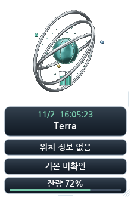

# Codex Orbit · LEVEL 3 - Practitioner

[LEVEL 1 - Beginner](%EB%A0%88%EB%B2%A81.md) · [LEVEL 2 - Explorer](%EB%A0%88%EB%B2%A82.md) · [LEVEL 3 - Practitioner](%EB%A0%88%EB%B2%A83.md) · [LEVEL 4 - Advanced](%EB%A0%88%EB%B2%A84.md) · [LEVEL 5 - Expert](%EB%A0%88%EB%B2%A85.md)

[같은 수준의 프로필](https://github.com/PUVKID/PUVKID/blob/main/docs/읽기안내/레벨3.md) · [프로젝트 첫 화면](../../README.md)

## LEVEL 3 · 기능과 확인 조건

| 기능 | 입력·조건 | 확인할 내용 |
| --- | --- | --- |
| 시작 | Windows 10/11 x64·OpenGL 3.3 | 단일 EXE 또는 현재 사용자 설치본을 사용합니다. |
| 지역 선택 | 자동·수동 선택과 검색 결과 확정 | 검색·취소만으로 수동 위치를 저장하지 않습니다. |
| 화면 확인 | 한국어·영어, 라이트·다크, 글자 배율 | 날씨·강수 집계 간격·원값과 상태를 함께 읽습니다. |
| 결과 확인 | 차수별 검증 범위와 전체 비교 | 실제 검사·합성 예시·미검증 범위를 구분합니다. |

## LEVEL 3 · 프로젝트 소개와 읽는 방법

Windows 실행 환경과 사용법·릴리스·보존 소스를 확인하고 실제 설정·관측·오래된 값을 화면과 대조하는 관점입니다. 합성 검증 화면을 자신의 계정 실측값으로 읽지 않습니다.

## LEVEL 3 · 실제 기능과 동작 범위

| 확인할 항목 (Checklist) | 본문의 핵심 조건 |
| --- | --- |
| 기능·동작 | 처음 감시는 과거 기록을 기준선으로 읽고 이후 새 변경을 알립니다. 제목 원문·정확한 모델 ID·알림 고정·북마크와 실패·미확인·오래된 한도를 실제 상태와 대조합니다. |
| 입력·처리·출력 | 감시 경로·현재 날짜·선택 모드·위치 출처와 한도 마지막 조회 시각을 확인합니다. 알림의 이전/현재 값과 기록 원문을 비교하고 방송·프라이버시 표시 범위를 점검합니다. |
| 결과·한계 | 화면별 합성 검증 범위와 실제 지원 환경·권리·자료 제외를 읽습니다. 미확인·오래된 값,명시 선택과 실행 관측,프라이버시 가림과 원문 보존을 실제 표시에서 나눕니다. |

처음 감시는 과거 기록을 기준선으로 읽고 이후 새 변경을 알립니다. 제목 원문·정확한 모델 ID·알림 고정·북마크와 실패·미확인·오래된 한도를 실제 상태와 대조합니다.

실행에 필요한 기능과 결과 확인 지점을 짝지어 읽습니다.

**기능별 공통 근거**

## LEVEL 3 · 입력에서 처리와 출력까지

감시 경로·현재 날짜·선택 모드·위치 출처와 한도 마지막 조회 시각을 확인합니다. 알림의 이전/현재 값과 기록 원문을 비교하고 방송·프라이버시 표시 범위를 점검합니다.

## LEVEL 3 · 사용·실험 순서와 확인 방법

Windows10/11 x64·OpenGL3.3 지원 드라이버와 실제 실행 파일을 확인합니다. 같은 데이터 폴더에 두 인스턴스를 동시에 실행하지 않고 언어·테마·모드·경로·알림·한도 stale·위치 추정을 점검합니다. 업데이트는 사용자가 공식 조회·SHA 검증을 확인한 뒤 준비합니다.

## LEVEL 3 · 결과와 한계를 해석하는 기준

화면별 합성 검증 범위와 실제 지원 환경·권리·자료 제외를 읽습니다. 미확인·오래된 값,명시 선택과 실행 관측,프라이버시 가림과 원문 보존을 실제 표시에서 나눕니다.

## LEVEL 3 · 구현과 핵심 파일을 연결해 읽기

실행·사용법·릴리스·공개 검증과 선택 차수 소스를 같은 시점으로 확인합니다. 방송 모드·진단ZIP·업데이트의 공개 제외·사용자 확인 조건을 점검하고 운영 원문을 게시하지 않습니다.

## LEVEL 3 · 용어와 실수하기 쉬운 구분

위젯은 바탕화면에 작게 띄우는 화면입니다. JSONL은 기록 한 건을 한 줄씩 저장하는 형식이고 감시는 그 파일의 새 기록을 읽는 일입니다. 모델·추론 강도는 기록에 담긴 설정·실행 관측 값이며 로컬 표시가 서버 신원을 증명하지는 않습니다. 렌더는 입체 모형을 화면 그림으로 만드는 계산이고 GPU는 그 그림 계산 장치입니다. 합성 화면은 검사용 예시 자료를 넣어 만든 화면입니다.

**설정 관측·실행 관측·기록된 공개 이유를 구분합니다.** 기록되지 않은 과거값·동기·작업 상태를 만들지 않습니다. 실제 계정 한도는 남은 비율이며 토큰 개수가 아닙니다. 합성 예시·목표 프레임·과거 렌더를 실제 계정 상태·서버 모델 신원·실측 성능으로 읽지 않습니다.

## LEVEL 3 · 전체 차수와 같은 수준의 상세 설명

차수 이름은 실제 보관 단위를 따릅니다. 부분본·시험 도구·최종 안내는 제품 버전과 구분하며, 폴더와 직전 비교를 함께 연결합니다.

| 차수 | 핵심 변경 | 자료 |
| --- | --- | --- |
| 1차 | Codex Orbit · 1차 | **자료 폴더:** [자료](../../history/01%EC%B0%A8) · **이 수준의 차수 설명:** [LEVEL 3 - Practitioner](../../history/01%EC%B0%A8/README.md#reading-level-3) · **직전 비교·범위:** [전체 비교](../../history/01%EC%B0%A8/%EC%A7%81%EC%A0%84%EC%B0%A8%EC%88%98.diff) |
| 2차 | Codex Orbit · 2차 | **자료 폴더:** [자료](../../history/02%EC%B0%A8) · **이 수준의 차수 설명:** [LEVEL 3 - Practitioner](../../history/02%EC%B0%A8/README.md#reading-level-3) · **직전 비교·범위:** [전체 비교](../../history/02%EC%B0%A8/%EC%A7%81%EC%A0%84%EC%B0%A8%EC%88%98.diff) |
| 3차 | Codex Orbit · 3차 | **자료 폴더:** [자료](../../history/03%EC%B0%A8) · **이 수준의 차수 설명:** [LEVEL 3 - Practitioner](../../history/03%EC%B0%A8/README.md#reading-level-3) · **직전 비교·범위:** [전체 비교](../../history/03%EC%B0%A8/%EC%A7%81%EC%A0%84%EC%B0%A8%EC%88%98.diff) |
| 4차 | Codex Orbit · 4차 | **자료 폴더:** [자료](../../history/04%EC%B0%A8) · **이 수준의 차수 설명:** [LEVEL 3 - Practitioner](../../history/04%EC%B0%A8/README.md#reading-level-3) · **직전 비교·범위:** [전체 비교](../../history/04%EC%B0%A8/%EC%A7%81%EC%A0%84%EC%B0%A8%EC%88%98.diff) |
| 5차 | Codex Orbit · 5차 | **자료 폴더:** [자료](../../history/05%EC%B0%A8) · **이 수준의 차수 설명:** [LEVEL 3 - Practitioner](../../history/05%EC%B0%A8/README.md#reading-level-3) · **직전 비교·범위:** [전체 비교](../../history/05%EC%B0%A8/%EC%A7%81%EC%A0%84%EC%B0%A8%EC%88%98.diff) |
| 6차 | Codex Orbit · 6차 | **자료 폴더:** [자료](../../history/06%EC%B0%A8) · **이 수준의 차수 설명:** [LEVEL 3 - Practitioner](../../history/06%EC%B0%A8/README.md#reading-level-3) · **직전 비교·범위:** [전체 비교](../../history/06%EC%B0%A8/%EC%A7%81%EC%A0%84%EC%B0%A8%EC%88%98.diff) |
| 7차 | Codex Orbit · 7차 | **자료 폴더:** [자료](../../history/07%EC%B0%A8) · **이 수준의 차수 설명:** [LEVEL 3 - Practitioner](../../history/07%EC%B0%A8/README.md#reading-level-3) · **직전 비교·범위:** [전체 비교](../../history/07%EC%B0%A8/%EC%A7%81%EC%A0%84%EC%B0%A8%EC%88%98.diff) |
| 8차 | Codex Orbit · 8차 | **자료 폴더:** [자료](../../history/08%EC%B0%A8) · **이 수준의 차수 설명:** [LEVEL 3 - Practitioner](../../history/08%EC%B0%A8/README.md#reading-level-3) · **직전 비교·범위:** [전체 비교](../../history/08%EC%B0%A8/%EC%A7%81%EC%A0%84%EC%B0%A8%EC%88%98.diff) |
| 9차 | Codex Orbit · 9차 | **자료 폴더:** [자료](../../history/09%EC%B0%A8) · **이 수준의 차수 설명:** [LEVEL 3 - Practitioner](../../history/09%EC%B0%A8/README.md#reading-level-3) · **직전 비교·범위:** [전체 비교](../../history/09%EC%B0%A8/%EC%A7%81%EC%A0%84%EC%B0%A8%EC%88%98.diff) |
| 10차 | Codex Orbit · 10차 | **자료 폴더:** [자료](../../history/10%EC%B0%A8) · **이 수준의 차수 설명:** [LEVEL 3 - Practitioner](../../history/10%EC%B0%A8/README.md#reading-level-3) · **직전 비교·범위:** [전체 비교](../../history/10%EC%B0%A8/%EC%A7%81%EC%A0%84%EC%B0%A8%EC%88%98.diff) |
| 11차 | Codex Orbit · 11차 | **자료 폴더:** [자료](../../history/11%EC%B0%A8) · **이 수준의 차수 설명:** [LEVEL 3 - Practitioner](../../history/11%EC%B0%A8/README.md#reading-level-3) · **직전 비교·범위:** [전체 비교](../../history/11%EC%B0%A8/%EC%A7%81%EC%A0%84%EC%B0%A8%EC%88%98.diff) |
| 12차 | Codex Orbit · 12차 | **자료 폴더:** [자료](../../history/12%EC%B0%A8) · **이 수준의 차수 설명:** [LEVEL 3 - Practitioner](../../history/12%EC%B0%A8/README.md#reading-level-3) · **직전 비교·범위:** [전체 비교](../../history/12%EC%B0%A8/%EC%A7%81%EC%A0%84%EC%B0%A8%EC%88%98.diff) |
| 13차 | Codex Orbit · 13차 | **자료 폴더:** [자료](../../history/13%EC%B0%A8) · **이 수준의 차수 설명:** [LEVEL 3 - Practitioner](../../history/13%EC%B0%A8/README.md#reading-level-3) · **직전 비교·범위:** [전체 비교](../../history/13%EC%B0%A8/%EC%A7%81%EC%A0%84%EC%B0%A8%EC%88%98.diff) |
| 14차 | Codex Orbit · 14차 | **자료 폴더:** [자료](../../history/14%EC%B0%A8) · **이 수준의 차수 설명:** [LEVEL 3 - Practitioner](../../history/14%EC%B0%A8/README.md#reading-level-3) · **직전 비교·범위:** [전체 비교](../../history/14%EC%B0%A8/%EC%A7%81%EC%A0%84%EC%B0%A8%EC%88%98.diff) |
| 15차 | Codex Orbit · 15차 | **자료 폴더:** [자료](../../history/15%EC%B0%A8) · **이 수준의 차수 설명:** [LEVEL 3 - Practitioner](../../history/15%EC%B0%A8/README.md#reading-level-3) · **직전 비교·범위:** [전체 비교](../../history/15%EC%B0%A8/%EC%A7%81%EC%A0%84%EC%B0%A8%EC%88%98.diff) |
| 16차 | Codex Orbit · 16차 | **자료 폴더:** [자료](../../history/16%EC%B0%A8) · **이 수준의 차수 설명:** [LEVEL 3 - Practitioner](../../history/16%EC%B0%A8/README.md#reading-level-3) · **직전 비교·범위:** [전체 비교](../../history/16%EC%B0%A8/%EC%A7%81%EC%A0%84%EC%B0%A8%EC%88%98.diff) |
| 17차 | Codex Orbit · 17차 | **자료 폴더:** [자료](../../history/17%EC%B0%A8) · **이 수준의 차수 설명:** [LEVEL 3 - Practitioner](../../history/17%EC%B0%A8/README.md#reading-level-3) · **직전 비교·범위:** [전체 비교](../../history/17%EC%B0%A8/%EC%A7%81%EC%A0%84%EC%B0%A8%EC%88%98.diff) |
| 18차 | Codex Orbit · 18차 | **자료 폴더:** [자료](../../history/18%EC%B0%A8) · **이 수준의 차수 설명:** [LEVEL 3 - Practitioner](../../history/18%EC%B0%A8/README.md#reading-level-3) · **직전 비교·범위:** [전체 비교](../../history/18%EC%B0%A8/%EC%A7%81%EC%A0%84%EC%B0%A8%EC%88%98.diff) |
| 19차 | Codex Orbit · 19차 | **자료 폴더:** [자료](../../history/19%EC%B0%A8) · **이 수준의 차수 설명:** [LEVEL 3 - Practitioner](../../history/19%EC%B0%A8/README.md#reading-level-3) · **직전 비교·범위:** [전체 비교](../../history/19%EC%B0%A8/%EC%A7%81%EC%A0%84%EC%B0%A8%EC%88%98.diff) |
| 20차 | Codex Orbit · 20차 | **자료 폴더:** [자료](../20%EC%B0%A8) · **이 수준의 차수 설명:** [LEVEL 3 - Practitioner](../20%EC%B0%A8/README.md#reading-level-3) · **직전 비교·범위:** [전체 비교](../20%EC%B0%A8/README.md) |
| 21차 | Codex Orbit · 21차 | **자료 폴더:** [자료](../../history/21%EC%B0%A8) · **이 수준의 차수 설명:** [LEVEL 3 - Practitioner](../../history/21%EC%B0%A8/README.md#reading-level-3) · **직전 비교·범위:** [전체 비교](../../history/21%EC%B0%A8/%EC%A7%81%EC%A0%84%EC%B0%A8%EC%88%98.diff) |
| 22차 | Codex Orbit · 22차 | **자료 폴더:** [자료](../../history/22%EC%B0%A8) · **이 수준의 차수 설명:** [LEVEL 3 - Practitioner](../../history/22%EC%B0%A8/README.md#reading-level-3) · **직전 비교·범위:** [전체 비교](../../history/22%EC%B0%A8/%EC%A7%81%EC%A0%84%EC%B0%A8%EC%88%98.diff) |
| 23차 | Codex Orbit · 23차 | **자료 폴더:** [자료](../../history/23%EC%B0%A8) · **이 수준의 차수 설명:** [LEVEL 3 - Practitioner](../../history/23%EC%B0%A8/README.md#reading-level-3) · **직전 비교·범위:** [전체 비교](../../history/23%EC%B0%A8/%EC%A7%81%EC%A0%84%EC%B0%A8%EC%88%98.diff) |
| 24차 | Codex Orbit · 24차 | **자료 폴더:** [자료](../../history/24%EC%B0%A8) · **이 수준의 차수 설명:** [LEVEL 3 - Practitioner](../../history/24%EC%B0%A8/README.md#reading-level-3) · **직전 비교·범위:** [전체 비교](../../history/24%EC%B0%A8/%EC%A7%81%EC%A0%84%EC%B0%A8%EC%88%98.diff) |
| 25차 | Codex Orbit · 25차 | **자료 폴더:** [자료](../../history/25) · **이 수준의 차수 설명:** [LEVEL 3 - Practitioner](../../history/25/README.md#reading-level-3) · **직전 비교·범위:** [전체 비교](../../history/25/%EC%A7%81%EC%A0%84%EC%B0%A8%EC%88%98.diff) |
| 26차 | Codex Orbit · 26차 | **자료 폴더:** [자료](../../history/26) · **이 수준의 차수 설명:** [LEVEL 3 - Practitioner](../../history/26/README.md#reading-level-3) · **직전 비교·범위:** [전체 비교](../../history/26/%EC%A7%81%EC%A0%84%EC%B0%A8%EC%88%98.diff) |
| 27차 | Codex Orbit · 27차 | **자료 폴더:** [자료](../../history/27) · **이 수준의 차수 설명:** [LEVEL 3 - Practitioner](../../history/27/README.md#reading-level-3) · **직전 비교·범위:** [전체 비교](../27%EC%B0%A8_%EC%A0%84%EC%B2%B4%EB%B3%80%EA%B2%BD.diff) |
| 28차 | Codex Orbit · 28차 | **자료 폴더:** [자료](../../history/28) · **이 수준의 차수 설명:** [LEVEL 3 - Practitioner](../../history/28/README.md#reading-level-3) · **직전 비교·범위:** [전체 비교](../28%EC%B0%A8_%EC%A0%84%EC%B2%B4%EB%B3%80%EA%B2%BD.diff) |
| 최종 | Codex Orbit · 최종 | **자료 폴더:** [자료](../%EC%B5%9C%EC%A2%85) · **이 수준의 차수 설명:** [LEVEL 3 - Practitioner](../%EC%B5%9C%EC%A2%85/README.md#reading-level-3) · **직전 비교·범위:** [전체 비교](../%EC%B5%9C%EC%A2%85/README.md) |
| 29차 | Codex Orbit · 29차 | **자료 폴더:** [자료](../../history/29%EC%B0%A8) · **이 수준의 차수 설명:** [LEVEL 3 - Practitioner](../../history/29%EC%B0%A8/README.md#reading-level-3) · **직전 비교·범위:** [전체 비교](../29%EC%B0%A8_%EC%A0%84%EC%B2%B4%EB%B3%80%EA%B2%BD.diff) |
| 30차 | Codex Orbit · 30차 | **자료 폴더:** [자료](../../history/30%EC%B0%A8) · **이 수준의 차수 설명:** [LEVEL 3 - Practitioner](../../history/30%EC%B0%A8/README.md#reading-level-3) · **직전 비교·범위:** [전체 비교](../../history/30%EC%B0%A8/%EC%A7%81%EC%A0%84%EC%B0%A8%EC%88%98.diff) |
| 31차 | 화면 마감과 테마 선택 | **자료 폴더:** [자료](../../history/31%EC%B0%A8) · **이 수준의 차수 설명:** [LEVEL 3 - Practitioner](../../history/31%EC%B0%A8/README.md#reading-level-3) · **직전 비교·범위:** [전체 비교](../../history/31%EC%B0%A8/%EC%A7%81%EC%A0%84%EC%B0%A8%EC%88%98.diff) |
| 32차 | 지역 검색과 날짜별 입체 조형 | **자료 폴더:** [자료](../../history/32%EC%B0%A8) · **이 수준의 차수 설명:** [LEVEL 3 - Practitioner](../../history/32%EC%B0%A8/README.md#reading-level-3) · **직전 비교·범위:** [전체 비교](../32%EC%B0%A8_%EC%A0%84%EC%B2%B4%EB%B3%80%EA%B2%BD.diff) |
| 33차 | 자동 위치·강수량·도시 행사 진행 자료 | **자료 폴더:** [자료 폴더](../../history/33차) · **상세 설명:** [상세 설명](../../history/33차/README.md#reading-level-3) · **직전 비교·범위:** [전체 비교·범위](../../history/33차/직전차수.diff) |
| 34차 | 픽셀 입체 조형과 도시 행사 | **자료 폴더:** [자료 폴더](../../history/34차) · **상세 설명:** [상세 설명](../../history/34차/README.md#reading-level-3) · **직전 비교·범위:** [전체 비교·범위](../34차_전체변경.diff) |
| 35차 | 개발자용 색상과 조명 | **자료 폴더:** [자료 폴더](../../history/35차) · **해당 수준 설명:** [같은 수준 상세](../../history/35차/README.md#reading-level-3) · **직전 비교 또는 범위:** [34차 이후 전체 변경](../../docs/35차_전체변경.diff) |

## LEVEL 3 · 논문·원고와 원본 자료의 범위

앱 소스·릴리스·설계·사용법·실제 배포본의 합성 검증 화면을 연결합니다. 20차 시안·21차 시안과 최종 상태 안내의 보존 범위를 구분하며 없는 소스·원고·제품 버전을 만들지 않습니다. 권리·공개 범위 원문을 함께 확인합니다.

## LEVEL 3 · 원래 모든 세부 설명으로 이동하기

설정값·코드 예제·실패 조건·측정 범위·화면과 파일별 안내를 생략하지 않도록 첫 화면의 전체 본문을 아래에 함께 둡니다. 각 항목은 이 페이지의 공통 근거로 바로 이동합니다. 원문에 담긴 이전 차수 조건을 현재 실행 조건으로 자동 적용하지 않습니다.

| 기존 항목 | 전체 근거 |
| --- | --- |
| Codex Orbit 3.2.0 | [원문 보기](#source-section-1) |
| 32차 · 지역 검색과 당일 입체 조형 | [원문 보기](#source-section-2) |
| 32차 실제 배포본의 합성 화면 | [원문 보기](#source-section-3) |
| 이전 31차 실제 배포본의 합성 화면 | [원문 보기](#source-section-4) |
| 31차 · 화면 마감과 테마 선택 | [원문 보기](#source-section-5) |
| 감시·표시·저장·업데이트의 연결 | [원문 보기](#source-section-6) |
| 30차 · 원래 날짜별 테마 기본 복원 | [원문 보기](#source-section-7) |
| 선택 가능한 29차 관측소 기능 | [원문 보기](#source-section-8) |
| 달력 모드와 기존 기능 | [원문 보기](#source-section-9) |
| 모든 차수와 실제 자료 | [원문 보기](#source-section-10) |
| 실행·소스와 권리 | [원문 보기](#source-section-11) |
| 이전29차 합성 예시 화면 | [원문 보기](#source-section-12) |

## LEVEL 3 · 항목별 자세한 풀이와 확인 지점

### LEVEL 3 · 32차 · 지역 검색과 당일 입체 조형

이 항목을 사용할 때는 다음 조건·파일·입출력을 실제 환경과 대조합니다.

날짜 위젯은 고리와 좌우 장식 없이 당일 대상 하나를 표시합니다. 기존 888개 월별 주제와 일반일 대상을 보존하고, 250개 국가·지역의 공휴일·지원 기념일에는 실제 행사명과 특집 조형을 적용합니다. 미래 법 개정과 모든 도시 축제까지 확정한 자료는 아닙니다.

지역 표시를 눌러 도시·주소·장소·국가를 직접 검색합니다. 선택 지점의 기온·날씨·습도·일출·일몰을 받아오며, 자동 IP 위치는 추정임을 표시합니다.

알림은 이전·현재 모델과 추론 강도를 나란히 비교하고 짧은 설명과 접을 수 있는 원문으로 정리했습니다. 화면은 흰색·슬레이트 블루와 다크 테마를 제공합니다.

당일 조형·지역 선택·IP 추정·전후 알림과 화면 테마를 확인합니다.

**확인 뒤 결과 읽기:** 888월 주제·250국가/지역의 지원 행사와 미래 법·모든 도시 축제의 미확정 범위를 구분합니다.

날짜 위젯은 고리와 좌우 장식 없이 당일 대상 하나를 표시합니다. 기존 888개 월별 주제와 일반일 대상을 보존하고, 250개 국가·지역의 공휴일·지원 기념일에는 실제 행사명과 특집 조형을 적용합니다. 미래 법 개정과 모든 도시 축제까지 확정한 자료는 아닙니다.

지역 표시를 눌러 도시·주소·장소·국가를 직접 검색합니다. 선택 지점의 기온·날씨·습도·일출·일몰을 받아오며, 자동 IP 위치는 추정임을 표시합니다.

알림은 이전·현재 모델과 추론 강도를 나란히 비교하고 짧은 설명과 접을 수 있는 원문으로 정리했습니다. 화면은 흰색·슬레이트 블루와 다크 테마를 제공합니다.

[이 항목의 전체 조건·원문](#source-section-2)

### LEVEL 3 · 32차 실제 배포본의 합성 화면

이 항목을 사용할 때는 다음 조건·파일·입출력을 실제 환경과 대조합니다.

실제 배포 EXE에서 개인 기록·네트워크 없이 검사한 화면입니다. 기온·습도·잔량과 모델 값은 합성 예시입니다. [검증 범위](../%EA%B3%B5%EA%B0%9C%EA%B2%80%EC%A6%9D_32%EC%B0%A8.md)

기온·습도·잔량·모델 값의 합성 표기와 공개 검증 범위를 읽습니다.

**확인 뒤 결과 읽기:** 실제 프로그램 렌더와 실제 계정·날씨·모델 관측값은 다른 증거입니다.

실제 배포 EXE에서 개인 기록·네트워크 없이 검사한 화면입니다. 기온·습도·잔량과 모델 값은 합성 예시입니다. [검증 범위](../%EA%B3%B5%EA%B0%9C%EA%B2%80%EC%A6%9D_32%EC%B0%A8.md)

[이 항목의 전체 조건·원문](#source-section-3)

### LEVEL 3 · 이전 31차 실제 배포본의 합성 화면

이 항목을 사용할 때는 다음 조건·파일·입출력을 실제 환경과 대조합니다.

개인 기록 없이 만든 합성 작업입니다. 모델·추론 값은 화면 검사용 예시이며 실제 실행 모델이나 계정 상태를 뜻하지 않습니다.

31차의 화면 형태와 합성 모델·추론 값을 구분합니다.

**확인 뒤 결과 읽기:** 예시를 현재 계정·실행 모델이나32차의 모든 상태 검증으로 확대하지 않습니다.

개인 기록 없이 만든 합성 작업입니다. 모델·추론 값은 화면 검사용 예시이며 실제 실행 모델이나 계정 상태를 뜻하지 않습니다.

[이 항목의 전체 조건·원문](#source-section-4)

### LEVEL 3 · 31차 · 화면 마감과 테마 선택

이 항목을 사용할 때는 다음 조건·파일·입출력을 실제 환경과 대조합니다.

시스템·라이트·다크 화면 테마를 즉시 적용하고 선택을 저장합니다. 언어·글자 크기·회전 속도는 같은 설정 영역에서 조절하고, 작업 현황에서 선택 설정과 최근 실행 관측을 구분합니다. 화면 설정 메뉴는 움직임 줄이기·가장자리 붙이기·알림 소리·성능과 화질·문제 확인용 파일 저장·새 버전 확인을 설명합니다. 프라이버시 모드는 화면의 제목과 작업 설명을 가리며 저장 원문을 유지합니다. 날짜별 과일·세 금속 링·날짜 규칙과 모델·추론 변경 알림은 유지합니다.

선택 저장·실제 관측 구분과 프라이버시 모드의 가림 범위를 확인합니다.

**확인 뒤 결과 읽기:** 표시를 가리는 기능과 저장 원문 삭제·모델 전환은 다릅니다.

시스템·라이트·다크 화면 테마를 즉시 적용하고 선택을 저장합니다. 언어·글자 크기·회전 속도는 같은 설정 영역에서 조절하고, 작업 현황에서 선택 설정과 최근 실행 관측을 구분합니다. 화면 설정 메뉴는 움직임 줄이기·가장자리 붙이기·알림 소리·성능과 화질·문제 확인용 파일 저장·새 버전 확인을 설명합니다. 프라이버시 모드는 화면의 제목과 작업 설명을 가리며 저장 원문을 유지합니다. 날짜별 과일·세 금속 링·날짜 규칙과 모델·추론 변경 알림은 유지합니다.

[이 항목의 전체 조건·원문](#source-section-5)

### LEVEL 3 · 감시·표시·저장·업데이트의 연결

이 항목을 사용할 때는 다음 조건·파일·입출력을 실제 환경과 대조합니다.

30차 소스에서 `notifier.Watcher`는 로컬 JSONL을 읽어 설정 관측·실행 관측·공개 이유를 구분하고 `app.py`가 알림·위젯·상세 이력을 표시합니다. `core.py`는 JSONL 꼬리 읽기·채팅 제목·화면 위치와 Markdown 적용/복구를 담당합니다. `activity.py`의 작업 상태와 `notice_format.py`의 표현을 렌더러의 장식 상태와 구분합니다.

기록 읽기 — 30차 notifier는 읽기 묶음512KiB·레코드2MiB·파일4096개·poll 총8MiB·대기256개·주기0.2초 상한을 둡니다. 최초 기준선과 새 기록 알림을 구분합니다.

표시 — calendar가 기본이며 명시 선택한 관측소는 유지합니다. calendar_renderer·observatory_scene의 GPU 그림과 실제 모델/추론 기록은 별개입니다.

계정 한도 — UsageClient가 codex.exe app-server를 QProcess 분리 파이프로 열고 읽기 요청합니다. 30초 갱신·12초 응답 제한·65초 이후 오래된 값 표시를 적용합니다.

연결 실패 — 한도 조회 실패 때 이전값을 stale로 표시하고 최대3회,3/6/9초 지연으로 다시 연결합니다. 미확인을0%로 바꾸지 않습니다.

종료 — UsageClient.close는 타이머와 pending을 정리하고 종료 요청 뒤500ms 대기, 필요하면 kill 후500ms 대기합니다.

배포 교체 — safe_update의 check→stage→apply 단계로 공식 릴리스·자산·SHA·로컬 경계를 검사하고 실행 확인 실패 시 이전 EXE를 복구합니다. MAX_DOWNLOAD는512MiB입니다.

사용자는 감시 경로·언어·표시 모드·모션/자원 품질을 고르고 새 알림의 이전/이후 값과 근거를 읽습니다.

날씨·사용 한도·업데이트는 네트워크 또는 App Server 기능이며 로컬 감시기의 기능 범위와 나눠 봅니다. 방송 모드와 진단 ZIP의 공개 제외 조건을 유지합니다. 실제 사용법·릴리스·빌드 안내와 차수별 함수/설정 참조는 아래에 연결되어 있습니다.

Watcher·core·activity·notice_format·UsageClient·safe_update의 실제 경계를 따라갑니다.

**확인 뒤 결과 읽기:** 자원 상한·stale·재연결·종료·SHA 복구 조건과 로컬/서버 증거 수준을 분리합니다.

**경계:** 기록 읽기

**실제 처리:** 30차 notifier는 읽기 묶음512KiB·레코드2MiB·파일4096개·poll 총8MiB·대기256개·주기0.2초 상한을 둡니다. 최초 기준선과 새 기록 알림을 구분합니다.

**경계:** 표시

**실제 처리:** calendar가 기본이며 명시 선택한 관측소는 유지합니다. calendar_renderer·observatory_scene의 GPU 그림과 실제 모델/추론 기록은 별개입니다.

**경계:** 계정 한도

**실제 처리:** UsageClient가 codex.exe app-server를 QProcess 분리 파이프로 열고 읽기 요청합니다. 30초 갱신·12초 응답 제한·65초 이후 오래된 값 표시를 적용합니다.

**경계:** 연결 실패

**실제 처리:** 한도 조회 실패 때 이전값을 stale로 표시하고 최대3회,3/6/9초 지연으로 다시 연결합니다. 미확인을0%로 바꾸지 않습니다.

**경계:** 종료

**실제 처리:** UsageClient.close는 타이머와 pending을 정리하고 종료 요청 뒤500ms 대기, 필요하면 kill 후500ms 대기합니다.

**경계:** 배포 교체

**실제 처리:** safe_update의 check→stage→apply 단계로 공식 릴리스·자산·SHA·로컬 경계를 검사하고 실행 확인 실패 시 이전 EXE를 복구합니다. MAX_DOWNLOAD는512MiB입니다.

[이 항목의 전체 조건·원문](#source-section-6)

### LEVEL 3 · 30차 · 원래 날짜별 테마 기본 복원

이 항목을 사용할 때는 다음 조건·파일·입출력을 실제 환경과 대조합니다.

설정에 표시 모드가 없는 경우에도 원래 날짜별 달력 조형을 표시합니다. 모델 변경 이벤트를 받아도 날짜 제목과 조형은 유지합니다. 888개 월 테마·일별 디자인·색·재질·날짜 규칙은 바꾸지 않았습니다. 이전/현재 모델·추론 강도·알림 기능도 유지합니다.

새 설정·모드 없는 기존 설정·모델 이벤트 후 날짜 유지와 명시 관측소를 확인합니다.

**확인 뒤 결과 읽기:** 기본값 복원을 월·일 자산 재제작이나 모델 변경 기능으로 읽지 않습니다.

설정에 표시 모드가 없는 경우에도 원래 날짜별 달력 조형을 표시합니다. 모델 변경 이벤트를 받아도 날짜 제목과 조형은 유지합니다. 888개 월 테마·일별 디자인·색·재질·날짜 규칙은 바꾸지 않았습니다. 이전/현재 모델·추론 강도·알림 기능도 유지합니다.

[이 항목의 전체 조건·원문](#source-section-7)

### LEVEL 3 · 선택 가능한 29차 관측소 기능

이 항목을 사용할 때는 다음 조건·파일·입출력을 실제 환경과 대조합니다.

은색 금속 링 세 개가 서로 다른 축에서 움직입니다. 솔의 태양·아스트라의 결정·테라의 구체·루나의 초승달 코어와 추론 강도별 입자 밀도를 구분합니다. 확인되지 않은 모델은 중립 조형으로 표시합니다.

위성은 기록에서 명시적으로 관측한 작업 상태를 표시합니다. 관심 채팅 고정·기록 북마크·자리비움 요약·시간 슬라이더 재생을 제공하며 재생은 실제 모델 설정을 바꾸지 않습니다.

알림은 채팅 제목·이전 모델과 추론 강도·현재 모델과 추론 강도·기록된 이유를 비교합니다. 정확한 모델 ID와 원문 기록은 보존하고 표시 제목의 장식 이모지를 정리합니다. 마우스를 올리면 자동 닫힘을 멈추고 알림을 고정할 수 있습니다.

방송 모드는 열린 알림·제목·작업·툴팁을 가립니다. 진단 ZIP은 대화·인증·경로·이벤트 원문을 제외한 항목만 로컬에 저장합니다. 업데이트는 사용자가 확인을 눌러 공식 릴리스를 조회하고 SHA-256 대조 후 준비하며, 교체 후 실행 확인 실패 시 이전 실행 파일로 복구합니다.

민트와 화이트 화면·나눔고딕 Bold를 사용합니다. 글자 크기·가장자리 도킹·펼침·재생/일시정지·모션 축소·자원 품질을 조절할 수 있으며 일시정지 중에도 알림 감시는 계속됩니다.

실제 한도는 **남은 사용 한도 비율**이며 남은 토큰 개수가 아닙니다. 미확인은 0%와 구분합니다. 선택 설정 관측과 실제 실행 기록 관측을 구분하며 로컬 기록이 서버 모델 신원을 보증하지 않습니다. 기록되지 않은 이유와 작업 상태를 만들어 내지 않습니다.

관심 고정·보관·자리비움·재생·방송·한도·업데이트와 모션 설정을 확인합니다.

**확인 뒤 결과 읽기:** 슬라이더는 기록 재생이며 실제 모델 복귀가 아니고 미확인 모델·한도를 확정값으로 채우지 않습니다.

- 은색 금속 링 세 개가 서로 다른 축에서 움직입니다. 솔의 태양·아스트라의 결정·테라의 구체·루나의 초승달 코어와 추론 강도별 입자 밀도를 구분합니다. 확인되지 않은 모델은 중립 조형으로 표시합니다.
- 위성은 기록에서 명시적으로 관측한 작업 상태를 표시합니다. 관심 채팅 고정·기록 북마크·자리비움 요약·시간 슬라이더 재생을 제공하며 재생은 실제 모델 설정을 바꾸지 않습니다.
- 알림은 채팅 제목·이전 모델과 추론 강도·현재 모델과 추론 강도·기록된 이유를 비교합니다. 정확한 모델 ID와 원문 기록은 보존하고 표시 제목의 장식 이모지를 정리합니다. 마우스를 올리면 자동 닫힘을 멈추고 알림을 고정할 수 있습니다.
- 방송 모드는 열린 알림·제목·작업·툴팁을 가립니다. 진단 ZIP은 대화·인증·경로·이벤트 원문을 제외한 항목만 로컬에 저장합니다. 업데이트는 사용자가 확인을 눌러 공식 릴리스를 조회하고 SHA-256 대조 후 준비하며, 교체 후 실행 확인 실패 시 이전 실행 파일로 복구합니다.
- 민트와 화이트 화면·나눔고딕 Bold를 사용합니다. 글자 크기·가장자리 도킹·펼침·재생/일시정지·모션 축소·자원 품질을 조절할 수 있으며 일시정지 중에도 알림 감시는 계속됩니다.

실제 한도는 **남은 사용 한도 비율**이며 남은 토큰 개수가 아닙니다. 미확인은 0%와 구분합니다. 선택 설정 관측과 실제 실행 기록 관측을 구분하며 로컬 기록이 서버 모델 신원을 보증하지 않습니다. 기록되지 않은 이유와 작업 상태를 만들어 내지 않습니다.

[이 항목의 전체 조건·원문](#source-section-8)

### LEVEL 3 · 달력 모드와 기존 기능

이 항목을 사용할 때는 다음 조건·파일·입출력을 실제 환경과 대조합니다.

2026~2099년의 [888개 월 테마](../%EC%97%B0%EB%8F%84%EB%B3%84_%EC%9B%94%EB%B3%84_%ED%85%8C%EB%A7%88_%EC%A0%84%EC%B2%B4.md)와 [CSV](../%EC%97%B0%EB%8F%84%EB%B3%84_%EC%9B%94%EB%B3%84_%ED%85%8C%EB%A7%88_%EC%A0%84%EC%B2%B4.csv), 날짜별 실제 메시 조형을 달력 모드로 보존합니다. 공통 생성 규칙을 재사용하므로 888개 수작업 모델을 뜻하지 않습니다. 한영 선택·날씨·IP 기반 지역·시계·속도 조절을 유지합니다. 하나의 GPU 작업자가 3840×2160 원본을 렌더하며 관측소 품질은 20/30/60fps 상한을 사용합니다. 실제 생성률과 모니터 표시율은 별개이고 고정 240fps 달성을 주장하지 않습니다.

2026~2099·888테마·공통 생성 규칙과 GPU 렌더·품질 상한을 읽습니다.

**확인 뒤 결과 읽기:** 수작업 모델 수·목표 생성률·실제 표시율·240fps 달성을 구분합니다.

2026~2099년의 [888개 월 테마](../%EC%97%B0%EB%8F%84%EB%B3%84_%EC%9B%94%EB%B3%84_%ED%85%8C%EB%A7%88_%EC%A0%84%EC%B2%B4.md)와 [CSV](../%EC%97%B0%EB%8F%84%EB%B3%84_%EC%9B%94%EB%B3%84_%ED%85%8C%EB%A7%88_%EC%A0%84%EC%B2%B4.csv), 날짜별 실제 메시 조형을 달력 모드로 보존합니다. 공통 생성 규칙을 재사용하므로 888개 수작업 모델을 뜻하지 않습니다. 한영 선택·날씨·IP 기반 지역·시계·속도 조절을 유지합니다. 하나의 GPU 작업자가 3840×2160 원본을 렌더하며 관측소 품질은 20/30/60fps 상한을 사용합니다. 실제 생성률과 모니터 표시율은 별개이고 고정 240fps 달성을 주장하지 않습니다.

[이 항목의 전체 조건·원문](#source-section-9)

### LEVEL 3 · 모든 차수와 실제 자료

20차 소스 부재·21차 시안·최종 상태 안내와 원본/공개SHA를 확인합니다.

**확인 뒤 결과 읽기:** 확인되지 않은 제품 버전·src·diff를 만들거나 비공개 검증 원문을 게시하지 않습니다.

| 차수 | 핵심 변경 | 자료 |
| --- | --- | --- |
| 1차 | Codex Orbit · 1차 | **자료 폴더·원본:** [자료 폴더](../../history/01%EC%B0%A8) · **상세 설명:** [상세 설명](../../history/01%EC%B0%A8/README.md#reading-level-3) · **직전 비교·범위:** [전체 비교·범위](../../history/01%EC%B0%A8/%EC%A7%81%EC%A0%84%EC%B0%A8%EC%88%98.diff) |
| 2차 | Codex Orbit · 2차 | **자료 폴더·원본:** [자료 폴더](../../history/02%EC%B0%A8) · **상세 설명:** [상세 설명](../../history/02%EC%B0%A8/README.md#reading-level-3) · **직전 비교·범위:** [전체 비교·범위](../../history/02%EC%B0%A8/%EC%A7%81%EC%A0%84%EC%B0%A8%EC%88%98.diff) |
| 3차 | Codex Orbit · 3차 | **자료 폴더·원본:** [자료 폴더](../../history/03%EC%B0%A8) · **상세 설명:** [상세 설명](../../history/03%EC%B0%A8/README.md#reading-level-3) · **직전 비교·범위:** [전체 비교·범위](../../history/03%EC%B0%A8/%EC%A7%81%EC%A0%84%EC%B0%A8%EC%88%98.diff) |
| 4차 | Codex Orbit · 4차 | **자료 폴더·원본:** [자료 폴더](../../history/04%EC%B0%A8) · **상세 설명:** [상세 설명](../../history/04%EC%B0%A8/README.md#reading-level-3) · **직전 비교·범위:** [전체 비교·범위](../../history/04%EC%B0%A8/%EC%A7%81%EC%A0%84%EC%B0%A8%EC%88%98.diff) |
| 5차 | Codex Orbit · 5차 | **자료 폴더·원본:** [자료 폴더](../../history/05%EC%B0%A8) · **상세 설명:** [상세 설명](../../history/05%EC%B0%A8/README.md#reading-level-3) · **직전 비교·범위:** [전체 비교·범위](../../history/05%EC%B0%A8/%EC%A7%81%EC%A0%84%EC%B0%A8%EC%88%98.diff) |
| 6차 | Codex Orbit · 6차 | **자료 폴더·원본:** [자료 폴더](../../history/06%EC%B0%A8) · **상세 설명:** [상세 설명](../../history/06%EC%B0%A8/README.md#reading-level-3) · **직전 비교·범위:** [전체 비교·범위](../../history/06%EC%B0%A8/%EC%A7%81%EC%A0%84%EC%B0%A8%EC%88%98.diff) |
| 7차 | Codex Orbit · 7차 | **자료 폴더·원본:** [자료 폴더](../../history/07%EC%B0%A8) · **상세 설명:** [상세 설명](../../history/07%EC%B0%A8/README.md#reading-level-3) · **직전 비교·범위:** [전체 비교·범위](../../history/07%EC%B0%A8/%EC%A7%81%EC%A0%84%EC%B0%A8%EC%88%98.diff) |
| 8차 | Codex Orbit · 8차 | **자료 폴더·원본:** [자료 폴더](../../history/08%EC%B0%A8) · **상세 설명:** [상세 설명](../../history/08%EC%B0%A8/README.md#reading-level-3) · **직전 비교·범위:** [전체 비교·범위](../../history/08%EC%B0%A8/%EC%A7%81%EC%A0%84%EC%B0%A8%EC%88%98.diff) |
| 9차 | Codex Orbit · 9차 | **자료 폴더·원본:** [자료 폴더](../../history/09%EC%B0%A8) · **상세 설명:** [상세 설명](../../history/09%EC%B0%A8/README.md#reading-level-3) · **직전 비교·범위:** [전체 비교·범위](../../history/09%EC%B0%A8/%EC%A7%81%EC%A0%84%EC%B0%A8%EC%88%98.diff) |
| 10차 | Codex Orbit · 10차 | **자료 폴더·원본:** [자료 폴더](../../history/10%EC%B0%A8) · **상세 설명:** [상세 설명](../../history/10%EC%B0%A8/README.md#reading-level-3) · **직전 비교·범위:** [전체 비교·범위](../../history/10%EC%B0%A8/%EC%A7%81%EC%A0%84%EC%B0%A8%EC%88%98.diff) |
| 11차 | Codex Orbit · 11차 | **자료 폴더·원본:** [자료 폴더](../../history/11%EC%B0%A8) · **상세 설명:** [상세 설명](../../history/11%EC%B0%A8/README.md#reading-level-3) · **직전 비교·범위:** [전체 비교·범위](../../history/11%EC%B0%A8/%EC%A7%81%EC%A0%84%EC%B0%A8%EC%88%98.diff) |
| 12차 | Codex Orbit · 12차 | **자료 폴더·원본:** [자료 폴더](../../history/12%EC%B0%A8) · **상세 설명:** [상세 설명](../../history/12%EC%B0%A8/README.md#reading-level-3) · **직전 비교·범위:** [전체 비교·범위](../../history/12%EC%B0%A8/%EC%A7%81%EC%A0%84%EC%B0%A8%EC%88%98.diff) |
| 13차 | Codex Orbit · 13차 | **자료 폴더·원본:** [자료 폴더](../../history/13%EC%B0%A8) · **상세 설명:** [상세 설명](../../history/13%EC%B0%A8/README.md#reading-level-3) · **직전 비교·범위:** [전체 비교·범위](../../history/13%EC%B0%A8/%EC%A7%81%EC%A0%84%EC%B0%A8%EC%88%98.diff) |
| 14차 | Codex Orbit · 14차 | **자료 폴더·원본:** [자료 폴더](../../history/14%EC%B0%A8) · **상세 설명:** [상세 설명](../../history/14%EC%B0%A8/README.md#reading-level-3) · **직전 비교·범위:** [전체 비교·범위](../../history/14%EC%B0%A8/%EC%A7%81%EC%A0%84%EC%B0%A8%EC%88%98.diff) |
| 15차 | Codex Orbit · 15차 | **자료 폴더·원본:** [자료 폴더](../../history/15%EC%B0%A8) · **상세 설명:** [상세 설명](../../history/15%EC%B0%A8/README.md#reading-level-3) · **직전 비교·범위:** [전체 비교·범위](../../history/15%EC%B0%A8/%EC%A7%81%EC%A0%84%EC%B0%A8%EC%88%98.diff) |
| 16차 | Codex Orbit · 16차 | **자료 폴더·원본:** [자료 폴더](../../history/16%EC%B0%A8) · **상세 설명:** [상세 설명](../../history/16%EC%B0%A8/README.md#reading-level-3) · **직전 비교·범위:** [전체 비교·범위](../../history/16%EC%B0%A8/%EC%A7%81%EC%A0%84%EC%B0%A8%EC%88%98.diff) |
| 17차 | Codex Orbit · 17차 | **자료 폴더·원본:** [자료 폴더](../../history/17%EC%B0%A8) · **상세 설명:** [상세 설명](../../history/17%EC%B0%A8/README.md#reading-level-3) · **직전 비교·범위:** [전체 비교·범위](../../history/17%EC%B0%A8/%EC%A7%81%EC%A0%84%EC%B0%A8%EC%88%98.diff) |
| 18차 | Codex Orbit · 18차 | **자료 폴더·원본:** [자료 폴더](../../history/18%EC%B0%A8) · **상세 설명:** [상세 설명](../../history/18%EC%B0%A8/README.md#reading-level-3) · **직전 비교·범위:** [전체 비교·범위](../../history/18%EC%B0%A8/%EC%A7%81%EC%A0%84%EC%B0%A8%EC%88%98.diff) |
| 19차 | Codex Orbit · 19차 | **자료 폴더·원본:** [자료 폴더](../../history/19%EC%B0%A8) · **상세 설명:** [상세 설명](../../history/19%EC%B0%A8/README.md#reading-level-3) · **직전 비교·범위:** [전체 비교·범위](../../history/19%EC%B0%A8/%EC%A7%81%EC%A0%84%EC%B0%A8%EC%88%98.diff) |
| 20차 | Codex Orbit · 20차 | **자료 폴더·원본:** [자료 폴더](../20%EC%B0%A8) · **상세 설명:** [상세 설명](../20%EC%B0%A8/README.md#reading-level-3) · **직전 비교·범위:** [전체 비교·범위](../20%EC%B0%A8/README.md) |
| 21차 | Codex Orbit · 21차 | **자료 폴더·원본:** [자료 폴더](../../history/21%EC%B0%A8) · **상세 설명:** [상세 설명](../../history/21%EC%B0%A8/README.md#reading-level-3) · **직전 비교·범위:** [전체 비교·범위](../../history/21%EC%B0%A8/%EC%A7%81%EC%A0%84%EC%B0%A8%EC%88%98.diff) |
| 22차 | Codex Orbit · 22차 | **자료 폴더·원본:** [자료 폴더](../../history/22%EC%B0%A8) · **상세 설명:** [상세 설명](../../history/22%EC%B0%A8/README.md#reading-level-3) · **직전 비교·범위:** [전체 비교·범위](../../history/22%EC%B0%A8/%EC%A7%81%EC%A0%84%EC%B0%A8%EC%88%98.diff) |
| 23차 | Codex Orbit · 23차 | **자료 폴더·원본:** [자료 폴더](../../history/23%EC%B0%A8) · **상세 설명:** [상세 설명](../../history/23%EC%B0%A8/README.md#reading-level-3) · **직전 비교·범위:** [전체 비교·범위](../../history/23%EC%B0%A8/%EC%A7%81%EC%A0%84%EC%B0%A8%EC%88%98.diff) |
| 24차 | Codex Orbit · 24차 | **자료 폴더·원본:** [자료 폴더](../../history/24%EC%B0%A8) · **상세 설명:** [상세 설명](../../history/24%EC%B0%A8/README.md#reading-level-3) · **직전 비교·범위:** [전체 비교·범위](../../history/24%EC%B0%A8/%EC%A7%81%EC%A0%84%EC%B0%A8%EC%88%98.diff) |
| 25차 | Codex Orbit · 25차 | **자료 폴더·원본:** [자료 폴더](../../history/25) · **상세 설명:** [상세 설명](../../history/25/README.md#reading-level-3) · **직전 비교·범위:** [전체 비교·범위](../../history/25/%EC%A7%81%EC%A0%84%EC%B0%A8%EC%88%98.diff) |
| 26차 | Codex Orbit · 26차 | **자료 폴더·원본:** [자료 폴더](../../history/26) · **상세 설명:** [상세 설명](../../history/26/README.md#reading-level-3) · **직전 비교·범위:** [전체 비교·범위](../../history/26/%EC%A7%81%EC%A0%84%EC%B0%A8%EC%88%98.diff) |
| 27차 | Codex Orbit · 27차 | **자료 폴더·원본:** [자료 폴더](../../history/27) · **상세 설명:** [상세 설명](../../history/27/README.md#reading-level-3) · **직전 비교·범위:** [전체 비교·범위](../27%EC%B0%A8_%EC%A0%84%EC%B2%B4%EB%B3%80%EA%B2%BD.diff) |
| 28차 | Codex Orbit · 28차 | **자료 폴더·원본:** [자료 폴더](../../history/28) · **상세 설명:** [상세 설명](../../history/28/README.md#reading-level-3) · **직전 비교·범위:** [전체 비교·범위](../28%EC%B0%A8_%EC%A0%84%EC%B2%B4%EB%B3%80%EA%B2%BD.diff) |
| 최종 | Codex Orbit · 최종 | **자료 폴더·원본:** [자료 폴더](../%EC%B5%9C%EC%A2%85) · **상세 설명:** [상세 설명](../%EC%B5%9C%EC%A2%85/README.md#reading-level-3) · **직전 비교·범위:** [전체 비교·범위](../%EC%B5%9C%EC%A2%85/README.md) |
| 29차 | Codex Orbit · 29차 | **자료 폴더·원본:** [자료 폴더](../../history/29%EC%B0%A8) · **상세 설명:** [상세 설명](../../history/29%EC%B0%A8/README.md#reading-level-3) · **직전 비교·범위:** [전체 비교·범위](../29%EC%B0%A8_%EC%A0%84%EC%B2%B4%EB%B3%80%EA%B2%BD.diff) · [소스 비교](../../history/29%EC%B0%A8/%EC%A7%81%EC%A0%84%EC%B0%A8%EC%88%98.diff) |
| 30차 | Codex Orbit · 30차 | **자료 폴더·원본:** [자료 폴더](../../history/30%EC%B0%A8) · **상세 설명:** [상세 설명](../../history/30%EC%B0%A8/README.md#reading-level-3) · **직전 비교·범위:** [전체 비교·범위](../../history/30%EC%B0%A8/%EC%A7%81%EC%A0%84%EC%B0%A8%EC%88%98.diff) |
| 31차 | 화면 마감과 테마 선택 | **자료 폴더·원본:** [자료 폴더](../../history/31%EC%B0%A8) · **상세 설명:** [상세 설명](../../history/31%EC%B0%A8/README.md#reading-level-3) · **직전 비교·범위:** [전체 비교·범위](../../history/31%EC%B0%A8/%EC%A7%81%EC%A0%84%EC%B0%A8%EC%88%98.diff) |
| 32차 | 지역 검색과 날짜별 입체 조형 | **자료 폴더·원본:** [자료 폴더](../../history/32%EC%B0%A8) · **상세 설명:** [상세 설명](../../history/32%EC%B0%A8/README.md#reading-level-3) · **직전 비교·범위:** [전체 비교·범위](../32%EC%B0%A8_%EC%A0%84%EC%B2%B4%EB%B3%80%EA%B2%BD.diff) |
| 33차 | 자동 위치·강수량·도시 행사 진행 자료 | **자료 폴더:** [자료 폴더](../../history/33차) · **상세 설명:** [상세 설명](../../history/33차/README.md#reading-level-3) · **직전 비교·범위:** [전체 비교·범위](../../history/33차/직전차수.diff) |
| 34차 | 픽셀 입체 조형과 도시 행사 | **자료 폴더:** [자료 폴더](../../history/34차) · **상세 설명:** [상세 설명](../../history/34차/README.md#reading-level-3) · **직전 비교·범위:** [전체 비교·범위](../34차_전체변경.diff) |
| 35차 | 개발자용 색상과 조명 | **자료 폴더:** [자료 폴더](../../history/35차) · **해당 수준 설명:** [같은 수준 상세](../../history/35차/README.md#reading-level-3) · **직전 비교 또는 범위:** [34차 이후 전체 변경](../../docs/35차_전체변경.diff) |

[이 항목의 전체 조건·원문](#source-section-10)

### LEVEL 3 · 실행·소스와 권리

이 항목을 사용할 때는 다음 조건·파일·입출력을 실제 환경과 대조합니다.

Windows 10/11 x64와 OpenGL 3.3을 지원하는 그래픽 드라이버가 필요합니다. 단일 EXE는 Python 설치 없이 실행하고 설치본은 현재 사용자용 바로가기·제거를 제공합니다. GPU 준비/실패는 정적 표식 또는 오류 설명으로 구분합니다.

공개 소스는 GitHub 자동 Source code ZIP 또는 이 저장소에서 받습니다. 비공개 전체 개발 ZIP·개인 대화·지침·인증 자료는 배포하지 않습니다. 기존 라이선스 고지를 보존하며 새 소스 라이선스를 임의 부여하지 않습니다. 재빌드는 `python -B -X utf8 tools/build_distribution.py`를 사용합니다. 원고가 없는 앱 작업으로 논문 PDF를 만들지 않았습니다.

Windows10/11x64·OpenGL3.3과 릴리스·소스·사용법·공개 범위를 대조합니다.

**확인 뒤 결과 읽기:** 로컬 기록·진단·인증·참조 자산의 제외와 사용 조건을 제품 기능과 분리합니다.

Windows 10/11 x64와 OpenGL 3.3을 지원하는 그래픽 드라이버가 필요합니다. 단일 EXE는 Python 설치 없이 실행하고 설치본은 현재 사용자용 바로가기·제거를 제공합니다. GPU 준비/실패는 정적 표식 또는 오류 설명으로 구분합니다.

공개 소스는 GitHub 자동 Source code ZIP 또는 이 저장소에서 받습니다. 비공개 전체 개발 ZIP·개인 대화·지침·인증 자료는 배포하지 않습니다. 기존 라이선스 고지를 보존하며 새 소스 라이선스를 임의 부여하지 않습니다. 재빌드는 `python -B -X utf8 tools/build_distribution.py`를 사용합니다. 원고가 없는 앱 작업으로 논문 PDF를 만들지 않았습니다.

[이 항목의 전체 조건·원문](#source-section-11)

### LEVEL 3 · 이전29차 합성 예시 화면

이 항목을 사용할 때는 다음 조건·파일·입출력을 실제 환경과 대조합니다.

다음 이미지는 실제 Qt 앱에 합성 이벤트와 예시 값을 넣은 화면이며 개인 채팅·실계정 수치가 아닙니다.

그림의 기능·합성 데이터와 실제 기기의 운영 관측을 나눕니다.

**확인 뒤 결과 읽기:** 예시 화면을 계정 한도·서버 모델 신원·새 성능의 증거로 사용하지 않습니다.

다음 이미지는 실제 Qt 앱에 합성 이벤트와 예시 값을 넣은 화면이며 개인 채팅·실계정 수치가 아닙니다.

[이 항목의 전체 조건·원문](#source-section-12)

## LEVEL 3 · 다음에 읽을 곳

같은 관점의 [프로필](https://github.com/PUVKID/PUVKID/blob/main/docs/읽기안내/레벨3.md)에서 다른 프로젝트로 이동하거나 위 차수표에서 구현의 변화를 읽습니다. 다른 깊이가 필요하면 페이지 위의 수준 선택을 이용합니다. 수치·예제 명령·비교 파일은 아래 전체 근거와 차수별 원문에서 함께 확인합니다.

## LEVEL 3 · 공통 근거 · 첫 화면의 원래 전체 설명

## Codex Orbit 3.2.0

연도·월·일에 맞춘 3D 테마를 기본으로 보여 주는 Windows 바탕화면 앱입니다. 관측소는 명시적으로 선택해 사용할 수 있습니다.

로컬 기록에서 확인한 모델·추론 강도 변화와 작업 상태를 보여 주며, 실제 계정 사용 한도 비율·시계·기온을 함께 확인할 수 있습니다.

[English](../../README.en.md) · [다운로드](../DOWNLOADS.md) · [사용법](../%EC%82%AC%EC%9A%A9%EB%B2%95.md) · [검증 범위](../%EA%B3%B5%EA%B0%9C%EA%B2%80%EC%A6%9D_32%EC%B0%A8.md) · [변경 기록](../../%EB%B3%80%EA%B2%BD%EA%B8%B0%EB%A1%9D_32%EC%B0%A8.md) · [권리·공개 범위](../../%EA%B3%B5%EA%B0%9C%EB%B2%94%EC%9C%84.md)

## 32차 · 지역 검색과 당일 입체 조형

날짜 위젯은 고리와 좌우 장식 없이 당일 대상 하나를 표시합니다. 기존 888개 월별 주제와 일반일 대상을 보존하고, 250개 국가·지역의 공휴일·지원 기념일에는 실제 행사명과 특집 조형을 적용합니다. 미래 법 개정과 모든 도시 축제까지 확정한 자료는 아닙니다.

지역 표시를 눌러 도시·주소·장소·국가를 직접 검색합니다. 선택 지점의 기온·날씨·습도·일출·일몰을 받아오며, 자동 IP 위치는 추정임을 표시합니다.

알림은 이전·현재 모델과 추론 강도를 나란히 비교하고 짧은 설명과 접을 수 있는 원문으로 정리했습니다. 화면은 흰색·슬레이트 블루와 다크 테마를 제공합니다.

[32차 상세](../../history/32%EC%B0%A8/README.md#reading-level-3) · [변경 기록](../../%EB%B3%80%EA%B2%BD%EA%B8%B0%EB%A1%9D_32%EC%B0%A8.md) · [지역·행사 범위](../2026-11-10_32%EC%B0%A8_%EC%A7%80%EC%97%AD%EA%B2%80%EC%83%89%EA%B3%BC%EA%B5%AD%EA%B0%80%EB%B3%84%ED%96%89%EC%82%AC_%EC%B6%94%EA%B0%80%EB%AA%85%EC%84%B8.md)

## 32차 실제 배포본의 합성 화면

실제 배포 EXE에서 개인 기록·네트워크 없이 검사한 화면입니다. 기온·습도·잔량과 모델 값은 합성 예시입니다. [검증 범위](../%EA%B3%B5%EA%B0%9C%EA%B2%80%EC%A6%9D_32%EC%B0%A8.md)

## 이전 31차 실제 배포본의 합성 화면

개인 기록 없이 만든 합성 작업입니다. 모델·추론 값은 화면 검사용 예시이며 실제 실행 모델이나 계정 상태를 뜻하지 않습니다.

## 31차 · 화면 마감과 테마 선택

시스템·라이트·다크 화면 테마를 즉시 적용하고 선택을 저장합니다. 언어·글자 크기·회전 속도는 같은 설정 영역에서 조절하고, 작업 현황에서 선택 설정과 최근 실행 관측을 구분합니다. 화면 설정 메뉴는 움직임 줄이기·가장자리 붙이기·알림 소리·성능과 화질·문제 확인용 파일 저장·새 버전 확인을 설명합니다. 프라이버시 모드는 화면의 제목과 작업 설명을 가리며 저장 원문을 유지합니다. 날짜별 과일·세 금속 링·날짜 규칙과 모델·추론 변경 알림은 유지합니다.

[31차 상세](../../history/31%EC%B0%A8/README.md#reading-level-3) · [변경 기록](../../%EB%B3%80%EA%B2%BD%EA%B8%B0%EB%A1%9D_32%EC%B0%A8.md)

## 감시·표시·저장·업데이트의 연결

30차 소스에서 `notifier.Watcher`는 로컬 JSONL을 읽어 설정 관측·실행 관측·공개 이유를 구분하고 `app.py`가 알림·위젯·상세 이력을 표시합니다. `core.py`는 JSONL 꼬리 읽기·채팅 제목·화면 위치와 Markdown 적용/복구를 담당합니다. `activity.py`의 작업 상태와 `notice_format.py`의 표현을 렌더러의 장식 상태와 구분합니다.

**경계:** 기록 읽기

**실제 처리:** 30차 notifier는 읽기 묶음512KiB·레코드2MiB·파일4096개·poll 총8MiB·대기256개·주기0.2초 상한을 둡니다. 최초 기준선과 새 기록 알림을 구분합니다.

**경계:** 표시

**실제 처리:** calendar가 기본이며 명시 선택한 관측소는 유지합니다. calendar_renderer·observatory_scene의 GPU 그림과 실제 모델/추론 기록은 별개입니다.

**경계:** 계정 한도

**실제 처리:** UsageClient가 codex.exe app-server를 QProcess 분리 파이프로 열고 읽기 요청합니다. 30초 갱신·12초 응답 제한·65초 이후 오래된 값 표시를 적용합니다.

**경계:** 연결 실패

**실제 처리:** 한도 조회 실패 때 이전값을 stale로 표시하고 최대3회,3/6/9초 지연으로 다시 연결합니다. 미확인을0%로 바꾸지 않습니다.

**경계:** 종료

**실제 처리:** UsageClient.close는 타이머와 pending을 정리하고 종료 요청 뒤500ms 대기, 필요하면 kill 후500ms 대기합니다.

**경계:** 배포 교체

**실제 처리:** safe_update의 check→stage→apply 단계로 공식 릴리스·자산·SHA·로컬 경계를 검사하고 실행 확인 실패 시 이전 EXE를 복구합니다. MAX_DOWNLOAD는512MiB입니다.

사용자는 감시 경로·언어·표시 모드·모션/자원 품질을 고르고 새 알림의 이전/이후 값과 근거를 읽습니다.

날씨·사용 한도·업데이트는 네트워크 또는 App Server 기능이며 로컬 감시기의 기능 범위와 나눠 봅니다. 방송 모드와 진단 ZIP의 공개 제외 조건을 유지합니다. 실제 사용법·릴리스·빌드 안내와 차수별 함수/설정 참조는 아래에 연결되어 있습니다.

[각 차수의 코드·조건·관측·전체 비교](../REVISION_INDEX.md)

## 30차 · 원래 날짜별 테마 기본 복원

설정에 표시 모드가 없는 경우에도 원래 날짜별 달력 조형을 표시합니다. 모델 변경 이벤트를 받아도 날짜 제목과 조형은 유지합니다. 888개 월 테마·일별 디자인·색·재질·날짜 규칙은 바꾸지 않았습니다. 이전/현재 모델·추론 강도·알림 기능도 유지합니다.

[30차 변경 기록](../../%EB%B3%80%EA%B2%BD%EA%B8%B0%EB%A1%9D_30%EC%B0%A8.md) · [검증 범위](../%EA%B3%B5%EA%B0%9C%EA%B2%80%EC%A6%9D_30%EC%B0%A8.md) · [29차와 전체 비교](../30%EC%B0%A8_%EC%A0%84%EC%B2%B4%EB%B3%80%EA%B2%BD.diff)

## 선택 가능한 29차 관측소 기능

- 은색 금속 링 세 개가 서로 다른 축에서 움직입니다. 솔의 태양·아스트라의 결정·테라의 구체·루나의 초승달 코어와 추론 강도별 입자 밀도를 구분합니다. 확인되지 않은 모델은 중립 조형으로 표시합니다.
- 위성은 기록에서 명시적으로 관측한 작업 상태를 표시합니다. 관심 채팅 고정·기록 북마크·자리비움 요약·시간 슬라이더 재생을 제공하며 재생은 실제 모델 설정을 바꾸지 않습니다.
- 알림은 채팅 제목·이전 모델과 추론 강도·현재 모델과 추론 강도·기록된 이유를 비교합니다. 정확한 모델 ID와 원문 기록은 보존하고 표시 제목의 장식 이모지를 정리합니다. 마우스를 올리면 자동 닫힘을 멈추고 알림을 고정할 수 있습니다.
- 방송 모드는 열린 알림·제목·작업·툴팁을 가립니다. 진단 ZIP은 대화·인증·경로·이벤트 원문을 제외한 항목만 로컬에 저장합니다. 업데이트는 사용자가 확인을 눌러 공식 릴리스를 조회하고 SHA-256 대조 후 준비하며, 교체 후 실행 확인 실패 시 이전 실행 파일로 복구합니다.
- 민트와 화이트 화면·나눔고딕 Bold를 사용합니다. 글자 크기·가장자리 도킹·펼침·재생/일시정지·모션 축소·자원 품질을 조절할 수 있으며 일시정지 중에도 알림 감시는 계속됩니다.

실제 한도는 **남은 사용 한도 비율**이며 남은 토큰 개수가 아닙니다. 미확인은 0%와 구분합니다. 선택 설정 관측과 실제 실행 기록 관측을 구분하며 로컬 기록이 서버 모델 신원을 보증하지 않습니다. 기록되지 않은 이유와 작업 상태를 만들어 내지 않습니다.

## 달력 모드와 기존 기능

2026~2099년의 [888개 월 테마](../%EC%97%B0%EB%8F%84%EB%B3%84_%EC%9B%94%EB%B3%84_%ED%85%8C%EB%A7%88_%EC%A0%84%EC%B2%B4.md)와 [CSV](../%EC%97%B0%EB%8F%84%EB%B3%84_%EC%9B%94%EB%B3%84_%ED%85%8C%EB%A7%88_%EC%A0%84%EC%B2%B4.csv), 날짜별 실제 메시 조형을 달력 모드로 보존합니다. 공통 생성 규칙을 재사용하므로 888개 수작업 모델을 뜻하지 않습니다. 한영 선택·날씨·IP 기반 지역·시계·속도 조절을 유지합니다. 하나의 GPU 작업자가 3840×2160 원본을 렌더하며 관측소 품질은 20/30/60fps 상한을 사용합니다. 실제 생성률과 모니터 표시율은 별개이고 고정 240fps 달성을 주장하지 않습니다.

## 모든 차수와 실제 자료

[전체 목차](../REVISION_INDEX.md) · [차수별 보조 자료·시안·제외 대응](../ARCHIVE_FILES.md)

<!-- 차수표 시작 -->
| 차수 | 핵심 변경 | 자료 |
| --- | --- | --- |
| 1차 | Codex Orbit · 1차 | **자료 폴더·원본:** [자료 폴더](../../history/01%EC%B0%A8) · **상세 설명:** [상세 설명](../../history/01%EC%B0%A8/README.md#reading-level-3) · **직전 비교·범위:** [전체 비교·범위](../../history/01%EC%B0%A8/%EC%A7%81%EC%A0%84%EC%B0%A8%EC%88%98.diff) |
| 2차 | Codex Orbit · 2차 | **자료 폴더·원본:** [자료 폴더](../../history/02%EC%B0%A8) · **상세 설명:** [상세 설명](../../history/02%EC%B0%A8/README.md#reading-level-3) · **직전 비교·범위:** [전체 비교·범위](../../history/02%EC%B0%A8/%EC%A7%81%EC%A0%84%EC%B0%A8%EC%88%98.diff) |
| 3차 | Codex Orbit · 3차 | **자료 폴더·원본:** [자료 폴더](../../history/03%EC%B0%A8) · **상세 설명:** [상세 설명](../../history/03%EC%B0%A8/README.md#reading-level-3) · **직전 비교·범위:** [전체 비교·범위](../../history/03%EC%B0%A8/%EC%A7%81%EC%A0%84%EC%B0%A8%EC%88%98.diff) |
| 4차 | Codex Orbit · 4차 | **자료 폴더·원본:** [자료 폴더](../../history/04%EC%B0%A8) · **상세 설명:** [상세 설명](../../history/04%EC%B0%A8/README.md#reading-level-3) · **직전 비교·범위:** [전체 비교·범위](../../history/04%EC%B0%A8/%EC%A7%81%EC%A0%84%EC%B0%A8%EC%88%98.diff) |
| 5차 | Codex Orbit · 5차 | **자료 폴더·원본:** [자료 폴더](../../history/05%EC%B0%A8) · **상세 설명:** [상세 설명](../../history/05%EC%B0%A8/README.md#reading-level-3) · **직전 비교·범위:** [전체 비교·범위](../../history/05%EC%B0%A8/%EC%A7%81%EC%A0%84%EC%B0%A8%EC%88%98.diff) |
| 6차 | Codex Orbit · 6차 | **자료 폴더·원본:** [자료 폴더](../../history/06%EC%B0%A8) · **상세 설명:** [상세 설명](../../history/06%EC%B0%A8/README.md#reading-level-3) · **직전 비교·범위:** [전체 비교·범위](../../history/06%EC%B0%A8/%EC%A7%81%EC%A0%84%EC%B0%A8%EC%88%98.diff) |
| 7차 | Codex Orbit · 7차 | **자료 폴더·원본:** [자료 폴더](../../history/07%EC%B0%A8) · **상세 설명:** [상세 설명](../../history/07%EC%B0%A8/README.md#reading-level-3) · **직전 비교·범위:** [전체 비교·범위](../../history/07%EC%B0%A8/%EC%A7%81%EC%A0%84%EC%B0%A8%EC%88%98.diff) |
| 8차 | Codex Orbit · 8차 | **자료 폴더·원본:** [자료 폴더](../../history/08%EC%B0%A8) · **상세 설명:** [상세 설명](../../history/08%EC%B0%A8/README.md#reading-level-3) · **직전 비교·범위:** [전체 비교·범위](../../history/08%EC%B0%A8/%EC%A7%81%EC%A0%84%EC%B0%A8%EC%88%98.diff) |
| 9차 | Codex Orbit · 9차 | **자료 폴더·원본:** [자료 폴더](../../history/09%EC%B0%A8) · **상세 설명:** [상세 설명](../../history/09%EC%B0%A8/README.md#reading-level-3) · **직전 비교·범위:** [전체 비교·범위](../../history/09%EC%B0%A8/%EC%A7%81%EC%A0%84%EC%B0%A8%EC%88%98.diff) |
| 10차 | Codex Orbit · 10차 | **자료 폴더·원본:** [자료 폴더](../../history/10%EC%B0%A8) · **상세 설명:** [상세 설명](../../history/10%EC%B0%A8/README.md#reading-level-3) · **직전 비교·범위:** [전체 비교·범위](../../history/10%EC%B0%A8/%EC%A7%81%EC%A0%84%EC%B0%A8%EC%88%98.diff) |
| 11차 | Codex Orbit · 11차 | **자료 폴더·원본:** [자료 폴더](../../history/11%EC%B0%A8) · **상세 설명:** [상세 설명](../../history/11%EC%B0%A8/README.md#reading-level-3) · **직전 비교·범위:** [전체 비교·범위](../../history/11%EC%B0%A8/%EC%A7%81%EC%A0%84%EC%B0%A8%EC%88%98.diff) |
| 12차 | Codex Orbit · 12차 | **자료 폴더·원본:** [자료 폴더](../../history/12%EC%B0%A8) · **상세 설명:** [상세 설명](../../history/12%EC%B0%A8/README.md#reading-level-3) · **직전 비교·범위:** [전체 비교·범위](../../history/12%EC%B0%A8/%EC%A7%81%EC%A0%84%EC%B0%A8%EC%88%98.diff) |
| 13차 | Codex Orbit · 13차 | **자료 폴더·원본:** [자료 폴더](../../history/13%EC%B0%A8) · **상세 설명:** [상세 설명](../../history/13%EC%B0%A8/README.md#reading-level-3) · **직전 비교·범위:** [전체 비교·범위](../../history/13%EC%B0%A8/%EC%A7%81%EC%A0%84%EC%B0%A8%EC%88%98.diff) |
| 14차 | Codex Orbit · 14차 | **자료 폴더·원본:** [자료 폴더](../../history/14%EC%B0%A8) · **상세 설명:** [상세 설명](../../history/14%EC%B0%A8/README.md#reading-level-3) · **직전 비교·범위:** [전체 비교·범위](../../history/14%EC%B0%A8/%EC%A7%81%EC%A0%84%EC%B0%A8%EC%88%98.diff) |
| 15차 | Codex Orbit · 15차 | **자료 폴더·원본:** [자료 폴더](../../history/15%EC%B0%A8) · **상세 설명:** [상세 설명](../../history/15%EC%B0%A8/README.md#reading-level-3) · **직전 비교·범위:** [전체 비교·범위](../../history/15%EC%B0%A8/%EC%A7%81%EC%A0%84%EC%B0%A8%EC%88%98.diff) |
| 16차 | Codex Orbit · 16차 | **자료 폴더·원본:** [자료 폴더](../../history/16%EC%B0%A8) · **상세 설명:** [상세 설명](../../history/16%EC%B0%A8/README.md#reading-level-3) · **직전 비교·범위:** [전체 비교·범위](../../history/16%EC%B0%A8/%EC%A7%81%EC%A0%84%EC%B0%A8%EC%88%98.diff) |
| 17차 | Codex Orbit · 17차 | **자료 폴더·원본:** [자료 폴더](../../history/17%EC%B0%A8) · **상세 설명:** [상세 설명](../../history/17%EC%B0%A8/README.md#reading-level-3) · **직전 비교·범위:** [전체 비교·범위](../../history/17%EC%B0%A8/%EC%A7%81%EC%A0%84%EC%B0%A8%EC%88%98.diff) |
| 18차 | Codex Orbit · 18차 | **자료 폴더·원본:** [자료 폴더](../../history/18%EC%B0%A8) · **상세 설명:** [상세 설명](../../history/18%EC%B0%A8/README.md#reading-level-3) · **직전 비교·범위:** [전체 비교·범위](../../history/18%EC%B0%A8/%EC%A7%81%EC%A0%84%EC%B0%A8%EC%88%98.diff) |
| 19차 | Codex Orbit · 19차 | **자료 폴더·원본:** [자료 폴더](../../history/19%EC%B0%A8) · **상세 설명:** [상세 설명](../../history/19%EC%B0%A8/README.md#reading-level-3) · **직전 비교·범위:** [전체 비교·범위](../../history/19%EC%B0%A8/%EC%A7%81%EC%A0%84%EC%B0%A8%EC%88%98.diff) |
| 20차 | Codex Orbit · 20차 | **자료 폴더·원본:** [자료 폴더](../20%EC%B0%A8) · **상세 설명:** [상세 설명](../20%EC%B0%A8/README.md#reading-level-3) · **직전 비교·범위:** [전체 비교·범위](../20%EC%B0%A8/README.md) |
| 21차 | Codex Orbit · 21차 | **자료 폴더·원본:** [자료 폴더](../../history/21%EC%B0%A8) · **상세 설명:** [상세 설명](../../history/21%EC%B0%A8/README.md#reading-level-3) · **직전 비교·범위:** [전체 비교·범위](../../history/21%EC%B0%A8/%EC%A7%81%EC%A0%84%EC%B0%A8%EC%88%98.diff) |
| 22차 | Codex Orbit · 22차 | **자료 폴더·원본:** [자료 폴더](../../history/22%EC%B0%A8) · **상세 설명:** [상세 설명](../../history/22%EC%B0%A8/README.md#reading-level-3) · **직전 비교·범위:** [전체 비교·범위](../../history/22%EC%B0%A8/%EC%A7%81%EC%A0%84%EC%B0%A8%EC%88%98.diff) |
| 23차 | Codex Orbit · 23차 | **자료 폴더·원본:** [자료 폴더](../../history/23%EC%B0%A8) · **상세 설명:** [상세 설명](../../history/23%EC%B0%A8/README.md#reading-level-3) · **직전 비교·범위:** [전체 비교·범위](../../history/23%EC%B0%A8/%EC%A7%81%EC%A0%84%EC%B0%A8%EC%88%98.diff) |
| 24차 | Codex Orbit · 24차 | **자료 폴더·원본:** [자료 폴더](../../history/24%EC%B0%A8) · **상세 설명:** [상세 설명](../../history/24%EC%B0%A8/README.md#reading-level-3) · **직전 비교·범위:** [전체 비교·범위](../../history/24%EC%B0%A8/%EC%A7%81%EC%A0%84%EC%B0%A8%EC%88%98.diff) |
| 25차 | Codex Orbit · 25차 | **자료 폴더·원본:** [자료 폴더](../../history/25) · **상세 설명:** [상세 설명](../../history/25/README.md#reading-level-3) · **직전 비교·범위:** [전체 비교·범위](../../history/25/%EC%A7%81%EC%A0%84%EC%B0%A8%EC%88%98.diff) |
| 26차 | Codex Orbit · 26차 | **자료 폴더·원본:** [자료 폴더](../../history/26) · **상세 설명:** [상세 설명](../../history/26/README.md#reading-level-3) · **직전 비교·범위:** [전체 비교·범위](../../history/26/%EC%A7%81%EC%A0%84%EC%B0%A8%EC%88%98.diff) |
| 27차 | Codex Orbit · 27차 | **자료 폴더·원본:** [자료 폴더](../../history/27) · **상세 설명:** [상세 설명](../../history/27/README.md#reading-level-3) · **직전 비교·범위:** [전체 비교·범위](../27%EC%B0%A8_%EC%A0%84%EC%B2%B4%EB%B3%80%EA%B2%BD.diff) |
| 28차 | Codex Orbit · 28차 | **자료 폴더·원본:** [자료 폴더](../../history/28) · **상세 설명:** [상세 설명](../../history/28/README.md#reading-level-3) · **직전 비교·범위:** [전체 비교·범위](../28%EC%B0%A8_%EC%A0%84%EC%B2%B4%EB%B3%80%EA%B2%BD.diff) |
| 최종 | Codex Orbit · 최종 | **자료 폴더·원본:** [자료 폴더](../%EC%B5%9C%EC%A2%85) · **상세 설명:** [상세 설명](../%EC%B5%9C%EC%A2%85/README.md#reading-level-3) · **직전 비교·범위:** [전체 비교·범위](../%EC%B5%9C%EC%A2%85/README.md) |
| 29차 | Codex Orbit · 29차 | **자료 폴더·원본:** [자료 폴더](../../history/29%EC%B0%A8) · **상세 설명:** [상세 설명](../../history/29%EC%B0%A8/README.md#reading-level-3) · **직전 비교·범위:** [전체 비교·범위](../29%EC%B0%A8_%EC%A0%84%EC%B2%B4%EB%B3%80%EA%B2%BD.diff) · [소스 비교](../../history/29%EC%B0%A8/%EC%A7%81%EC%A0%84%EC%B0%A8%EC%88%98.diff) |
| 30차 | Codex Orbit · 30차 | **자료 폴더·원본:** [자료 폴더](../../history/30%EC%B0%A8) · **상세 설명:** [상세 설명](../../history/30%EC%B0%A8/README.md#reading-level-3) · **직전 비교·범위:** [전체 비교·범위](../../history/30%EC%B0%A8/%EC%A7%81%EC%A0%84%EC%B0%A8%EC%88%98.diff) |
| 31차 | 화면 마감과 테마 선택 | **자료 폴더·원본:** [자료 폴더](../../history/31%EC%B0%A8) · **상세 설명:** [상세 설명](../../history/31%EC%B0%A8/README.md#reading-level-3) · **직전 비교·범위:** [전체 비교·범위](../../history/31%EC%B0%A8/%EC%A7%81%EC%A0%84%EC%B0%A8%EC%88%98.diff) |
| 32차 | 지역 검색과 날짜별 입체 조형 | **자료 폴더·원본:** [자료 폴더](../../history/32%EC%B0%A8) · **상세 설명:** [상세 설명](../../history/32%EC%B0%A8/README.md#reading-level-3) · **직전 비교·범위:** [전체 비교·범위](../32%EC%B0%A8_%EC%A0%84%EC%B2%B4%EB%B3%80%EA%B2%BD.diff) |
| 33차 | 자동 위치·강수량·도시 행사 진행 자료 | **자료 폴더:** [자료 폴더](../../history/33차) · **상세 설명:** [상세 설명](../../history/33차/README.md#reading-level-3) · **직전 비교·범위:** [전체 비교·범위](../../history/33차/직전차수.diff) |
| 34차 | 픽셀 입체 조형과 도시 행사 | **자료 폴더:** [자료 폴더](../../history/34차) · **상세 설명:** [상세 설명](../../history/34차/README.md#reading-level-3) · **직전 비교·범위:** [전체 비교·범위](../34차_전체변경.diff) |
| 35차 | 개발자용 색상과 조명 | **자료 폴더:** [자료 폴더](../../history/35차) · **해당 수준 설명:** [같은 수준 상세](../../history/35차/README.md#reading-level-3) · **직전 비교 또는 범위:** [34차 이후 전체 변경](../../docs/35차_전체변경.diff) |
<!-- 차수표 끝 -->

원본 소스 비교에는 주석·공백·개행과 신규·삭제 상태를 포함합니다. 20차는 실행 소스 없이 38개 시안, 21차는 110개 시안을 보존합니다. 최종 폴더의 개인 운영 검증 원문은 공개하지 않습니다. 역사 자료 2,281개 항목의 보존·정제·제외 사유와 원본/공개 SHA를 차수별로 연결했습니다.

## 실행·소스와 권리

Windows 10/11 x64와 OpenGL 3.3을 지원하는 그래픽 드라이버가 필요합니다. 단일 EXE는 Python 설치 없이 실행하고 설치본은 현재 사용자용 바로가기·제거를 제공합니다. GPU 준비/실패는 정적 표식 또는 오류 설명으로 구분합니다.

공개 소스는 GitHub 자동 Source code ZIP 또는 이 저장소에서 받습니다. 비공개 전체 개발 ZIP·개인 대화·지침·인증 자료는 배포하지 않습니다. 기존 라이선스 고지를 보존하며 새 소스 라이선스를 임의 부여하지 않습니다. 재빌드는 `python -B -X utf8 tools/build_distribution.py`를 사용합니다. 원고가 없는 앱 작업으로 논문 PDF를 만들지 않았습니다.

## 이전29차 합성 예시 화면

다음 이미지는 실제 Qt 앱에 합성 이벤트와 예시 값을 넣은 화면이며 개인 채팅·실계정 수치가 아닙니다.

## LEVEL 3 · 34차까지의 자세한 사용과 검토

### LEVEL 3 추가 해설 · 앱의 목적과 사용

실행 환경은 Windows 10/11 x64와 OpenGL 3.3 지원 드라이버입니다. 단일 실행 파일을 열거나 설치본을 사용하고, 같은 데이터 폴더에서 두 실행본을 동시에 실행하지 않습니다. 지역·언어·테마·글자 크기와 움직임을 조절하고 상태 표시와 원값을 확인합니다.

첫 감시는 기존 기록을 기준선으로 삼고 이후 변경을 알립니다. 알림을 고정하거나 기록을 보관할 수 있습니다. 화면 설정에서 일시정지·모션 축소·가장자리 붙이기·소리와 자원 품질을 조절합니다. 일시정지 중에도 감시·알림·시계는 계속됩니다. 문제 확인용 파일은 허용된 항목만 로컬에 저장합니다.

### LEVEL 3 추가 해설 · 사용 절차와 확인 항목

1. Windows 10/11 x64, OpenGL 3.3 드라이버를 준비합니다. 단일 EXE 또는 현재 사용자용 설치본을 사용하며 같은 데이터 폴더에서 동시에 실행하지 않습니다.
2. 위젯에서 감시 기록과 계정 한도를 열고, 새 알림의 이전·현재 값과 기록된 이유를 비교합니다. 첫 감시는 과거 기록을 기준선으로 읽습니다. 관측이 없으면 값을 만들어 채우지 않습니다.
3. 지역 표시를 눌러 도시·장소·주소 또는 국가를 검색하고 선택합니다. 국가만 고르면 날씨 지역은 유지됩니다. 자동 IP 위치는 추정입니다. 강수량은 단위·제공 집계 간격과 함께 보고 미확인·0·오래된 상태를 구분합니다.
4. 화면 설정에서 언어, 시스템·라이트·다크, 글자 크기, 회전 속도, 모션 축소, 도킹과 품질을 조절합니다. 재생 정지 중에도 감시·알림·시계는 유지됩니다. 한도는 남은 토큰이 아닌 비율이며 원비율은 툴팁에서 확인합니다.
5. 진단 파일을 저장할 때 로컬 저장 항목을 확인합니다. 프라이버시 모드는 저장 원문을 지우지 않습니다. 공식 릴리스 업데이트는 SHA 대조를 거치고 재시작 확인 실패 때 이전 실행 파일을 복구합니다.

### LEVEL 3 추가 해설 · 결과의 읽기 범위

관측소 위성은 명시된 작업만 나타내며 최대 24개이고 나머지는 목록에 둡니다. 기록 슬라이더는 실제 모델 설정을 바꾸지 않습니다. 날짜 조형은 공통 규칙으로 생성되므로 888개 연월 주제가 888개 수작업 모델을 의미하지 않습니다. 자동 위치는 GPS·건물 주소가 아니며 개별 건물의 기온 측정도 아닙니다.

도시 행사 목록과 실제 발표 일정을 따로 읽고, 정확한 발표 날짜에만 행사 모티프가 연결됩니다. 일정 갱신의 연결·검증 실패 시 기존 자료와 상태를 확인합니다. 모든 도시나 미발표 일정이 수록됐다고 가정하지 않습니다.

### LEVEL 3 추가 해설 · 준비부터 사용·오류 확인까지

1. Windows 10/11 x64와 OpenGL 3.3 드라이버를 확인합니다. 배포 EXE는 Python 없이 실행하며 설치본은 현재 사용자용입니다. 같은 데이터 폴더로 두 실행본을 열지 않습니다. AppData의 개인 기록은 제거 시 임의 삭제하지 않습니다.
2. 위젯을 누르고 왼쪽 탐색에서 관측소·변경 기록·사용 한도를 선택합니다. 위젯 드래그·오른쪽/아래 크기 변경과 독립적인 글자 배율을 조절합니다. 시스템/라이트/다크 테마는 즉시 저장하며 시스템 모드는 운영체제 변화를 따릅니다. 모니터 변경 후 위치는 보이는 영역으로 보정합니다.
3. 지역 창에서 자동·수동을 명시 선택합니다. 수동 검색·취소만으로 저장되지 않습니다. 자동 복귀는 수동 위치 해제 후 재조회입니다. 국가만 고를 때 날씨 좌표는 유지되는지 확인합니다. IP는 GPS·건물 위치가 아니고 Windows 위치 서비스는 필요하지 않습니다.
4. 날씨의 수치·강수량 집계 간격·미확인·이전값, 일출·일몰 시간대를 확인합니다. 현지 날짜는 도시·디자인 국가 일치와 날씨 응답 시차 확인이 조건입니다. 국가만 골라 시간대가 없으면 한국 날짜를 안내합니다. 주소 검색어는 OpenStreetMap 기반 공개 서버로 전송하며 모든 장소·건물별 실측 정확도는 보장하지 않습니다.
5. 새 알림의 제목·전후 모델/강도·공개 이유와 원문을 대조합니다. 제목 이모지 제거는 표시 정리입니다. 강도 없음·최소·낮음·보통·높음·매우 높음·최고 및 정확한 모델 ID를 유지합니다. 이전값·이유 미기록은 추정하지 않습니다. 마우스 오버·고정·북마크·닫기 뒤 이력을 확인합니다. 알림음은 기본 꺼짐이고 종류별 운영체제 소리를 선택합니다.
6. 관측소는 Sol/태양·Astra/결정·Terra/구체·Luna/초승달 및 미확인 중립 코어를 사용합니다. 관심 채팅 우선 표시·최대 24위성·나머지 목록을 확인합니다. 클릭은 앱 내부 기록 열기이며 Codex 직접 이동 대신 ID 복사를 제공합니다. 슬라이더 재생·자리비움 요약은 저장 기록을 읽는 기능입니다.

### LEVEL 3 추가 해설 · 행사 자료를 읽고 갱신하는 절차

‘축제 목록·출처’에서 도시 식별 지원 여부, 항목 분류, 실제 발표 일정을 따로 확인합니다. 시리즈·개최분·미분류를 합쳐 시리즈 수로 쓰지 않습니다. 주소에 검증된 도시 ID가 없으면 미확인일 수 있고 이름·근접 좌표만으로 연결하지 않습니다. 날짜·출처·라이선스를 읽고 음악·영화·눈·빛·카니발·꽃·문화·열기구의 8모티프가 정확한 발표 날짜에 적용되는지 봅니다. 주요 고정 특집은 유지하며 개별 수작업 축제 모델과 미발표 미래 일정은 보장하지 않습니다. 일정 새로고침은 검증된 국가 자료를 반영하고 실패하면 기존 자료와 실패 상태를 유지합니다.

### LEVEL 3 추가 해설 · 오류와 검증 기록을 대조할 지점

감시 경로·새 JSONL 기록·첫 기준선·알림 설정을 먼저 구분합니다. 중단·복구 알림은 상태 전환마다 한 번입니다. 30차 감시의 선언은 읽기 묶음 512KiB, 기록 2MiB, 파일 4096개, 주기 총 8MiB, 대기 256개, 0.2초 주기입니다. 30차 한도 조회는 app-server 분리 파이프를 사용하며 30초 갱신·12초 응답 제한·65초 이후 이전값 표시, 최대 세 번 3/6/9초 재연결입니다. 종료 시 요청 정리·500ms 대기·필요 시 강제 종료·500ms 추가 대기를 구분합니다. 이는 해당 소스 설명이며 지금 새로 측정한 결과가 아닙니다.

34차 GPU 준비 5초와 준비 후 기존 표시 검사 2초는 각각 확인해야 합니다. 정상 회수 뒤 필요한 소유 Job 종료와 잔존 프로세스 확인은 첫 프레임 성공과 별도입니다. 운영체제 모든 정지의 기한 내 해소를 보장하지 않습니다. 예시 화면·설치 내용 추출·실제 설치 실행은 서로 다른 검증입니다.

### LEVEL 3 추가 해설 · 소스 재현·지침·권리와 논문

공개 소스는 저장소 또는 Source code ZIP에서 받고 버전별 자산·의존성·라이선스를 준비한 후 `python -B -X utf8 tools/build_distribution.py`로 재빌드합니다. GPU 준비 실패 표식과 시작 오류를 확인하며 명령 존재만으로 재현 성공을 주장하지 않습니다. 개인 원문·지침·인증 자료와 비공개 개발 ZIP은 공개 자료에 없습니다. 기존 라이선스를 보존합니다.

기본 MD는 시작 자료이며 개인 MD 공유 전에 대화·연락처·인증값을 제외합니다. 적용은 해당 프로젝트가 지원하는 지침 파일 방식으로 하며 모든 열린 채팅 자동 주입·비공개 추론 접근은 지원 주장이 아닙니다. 진단 저장에서 제외 항목을 확인하고 자동 전송하지 않음을 구분합니다. 공식 업데이트는 SHA 검증 후 설치·재시작하며 실패 복구와 개인 설정·MD 보존을 확인합니다. 소스 실행은 설치 EXE 교체를 대신하지 않습니다. **앱 개발 자료에 논문·원고가 없어 PDF를 생성하지 않았습니다.**

[현재 사용법](../사용법.md) · [공개·보존 범위](../../공개범위.md) · [전체 차수 목차](../REVISION_INDEX.md) · [34차 검증](../공개검증_34차.md)

### LEVEL 3 추가 해설 · 34차의 변화와 검증

**준비:** Windows 10/11 x64와 OpenGL 3.3 지원 드라이버를 확인합니다. `CodexOrbit.exe` 또는 현재 사용자용 `CodexOrbit-Setup.exe`를 사용하며, 두 실행본을 같은 데이터 폴더에서 동시에 실행하지 않습니다.

**절차:** 위젯의 지역 표시에서 자동·수동을 고르고, 수동일 때 도시나 장소 검색 결과를 선택합니다. 국가만 선택하면 날씨 위치는 그대로입니다. ‘축제 목록·출처’에서 수록 항목과 발표 일정을 따로 확인하고, 필요한 경우 일정 새로고침을 실행합니다. 화면 설정에서 테마·글자 크기와 움직임 축소를 조절할 수 있습니다.

**결과와 주의:** 강수량의 단위와 제공된 집계 간격, 오래된 값 표시를 함께 확인합니다. 백분율 요약은 소수 첫째 자리 반올림이며 툴팁에서 원비율을 봅니다. 날짜별 조형의 표시나 합성 예시 화면을 실제 계정 상태나 모든 환경의 성공으로 간주하지 말고 34차 검증 문서의 범위를 확인합니다.

**검증 범위:** 검증 문서에서 653개 검사 중 실패 0·건너뜀 1과 800×600의 한국어·영어, 라이트·다크, 100%·150% 네 조합을 확인합니다. 날씨·도시·행사는 합성 입력입니다. 설치본의 내부 실행 파일은 추출해 해시를 비교했으므로 실제 설치 검증으로 읽지 않습니다. 날씨 조회의 8초 제한, 최초 시간 초과와 후속 1.157초 수신, 혼합 GPU 보조 경로의 최초 5초 응답 실패는 각각 별개로 확인합니다.

### LEVEL 3 추가 해설 · 실제 차수와 비교

비교 파일에는 추가·수정·삭제뿐 아니라 주석·공백·개행도 포함될 수 있습니다. 바이너리의 크기와 해시는 파일 일치 확인 자료이며 내용을 대신 설명하지 않습니다. 20차와 최종 자료는 비교 대상 부재를 명시합니다. 표의 수준별 상세를 열면 해당 차수 설명의 같은 읽기 수준으로 이동합니다.

| 차수 | 핵심 변경 | 자료 |
| --- | --- | --- |
| 1차 | Codex Orbit · 1차 | [자료 폴더](../../history/01차) · **해당 수준 설명:** [같은 수준 상세](../../history/01차/README.md#reading-level-3) · **직전 비교 또는 범위:** [비교 또는 보존 범위](../../history/01차/직전차수.diff) |
| 2차 | Codex Orbit · 2차 | [자료 폴더](../../history/02차) · **해당 수준 설명:** [같은 수준 상세](../../history/02차/README.md#reading-level-3) · **직전 비교 또는 범위:** [비교 또는 보존 범위](../../history/02차/직전차수.diff) |
| 3차 | Codex Orbit · 3차 | [자료 폴더](../../history/03차) · **해당 수준 설명:** [같은 수준 상세](../../history/03차/README.md#reading-level-3) · **직전 비교 또는 범위:** [비교 또는 보존 범위](../../history/03차/직전차수.diff) |
| 4차 | Codex Orbit · 4차 | [자료 폴더](../../history/04차) · **해당 수준 설명:** [같은 수준 상세](../../history/04차/README.md#reading-level-3) · **직전 비교 또는 범위:** [비교 또는 보존 범위](../../history/04차/직전차수.diff) |
| 5차 | Codex Orbit · 5차 | [자료 폴더](../../history/05차) · **해당 수준 설명:** [같은 수준 상세](../../history/05차/README.md#reading-level-3) · **직전 비교 또는 범위:** [비교 또는 보존 범위](../../history/05차/직전차수.diff) |
| 6차 | Codex Orbit · 6차 | [자료 폴더](../../history/06차) · **해당 수준 설명:** [같은 수준 상세](../../history/06차/README.md#reading-level-3) · **직전 비교 또는 범위:** [비교 또는 보존 범위](../../history/06차/직전차수.diff) |
| 7차 | Codex Orbit · 7차 | [자료 폴더](../../history/07차) · **해당 수준 설명:** [같은 수준 상세](../../history/07차/README.md#reading-level-3) · **직전 비교 또는 범위:** [비교 또는 보존 범위](../../history/07차/직전차수.diff) |
| 8차 | Codex Orbit · 8차 | [자료 폴더](../../history/08차) · **해당 수준 설명:** [같은 수준 상세](../../history/08차/README.md#reading-level-3) · **직전 비교 또는 범위:** [비교 또는 보존 범위](../../history/08차/직전차수.diff) |
| 9차 | Codex Orbit · 9차 | [자료 폴더](../../history/09차) · **해당 수준 설명:** [같은 수준 상세](../../history/09차/README.md#reading-level-3) · **직전 비교 또는 범위:** [비교 또는 보존 범위](../../history/09차/직전차수.diff) |
| 10차 | Codex Orbit · 10차 | [자료 폴더](../../history/10차) · **해당 수준 설명:** [같은 수준 상세](../../history/10차/README.md#reading-level-3) · **직전 비교 또는 범위:** [비교 또는 보존 범위](../../history/10차/직전차수.diff) |
| 11차 | Codex Orbit · 11차 | [자료 폴더](../../history/11차) · **해당 수준 설명:** [같은 수준 상세](../../history/11차/README.md#reading-level-3) · **직전 비교 또는 범위:** [비교 또는 보존 범위](../../history/11차/직전차수.diff) |
| 12차 | Codex Orbit · 12차 | [자료 폴더](../../history/12차) · **해당 수준 설명:** [같은 수준 상세](../../history/12차/README.md#reading-level-3) · **직전 비교 또는 범위:** [비교 또는 보존 범위](../../history/12차/직전차수.diff) |
| 13차 | Codex Orbit · 13차 | [자료 폴더](../../history/13차) · **해당 수준 설명:** [같은 수준 상세](../../history/13차/README.md#reading-level-3) · **직전 비교 또는 범위:** [비교 또는 보존 범위](../../history/13차/직전차수.diff) |
| 14차 | Codex Orbit · 14차 | [자료 폴더](../../history/14차) · **해당 수준 설명:** [같은 수준 상세](../../history/14차/README.md#reading-level-3) · **직전 비교 또는 범위:** [비교 또는 보존 범위](../../history/14차/직전차수.diff) |
| 15차 | Codex Orbit · 15차 | [자료 폴더](../../history/15차) · **해당 수준 설명:** [같은 수준 상세](../../history/15차/README.md#reading-level-3) · **직전 비교 또는 범위:** [비교 또는 보존 범위](../../history/15차/직전차수.diff) |
| 16차 | Codex Orbit · 16차 | [자료 폴더](../../history/16차) · **해당 수준 설명:** [같은 수준 상세](../../history/16차/README.md#reading-level-3) · **직전 비교 또는 범위:** [비교 또는 보존 범위](../../history/16차/직전차수.diff) |
| 17차 | Codex Orbit · 17차 | [자료 폴더](../../history/17차) · **해당 수준 설명:** [같은 수준 상세](../../history/17차/README.md#reading-level-3) · **직전 비교 또는 범위:** [비교 또는 보존 범위](../../history/17차/직전차수.diff) |
| 18차 | Codex Orbit · 18차 | [자료 폴더](../../history/18차) · **해당 수준 설명:** [같은 수준 상세](../../history/18차/README.md#reading-level-3) · **직전 비교 또는 범위:** [비교 또는 보존 범위](../../history/18차/직전차수.diff) |
| 19차 | Codex Orbit · 19차 | [자료 폴더](../../history/19차) · **해당 수준 설명:** [같은 수준 상세](../../history/19차/README.md#reading-level-3) · **직전 비교 또는 범위:** [비교 또는 보존 범위](../../history/19차/직전차수.diff) |
| 20차 | Codex Orbit · 20차 | [자료 폴더](../20차) · **해당 수준 설명:** [같은 수준 상세](../../docs/20차/README.md#reading-level-3) · **직전 비교 또는 범위:** 비교 대상 없음: 공개 실행 소스 미확인 |
| 21차 | Codex Orbit · 21차 | [자료 폴더](../../history/21차) · **해당 수준 설명:** [같은 수준 상세](../../history/21차/README.md#reading-level-3) · **직전 비교 또는 범위:** [비교 또는 보존 범위](../../history/21차/직전차수.diff) |
| 22차 | Codex Orbit · 22차 | [자료 폴더](../../history/22차) · **해당 수준 설명:** [같은 수준 상세](../../history/22차/README.md#reading-level-3) · **직전 비교 또는 범위:** [비교 또는 보존 범위](../../history/22차/직전차수.diff) |
| 23차 | Codex Orbit · 23차 | [자료 폴더](../../history/23차) · **해당 수준 설명:** [같은 수준 상세](../../history/23차/README.md#reading-level-3) · **직전 비교 또는 범위:** [비교 또는 보존 범위](../../history/23차/직전차수.diff) |
| 24차 | Codex Orbit · 24차 | [자료 폴더](../../history/24차) · **해당 수준 설명:** [같은 수준 상세](../../history/24차/README.md#reading-level-3) · **직전 비교 또는 범위:** [비교 또는 보존 범위](../../history/24차/직전차수.diff) |
| 25차 | Codex Orbit · 25차 | [자료 폴더](../../history/25) · **해당 수준 설명:** [같은 수준 상세](../../history/25/README.md#reading-level-3) · **직전 비교 또는 범위:** [비교 또는 보존 범위](../../history/25/직전차수.diff) |
| 26차 | Codex Orbit · 26차 | [자료 폴더](../../history/26) · **해당 수준 설명:** [같은 수준 상세](../../history/26/README.md#reading-level-3) · **직전 비교 또는 범위:** [비교 또는 보존 범위](../../history/26/직전차수.diff) |
| 27차 | Codex Orbit · 27차 | [자료 폴더](../../history/27) · **해당 수준 설명:** [같은 수준 상세](../../history/27/README.md#reading-level-3) · **직전 비교 또는 범위:** [비교 또는 보존 범위](../../docs/27차_전체변경.diff) |
| 28차 | Codex Orbit · 28차 | [자료 폴더](../../history/28) · **해당 수준 설명:** [같은 수준 상세](../../history/28/README.md#reading-level-3) · **직전 비교 또는 범위:** [비교 또는 보존 범위](../../docs/28차_전체변경.diff) |
| 29차 | Codex Orbit · 29차 | [자료 폴더](../../history/29차) · **해당 수준 설명:** [같은 수준 상세](../../history/29차/README.md#reading-level-3) · **직전 비교 또는 범위:** [비교 또는 보존 범위](../../history/29차/직전차수.diff) |
| 30차 | Codex Orbit · 30차 | [자료 폴더](../../history/30차) · **해당 수준 설명:** [같은 수준 상세](../../history/30차/README.md#reading-level-3) · **직전 비교 또는 범위:** [비교 또는 보존 범위](../../history/30차/직전차수.diff) |
| 31차 | 화면 마감과 테마 선택 | [자료 폴더](../../history/31차) · **해당 수준 설명:** [같은 수준 상세](../../history/31차/README.md#reading-level-3) · **직전 비교 또는 범위:** [비교 또는 보존 범위](../../history/31차/직전차수.diff) |
| 최종 | Codex Orbit · 최종 | [자료 폴더](../최종) · **해당 수준 설명:** [같은 수준 상세](../../docs/최종/README.md#reading-level-3) · **직전 비교 또는 범위:** 비교 대상 없음: 별도 최종 소스 미확인 |
| 32차 | 지역 검색과 날짜별 입체 조형 | [자료 폴더](../../history/32차) · **해당 수준 설명:** [같은 수준 상세](../../history/32차/README.md#reading-level-3) · **직전 비교 또는 범위:** [비교 또는 보존 범위](../../docs/32차_전체변경.diff) |
| 33차 | 자동 위치·강수량·도시 행사 진행 자료 | [자료 폴더](../../history/33차) · **해당 수준 설명:** [같은 수준 상세](../../history/33차/README.md#reading-level-3) · **직전 비교 또는 범위:** [비교 또는 보존 범위](../../history/33차/직전차수.diff) |
| 34차 | 픽셀 입체 조형과 도시 행사 | [자료 폴더](../../history/34차) · **해당 수준 설명:** [같은 수준 상세](../../history/34차/README.md#reading-level-3) · **직전 비교 또는 범위:** [비교 또는 보존 범위](../../docs/34차_전체변경.diff) |
| 35차 | 개발자용 색상과 조명 | **자료 폴더:** [자료 폴더](../../history/35차) · **해당 수준 설명:** [같은 수준 상세](../../history/35차/README.md#reading-level-3) · **직전 비교 또는 범위:** [34차 이후 전체 변경](../../docs/35차_전체변경.diff) |

## LEVEL 3 · 배포 사용법의 수준 안내 추가

**가이드 추가 후 재빌드와 새 배포 검사를 확인했습니다.** 전체 653개 검사에서 실패 0·건너뜀 1, 빌드 입력 843파일 불변을 확인했습니다. 새 EXE의 한국어 가이드와 별도 한국어·영어 사용법에는 다섯 링크가 있으며, 영어 가이드까지 모두 EXE 안에 내장된 구조는 아닙니다. 새 실행본의 네 합성 화면 조합·정적 227검사·설치본 47파일 추출 대조를 확인했지만 실제 설치와 새 EXE의 행사 8종 순회는 이 결과에 포함하지 않습니다.

[34차의 같은 수준 설명](../../history/34차/README.md#reading-level-3) · [가이드 원문과 변경 범위](../34차_배포사용법_수준안내.md)

## LEVEL 3 · 35차 색상과 조명 준비

현재 35차는 **3.5.0 정식 배포본**으로 안내합니다. 아래 준비 해설의 기능을 새 차수에 반영했으며 실제 EXE·설치본 메타와 최소 실행 결과는 [최소 검사 상태](../35차_최소검사.md)에 기록합니다. 전체 회귀와 독립 검증을 새로 통과한 것으로 표시하지 않습니다.

사용 절차는 화면 테마 선택 → 색상 꾸미기 열기 → 여섯 조합 또는 색 선택기·6자리 HEX 입력 → 다크·라이트 미리보기와 0~100 조명 확인 → 적용입니다. 미리보기는 전체 테마를 바꾸지 않습니다. 기본값 복원 뒤 적용해야 보관되고 취소하면 저장하지 않습니다. 유효하지 않은 색 코드는 필드 설명을 확인해 고쳐야 적용할 수 있습니다.

설정 저장이 실패하면 기존 설정과 화면으로 복구하고 창을 열어 둡니다. 입력한 원색을 보존하며 텍스트·선택 상태와 조명이 반영된 배경의 대비를 따로 확인합니다. 실제 제품 확인에서는 앱 버튼으로 열기, 오류·프리셋·취소·저장 실패·다시 읽기·팔레트 캐시와 작은 창, 한영 및 100·150% 글자 크기를 확인해야 합니다. 다시 읽기는 전체 프로세스 재시작과 구분합니다.

날짜별 과일·꽃·기념일·도시 행사와 자연색·픽셀 3D 회전은 유지 대상입니다. 자동 위치는 IP 기반의 대략적 추정이고 수동 위치는 선택한 지역을 사용하며, 정확한 실제 위치를 보장하지 않습니다. 사용 한도는 남은 토큰 수가 아니며 실제 비율과 원값을 보존합니다. 자원 설정은 초당 240장 달성을 보장하지 않습니다. **35차는 정식 배포하며, 최소 실행의 관측 범위와 자동 검사 미완료를 아래에 구분합니다.** 앞의 34차 측정은 34차의 결과입니다.

<!-- 35차-실제검증-시작 -->
**3.5.0 정식 배포본**입니다. 실제 EXE의 합성 UI 검사에서 라이트·한국어100%, 다크·영어100%, 라이트·한국어150% 세 조합을 완료했습니다. 네 번째 다크·영어150% 조합은 `AssertionError`로 완료하지 못했으며 정확한 원인은 미확정입니다. 이 자동 검사 미완료가 실제150% 제품 고장을 확정하지 않습니다. 사용자는 150% 배율의 실사용이 정상이라고 직접 확인했습니다. 이는 자동 검사 전체 통과와 구분합니다. 설정 검사는 다섯 항목 통과 뒤 첫 대화상자 검사에서 180초 제한으로 중단됐습니다. 같은 EXE의 기본 실행 한 번은 종료 코드0으로 끝났고 시작 준비·프레임 변화·투명 위젯을 확인했습니다. 전체 UI·회귀·실제 설치의 통과를 뜻하지 않습니다.
<!-- 35차-실제검증-끝 -->

기본 색은 포인트 `#73F936`, 다크 `#0B0D0C`, 라이트 `#F7F8F7`이고 조명 기본값은 25입니다. 저장 대상 설정 키 `appearance35`를 확인하며 날짜별 모형의 12초 회전과 위치·날씨·모델 및 추론 알림도 회귀 확인 대상으로 남습니다.

[같은 수준 34차](../../history/34차/README.md#reading-level-3) · [같은 수준 35차](../../history/35차/README.md#reading-level-3)
