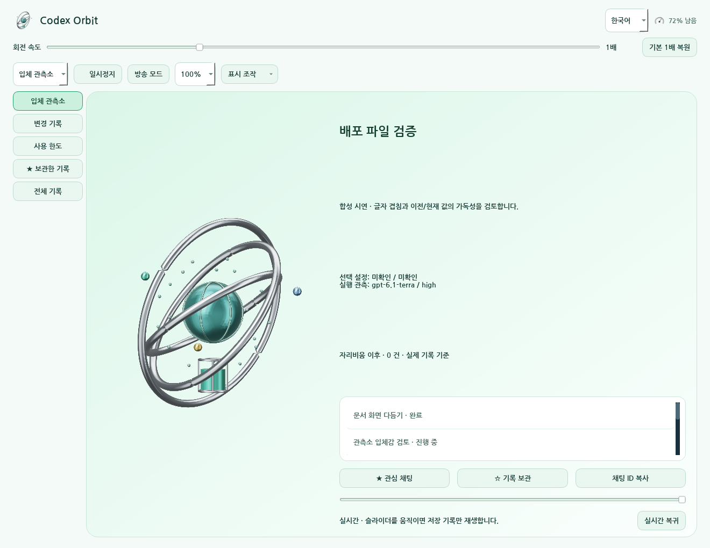
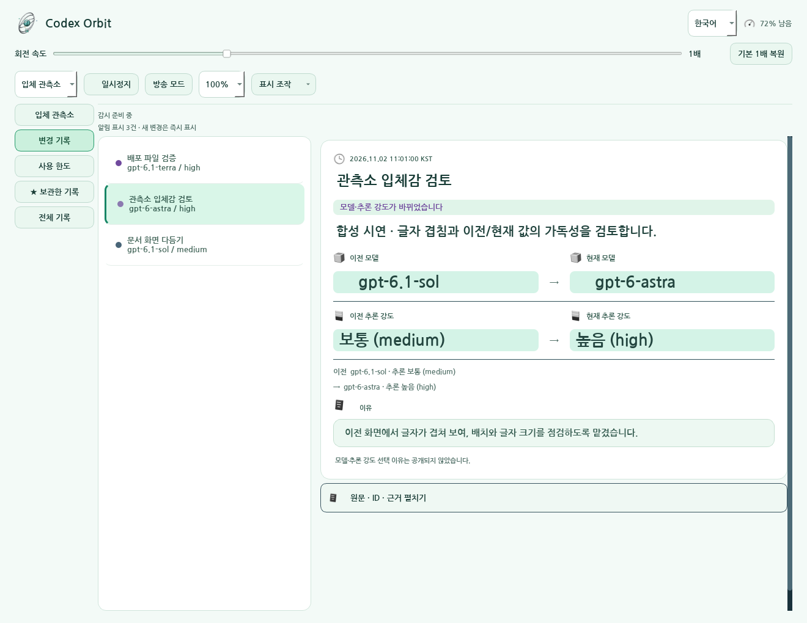

# Codex Orbit · LEVEL 5 - Expert

[LEVEL 1 - Beginner](%EB%A0%88%EB%B2%A81.md) · [LEVEL 2 - Explorer](%EB%A0%88%EB%B2%A82.md) · [LEVEL 3 - Practitioner](%EB%A0%88%EB%B2%A83.md) · [LEVEL 4 - Advanced](%EB%A0%88%EB%B2%A84.md) · [LEVEL 5 - Expert](%EB%A0%88%EB%B2%A85.md)

[같은 수준의 프로필](https://github.com/PUVKID/PUVKID/blob/main/docs/읽기안내/레벨5.md) · [프로젝트 첫 화면](../../README.md)

## LEVEL 5 · 프로젝트 소개와 읽는 방법

전문 검토는 JSONL 자원 상한·레코드 경계·설정/실행 출처·소유권·한도 stale 정책·QProcess 종료·릴리스 검증 및 복구를 실제 소스와 대조합니다. 로컬 관측을 서버 모델 신원 보증으로 확대하지 않습니다.

## LEVEL 5 · 실제 기능과 동작 범위

읽기512KiB/레코드2MiB/파일4096/poll8MiB/대기256/주기.2초,한도30초갱신/12초응답/65초stale·3회3/6/9초재연결과배포SHA·경계를대조합니다.

계약·입력 거부·상태·저장·관측 근거를 실제 소스와 대조합니다.

**기능별 공통 근거**

## LEVEL 5 · 입력에서 처리와 출력까지

JSONL·활동 tracker·UsageClient의 읽기 출처와 렌더 상태를 대조합니다. 현재한도 비율과 남은 토큰·합성 기온·목표fps·로컬 모델 관측의증거수준을분리합니다.

## LEVEL 5 · 사용·실험 순서와 확인 방법

실제 소스와 차수 diff에서 기록 상한·소유권·한도 QProcess·500ms 종료/kill대기·512MiB 다운로드 상한·공식 자산/SHA·로컬 경계를 대조합니다. 합성 fixture와 앱 실행 증거·서버 보증은 각각 분리합니다.

## LEVEL 5 · 결과와 한계를 해석하는 기준

날짜 규칙2026~2099·888테마·250국가/지역·3840×2160 렌더와 각차수 보존 범위를 대조합니다. 원문/공개SHA·부분소스·시안·제외자료를 유지하며 합성 화면이나 로컬 로그를 서버 신원·계정 사용 성능으로 바꾸지 않습니다.

## LEVEL 5 · 구현과 핵심 파일을 연결해 읽기

원문 소스·전체 diff·함수/옵션 참조·빌드/릴리스SHA를 대조합니다. 20차 실행src 부재·21차 시안·최종별도검증의 한계를 보존하고 없는 코드·제품 버전·서버 보증을 만들지 않습니다.

## LEVEL 5 · 용어와 실수하기 쉬운 구분

위젯은 바탕화면에 작게 띄우는 화면입니다. JSONL은 기록 한 건을 한 줄씩 저장하는 형식이고 감시는 그 파일의 새 기록을 읽는 일입니다. 모델·추론 강도는 기록에 담긴 설정·실행 관측 값이며 로컬 표시가 서버 신원을 증명하지는 않습니다. 렌더는 입체 모형을 화면 그림으로 만드는 계산이고 GPU는 그 그림 계산 장치입니다. 합성 화면은 검사용 예시 자료를 넣어 만든 화면입니다.

**설정 관측·실행 관측·기록된 공개 이유를 구분합니다.** 기록되지 않은 과거값·동기·작업 상태를 만들지 않습니다. 실제 계정 한도는 남은 비율이며 토큰 개수가 아닙니다. 합성 예시·목표 프레임·과거 렌더를 실제 계정 상태·서버 모델 신원·실측 성능으로 읽지 않습니다.

## LEVEL 5 · 전체 차수와 같은 수준의 상세 설명

차수 이름은 실제 보관 단위를 따릅니다. 부분본·시험 도구·최종 안내는 제품 버전과 구분하며, 폴더와 직전 비교를 함께 연결합니다.

| 내용 |
| --- |
| **차수·자료:** 1차 **자료 폴더:** [자료](../../history/01%EC%B0%A8) **이 수준의 차수 설명:** [LEVEL 5 - Expert](../../history/01%EC%B0%A8/README.md#reading-level-5) **직전 비교·범위:** [전체 비교](../../history/01%EC%B0%A8/%EC%A7%81%EC%A0%84%EC%B0%A8%EC%88%98.diff) |
| **차수·자료:** 2차 **자료 폴더:** [자료](../../history/02%EC%B0%A8) **이 수준의 차수 설명:** [LEVEL 5 - Expert](../../history/02%EC%B0%A8/README.md#reading-level-5) **직전 비교·범위:** [전체 비교](../../history/02%EC%B0%A8/%EC%A7%81%EC%A0%84%EC%B0%A8%EC%88%98.diff) |
| **차수·자료:** 3차 **자료 폴더:** [자료](../../history/03%EC%B0%A8) **이 수준의 차수 설명:** [LEVEL 5 - Expert](../../history/03%EC%B0%A8/README.md#reading-level-5) **직전 비교·범위:** [전체 비교](../../history/03%EC%B0%A8/%EC%A7%81%EC%A0%84%EC%B0%A8%EC%88%98.diff) |
| **차수·자료:** 4차 **자료 폴더:** [자료](../../history/04%EC%B0%A8) **이 수준의 차수 설명:** [LEVEL 5 - Expert](../../history/04%EC%B0%A8/README.md#reading-level-5) **직전 비교·범위:** [전체 비교](../../history/04%EC%B0%A8/%EC%A7%81%EC%A0%84%EC%B0%A8%EC%88%98.diff) |
| **차수·자료:** 5차 **자료 폴더:** [자료](../../history/05%EC%B0%A8) **이 수준의 차수 설명:** [LEVEL 5 - Expert](../../history/05%EC%B0%A8/README.md#reading-level-5) **직전 비교·범위:** [전체 비교](../../history/05%EC%B0%A8/%EC%A7%81%EC%A0%84%EC%B0%A8%EC%88%98.diff) |
| **차수·자료:** 6차 **자료 폴더:** [자료](../../history/06%EC%B0%A8) **이 수준의 차수 설명:** [LEVEL 5 - Expert](../../history/06%EC%B0%A8/README.md#reading-level-5) **직전 비교·범위:** [전체 비교](../../history/06%EC%B0%A8/%EC%A7%81%EC%A0%84%EC%B0%A8%EC%88%98.diff) |
| **차수·자료:** 7차 **자료 폴더:** [자료](../../history/07%EC%B0%A8) **이 수준의 차수 설명:** [LEVEL 5 - Expert](../../history/07%EC%B0%A8/README.md#reading-level-5) **직전 비교·범위:** [전체 비교](../../history/07%EC%B0%A8/%EC%A7%81%EC%A0%84%EC%B0%A8%EC%88%98.diff) |
| **차수·자료:** 8차 **자료 폴더:** [자료](../../history/08%EC%B0%A8) **이 수준의 차수 설명:** [LEVEL 5 - Expert](../../history/08%EC%B0%A8/README.md#reading-level-5) **직전 비교·범위:** [전체 비교](../../history/08%EC%B0%A8/%EC%A7%81%EC%A0%84%EC%B0%A8%EC%88%98.diff) |
| **차수·자료:** 9차 **자료 폴더:** [자료](../../history/09%EC%B0%A8) **이 수준의 차수 설명:** [LEVEL 5 - Expert](../../history/09%EC%B0%A8/README.md#reading-level-5) **직전 비교·범위:** [전체 비교](../../history/09%EC%B0%A8/%EC%A7%81%EC%A0%84%EC%B0%A8%EC%88%98.diff) |
| **차수·자료:** 10차 **자료 폴더:** [자료](../../history/10%EC%B0%A8) **이 수준의 차수 설명:** [LEVEL 5 - Expert](../../history/10%EC%B0%A8/README.md#reading-level-5) **직전 비교·범위:** [전체 비교](../../history/10%EC%B0%A8/%EC%A7%81%EC%A0%84%EC%B0%A8%EC%88%98.diff) |
| **차수·자료:** 11차 **자료 폴더:** [자료](../../history/11%EC%B0%A8) **이 수준의 차수 설명:** [LEVEL 5 - Expert](../../history/11%EC%B0%A8/README.md#reading-level-5) **직전 비교·범위:** [전체 비교](../../history/11%EC%B0%A8/%EC%A7%81%EC%A0%84%EC%B0%A8%EC%88%98.diff) |
| **차수·자료:** 12차 **자료 폴더:** [자료](../../history/12%EC%B0%A8) **이 수준의 차수 설명:** [LEVEL 5 - Expert](../../history/12%EC%B0%A8/README.md#reading-level-5) **직전 비교·범위:** [전체 비교](../../history/12%EC%B0%A8/%EC%A7%81%EC%A0%84%EC%B0%A8%EC%88%98.diff) |
| **차수·자료:** 13차 **자료 폴더:** [자료](../../history/13%EC%B0%A8) **이 수준의 차수 설명:** [LEVEL 5 - Expert](../../history/13%EC%B0%A8/README.md#reading-level-5) **직전 비교·범위:** [전체 비교](../../history/13%EC%B0%A8/%EC%A7%81%EC%A0%84%EC%B0%A8%EC%88%98.diff) |
| **차수·자료:** 14차 **자료 폴더:** [자료](../../history/14%EC%B0%A8) **이 수준의 차수 설명:** [LEVEL 5 - Expert](../../history/14%EC%B0%A8/README.md#reading-level-5) **직전 비교·범위:** [전체 비교](../../history/14%EC%B0%A8/%EC%A7%81%EC%A0%84%EC%B0%A8%EC%88%98.diff) |
| **차수·자료:** 15차 **자료 폴더:** [자료](../../history/15%EC%B0%A8) **이 수준의 차수 설명:** [LEVEL 5 - Expert](../../history/15%EC%B0%A8/README.md#reading-level-5) **직전 비교·범위:** [전체 비교](../../history/15%EC%B0%A8/%EC%A7%81%EC%A0%84%EC%B0%A8%EC%88%98.diff) |
| **차수·자료:** 16차 **자료 폴더:** [자료](../../history/16%EC%B0%A8) **이 수준의 차수 설명:** [LEVEL 5 - Expert](../../history/16%EC%B0%A8/README.md#reading-level-5) **직전 비교·범위:** [전체 비교](../../history/16%EC%B0%A8/%EC%A7%81%EC%A0%84%EC%B0%A8%EC%88%98.diff) |
| **차수·자료:** 17차 **자료 폴더:** [자료](../../history/17%EC%B0%A8) **이 수준의 차수 설명:** [LEVEL 5 - Expert](../../history/17%EC%B0%A8/README.md#reading-level-5) **직전 비교·범위:** [전체 비교](../../history/17%EC%B0%A8/%EC%A7%81%EC%A0%84%EC%B0%A8%EC%88%98.diff) |
| **차수·자료:** 18차 **자료 폴더:** [자료](../../history/18%EC%B0%A8) **이 수준의 차수 설명:** [LEVEL 5 - Expert](../../history/18%EC%B0%A8/README.md#reading-level-5) **직전 비교·범위:** [전체 비교](../../history/18%EC%B0%A8/%EC%A7%81%EC%A0%84%EC%B0%A8%EC%88%98.diff) |
| **차수·자료:** 19차 **자료 폴더:** [자료](../../history/19%EC%B0%A8) **이 수준의 차수 설명:** [LEVEL 5 - Expert](../../history/19%EC%B0%A8/README.md#reading-level-5) **직전 비교·범위:** [전체 비교](../../history/19%EC%B0%A8/%EC%A7%81%EC%A0%84%EC%B0%A8%EC%88%98.diff) |
| **차수·자료:** 20차 **자료 폴더:** [자료](../20%EC%B0%A8) **이 수준의 차수 설명:** [LEVEL 5 - Expert](../20%EC%B0%A8/README.md#reading-level-5) **직전 비교·범위:** [전체 비교](../20%EC%B0%A8/README.md) |
| **차수·자료:** 21차 **자료 폴더:** [자료](../../history/21%EC%B0%A8) **이 수준의 차수 설명:** [LEVEL 5 - Expert](../../history/21%EC%B0%A8/README.md#reading-level-5) **직전 비교·범위:** [전체 비교](../../history/21%EC%B0%A8/%EC%A7%81%EC%A0%84%EC%B0%A8%EC%88%98.diff) |
| **차수·자료:** 22차 **자료 폴더:** [자료](../../history/22%EC%B0%A8) **이 수준의 차수 설명:** [LEVEL 5 - Expert](../../history/22%EC%B0%A8/README.md#reading-level-5) **직전 비교·범위:** [전체 비교](../../history/22%EC%B0%A8/%EC%A7%81%EC%A0%84%EC%B0%A8%EC%88%98.diff) |
| **차수·자료:** 23차 **자료 폴더:** [자료](../../history/23%EC%B0%A8) **이 수준의 차수 설명:** [LEVEL 5 - Expert](../../history/23%EC%B0%A8/README.md#reading-level-5) **직전 비교·범위:** [전체 비교](../../history/23%EC%B0%A8/%EC%A7%81%EC%A0%84%EC%B0%A8%EC%88%98.diff) |
| **차수·자료:** 24차 **자료 폴더:** [자료](../../history/24%EC%B0%A8) **이 수준의 차수 설명:** [LEVEL 5 - Expert](../../history/24%EC%B0%A8/README.md#reading-level-5) **직전 비교·범위:** [전체 비교](../../history/24%EC%B0%A8/%EC%A7%81%EC%A0%84%EC%B0%A8%EC%88%98.diff) |
| **차수·자료:** 25차 **자료 폴더:** [자료](../../history/25) **이 수준의 차수 설명:** [LEVEL 5 - Expert](../../history/25/README.md#reading-level-5) **직전 비교·범위:** [전체 비교](../../history/25/%EC%A7%81%EC%A0%84%EC%B0%A8%EC%88%98.diff) |
| **차수·자료:** 26차 **자료 폴더:** [자료](../../history/26) **이 수준의 차수 설명:** [LEVEL 5 - Expert](../../history/26/README.md#reading-level-5) **직전 비교·범위:** [전체 비교](../../history/26/%EC%A7%81%EC%A0%84%EC%B0%A8%EC%88%98.diff) |
| **차수·자료:** 27차 **자료 폴더:** [자료](../../history/27) **이 수준의 차수 설명:** [LEVEL 5 - Expert](../../history/27/README.md#reading-level-5) **직전 비교·범위:** [전체 비교](../27%EC%B0%A8_%EC%A0%84%EC%B2%B4%EB%B3%80%EA%B2%BD.diff) |
| **차수·자료:** 28차 **자료 폴더:** [자료](../../history/28) **이 수준의 차수 설명:** [LEVEL 5 - Expert](../../history/28/README.md#reading-level-5) **직전 비교·범위:** [전체 비교](../28%EC%B0%A8_%EC%A0%84%EC%B2%B4%EB%B3%80%EA%B2%BD.diff) |
| **차수·자료:** 최종 **자료 폴더:** [자료](../%EC%B5%9C%EC%A2%85) **이 수준의 차수 설명:** [LEVEL 5 - Expert](../%EC%B5%9C%EC%A2%85/README.md#reading-level-5) **직전 비교·범위:** [전체 비교](../%EC%B5%9C%EC%A2%85/README.md) |
| **차수·자료:** 29차 **자료 폴더:** [자료](../../history/29%EC%B0%A8) **이 수준의 차수 설명:** [LEVEL 5 - Expert](../../history/29%EC%B0%A8/README.md#reading-level-5) **직전 비교·범위:** [전체 비교](../29%EC%B0%A8_%EC%A0%84%EC%B2%B4%EB%B3%80%EA%B2%BD.diff) |
| **차수·자료:** 30차 **자료 폴더:** [자료](../../history/30%EC%B0%A8) **이 수준의 차수 설명:** [LEVEL 5 - Expert](../../history/30%EC%B0%A8/README.md#reading-level-5) **직전 비교·범위:** [전체 비교](../../history/30%EC%B0%A8/%EC%A7%81%EC%A0%84%EC%B0%A8%EC%88%98.diff) |
| **차수·자료:** 31차 **자료 폴더:** [자료](../../history/31%EC%B0%A8) **이 수준의 차수 설명:** [LEVEL 5 - Expert](../../history/31%EC%B0%A8/README.md#reading-level-5) **직전 비교·범위:** [전체 비교](../../history/31%EC%B0%A8/%EC%A7%81%EC%A0%84%EC%B0%A8%EC%88%98.diff) |
| **차수·자료:** 32차 **자료 폴더:** [자료](../../history/32%EC%B0%A8) **이 수준의 차수 설명:** [LEVEL 5 - Expert](../../history/32%EC%B0%A8/README.md#reading-level-5) **직전 비교·범위:** [전체 비교](../32%EC%B0%A8_%EC%A0%84%EC%B2%B4%EB%B3%80%EA%B2%BD.diff) |

## LEVEL 5 · 논문·원고와 원본 자료의 범위

앱 소스·릴리스·설계·사용법·실제 배포본의 합성 검증 화면을 연결합니다. 20차 시안·21차 시안과 최종 상태 안내의 보존 범위를 구분하며 없는 소스·원고·제품 버전을 만들지 않습니다. 권리·공개 범위 원문을 함께 확인합니다.

## LEVEL 5 · 원래 모든 세부 설명으로 이동하기

설정값·코드 예제·실패 조건·측정 범위·화면과 파일별 안내를 생략하지 않도록 첫 화면의 전체 본문을 아래에 함께 둡니다. 각 항목은 이 페이지의 공통 근거로 바로 이동합니다. 원문에 담긴 이전 차수 조건을 현재 실행 조건으로 자동 적용하지 않습니다.

| 내용 |
| --- |
| **첫 화면의 원래 항목:** Codex Orbit 3.2.0 **이 페이지의 전체 근거:** [원문 보기](#source-section-1) |
| **첫 화면의 원래 항목:** 32차 · 지역 검색과 당일 입체 조형 **이 페이지의 전체 근거:** [원문 보기](#source-section-2) |
| **첫 화면의 원래 항목:** 32차 실제 배포본의 합성 화면 **이 페이지의 전체 근거:** [원문 보기](#source-section-3) |
| **첫 화면의 원래 항목:** 이전 31차 실제 배포본의 합성 화면 **이 페이지의 전체 근거:** [원문 보기](#source-section-4) |
| **첫 화면의 원래 항목:** 31차 · 화면 마감과 테마 선택 **이 페이지의 전체 근거:** [원문 보기](#source-section-5) |
| **첫 화면의 원래 항목:** 감시·표시·저장·업데이트의 연결 **이 페이지의 전체 근거:** [원문 보기](#source-section-6) |
| **첫 화면의 원래 항목:** 30차 · 원래 날짜별 테마 기본 복원 **이 페이지의 전체 근거:** [원문 보기](#source-section-7) |
| **첫 화면의 원래 항목:** 선택 가능한 29차 관측소 기능 **이 페이지의 전체 근거:** [원문 보기](#source-section-8) |
| **첫 화면의 원래 항목:** 달력 모드와 기존 기능 **이 페이지의 전체 근거:** [원문 보기](#source-section-9) |
| **첫 화면의 원래 항목:** 모든 차수와 실제 자료 **이 페이지의 전체 근거:** [원문 보기](#source-section-10) |
| **첫 화면의 원래 항목:** 실행·소스와 권리 **이 페이지의 전체 근거:** [원문 보기](#source-section-11) |
| **첫 화면의 원래 항목:** 이전29차 합성 예시 화면 **이 페이지의 전체 근거:** [원문 보기](#source-section-12) |

## LEVEL 5 · 항목별 자세한 풀이와 확인 지점

### LEVEL 5 · 32차 · 지역 검색과 당일 입체 조형

이 항목의 계약과 재현 조건을 아래 사실 및 연결 원문에 대조합니다. 관측값·기본값·조건 분기를 구분합니다.

날짜 위젯은 고리와 좌우 장식 없이 당일 대상 하나를 표시합니다. 기존 888개 월별 주제와 일반일 대상을 보존하고, 250개 국가·지역의 공휴일·지원 기념일에는 실제 행사명과 특집 조형을 적용합니다. 미래 법 개정과 모든 도시 축제까지 확정한 자료는 아닙니다.

지역 표시를 눌러 도시·주소·장소·국가를 직접 검색합니다. 선택 지점의 기온·날씨·습도·일출·일몰을 받아오며, 자동 IP 위치는 추정임을 표시합니다.

알림은 이전·현재 모델과 추론 강도를 나란히 비교하고 짧은 설명과 접을 수 있는 원문으로 정리했습니다. 화면은 흰색·슬레이트 블루와 다크 테마를 제공합니다.

888월 주제·250국가/지역의 지원 행사와 미래 법·모든 도시 축제의 미확정 범위를 구분합니다.

**전문 대조 지점:** 당일 조형·지역 선택·IP 추정·전후 알림과 화면 테마를 확인합니다.

날짜 위젯은 고리와 좌우 장식 없이 당일 대상 하나를 표시합니다. 기존 888개 월별 주제와 일반일 대상을 보존하고, 250개 국가·지역의 공휴일·지원 기념일에는 실제 행사명과 특집 조형을 적용합니다. 미래 법 개정과 모든 도시 축제까지 확정한 자료는 아닙니다.

지역 표시를 눌러 도시·주소·장소·국가를 직접 검색합니다. 선택 지점의 기온·날씨·습도·일출·일몰을 받아오며, 자동 IP 위치는 추정임을 표시합니다.

알림은 이전·현재 모델과 추론 강도를 나란히 비교하고 짧은 설명과 접을 수 있는 원문으로 정리했습니다. 화면은 흰색·슬레이트 블루와 다크 테마를 제공합니다.

[이 항목의 전체 조건·원문](#source-section-2)

### LEVEL 5 · 32차 실제 배포본의 합성 화면

이 항목의 계약과 재현 조건을 아래 사실 및 연결 원문에 대조합니다. 관측값·기본값·조건 분기를 구분합니다.

실제 배포 EXE에서 개인 기록·네트워크 없이 검사한 화면입니다. 기온·습도·잔량과 모델 값은 합성 예시입니다. [검증 범위](../%EA%B3%B5%EA%B0%9C%EA%B2%80%EC%A6%9D_32%EC%B0%A8.md)

실제 프로그램 렌더와 실제 계정·날씨·모델 관측값은 다른 증거입니다.

**전문 대조 지점:** 기온·습도·잔량·모델 값의 합성 표기와 공개 검증 범위를 읽습니다.

실제 배포 EXE에서 개인 기록·네트워크 없이 검사한 화면입니다. 기온·습도·잔량과 모델 값은 합성 예시입니다. [검증 범위](../%EA%B3%B5%EA%B0%9C%EA%B2%80%EC%A6%9D_32%EC%B0%A8.md)

[이 항목의 전체 조건·원문](#source-section-3)

### LEVEL 5 · 이전 31차 실제 배포본의 합성 화면

이 항목의 계약과 재현 조건을 아래 사실 및 연결 원문에 대조합니다. 관측값·기본값·조건 분기를 구분합니다.

개인 기록 없이 만든 합성 작업입니다. 모델·추론 값은 화면 검사용 예시이며 실제 실행 모델이나 계정 상태를 뜻하지 않습니다.

예시를 현재 계정·실행 모델이나32차의 모든 상태 검증으로 확대하지 않습니다.

**전문 대조 지점:** 31차의 화면 형태와 합성 모델·추론 값을 구분합니다.

개인 기록 없이 만든 합성 작업입니다. 모델·추론 값은 화면 검사용 예시이며 실제 실행 모델이나 계정 상태를 뜻하지 않습니다.

[이 항목의 전체 조건·원문](#source-section-4)

### LEVEL 5 · 31차 · 화면 마감과 테마 선택

이 항목의 계약과 재현 조건을 아래 사실 및 연결 원문에 대조합니다. 관측값·기본값·조건 분기를 구분합니다.

시스템·라이트·다크 화면 테마를 즉시 적용하고 선택을 저장합니다. 언어·글자 크기·회전 속도는 같은 설정 영역에서 조절하고, 작업 현황에서 선택 설정과 최근 실행 관측을 구분합니다. 화면 설정 메뉴는 움직임 줄이기·가장자리 붙이기·알림 소리·성능과 화질·문제 확인용 파일 저장·새 버전 확인을 설명합니다. 프라이버시 모드는 화면의 제목과 작업 설명을 가리며 저장 원문을 유지합니다. 날짜별 과일·세 금속 링·날짜 규칙과 모델·추론 변경 알림은 유지합니다.

표시를 가리는 기능과 저장 원문 삭제·모델 전환은 다릅니다.

**전문 대조 지점:** 선택 저장·실제 관측 구분과 프라이버시 모드의 가림 범위를 확인합니다.

시스템·라이트·다크 화면 테마를 즉시 적용하고 선택을 저장합니다. 언어·글자 크기·회전 속도는 같은 설정 영역에서 조절하고, 작업 현황에서 선택 설정과 최근 실행 관측을 구분합니다. 화면 설정 메뉴는 움직임 줄이기·가장자리 붙이기·알림 소리·성능과 화질·문제 확인용 파일 저장·새 버전 확인을 설명합니다. 프라이버시 모드는 화면의 제목과 작업 설명을 가리며 저장 원문을 유지합니다. 날짜별 과일·세 금속 링·날짜 규칙과 모델·추론 변경 알림은 유지합니다.

[이 항목의 전체 조건·원문](#source-section-5)

### LEVEL 5 · 감시·표시·저장·업데이트의 연결

이 항목의 계약과 재현 조건을 아래 사실 및 연결 원문에 대조합니다. 관측값·기본값·조건 분기를 구분합니다.

30차 소스에서 `notifier.Watcher`는 로컬 JSONL을 읽어 설정 관측·실행 관측·공개 이유를 구분하고 `app.py`가 알림·위젯·상세 이력을 표시합니다. `core.py`는 JSONL 꼬리 읽기·채팅 제목·화면 위치와 Markdown 적용/복구를 담당합니다. `activity.py`의 작업 상태와 `notice_format.py`의 표현을 렌더러의 장식 상태와 구분합니다.

기록 읽기 — 30차 notifier는 읽기 묶음512KiB·레코드2MiB·파일4096개·poll 총8MiB·대기256개·주기0.2초 상한을 둡니다. 최초 기준선과 새 기록 알림을 구분합니다.

표시 — calendar가 기본이며 명시 선택한 관측소는 유지합니다. calendar_renderer·observatory_scene의 GPU 그림과 실제 모델/추론 기록은 별개입니다.

계정 한도 — UsageClient가 codex.exe app-server를 QProcess 분리 파이프로 열고 읽기 요청합니다. 30초 갱신·12초 응답 제한·65초 이후 오래된 값 표시를 적용합니다.

연결 실패 — 한도 조회 실패 때 이전값을 stale로 표시하고 최대3회,3/6/9초 지연으로 다시 연결합니다. 미확인을0%로 바꾸지 않습니다.

종료 — UsageClient.close는 타이머와 pending을 정리하고 종료 요청 뒤500ms 대기, 필요하면 kill 후500ms 대기합니다.

배포 교체 — safe_update의 check→stage→apply 단계로 공식 릴리스·자산·SHA·로컬 경계를 검사하고 실행 확인 실패 시 이전 EXE를 복구합니다. MAX_DOWNLOAD는512MiB입니다.

사용자는 감시 경로·언어·표시 모드·모션/자원 품질을 고르고 새 알림의 이전/이후 값과 근거를 읽습니다.

날씨·사용 한도·업데이트는 네트워크 또는 App Server 기능이며 로컬 감시기의 기능 범위와 나눠 봅니다. 방송 모드와 진단 ZIP의 공개 제외 조건을 유지합니다. 실제 사용법·릴리스·빌드 안내와 차수별 함수/설정 참조는 아래에 연결되어 있습니다.

자원 상한·stale·재연결·종료·SHA 복구 조건과 로컬/서버 증거 수준을 분리합니다.

**전문 대조 지점:** Watcher·core·activity·notice_format·UsageClient·safe_update의 실제 경계를 따라갑니다. 원문 식별자·옵션: notifier.Watcher · app.py · core.py · activity.py · notice_format.py.

30차 소스에서 `notifier.Watcher`는 로컬 JSONL을 읽어 설정 관측·실행 관측·공개 이유를 구분하고 `app.py`가 알림·위젯·상세 이력을 표시합니다. `core.py`는 JSONL 꼬리 읽기·채팅 제목·화면 위치와 Markdown 적용/복구를 담당합니다. `activity.py`의 작업 상태와 `notice_format.py`의 표현을 렌더러의 장식 상태와 구분합니다.

사용자는 감시 경로·언어·표시 모드·모션/자원 품질을 고르고 새 알림의 이전/이후 값과 근거를 읽습니다.

날씨·사용 한도·업데이트는 네트워크 또는 App Server 기능이며 로컬 감시기의 기능 범위와 나눠 봅니다. 방송 모드와 진단 ZIP의 공개 제외 조건을 유지합니다. 실제 사용법·릴리스·빌드 안내와 차수별 함수/설정 참조는 아래에 연결되어 있습니다.

**경계:** 기록 읽기

**실제 처리:** 30차 notifier는 읽기 묶음512KiB·레코드2MiB·파일4096개·poll 총8MiB·대기256개·주기0.2초 상한을 둡니다. 최초 기준선과 새 기록 알림을 구분합니다.

**경계:** 표시

**실제 처리:** calendar가 기본이며 명시 선택한 관측소는 유지합니다. calendar_renderer·observatory_scene의 GPU 그림과 실제 모델/추론 기록은 별개입니다.

**경계:** 계정 한도

**실제 처리:** UsageClient가 codex.exe app-server를 QProcess 분리 파이프로 열고 읽기 요청합니다. 30초 갱신·12초 응답 제한·65초 이후 오래된 값 표시를 적용합니다.

**경계:** 연결 실패

**실제 처리:** 한도 조회 실패 때 이전값을 stale로 표시하고 최대3회,3/6/9초 지연으로 다시 연결합니다. 미확인을0%로 바꾸지 않습니다.

**경계:** 종료

**실제 처리:** UsageClient.close는 타이머와 pending을 정리하고 종료 요청 뒤500ms 대기, 필요하면 kill 후500ms 대기합니다.

**경계:** 배포 교체

**실제 처리:** safe_update의 check→stage→apply 단계로 공식 릴리스·자산·SHA·로컬 경계를 검사하고 실행 확인 실패 시 이전 EXE를 복구합니다. MAX_DOWNLOAD는512MiB입니다.

[이 항목의 전체 조건·원문](#source-section-6)

### LEVEL 5 · 30차 · 원래 날짜별 테마 기본 복원

이 항목의 계약과 재현 조건을 아래 사실 및 연결 원문에 대조합니다. 관측값·기본값·조건 분기를 구분합니다.

설정에 표시 모드가 없는 경우에도 원래 날짜별 달력 조형을 표시합니다. 모델 변경 이벤트를 받아도 날짜 제목과 조형은 유지합니다. 888개 월 테마·일별 디자인·색·재질·날짜 규칙은 바꾸지 않았습니다. 이전/현재 모델·추론 강도·알림 기능도 유지합니다.

기본값 복원을 월·일 자산 재제작이나 모델 변경 기능으로 읽지 않습니다.

**전문 대조 지점:** 새 설정·모드 없는 기존 설정·모델 이벤트 후 날짜 유지와 명시 관측소를 확인합니다.

설정에 표시 모드가 없는 경우에도 원래 날짜별 달력 조형을 표시합니다. 모델 변경 이벤트를 받아도 날짜 제목과 조형은 유지합니다. 888개 월 테마·일별 디자인·색·재질·날짜 규칙은 바꾸지 않았습니다. 이전/현재 모델·추론 강도·알림 기능도 유지합니다.

[이 항목의 전체 조건·원문](#source-section-7)

### LEVEL 5 · 선택 가능한 29차 관측소 기능

이 항목의 계약과 재현 조건을 아래 사실 및 연결 원문에 대조합니다. 관측값·기본값·조건 분기를 구분합니다.

은색 금속 링 세 개가 서로 다른 축에서 움직입니다. 솔의 태양·아스트라의 결정·테라의 구체·루나의 초승달 코어와 추론 강도별 입자 밀도를 구분합니다. 확인되지 않은 모델은 중립 조형으로 표시합니다.

위성은 기록에서 명시적으로 관측한 작업 상태를 표시합니다. 관심 채팅 고정·기록 북마크·자리비움 요약·시간 슬라이더 재생을 제공하며 재생은 실제 모델 설정을 바꾸지 않습니다.

알림은 채팅 제목·이전 모델과 추론 강도·현재 모델과 추론 강도·기록된 이유를 비교합니다. 정확한 모델 ID와 원문 기록은 보존하고 표시 제목의 장식 이모지를 정리합니다. 마우스를 올리면 자동 닫힘을 멈추고 알림을 고정할 수 있습니다.

방송 모드는 열린 알림·제목·작업·툴팁을 가립니다. 진단 ZIP은 대화·인증·경로·이벤트 원문을 제외한 항목만 로컬에 저장합니다. 업데이트는 사용자가 확인을 눌러 공식 릴리스를 조회하고 SHA-256 대조 후 준비하며, 교체 후 실행 확인 실패 시 이전 실행 파일로 복구합니다.

민트와 화이트 화면·나눔고딕 Bold를 사용합니다. 글자 크기·가장자리 도킹·펼침·재생/일시정지·모션 축소·자원 품질을 조절할 수 있으며 일시정지 중에도 알림 감시는 계속됩니다.

실제 한도는 **남은 사용 한도 비율**이며 남은 토큰 개수가 아닙니다. 미확인은 0%와 구분합니다. 선택 설정 관측과 실제 실행 기록 관측을 구분하며 로컬 기록이 서버 모델 신원을 보증하지 않습니다. 기록되지 않은 이유와 작업 상태를 만들어 내지 않습니다.

슬라이더는 기록 재생이며 실제 모델 복귀가 아니고 미확인 모델·한도를 확정값으로 채우지 않습니다.

**전문 대조 지점:** 관심 고정·보관·자리비움·재생·방송·한도·업데이트와 모션 설정을 확인합니다.

- 은색 금속 링 세 개가 서로 다른 축에서 움직입니다. 솔의 태양·아스트라의 결정·테라의 구체·루나의 초승달 코어와 추론 강도별 입자 밀도를 구분합니다. 확인되지 않은 모델은 중립 조형으로 표시합니다.
- 위성은 기록에서 명시적으로 관측한 작업 상태를 표시합니다. 관심 채팅 고정·기록 북마크·자리비움 요약·시간 슬라이더 재생을 제공하며 재생은 실제 모델 설정을 바꾸지 않습니다.
- 알림은 채팅 제목·이전 모델과 추론 강도·현재 모델과 추론 강도·기록된 이유를 비교합니다. 정확한 모델 ID와 원문 기록은 보존하고 표시 제목의 장식 이모지를 정리합니다. 마우스를 올리면 자동 닫힘을 멈추고 알림을 고정할 수 있습니다.
- 방송 모드는 열린 알림·제목·작업·툴팁을 가립니다. 진단 ZIP은 대화·인증·경로·이벤트 원문을 제외한 항목만 로컬에 저장합니다. 업데이트는 사용자가 확인을 눌러 공식 릴리스를 조회하고 SHA-256 대조 후 준비하며, 교체 후 실행 확인 실패 시 이전 실행 파일로 복구합니다.
- 민트와 화이트 화면·나눔고딕 Bold를 사용합니다. 글자 크기·가장자리 도킹·펼침·재생/일시정지·모션 축소·자원 품질을 조절할 수 있으며 일시정지 중에도 알림 감시는 계속됩니다.

실제 한도는 **남은 사용 한도 비율**이며 남은 토큰 개수가 아닙니다. 미확인은 0%와 구분합니다. 선택 설정 관측과 실제 실행 기록 관측을 구분하며 로컬 기록이 서버 모델 신원을 보증하지 않습니다. 기록되지 않은 이유와 작업 상태를 만들어 내지 않습니다.

[이 항목의 전체 조건·원문](#source-section-8)

### LEVEL 5 · 달력 모드와 기존 기능

이 항목의 계약과 재현 조건을 아래 사실 및 연결 원문에 대조합니다. 관측값·기본값·조건 분기를 구분합니다.

2026~2099년의 [888개 월 테마](../%EC%97%B0%EB%8F%84%EB%B3%84_%EC%9B%94%EB%B3%84_%ED%85%8C%EB%A7%88_%EC%A0%84%EC%B2%B4.md)와 [CSV](../%EC%97%B0%EB%8F%84%EB%B3%84_%EC%9B%94%EB%B3%84_%ED%85%8C%EB%A7%88_%EC%A0%84%EC%B2%B4.csv), 날짜별 실제 메시 조형을 달력 모드로 보존합니다. 공통 생성 규칙을 재사용하므로 888개 수작업 모델을 뜻하지 않습니다. 한영 선택·날씨·IP 기반 지역·시계·속도 조절을 유지합니다. 하나의 GPU 작업자가 3840×2160 원본을 렌더하며 관측소 품질은 20/30/60fps 상한을 사용합니다. 실제 생성률과 모니터 표시율은 별개이고 고정 240fps 달성을 주장하지 않습니다.

수작업 모델 수·목표 생성률·실제 표시율·240fps 달성을 구분합니다.

**전문 대조 지점:** 2026~2099·888테마·공통 생성 규칙과 GPU 렌더·품질 상한을 읽습니다.

2026~2099년의 [888개 월 테마](../%EC%97%B0%EB%8F%84%EB%B3%84_%EC%9B%94%EB%B3%84_%ED%85%8C%EB%A7%88_%EC%A0%84%EC%B2%B4.md)와 [CSV](../%EC%97%B0%EB%8F%84%EB%B3%84_%EC%9B%94%EB%B3%84_%ED%85%8C%EB%A7%88_%EC%A0%84%EC%B2%B4.csv), 날짜별 실제 메시 조형을 달력 모드로 보존합니다. 공통 생성 규칙을 재사용하므로 888개 수작업 모델을 뜻하지 않습니다. 한영 선택·날씨·IP 기반 지역·시계·속도 조절을 유지합니다. 하나의 GPU 작업자가 3840×2160 원본을 렌더하며 관측소 품질은 20/30/60fps 상한을 사용합니다. 실제 생성률과 모니터 표시율은 별개이고 고정 240fps 달성을 주장하지 않습니다.

[이 항목의 전체 조건·원문](#source-section-9)

### LEVEL 5 · 모든 차수와 실제 자료

확인되지 않은 제품 버전·src·diff를 만들거나 비공개 검증 원문을 게시하지 않습니다.

**전문 대조 지점:** 20차 소스 부재·21차 시안·최종 상태 안내와 원본/공개SHA를 확인합니다.

원본 소스 비교에는 주석·공백·개행과 신규·삭제 상태를 포함합니다. 20차는 실행 소스 없이 38개 시안, 21차는 110개 시안을 보존합니다. 최종 폴더의 개인 운영 검증 원문은 공개하지 않습니다. 역사 자료 2,281개 항목의 보존·정제·제외 사유와 원본/공개 SHA를 차수별로 연결했습니다.

| 내용 |
| --- |
| **차수·자료:** 1차 **자료 폴더·원본:** [자료 폴더](../../history/01%EC%B0%A8) **상세 설명:** [상세 설명](../../history/01%EC%B0%A8/README.md#reading-level-5) **직전 비교·범위:** [전체 비교·범위](../../history/01%EC%B0%A8/%EC%A7%81%EC%A0%84%EC%B0%A8%EC%88%98.diff) |
| **차수·자료:** 2차 **자료 폴더·원본:** [자료 폴더](../../history/02%EC%B0%A8) **상세 설명:** [상세 설명](../../history/02%EC%B0%A8/README.md#reading-level-5) **직전 비교·범위:** [전체 비교·범위](../../history/02%EC%B0%A8/%EC%A7%81%EC%A0%84%EC%B0%A8%EC%88%98.diff) |
| **차수·자료:** 3차 **자료 폴더·원본:** [자료 폴더](../../history/03%EC%B0%A8) **상세 설명:** [상세 설명](../../history/03%EC%B0%A8/README.md#reading-level-5) **직전 비교·범위:** [전체 비교·범위](../../history/03%EC%B0%A8/%EC%A7%81%EC%A0%84%EC%B0%A8%EC%88%98.diff) |
| **차수·자료:** 4차 **자료 폴더·원본:** [자료 폴더](../../history/04%EC%B0%A8) **상세 설명:** [상세 설명](../../history/04%EC%B0%A8/README.md#reading-level-5) **직전 비교·범위:** [전체 비교·범위](../../history/04%EC%B0%A8/%EC%A7%81%EC%A0%84%EC%B0%A8%EC%88%98.diff) |
| **차수·자료:** 5차 **자료 폴더·원본:** [자료 폴더](../../history/05%EC%B0%A8) **상세 설명:** [상세 설명](../../history/05%EC%B0%A8/README.md#reading-level-5) **직전 비교·범위:** [전체 비교·범위](../../history/05%EC%B0%A8/%EC%A7%81%EC%A0%84%EC%B0%A8%EC%88%98.diff) |
| **차수·자료:** 6차 **자료 폴더·원본:** [자료 폴더](../../history/06%EC%B0%A8) **상세 설명:** [상세 설명](../../history/06%EC%B0%A8/README.md#reading-level-5) **직전 비교·범위:** [전체 비교·범위](../../history/06%EC%B0%A8/%EC%A7%81%EC%A0%84%EC%B0%A8%EC%88%98.diff) |
| **차수·자료:** 7차 **자료 폴더·원본:** [자료 폴더](../../history/07%EC%B0%A8) **상세 설명:** [상세 설명](../../history/07%EC%B0%A8/README.md#reading-level-5) **직전 비교·범위:** [전체 비교·범위](../../history/07%EC%B0%A8/%EC%A7%81%EC%A0%84%EC%B0%A8%EC%88%98.diff) |
| **차수·자료:** 8차 **자료 폴더·원본:** [자료 폴더](../../history/08%EC%B0%A8) **상세 설명:** [상세 설명](../../history/08%EC%B0%A8/README.md#reading-level-5) **직전 비교·범위:** [전체 비교·범위](../../history/08%EC%B0%A8/%EC%A7%81%EC%A0%84%EC%B0%A8%EC%88%98.diff) |
| **차수·자료:** 9차 **자료 폴더·원본:** [자료 폴더](../../history/09%EC%B0%A8) **상세 설명:** [상세 설명](../../history/09%EC%B0%A8/README.md#reading-level-5) **직전 비교·범위:** [전체 비교·범위](../../history/09%EC%B0%A8/%EC%A7%81%EC%A0%84%EC%B0%A8%EC%88%98.diff) |
| **차수·자료:** 10차 **자료 폴더·원본:** [자료 폴더](../../history/10%EC%B0%A8) **상세 설명:** [상세 설명](../../history/10%EC%B0%A8/README.md#reading-level-5) **직전 비교·범위:** [전체 비교·범위](../../history/10%EC%B0%A8/%EC%A7%81%EC%A0%84%EC%B0%A8%EC%88%98.diff) |
| **차수·자료:** 11차 **자료 폴더·원본:** [자료 폴더](../../history/11%EC%B0%A8) **상세 설명:** [상세 설명](../../history/11%EC%B0%A8/README.md#reading-level-5) **직전 비교·범위:** [전체 비교·범위](../../history/11%EC%B0%A8/%EC%A7%81%EC%A0%84%EC%B0%A8%EC%88%98.diff) |
| **차수·자료:** 12차 **자료 폴더·원본:** [자료 폴더](../../history/12%EC%B0%A8) **상세 설명:** [상세 설명](../../history/12%EC%B0%A8/README.md#reading-level-5) **직전 비교·범위:** [전체 비교·범위](../../history/12%EC%B0%A8/%EC%A7%81%EC%A0%84%EC%B0%A8%EC%88%98.diff) |
| **차수·자료:** 13차 **자료 폴더·원본:** [자료 폴더](../../history/13%EC%B0%A8) **상세 설명:** [상세 설명](../../history/13%EC%B0%A8/README.md#reading-level-5) **직전 비교·범위:** [전체 비교·범위](../../history/13%EC%B0%A8/%EC%A7%81%EC%A0%84%EC%B0%A8%EC%88%98.diff) |
| **차수·자료:** 14차 **자료 폴더·원본:** [자료 폴더](../../history/14%EC%B0%A8) **상세 설명:** [상세 설명](../../history/14%EC%B0%A8/README.md#reading-level-5) **직전 비교·범위:** [전체 비교·범위](../../history/14%EC%B0%A8/%EC%A7%81%EC%A0%84%EC%B0%A8%EC%88%98.diff) |
| **차수·자료:** 15차 **자료 폴더·원본:** [자료 폴더](../../history/15%EC%B0%A8) **상세 설명:** [상세 설명](../../history/15%EC%B0%A8/README.md#reading-level-5) **직전 비교·범위:** [전체 비교·범위](../../history/15%EC%B0%A8/%EC%A7%81%EC%A0%84%EC%B0%A8%EC%88%98.diff) |
| **차수·자료:** 16차 **자료 폴더·원본:** [자료 폴더](../../history/16%EC%B0%A8) **상세 설명:** [상세 설명](../../history/16%EC%B0%A8/README.md#reading-level-5) **직전 비교·범위:** [전체 비교·범위](../../history/16%EC%B0%A8/%EC%A7%81%EC%A0%84%EC%B0%A8%EC%88%98.diff) |
| **차수·자료:** 17차 **자료 폴더·원본:** [자료 폴더](../../history/17%EC%B0%A8) **상세 설명:** [상세 설명](../../history/17%EC%B0%A8/README.md#reading-level-5) **직전 비교·범위:** [전체 비교·범위](../../history/17%EC%B0%A8/%EC%A7%81%EC%A0%84%EC%B0%A8%EC%88%98.diff) |
| **차수·자료:** 18차 **자료 폴더·원본:** [자료 폴더](../../history/18%EC%B0%A8) **상세 설명:** [상세 설명](../../history/18%EC%B0%A8/README.md#reading-level-5) **직전 비교·범위:** [전체 비교·범위](../../history/18%EC%B0%A8/%EC%A7%81%EC%A0%84%EC%B0%A8%EC%88%98.diff) |
| **차수·자료:** 19차 **자료 폴더·원본:** [자료 폴더](../../history/19%EC%B0%A8) **상세 설명:** [상세 설명](../../history/19%EC%B0%A8/README.md#reading-level-5) **직전 비교·범위:** [전체 비교·범위](../../history/19%EC%B0%A8/%EC%A7%81%EC%A0%84%EC%B0%A8%EC%88%98.diff) |
| **차수·자료:** 20차 **자료 폴더·원본:** [자료 폴더](../20%EC%B0%A8) **상세 설명:** [상세 설명](../20%EC%B0%A8/README.md#reading-level-5) **직전 비교·범위:** [전체 비교·범위](../20%EC%B0%A8/README.md) |
| **차수·자료:** 21차 **자료 폴더·원본:** [자료 폴더](../../history/21%EC%B0%A8) **상세 설명:** [상세 설명](../../history/21%EC%B0%A8/README.md#reading-level-5) **직전 비교·범위:** [전체 비교·범위](../../history/21%EC%B0%A8/%EC%A7%81%EC%A0%84%EC%B0%A8%EC%88%98.diff) |
| **차수·자료:** 22차 **자료 폴더·원본:** [자료 폴더](../../history/22%EC%B0%A8) **상세 설명:** [상세 설명](../../history/22%EC%B0%A8/README.md#reading-level-5) **직전 비교·범위:** [전체 비교·범위](../../history/22%EC%B0%A8/%EC%A7%81%EC%A0%84%EC%B0%A8%EC%88%98.diff) |
| **차수·자료:** 23차 **자료 폴더·원본:** [자료 폴더](../../history/23%EC%B0%A8) **상세 설명:** [상세 설명](../../history/23%EC%B0%A8/README.md#reading-level-5) **직전 비교·범위:** [전체 비교·범위](../../history/23%EC%B0%A8/%EC%A7%81%EC%A0%84%EC%B0%A8%EC%88%98.diff) |
| **차수·자료:** 24차 **자료 폴더·원본:** [자료 폴더](../../history/24%EC%B0%A8) **상세 설명:** [상세 설명](../../history/24%EC%B0%A8/README.md#reading-level-5) **직전 비교·범위:** [전체 비교·범위](../../history/24%EC%B0%A8/%EC%A7%81%EC%A0%84%EC%B0%A8%EC%88%98.diff) |
| **차수·자료:** 25차 **자료 폴더·원본:** [자료 폴더](../../history/25) **상세 설명:** [상세 설명](../../history/25/README.md#reading-level-5) **직전 비교·범위:** [전체 비교·범위](../../history/25/%EC%A7%81%EC%A0%84%EC%B0%A8%EC%88%98.diff) |
| **차수·자료:** 26차 **자료 폴더·원본:** [자료 폴더](../../history/26) **상세 설명:** [상세 설명](../../history/26/README.md#reading-level-5) **직전 비교·범위:** [전체 비교·범위](../../history/26/%EC%A7%81%EC%A0%84%EC%B0%A8%EC%88%98.diff) |
| **차수·자료:** 27차 **자료 폴더·원본:** [자료 폴더](../../history/27) **상세 설명:** [상세 설명](../../history/27/README.md#reading-level-5) **직전 비교·범위:** [전체 비교·범위](../27%EC%B0%A8_%EC%A0%84%EC%B2%B4%EB%B3%80%EA%B2%BD.diff) |
| **차수·자료:** 28차 **자료 폴더·원본:** [자료 폴더](../../history/28) **상세 설명:** [상세 설명](../../history/28/README.md#reading-level-5) **직전 비교·범위:** [전체 비교·범위](../28%EC%B0%A8_%EC%A0%84%EC%B2%B4%EB%B3%80%EA%B2%BD.diff) |
| **차수·자료:** 최종 **자료 폴더·원본:** [자료 폴더](../%EC%B5%9C%EC%A2%85) **상세 설명:** [상세 설명](../%EC%B5%9C%EC%A2%85/README.md#reading-level-5) **직전 비교·범위:** [전체 비교·범위](../%EC%B5%9C%EC%A2%85/README.md) |
| **차수·자료:** 29차 **자료 폴더·원본:** [자료 폴더](../../history/29%EC%B0%A8) **상세 설명:** [상세 설명](../../history/29%EC%B0%A8/README.md#reading-level-5) **직전 비교·범위:** [전체 비교·범위](../29%EC%B0%A8_%EC%A0%84%EC%B2%B4%EB%B3%80%EA%B2%BD.diff) · [소스 비교](../../history/29%EC%B0%A8/%EC%A7%81%EC%A0%84%EC%B0%A8%EC%88%98.diff) |
| **차수·자료:** 30차 **자료 폴더·원본:** [자료 폴더](../../history/30%EC%B0%A8) **상세 설명:** [상세 설명](../../history/30%EC%B0%A8/README.md#reading-level-5) **직전 비교·범위:** [전체 비교·범위](../../history/30%EC%B0%A8/%EC%A7%81%EC%A0%84%EC%B0%A8%EC%88%98.diff) |
| **차수·자료:** 31차 **자료 폴더·원본:** [자료 폴더](../../history/31%EC%B0%A8) **상세 설명:** [상세 설명](../../history/31%EC%B0%A8/README.md#reading-level-5) **직전 비교·범위:** [전체 비교·범위](../../history/31%EC%B0%A8/%EC%A7%81%EC%A0%84%EC%B0%A8%EC%88%98.diff) |
| **차수·자료:** 32차 **자료 폴더·원본:** [자료 폴더](../../history/32%EC%B0%A8) **상세 설명:** [상세 설명](../../history/32%EC%B0%A8/README.md#reading-level-5) **직전 비교·범위:** [전체 비교·범위](../32%EC%B0%A8_%EC%A0%84%EC%B2%B4%EB%B3%80%EA%B2%BD.diff) |

[이 항목의 전체 조건·원문](#source-section-10)

### LEVEL 5 · 실행·소스와 권리

이 항목의 계약과 재현 조건을 아래 사실 및 연결 원문에 대조합니다. 관측값·기본값·조건 분기를 구분합니다.

Windows 10/11 x64와 OpenGL 3.3을 지원하는 그래픽 드라이버가 필요합니다. 단일 EXE는 Python 설치 없이 실행하고 설치본은 현재 사용자용 바로가기·제거를 제공합니다. GPU 준비/실패는 정적 표식 또는 오류 설명으로 구분합니다.

공개 소스는 GitHub 자동 Source code ZIP 또는 이 저장소에서 받습니다. 비공개 전체 개발 ZIP·개인 대화·지침·인증 자료는 배포하지 않습니다. 기존 라이선스 고지를 보존하며 새 소스 라이선스를 임의 부여하지 않습니다. 재빌드는 `python -B -X utf8 tools/build_distribution.py`를 사용합니다. 원고가 없는 앱 작업으로 논문 PDF를 만들지 않았습니다.

로컬 기록·진단·인증·참조 자산의 제외와 사용 조건을 제품 기능과 분리합니다.

**전문 대조 지점:** Windows10/11x64·OpenGL3.3과 릴리스·소스·사용법·공개 범위를 대조합니다. 원문 식별자·옵션: python -B -X utf8 tools/build_distribution.py.

Windows 10/11 x64와 OpenGL 3.3을 지원하는 그래픽 드라이버가 필요합니다. 단일 EXE는 Python 설치 없이 실행하고 설치본은 현재 사용자용 바로가기·제거를 제공합니다. GPU 준비/실패는 정적 표식 또는 오류 설명으로 구분합니다.

공개 소스는 GitHub 자동 Source code ZIP 또는 이 저장소에서 받습니다. 비공개 전체 개발 ZIP·개인 대화·지침·인증 자료는 배포하지 않습니다. 기존 라이선스 고지를 보존하며 새 소스 라이선스를 임의 부여하지 않습니다. 재빌드는 `python -B -X utf8 tools/build_distribution.py`를 사용합니다. 원고가 없는 앱 작업으로 논문 PDF를 만들지 않았습니다.

[이 항목의 전체 조건·원문](#source-section-11)

### LEVEL 5 · 이전29차 합성 예시 화면

이 항목의 계약과 재현 조건을 아래 사실 및 연결 원문에 대조합니다. 관측값·기본값·조건 분기를 구분합니다.

다음 이미지는 실제 Qt 앱에 합성 이벤트와 예시 값을 넣은 화면이며 개인 채팅·실계정 수치가 아닙니다.

예시 화면을 계정 한도·서버 모델 신원·새 성능의 증거로 사용하지 않습니다.

**전문 대조 지점:** 그림의 기능·합성 데이터와 실제 기기의 운영 관측을 나눕니다.

다음 이미지는 실제 Qt 앱에 합성 이벤트와 예시 값을 넣은 화면이며 개인 채팅·실계정 수치가 아닙니다.

[이 항목의 전체 조건·원문](#source-section-12)

## LEVEL 5 · 다음에 읽을 곳

같은 관점의 [프로필](https://github.com/PUVKID/PUVKID/blob/main/docs/읽기안내/레벨5.md)에서 다른 프로젝트로 이동하거나 위 차수표에서 구현의 변화를 읽습니다. 다른 깊이가 필요하면 페이지 위의 수준 선택을 이용합니다. 수치·예제 명령·비교 파일은 아래 전체 근거와 차수별 원문에서 함께 확인합니다.

## LEVEL 5 · 공통 근거 · 첫 화면의 원래 전체 설명

## Codex Orbit 3.2.0

연도·월·일에 맞춘 3D 테마를 기본으로 보여 주는 Windows 바탕화면 앱입니다. 관측소는 명시적으로 선택해 사용할 수 있습니다.

로컬 기록에서 확인한 모델·추론 강도 변화와 작업 상태를 보여 주며, 실제 계정 사용 한도 비율·시계·기온을 함께 확인할 수 있습니다.

[English](../../README.en.md) · [다운로드](../DOWNLOADS.md) · [사용법](../%EC%82%AC%EC%9A%A9%EB%B2%95.md) · [검증 범위](../%EA%B3%B5%EA%B0%9C%EA%B2%80%EC%A6%9D_32%EC%B0%A8.md) · [변경 기록](../../%EB%B3%80%EA%B2%BD%EA%B8%B0%EB%A1%9D_32%EC%B0%A8.md) · [권리·공개 범위](../../%EA%B3%B5%EA%B0%9C%EB%B2%94%EC%9C%84.md)

## 32차 · 지역 검색과 당일 입체 조형

날짜 위젯은 고리와 좌우 장식 없이 당일 대상 하나를 표시합니다. 기존 888개 월별 주제와 일반일 대상을 보존하고, 250개 국가·지역의 공휴일·지원 기념일에는 실제 행사명과 특집 조형을 적용합니다. 미래 법 개정과 모든 도시 축제까지 확정한 자료는 아닙니다.

지역 표시를 눌러 도시·주소·장소·국가를 직접 검색합니다. 선택 지점의 기온·날씨·습도·일출·일몰을 받아오며, 자동 IP 위치는 추정임을 표시합니다.

알림은 이전·현재 모델과 추론 강도를 나란히 비교하고 짧은 설명과 접을 수 있는 원문으로 정리했습니다. 화면은 흰색·슬레이트 블루와 다크 테마를 제공합니다.

[32차 상세](../../history/32%EC%B0%A8/README.md#reading-level-5) · [변경 기록](../../%EB%B3%80%EA%B2%BD%EA%B8%B0%EB%A1%9D_32%EC%B0%A8.md) · [지역·행사 범위](../2026-11-10_32%EC%B0%A8_%EC%A7%80%EC%97%AD%EA%B2%80%EC%83%89%EA%B3%BC%EA%B5%AD%EA%B0%80%EB%B3%84%ED%96%89%EC%82%AC_%EC%B6%94%EA%B0%80%EB%AA%85%EC%84%B8.md)

## 32차 실제 배포본의 합성 화면

실제 배포 EXE에서 개인 기록·네트워크 없이 검사한 화면입니다. 기온·습도·잔량과 모델 값은 합성 예시입니다. [검증 범위](../%EA%B3%B5%EA%B0%9C%EA%B2%80%EC%A6%9D_32%EC%B0%A8.md)

## 이전 31차 실제 배포본의 합성 화면

개인 기록 없이 만든 합성 작업입니다. 모델·추론 값은 화면 검사용 예시이며 실제 실행 모델이나 계정 상태를 뜻하지 않습니다.

## 31차 · 화면 마감과 테마 선택

시스템·라이트·다크 화면 테마를 즉시 적용하고 선택을 저장합니다. 언어·글자 크기·회전 속도는 같은 설정 영역에서 조절하고, 작업 현황에서 선택 설정과 최근 실행 관측을 구분합니다. 화면 설정 메뉴는 움직임 줄이기·가장자리 붙이기·알림 소리·성능과 화질·문제 확인용 파일 저장·새 버전 확인을 설명합니다. 프라이버시 모드는 화면의 제목과 작업 설명을 가리며 저장 원문을 유지합니다. 날짜별 과일·세 금속 링·날짜 규칙과 모델·추론 변경 알림은 유지합니다.

[31차 상세](../../history/31%EC%B0%A8/README.md#reading-level-5) · [변경 기록](../../%EB%B3%80%EA%B2%BD%EA%B8%B0%EB%A1%9D_32%EC%B0%A8.md)

## 감시·표시·저장·업데이트의 연결

30차 소스에서 `notifier.Watcher`는 로컬 JSONL을 읽어 설정 관측·실행 관측·공개 이유를 구분하고 `app.py`가 알림·위젯·상세 이력을 표시합니다. `core.py`는 JSONL 꼬리 읽기·채팅 제목·화면 위치와 Markdown 적용/복구를 담당합니다. `activity.py`의 작업 상태와 `notice_format.py`의 표현을 렌더러의 장식 상태와 구분합니다.

**경계:** 기록 읽기

**실제 처리:** 30차 notifier는 읽기 묶음512KiB·레코드2MiB·파일4096개·poll 총8MiB·대기256개·주기0.2초 상한을 둡니다. 최초 기준선과 새 기록 알림을 구분합니다.

**경계:** 표시

**실제 처리:** calendar가 기본이며 명시 선택한 관측소는 유지합니다. calendar_renderer·observatory_scene의 GPU 그림과 실제 모델/추론 기록은 별개입니다.

**경계:** 계정 한도

**실제 처리:** UsageClient가 codex.exe app-server를 QProcess 분리 파이프로 열고 읽기 요청합니다. 30초 갱신·12초 응답 제한·65초 이후 오래된 값 표시를 적용합니다.

**경계:** 연결 실패

**실제 처리:** 한도 조회 실패 때 이전값을 stale로 표시하고 최대3회,3/6/9초 지연으로 다시 연결합니다. 미확인을0%로 바꾸지 않습니다.

**경계:** 종료

**실제 처리:** UsageClient.close는 타이머와 pending을 정리하고 종료 요청 뒤500ms 대기, 필요하면 kill 후500ms 대기합니다.

**경계:** 배포 교체

**실제 처리:** safe_update의 check→stage→apply 단계로 공식 릴리스·자산·SHA·로컬 경계를 검사하고 실행 확인 실패 시 이전 EXE를 복구합니다. MAX_DOWNLOAD는512MiB입니다.

사용자는 감시 경로·언어·표시 모드·모션/자원 품질을 고르고 새 알림의 이전/이후 값과 근거를 읽습니다.

날씨·사용 한도·업데이트는 네트워크 또는 App Server 기능이며 로컬 감시기의 기능 범위와 나눠 봅니다. 방송 모드와 진단 ZIP의 공개 제외 조건을 유지합니다. 실제 사용법·릴리스·빌드 안내와 차수별 함수/설정 참조는 아래에 연결되어 있습니다.

[각 차수의 코드·조건·관측·전체 비교](../REVISION_INDEX.md)

## 30차 · 원래 날짜별 테마 기본 복원

설정에 표시 모드가 없는 경우에도 원래 날짜별 달력 조형을 표시합니다. 모델 변경 이벤트를 받아도 날짜 제목과 조형은 유지합니다. 888개 월 테마·일별 디자인·색·재질·날짜 규칙은 바꾸지 않았습니다. 이전/현재 모델·추론 강도·알림 기능도 유지합니다.

[30차 변경 기록](../../%EB%B3%80%EA%B2%BD%EA%B8%B0%EB%A1%9D_30%EC%B0%A8.md) · [검증 범위](../%EA%B3%B5%EA%B0%9C%EA%B2%80%EC%A6%9D_30%EC%B0%A8.md) · [29차와 전체 비교](../30%EC%B0%A8_%EC%A0%84%EC%B2%B4%EB%B3%80%EA%B2%BD.diff)

## 선택 가능한 29차 관측소 기능

- 은색 금속 링 세 개가 서로 다른 축에서 움직입니다. 솔의 태양·아스트라의 결정·테라의 구체·루나의 초승달 코어와 추론 강도별 입자 밀도를 구분합니다. 확인되지 않은 모델은 중립 조형으로 표시합니다.
- 위성은 기록에서 명시적으로 관측한 작업 상태를 표시합니다. 관심 채팅 고정·기록 북마크·자리비움 요약·시간 슬라이더 재생을 제공하며 재생은 실제 모델 설정을 바꾸지 않습니다.
- 알림은 채팅 제목·이전 모델과 추론 강도·현재 모델과 추론 강도·기록된 이유를 비교합니다. 정확한 모델 ID와 원문 기록은 보존하고 표시 제목의 장식 이모지를 정리합니다. 마우스를 올리면 자동 닫힘을 멈추고 알림을 고정할 수 있습니다.
- 방송 모드는 열린 알림·제목·작업·툴팁을 가립니다. 진단 ZIP은 대화·인증·경로·이벤트 원문을 제외한 항목만 로컬에 저장합니다. 업데이트는 사용자가 확인을 눌러 공식 릴리스를 조회하고 SHA-256 대조 후 준비하며, 교체 후 실행 확인 실패 시 이전 실행 파일로 복구합니다.
- 민트와 화이트 화면·나눔고딕 Bold를 사용합니다. 글자 크기·가장자리 도킹·펼침·재생/일시정지·모션 축소·자원 품질을 조절할 수 있으며 일시정지 중에도 알림 감시는 계속됩니다.

실제 한도는 **남은 사용 한도 비율**이며 남은 토큰 개수가 아닙니다. 미확인은 0%와 구분합니다. 선택 설정 관측과 실제 실행 기록 관측을 구분하며 로컬 기록이 서버 모델 신원을 보증하지 않습니다. 기록되지 않은 이유와 작업 상태를 만들어 내지 않습니다.

## 달력 모드와 기존 기능

2026~2099년의 [888개 월 테마](../%EC%97%B0%EB%8F%84%EB%B3%84_%EC%9B%94%EB%B3%84_%ED%85%8C%EB%A7%88_%EC%A0%84%EC%B2%B4.md)와 [CSV](../%EC%97%B0%EB%8F%84%EB%B3%84_%EC%9B%94%EB%B3%84_%ED%85%8C%EB%A7%88_%EC%A0%84%EC%B2%B4.csv), 날짜별 실제 메시 조형을 달력 모드로 보존합니다. 공통 생성 규칙을 재사용하므로 888개 수작업 모델을 뜻하지 않습니다. 한영 선택·날씨·IP 기반 지역·시계·속도 조절을 유지합니다. 하나의 GPU 작업자가 3840×2160 원본을 렌더하며 관측소 품질은 20/30/60fps 상한을 사용합니다. 실제 생성률과 모니터 표시율은 별개이고 고정 240fps 달성을 주장하지 않습니다.

## 모든 차수와 실제 자료

[전체 목차](../REVISION_INDEX.md) · [차수별 보조 자료·시안·제외 대응](../ARCHIVE_FILES.md)

<!-- 차수표 시작 -->
| 내용 |
| --- |
| **차수·자료:** 1차 **자료 폴더·원본:** [자료 폴더](../../history/01%EC%B0%A8) **상세 설명:** [상세 설명](../../history/01%EC%B0%A8/README.md#reading-level-5) **직전 비교·범위:** [전체 비교·범위](../../history/01%EC%B0%A8/%EC%A7%81%EC%A0%84%EC%B0%A8%EC%88%98.diff) |
| **차수·자료:** 2차 **자료 폴더·원본:** [자료 폴더](../../history/02%EC%B0%A8) **상세 설명:** [상세 설명](../../history/02%EC%B0%A8/README.md#reading-level-5) **직전 비교·범위:** [전체 비교·범위](../../history/02%EC%B0%A8/%EC%A7%81%EC%A0%84%EC%B0%A8%EC%88%98.diff) |
| **차수·자료:** 3차 **자료 폴더·원본:** [자료 폴더](../../history/03%EC%B0%A8) **상세 설명:** [상세 설명](../../history/03%EC%B0%A8/README.md#reading-level-5) **직전 비교·범위:** [전체 비교·범위](../../history/03%EC%B0%A8/%EC%A7%81%EC%A0%84%EC%B0%A8%EC%88%98.diff) |
| **차수·자료:** 4차 **자료 폴더·원본:** [자료 폴더](../../history/04%EC%B0%A8) **상세 설명:** [상세 설명](../../history/04%EC%B0%A8/README.md#reading-level-5) **직전 비교·범위:** [전체 비교·범위](../../history/04%EC%B0%A8/%EC%A7%81%EC%A0%84%EC%B0%A8%EC%88%98.diff) |
| **차수·자료:** 5차 **자료 폴더·원본:** [자료 폴더](../../history/05%EC%B0%A8) **상세 설명:** [상세 설명](../../history/05%EC%B0%A8/README.md#reading-level-5) **직전 비교·범위:** [전체 비교·범위](../../history/05%EC%B0%A8/%EC%A7%81%EC%A0%84%EC%B0%A8%EC%88%98.diff) |
| **차수·자료:** 6차 **자료 폴더·원본:** [자료 폴더](../../history/06%EC%B0%A8) **상세 설명:** [상세 설명](../../history/06%EC%B0%A8/README.md#reading-level-5) **직전 비교·범위:** [전체 비교·범위](../../history/06%EC%B0%A8/%EC%A7%81%EC%A0%84%EC%B0%A8%EC%88%98.diff) |
| **차수·자료:** 7차 **자료 폴더·원본:** [자료 폴더](../../history/07%EC%B0%A8) **상세 설명:** [상세 설명](../../history/07%EC%B0%A8/README.md#reading-level-5) **직전 비교·범위:** [전체 비교·범위](../../history/07%EC%B0%A8/%EC%A7%81%EC%A0%84%EC%B0%A8%EC%88%98.diff) |
| **차수·자료:** 8차 **자료 폴더·원본:** [자료 폴더](../../history/08%EC%B0%A8) **상세 설명:** [상세 설명](../../history/08%EC%B0%A8/README.md#reading-level-5) **직전 비교·범위:** [전체 비교·범위](../../history/08%EC%B0%A8/%EC%A7%81%EC%A0%84%EC%B0%A8%EC%88%98.diff) |
| **차수·자료:** 9차 **자료 폴더·원본:** [자료 폴더](../../history/09%EC%B0%A8) **상세 설명:** [상세 설명](../../history/09%EC%B0%A8/README.md#reading-level-5) **직전 비교·범위:** [전체 비교·범위](../../history/09%EC%B0%A8/%EC%A7%81%EC%A0%84%EC%B0%A8%EC%88%98.diff) |
| **차수·자료:** 10차 **자료 폴더·원본:** [자료 폴더](../../history/10%EC%B0%A8) **상세 설명:** [상세 설명](../../history/10%EC%B0%A8/README.md#reading-level-5) **직전 비교·범위:** [전체 비교·범위](../../history/10%EC%B0%A8/%EC%A7%81%EC%A0%84%EC%B0%A8%EC%88%98.diff) |
| **차수·자료:** 11차 **자료 폴더·원본:** [자료 폴더](../../history/11%EC%B0%A8) **상세 설명:** [상세 설명](../../history/11%EC%B0%A8/README.md#reading-level-5) **직전 비교·범위:** [전체 비교·범위](../../history/11%EC%B0%A8/%EC%A7%81%EC%A0%84%EC%B0%A8%EC%88%98.diff) |
| **차수·자료:** 12차 **자료 폴더·원본:** [자료 폴더](../../history/12%EC%B0%A8) **상세 설명:** [상세 설명](../../history/12%EC%B0%A8/README.md#reading-level-5) **직전 비교·범위:** [전체 비교·범위](../../history/12%EC%B0%A8/%EC%A7%81%EC%A0%84%EC%B0%A8%EC%88%98.diff) |
| **차수·자료:** 13차 **자료 폴더·원본:** [자료 폴더](../../history/13%EC%B0%A8) **상세 설명:** [상세 설명](../../history/13%EC%B0%A8/README.md#reading-level-5) **직전 비교·범위:** [전체 비교·범위](../../history/13%EC%B0%A8/%EC%A7%81%EC%A0%84%EC%B0%A8%EC%88%98.diff) |
| **차수·자료:** 14차 **자료 폴더·원본:** [자료 폴더](../../history/14%EC%B0%A8) **상세 설명:** [상세 설명](../../history/14%EC%B0%A8/README.md#reading-level-5) **직전 비교·범위:** [전체 비교·범위](../../history/14%EC%B0%A8/%EC%A7%81%EC%A0%84%EC%B0%A8%EC%88%98.diff) |
| **차수·자료:** 15차 **자료 폴더·원본:** [자료 폴더](../../history/15%EC%B0%A8) **상세 설명:** [상세 설명](../../history/15%EC%B0%A8/README.md#reading-level-5) **직전 비교·범위:** [전체 비교·범위](../../history/15%EC%B0%A8/%EC%A7%81%EC%A0%84%EC%B0%A8%EC%88%98.diff) |
| **차수·자료:** 16차 **자료 폴더·원본:** [자료 폴더](../../history/16%EC%B0%A8) **상세 설명:** [상세 설명](../../history/16%EC%B0%A8/README.md#reading-level-5) **직전 비교·범위:** [전체 비교·범위](../../history/16%EC%B0%A8/%EC%A7%81%EC%A0%84%EC%B0%A8%EC%88%98.diff) |
| **차수·자료:** 17차 **자료 폴더·원본:** [자료 폴더](../../history/17%EC%B0%A8) **상세 설명:** [상세 설명](../../history/17%EC%B0%A8/README.md#reading-level-5) **직전 비교·범위:** [전체 비교·범위](../../history/17%EC%B0%A8/%EC%A7%81%EC%A0%84%EC%B0%A8%EC%88%98.diff) |
| **차수·자료:** 18차 **자료 폴더·원본:** [자료 폴더](../../history/18%EC%B0%A8) **상세 설명:** [상세 설명](../../history/18%EC%B0%A8/README.md#reading-level-5) **직전 비교·범위:** [전체 비교·범위](../../history/18%EC%B0%A8/%EC%A7%81%EC%A0%84%EC%B0%A8%EC%88%98.diff) |
| **차수·자료:** 19차 **자료 폴더·원본:** [자료 폴더](../../history/19%EC%B0%A8) **상세 설명:** [상세 설명](../../history/19%EC%B0%A8/README.md#reading-level-5) **직전 비교·범위:** [전체 비교·범위](../../history/19%EC%B0%A8/%EC%A7%81%EC%A0%84%EC%B0%A8%EC%88%98.diff) |
| **차수·자료:** 20차 **자료 폴더·원본:** [자료 폴더](../20%EC%B0%A8) **상세 설명:** [상세 설명](../20%EC%B0%A8/README.md#reading-level-5) **직전 비교·범위:** [전체 비교·범위](../20%EC%B0%A8/README.md) |
| **차수·자료:** 21차 **자료 폴더·원본:** [자료 폴더](../../history/21%EC%B0%A8) **상세 설명:** [상세 설명](../../history/21%EC%B0%A8/README.md#reading-level-5) **직전 비교·범위:** [전체 비교·범위](../../history/21%EC%B0%A8/%EC%A7%81%EC%A0%84%EC%B0%A8%EC%88%98.diff) |
| **차수·자료:** 22차 **자료 폴더·원본:** [자료 폴더](../../history/22%EC%B0%A8) **상세 설명:** [상세 설명](../../history/22%EC%B0%A8/README.md#reading-level-5) **직전 비교·범위:** [전체 비교·범위](../../history/22%EC%B0%A8/%EC%A7%81%EC%A0%84%EC%B0%A8%EC%88%98.diff) |
| **차수·자료:** 23차 **자료 폴더·원본:** [자료 폴더](../../history/23%EC%B0%A8) **상세 설명:** [상세 설명](../../history/23%EC%B0%A8/README.md#reading-level-5) **직전 비교·범위:** [전체 비교·범위](../../history/23%EC%B0%A8/%EC%A7%81%EC%A0%84%EC%B0%A8%EC%88%98.diff) |
| **차수·자료:** 24차 **자료 폴더·원본:** [자료 폴더](../../history/24%EC%B0%A8) **상세 설명:** [상세 설명](../../history/24%EC%B0%A8/README.md#reading-level-5) **직전 비교·범위:** [전체 비교·범위](../../history/24%EC%B0%A8/%EC%A7%81%EC%A0%84%EC%B0%A8%EC%88%98.diff) |
| **차수·자료:** 25차 **자료 폴더·원본:** [자료 폴더](../../history/25) **상세 설명:** [상세 설명](../../history/25/README.md#reading-level-5) **직전 비교·범위:** [전체 비교·범위](../../history/25/%EC%A7%81%EC%A0%84%EC%B0%A8%EC%88%98.diff) |
| **차수·자료:** 26차 **자료 폴더·원본:** [자료 폴더](../../history/26) **상세 설명:** [상세 설명](../../history/26/README.md#reading-level-5) **직전 비교·범위:** [전체 비교·범위](../../history/26/%EC%A7%81%EC%A0%84%EC%B0%A8%EC%88%98.diff) |
| **차수·자료:** 27차 **자료 폴더·원본:** [자료 폴더](../../history/27) **상세 설명:** [상세 설명](../../history/27/README.md#reading-level-5) **직전 비교·범위:** [전체 비교·범위](../27%EC%B0%A8_%EC%A0%84%EC%B2%B4%EB%B3%80%EA%B2%BD.diff) |
| **차수·자료:** 28차 **자료 폴더·원본:** [자료 폴더](../../history/28) **상세 설명:** [상세 설명](../../history/28/README.md#reading-level-5) **직전 비교·범위:** [전체 비교·범위](../28%EC%B0%A8_%EC%A0%84%EC%B2%B4%EB%B3%80%EA%B2%BD.diff) |
| **차수·자료:** 최종 **자료 폴더·원본:** [자료 폴더](../%EC%B5%9C%EC%A2%85) **상세 설명:** [상세 설명](../%EC%B5%9C%EC%A2%85/README.md#reading-level-5) **직전 비교·범위:** [전체 비교·범위](../%EC%B5%9C%EC%A2%85/README.md) |
| **차수·자료:** 29차 **자료 폴더·원본:** [자료 폴더](../../history/29%EC%B0%A8) **상세 설명:** [상세 설명](../../history/29%EC%B0%A8/README.md#reading-level-5) **직전 비교·범위:** [전체 비교·범위](../29%EC%B0%A8_%EC%A0%84%EC%B2%B4%EB%B3%80%EA%B2%BD.diff) · [소스 비교](../../history/29%EC%B0%A8/%EC%A7%81%EC%A0%84%EC%B0%A8%EC%88%98.diff) |
| **차수·자료:** 30차 **자료 폴더·원본:** [자료 폴더](../../history/30%EC%B0%A8) **상세 설명:** [상세 설명](../../history/30%EC%B0%A8/README.md#reading-level-5) **직전 비교·범위:** [전체 비교·범위](../../history/30%EC%B0%A8/%EC%A7%81%EC%A0%84%EC%B0%A8%EC%88%98.diff) |
| **차수·자료:** 31차 **자료 폴더·원본:** [자료 폴더](../../history/31%EC%B0%A8) **상세 설명:** [상세 설명](../../history/31%EC%B0%A8/README.md#reading-level-5) **직전 비교·범위:** [전체 비교·범위](../../history/31%EC%B0%A8/%EC%A7%81%EC%A0%84%EC%B0%A8%EC%88%98.diff) |
| **차수·자료:** 32차 **자료 폴더·원본:** [자료 폴더](../../history/32%EC%B0%A8) **상세 설명:** [상세 설명](../../history/32%EC%B0%A8/README.md#reading-level-5) **직전 비교·범위:** [전체 비교·범위](../32%EC%B0%A8_%EC%A0%84%EC%B2%B4%EB%B3%80%EA%B2%BD.diff) |
<!-- 차수표 끝 -->

원본 소스 비교에는 주석·공백·개행과 신규·삭제 상태를 포함합니다. 20차는 실행 소스 없이 38개 시안, 21차는 110개 시안을 보존합니다. 최종 폴더의 개인 운영 검증 원문은 공개하지 않습니다. 역사 자료 2,281개 항목의 보존·정제·제외 사유와 원본/공개 SHA를 차수별로 연결했습니다.

## 실행·소스와 권리

Windows 10/11 x64와 OpenGL 3.3을 지원하는 그래픽 드라이버가 필요합니다. 단일 EXE는 Python 설치 없이 실행하고 설치본은 현재 사용자용 바로가기·제거를 제공합니다. GPU 준비/실패는 정적 표식 또는 오류 설명으로 구분합니다.

공개 소스는 GitHub 자동 Source code ZIP 또는 이 저장소에서 받습니다. 비공개 전체 개발 ZIP·개인 대화·지침·인증 자료는 배포하지 않습니다. 기존 라이선스 고지를 보존하며 새 소스 라이선스를 임의 부여하지 않습니다. 재빌드는 `python -B -X utf8 tools/build_distribution.py`를 사용합니다. 원고가 없는 앱 작업으로 논문 PDF를 만들지 않았습니다.

## 이전29차 합성 예시 화면

다음 이미지는 실제 Qt 앱에 합성 이벤트와 예시 값을 넣은 화면이며 개인 채팅·실계정 수치가 아닙니다.

