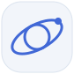
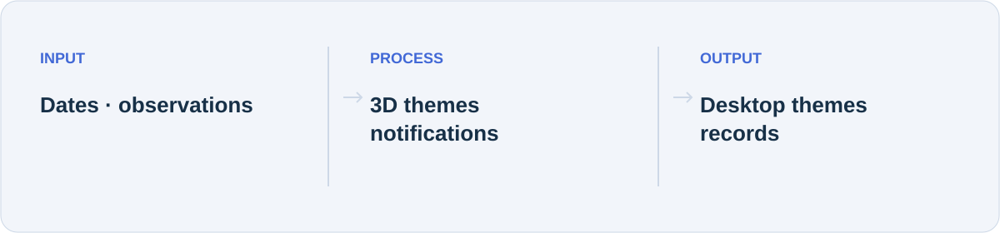
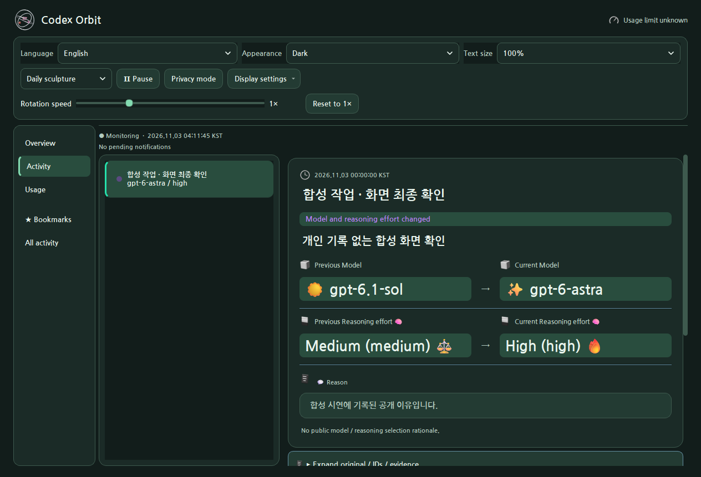

<!-- readme-header32:start -->

<h1 align="center" id="project-title">Codex Orbit</h1>

A Windows desktop for dates and observation records

  
  

  
  
  
  
  

<small>LEVEL links open the Korean source at the same reading level.</small>

<picture>
  <source media="(max-width: 600px) and (prefers-color-scheme: dark)" srcset="../assets/readme/flow-en-dark-mobile.svg" />
  <source media="(max-width: 600px)" srcset="../assets/readme/flow-en-light-mobile.svg" />
  <source media="(prefers-color-scheme: dark)" srcset="../assets/readme/flow-en-dark.svg" />
  <source media="(prefers-color-scheme: light)" srcset="../assets/readme/flow-en-light.svg" />
  
</picture>
<!-- readme-header32:end -->

## Revision 44 · Consistent notifications and internal screens

Version 3.13.0 uses the widget's previous/current comparison inside the app. Date-specific fruit, flowers, holidays, pixel motion, weather correction, and existing settings are preserved.

| Area | Change |
| --- | --- |
| Model and effort | Two comparison rows; narrow windows stack previous/current groups |
| Reason | A short explanation, with the original record available to expand |
| Controls | Shared Rust-generated light/dark styles and one expandable settings area |
| Calendar | Checked 27,028 dates through 2099 and 141 models across 282 GPU frames |

[Revision 44 details (Korean source)](../history/44차/README.md) · [Usage (Korean source)](../docs/44차_내부화면과날짜별위젯.md) · [Downloads](../docs/DOWNLOADS.md)

## Revision 43 · One-minute weather and connection-scoped city correction

Version 3.12.0 queries the weather every minute and applies a user-confirmed city correction only to the current connection. It preserves the Revision 41 notification design and excludes the Revision 42 design work.

| Area | Behavior |
| --- | --- |
| Weather and humidity | Queried again every 60 seconds at the same coordinates |
| City correction | Applies the confirmed city only when the current connection and country match |
| Response consistency | A native Rust DLL checks the distance between the requested coordinates and the weather grid |

[Revision 43 details (Korean source)](../history/43차/README.md) · [Usage (Korean source)](../docs/43차_날씨와위치.md) · [Downloads (Korean source)](../docs/DOWNLOADS.md)

## Revision 41 · Selected notification design

Version 3.11.0 restores the notification design selected by the user. It includes model illustrations, reasoning-effort bars, a short reason, explanation and detail links, and two buttons for pinning and archiving records.

| Area | Display |
| --- | --- |
| Comparison | Sun, star, Earth, and moon model illustrations with effort bars |
| Reason | A short explanation and sentence emojis below the comparison table |
| Explanation and details | Show more explanation / View details |
| Bottom controls | Pin / Archive record |

[Revision 41 details (Korean source)](../history/41차/README.md) · [Usage (Korean source)](../docs/41차_선택한알림형식.md) · [Downloads (Korean source)](../docs/DOWNLOADS.md)

A Windows desktop app that shows 3D themes for the year, month, and day by default. The observatory is available through explicit selection.

<!-- project-levels:start -->

## Main features and usage conditions

| Feature | Input and conditions | Behavior and limits |
| --- | --- | --- |
| Notifications | Model and reasoning-effort changes present in the records | Distinguishes previous/current values and disclosed reasons. |
| Date-specific models | Date, country, and confirmed event dates | Displays that day's 3D subject while keeping text sharp. |
| Location and weather | Automatic estimates or manually selected search results | Shows temperature, precipitation, and aggregation intervals, distinguishing unknown values. |
| Usage limits | Account percentages supplied by the signed-in Codex | These are not remaining token counts; original values are available in tooltips. |

## Choose a reading level

| Level | Explanation scope |
| --- | --- |
| [LEVEL 1 - Beginner (Korean source)](../docs/읽기안내/레벨1.md) | Unfamiliar terms explained with actual behavior, examples, and easily misunderstood limits. |
| [LEVEL 2 - Explorer (Korean source)](../docs/읽기안내/레벨2.md) | Inputs, processing, outputs, feature connections, and revision changes. |
| [LEVEL 3 - Practitioner (Korean source)](../docs/읽기안내/레벨3.md) | Prerequisites, usage steps, settings, results, and checking failures. |
| [LEVEL 4 - Advanced (Korean source)](../docs/읽기안내/레벨4.md) | Module design, state transitions, verification boundaries, and implementation choices. |
| [LEVEL 5 - Expert (Korean source)](../docs/읽기안내/레벨5.md) | Actual code, protocols, settings, full comparisons, and measurement evidence. |

All guides cover the same project and all revisions. The existing detailed body remains below.
<!-- project-levels:end -->

## Revision 40 · emoji and notification readability

**3.10.0** restores emoji for notification types, models, and reasoning effort. Previous/current values are compared side by side, with the reason for the change in a separate area.

| Area | Change |
| --- | --- |
| Emoji | Displays 🔄·⚙️·📋·▶️ according to notification type |
| Values | Preserves model/reasoning emoji and exact previous/current values |
| Reasons | A distinct explanation area and the complete disclosed original text |
| Controls | Open history, 📌 pin, and ⭐ archive |

[Revision 40 details (Korean source)](../history/40차/README.md) · [Usage (Korean source)](../docs/40차_이모지와알림.md) · [Downloads (Korean source)](../docs/DOWNLOADS.md)

## Revision 39 · clear change notifications

**3.9.0** displays notification decorations as custom-drawn graphics. Read the chat title, previous/current models and reasoning effort, then a short reason; **only the changed current value is emphasized**.

| Area | Change |
| --- | --- |
| Models | Sun, star, Earth, and Moon graphics with exact IDs |
| Reasoning | A six-segment bar, accessible names, and original effort levels |
| Scaling | Adjusts text/graphic sizes, padding, and row heights together |
| Controls | Graphic icons for pin, archive, and close |

[Revision 39 details (Korean source)](../history/39차/README.md) · [Usage (Korean source)](../docs/39차_알림아이콘.md) · [Downloads (Korean source)](../docs/DOWNLOADS.md)

## Revision 38 · readable notifications and dates including the year

**3.8.0** refines notifications to make chat titles and before/after values easier to compare. Reasons appear first as one sentence, with the full disclosed original text in a scrolling pane. Dates use the **2026/11/25** format.

| Area | Change |
| --- | --- |
| Notifications | Large title, two comparison rows for model/reasoning, and emphasis on changed current values |
| Reasons | An accessible sentence, separate original-text pane, and paused auto-dismiss while reading |
| Dates | Year/month/day, with time separated at narrow widths |

[Revision 38 details (Korean source)](../history/38차/README.md) · [Changes and controls (Korean source)](../docs/38차_알림가독성.md) · [Downloads (Korean source)](../docs/DOWNLOADS.md)

Revision 31–37 features, distribution, and screen records

## Revision 37 · notification center, monitoring status, and update information

**3.7.0** connects a notification center for browsing observed records, monitoring status and notification controls, and official update information. System/light/dark modes and date-specific fruit/flower pixel 3D sculptures are retained. Actual records are distinguished from previews, and implemented features from execution scopes that remain unverified.

| Area | Connected features |
| --- | --- |
| Notification center | Search, filters, grouping, summaries, copying, CSV/JSON, and privacy masking |
| Monitoring and notifications | Status, reconnecting, query times, focus/mute/display settings, and previews without recorded events |
| Updates | Official sources, disk space, verification, stages, recent results, and failure guidance |

[50 items and constraints (Korean source)](../docs/37차_50개개선.md) · [Current downloads (Korean source)](../docs/DOWNLOADS.md) · [Actual minimum checks (Korean source)](../docs/37차_최소검사.md) · [Full comparison index (Korean source)](../history/37차/비교/README.md)

[LEVEL 1 (Korean source)](../history/37차/README.md#user-content-reading-level-1) · [LEVEL 2 (Korean source)](../history/37차/README.md#user-content-reading-level-2) · [LEVEL 3 (Korean source)](../history/37차/README.md#user-content-reading-level-3) · [LEVEL 4 (Korean source)](../history/37차/README.md#user-content-reading-level-4) · [LEVEL 5 (Korean source)](../history/37차/README.md#user-content-reading-level-5)

Existing passing evidence for **21** relevant pure functions is reused. [Revision 37 minimum checks (Korean source)](../docs/37차_최소검사.md) distinguish the actual checks of distribution files and GUI connections.

Location display strengthens consistency between country, province/state, city names, and identifiers. Automatic location is a network estimate and does not guarantee accurate device location. [Location display consistency (Korean source)](../docs/37차_지역정합.md)

## Revision 36 · installer option cleanup

The product version remains **3.5.0**; only the installer was replaced.

This revision **automatically creates a desktop shortcut** without a selection page and removes the launch checkbox from the completion page.

The app EXE and 150% settings are unchanged at the same version. [Current downloads (Korean source)](../docs/DOWNLOADS.md) distinguish the new Setup from revision 35 hashes before replacement.

[LEVEL 1 (Korean source)](../history/36차/README.md#user-content-reading-level-1) · [LEVEL 2 (Korean source)](../history/36차/README.md#user-content-reading-level-2) · [LEVEL 3 (Korean source)](../history/36차/README.md#user-content-reading-level-3) · [LEVEL 4 (Korean source)](../history/36차/README.md#user-content-reading-level-4) · [LEVEL 5 (Korean source)](../history/36차/README.md#user-content-reading-level-5)

## Revision 35 · colors and lighting

Choose system, light, or dark in **Screen theme** at the top. **Customize colors** beside it offers six palettes or direct color-code entry for the accent, dark background, and light background. Color-picker buttons are also provided.

Lighting intensity ranges from 0 to 100; **0 turns lighting off**.

The preview's dark/light selection changes only the preview.

Settings are saved only with **Apply**; **Cancel** retains the existing settings.

Restoring defaults is also not saved until applied.

Invalid color codes show an explanation and block application; a save failure restores the previous settings and screen.

Entered base colors are preserved while text colors are adjusted for readability. Date-specific fruit, flowers, anniversaries, city events, and rotating pixel 3D forms remain. Usage bars retain actual percentages/original values; automatic/manual location and model/reasoning/task-resumption notifications are unchanged. Lighting does not add whole-screen blur or a separate animation timer.

**3.5.0 is an official distribution release.**

[Check scope and distribution status (Korean source)](../docs/35차_최소검사.md) distinguish EXE/Setup generation and minimum startup checks, three completed synthetic-screen combinations, an unfinished fourth automated check, and a settings-check timeout.

The user directly confirmed normal practical use at 150% scaling.

That is distinct from all automated checks passing.

## Revision 34 · pixel 3D sculptures and city events

Date-specific fruit, flowers, anniversaries, and city-event subjects are displayed through pixel rendering of actual 3D meshes, rotating once around the vertical axis.

Text, weather, and remaining usage stay sharp.

Inherits automatic/manual location, precipitation aggregation intervals, rounding to one decimal place, and original-value inspection.

Distinguishes city festival entries, announced schedules, evidence-backed series/editions, and unclassified entries.

Only official dates are connected to 8 event motifs, with sources, licenses, updates, and coverage limits.

It does not guarantee all events worldwide or unannounced future dates. Revision 33 proceeded without a separate release; its original materials are preserved in this publication and integrated into revision 34, with its then-progress distinguished from actual revision 34 verification results.

GPU work is isolated in a separately owned process, separating the ordinary app from the internal GPU entry point.

The maximum 5-second preparation period is separate from the existing 2-second displayed-frame check after readiness. Shutdown first requests graceful reclamation, then forcibly reclaims only the owned Job if necessary.

This does not guarantee that every OS hang can be resolved within the deadline.

Actual final results are distinguished in the verification documents.

[Revision 34 details (Korean source)](../history/34차/README.md) · [Revision 33 work-in-progress materials (Korean source)](../history/33차/README.md) · [Change log (Korean source)](../변경기록_34차.md) · [Feature scope (Korean source)](../docs/2026-11-13_34차_픽셀3D_명세.md) · [GPU process isolation (Korean source)](../docs/34차_그래픽프로세스격리.md)

A Windows desktop app that shows 3D themes for the year, month, and day by default. The observatory is available through explicit selection.

Shows model/reasoning-effort changes and task status observed in local records, alongside actual account usage-limit percentages, a clock, and temperature.

[Earlier English version (existing English source)](../README.en.md) · [Downloads (Korean source)](../docs/DOWNLOADS.md) · [Usage (Korean source)](../docs/사용법.md) · [Verification scope (Korean source)](../docs/공개검증_34차.md) · [Change log (Korean source)](../변경기록_34차.md) · [Rights and publication scope (Korean source)](../공개범위.md)

## Revision 32 · location search and the day's 3D subject

The date widget displays one subject for the day without rings or side ornaments. Retains the existing 888 monthly themes and ordinary daily subjects; public holidays/supported anniversaries across 250 countries/territories receive actual event names and special sculptures. This is not definitive data for future legal changes or every city festival.

Click the location to search directly for a city, address, place, or country. Retrieves temperature, weather, humidity, sunrise, and sunset for the chosen point, and labels automatic IP location as an estimate.

Notifications compare previous/current models and reasoning effort side by side, with a short explanation and collapsible original text. The screen offers white/slate-blue and dark themes.

[Revision 32 details (Korean source)](../history/32차/README.md) · [Change log (Korean source)](../변경기록_32차.md) · [Location/event scope (Korean source)](../docs/2026-11-10_32차_지역검색과국가별행사_추가명세.md)

## Synthetic screens from the actual revision 32 distribution

Screens checked in the actual distributed EXE without personal records or networking. Temperature, humidity, remaining usage, and model values are synthetic examples. [Verification scope (Korean source)](../docs/공개검증_32차.md)

## Synthetic screens from the previous revision 31 distribution

Synthetic tasks made without personal records. Model/reasoning values are screen-testing examples, not actual runtime models or account state.

## Revision 31 · screen finishing and theme selection

Applies system/light/dark themes immediately and saves the selection.

Language, text size, and rotation speed are controlled in the same settings area; task status distinguishes selected settings from recent execution observations.

The screen settings menu explains reduced motion, edge docking, notification sounds, performance/quality, saving diagnostic files, and checking new versions.

Privacy mode masks on-screen titles and task descriptions while retaining stored original text.

Date-specific fruit, three metal rings, date rules, and model/reasoning change notifications are retained.

[Revision 31 details (Korean source)](../history/31차/README.md) · [Change log (Korean source)](../변경기록_32차.md)

## Connecting monitoring, display, storage, and updates

In revision 30 source, `notifier.Watcher` reads local JSONL and distinguishes setting observations, execution observations, and disclosed reasons; `app.py` displays notifications, widgets, and detailed history. `core.py` handles tailing JSONL, chat titles, window placement, and Markdown application/restoration. Task state in `activity.py` and formatting in `notice_format.py` are distinct from renderer decoration state.

**Boundary:** Reading records

**Actual processing:** Revision 30 notifier limits read chunks to 512KiB, records to 2MiB, files to 4096, total polling to 8MiB, pending items to 256, and the interval to 0.2 seconds. It distinguishes the initial baseline from notifications for new records.

**Boundary:** Display

**Actual processing:** calendar is the default; an explicitly selected observatory is retained. GPU graphics in calendar_renderer/observatory_scene are separate from actual model/reasoning records.

**Boundary:** Account limits

**Actual processing:** UsageClient opens codex.exe app-server through QProcess with separate pipes and makes read requests. Refreshes every 30 seconds, allows 12 seconds for a response, and marks values stale after 65 seconds.

**Boundary:** Connection failure

**Actual processing:** A failed limit query marks previous values stale and reconnects at most 3 times with 3/6/9-second delays. Unknown values are not converted to 0%.

**Boundary:** Shutdown

**Actual processing:** UsageClient.close clears timers and pending work, requests shutdown, waits 500ms, and if needed kills the process and waits another 500ms.

**Boundary:** Distribution replacement

**Actual processing:** safe_update checks official releases, assets, SHA, and local boundaries through check → stage → apply, restoring the previous EXE if startup confirmation fails. MAX_DOWNLOAD is 512MiB.

Users choose monitoring paths, language, display mode, and motion/resource quality, then read before/after values and evidence in new notifications.

Weather, usage limits, and updates are network or App Server features, separate from the local watcher's scope. Broadcast-mode and diagnostic-ZIP publication exclusions remain. Actual usage, releases, builds, and revision-specific function/settings references are linked below.

[Code, conditions, observations, and full comparisons for every revision (Korean source)](../docs/REVISION_INDEX.md)

## Revision 30 · restoring the original date-specific theme default

Displays the original date-specific calendar sculpture even when settings contain no display mode. Date titles/sculptures remain on model-change events. The 888 monthly themes, daily designs, colors, materials, and date rules are unchanged. Previous/current models, reasoning effort, and notifications are also retained.

[Revision 30 change log (Korean source)](../변경기록_30차.md) · [Verification scope (Korean source)](../docs/공개검증_30차.md) · [Full comparison with revision 29 (Korean source)](../docs/30%EC%B0%A8_%EC%A0%84%EC%B2%B4%EB%B3%80%EA%B2%BD-%EC%97%B4%EB%9E%8C.md)

## Optional revision 29 observatory features

- Three silver metal rings move on different axes. Distinguishes Sol's sun, Astra's crystal, Terra's sphere, and Luna's crescent core, with particle density by reasoning effort. Unconfirmed models use a neutral form.
- Satellites display task states explicitly observed in records. Offers pinned chats, record bookmarks, away summaries, and time-slider playback; playback does not change actual model settings.
- Notifications compare the chat title, previous model/reasoning effort, current model/reasoning effort, and recorded reason. Preserves exact model IDs/original records while tidying decorative emoji in displayed titles. Hovering pauses auto-dismiss, and notifications can be pinned.
- Broadcast mode masks open notifications, titles, tasks, and tooltips. Diagnostic ZIPs are saved locally with conversation, authentication, paths, and original event text excluded. Updates query official releases when the user clicks Check, prepare after SHA-256 comparison, and restore the previous executable if startup confirmation fails after replacement.
- Uses mint/white screens and Nanum Gothic Bold. Supports text size, edge docking, expansion, play/pause, reduced motion, and resource quality; notification monitoring continues while paused.

The actual limit is the **percentage of remaining usage allowance**, not remaining tokens. Unknown is distinct from 0%. Observing selected settings is distinct from observing execution records, and local records do not guarantee server model identity. Unrecorded reasons and task states are not invented.

## Calendar mode and existing features

Preserves [888 monthly themes (Korean source)](../docs/연도별_월별_테마_전체.md), their [CSV (Korean source)](../docs/연도별_월별_테마_전체.csv), and actual date-specific mesh sculptures for 2026–2099 in calendar mode.

Shared generation rules are reused; this does not mean 888 hand-crafted models.

Retains Korean/English selection, weather, IP-based location, clock, and speed controls.

One GPU worker renders a 3840×2160 source image; observatory quality uses 20/30/60fps caps.

Actual generation rate and monitor display rate are separate; constant 240fps is not claimed.

## All revisions and actual materials

View all revisions and actual materials in detail

[Complete index (Korean source)](../docs/REVISION_INDEX.md) · [Revision supplements, designs, and exclusion correspondence (Korean source)](../docs/ARCHIVE_FILES.md)

| Revision | Main changes | Materials |
| --- | --- | --- |
| Revision 1 | Codex Orbit·Revision 1 | **Material folder/original:** [Material folder (Korean source)](../history/01%EC%B0%A8) · **Detailed description:** [Detailed description (Korean source)](../history/01%EC%B0%A8/README.md) · **Preceding comparison/scope:** [Full comparison/scope (Korean source)](../history/01%EC%B0%A8/%EC%A7%81%EC%A0%84%EC%B0%A8%EC%88%98.diff) |
| Revision 2 | Codex Orbit·Revision 2 | **Material folder/original:** [Material folder (Korean source)](../history/02%EC%B0%A8) · **Detailed description:** [Detailed description (Korean source)](../history/02%EC%B0%A8/README.md) · **Preceding comparison/scope:** [Full comparison/scope (Korean source)](../history/02%EC%B0%A8/%EC%A7%81%EC%A0%84%EC%B0%A8%EC%88%98.diff) |
| Revision 3 | Codex Orbit·Revision 3 | **Material folder/original:** [Material folder (Korean source)](../history/03%EC%B0%A8) · **Detailed description:** [Detailed description (Korean source)](../history/03%EC%B0%A8/README.md) · **Preceding comparison/scope:** [Full comparison/scope (Korean source)](../history/03%EC%B0%A8/%EC%A7%81%EC%A0%84%EC%B0%A8%EC%88%98.diff) |
| Revision 4 | Codex Orbit·Revision 4 | **Material folder/original:** [Material folder (Korean source)](../history/04%EC%B0%A8) · **Detailed description:** [Detailed description (Korean source)](../history/04%EC%B0%A8/README.md) · **Preceding comparison/scope:** [Full comparison/scope (Korean source)](../history/04%EC%B0%A8/%EC%A7%81%EC%A0%84%EC%B0%A8%EC%88%98.diff) |
| Revision 5 | Codex Orbit·Revision 5 | **Material folder/original:** [Material folder (Korean source)](../history/05%EC%B0%A8) · **Detailed description:** [Detailed description (Korean source)](../history/05%EC%B0%A8/README.md) · **Preceding comparison/scope:** [Full comparison/scope (Korean source)](../history/05%EC%B0%A8/%EC%A7%81%EC%A0%84%EC%B0%A8%EC%88%98.diff) |
| Revision 6 | Codex Orbit·Revision 6 | **Material folder/original:** [Material folder (Korean source)](../history/06%EC%B0%A8) · **Detailed description:** [Detailed description (Korean source)](../history/06%EC%B0%A8/README.md) · **Preceding comparison/scope:** [Full comparison/scope (Korean source)](../history/06%EC%B0%A8/%EC%A7%81%EC%A0%84%EC%B0%A8%EC%88%98-%EC%97%B4%EB%9E%8C.md) |
| Revision 7 | Codex Orbit·Revision 7 | **Material folder/original:** [Material folder (Korean source)](../history/07%EC%B0%A8) · **Detailed description:** [Detailed description (Korean source)](../history/07%EC%B0%A8/README.md) · **Preceding comparison/scope:** [Full comparison/scope (Korean source)](../history/07%EC%B0%A8/%EC%A7%81%EC%A0%84%EC%B0%A8%EC%88%98.diff) |
| Revision 8 | Codex Orbit·Revision 8 | **Material folder/original:** [Material folder (Korean source)](../history/08%EC%B0%A8) · **Detailed description:** [Detailed description (Korean source)](../history/08%EC%B0%A8/README.md) · **Preceding comparison/scope:** [Full comparison/scope (Korean source)](../history/08%EC%B0%A8/%EC%A7%81%EC%A0%84%EC%B0%A8%EC%88%98.diff) |
| Revision 9 | Codex Orbit·Revision 9 | **Material folder/original:** [Material folder (Korean source)](../history/09%EC%B0%A8) · **Detailed description:** [Detailed description (Korean source)](../history/09%EC%B0%A8/README.md) · **Preceding comparison/scope:** [Full comparison/scope (Korean source)](../history/09%EC%B0%A8/%EC%A7%81%EC%A0%84%EC%B0%A8%EC%88%98.diff) |
| Revision 10 | Codex Orbit·Revision 10 | **Material folder/original:** [Material folder (Korean source)](../history/10%EC%B0%A8) · **Detailed description:** [Detailed description (Korean source)](../history/10%EC%B0%A8/README.md) · **Preceding comparison/scope:** [Full comparison/scope (Korean source)](../history/10%EC%B0%A8/%EC%A7%81%EC%A0%84%EC%B0%A8%EC%88%98.diff) |
| Revision 11 | Codex Orbit·Revision 11 | **Material folder/original:** [Material folder (Korean source)](../history/11%EC%B0%A8) · **Detailed description:** [Detailed description (Korean source)](../history/11%EC%B0%A8/README.md) · **Preceding comparison/scope:** [Full comparison/scope (Korean source)](../history/11%EC%B0%A8/%EC%A7%81%EC%A0%84%EC%B0%A8%EC%88%98.diff) |
| Revision 12 | Codex Orbit·Revision 12 | **Material folder/original:** [Material folder (Korean source)](../history/12%EC%B0%A8) · **Detailed description:** [Detailed description (Korean source)](../history/12%EC%B0%A8/README.md) · **Preceding comparison/scope:** [Full comparison/scope (Korean source)](../history/12%EC%B0%A8/%EC%A7%81%EC%A0%84%EC%B0%A8%EC%88%98.diff) |
| Revision 13 | Codex Orbit·Revision 13 | **Material folder/original:** [Material folder (Korean source)](../history/13%EC%B0%A8) · **Detailed description:** [Detailed description (Korean source)](../history/13%EC%B0%A8/README.md) · **Preceding comparison/scope:** [Full comparison/scope (Korean source)](../history/13%EC%B0%A8/%EC%A7%81%EC%A0%84%EC%B0%A8%EC%88%98.diff) |
| Revision 14 | Codex Orbit·Revision 14 | **Material folder/original:** [Material folder (Korean source)](../history/14%EC%B0%A8) · **Detailed description:** [Detailed description (Korean source)](../history/14%EC%B0%A8/README.md) · **Preceding comparison/scope:** [Full comparison/scope (Korean source)](../history/14%EC%B0%A8/%EC%A7%81%EC%A0%84%EC%B0%A8%EC%88%98.diff) |
| Revision 15 | Codex Orbit·Revision 15 | **Material folder/original:** [Material folder (Korean source)](../history/15%EC%B0%A8) · **Detailed description:** [Detailed description (Korean source)](../history/15%EC%B0%A8/README.md) · **Preceding comparison/scope:** [Full comparison/scope (Korean source)](../history/15%EC%B0%A8/%EC%A7%81%EC%A0%84%EC%B0%A8%EC%88%98.diff) |
| Revision 16 | Codex Orbit·Revision 16 | **Material folder/original:** [Material folder (Korean source)](../history/16%EC%B0%A8) · **Detailed description:** [Detailed description (Korean source)](../history/16%EC%B0%A8/README.md) · **Preceding comparison/scope:** [Full comparison/scope (Korean source)](../history/16%EC%B0%A8/%EC%A7%81%EC%A0%84%EC%B0%A8%EC%88%98.diff) |
| Revision 17 | Codex Orbit·Revision 17 | **Material folder/original:** [Material folder (Korean source)](../history/17%EC%B0%A8) · **Detailed description:** [Detailed description (Korean source)](../history/17%EC%B0%A8/README.md) · **Preceding comparison/scope:** [Full comparison/scope (Korean source)](../history/17%EC%B0%A8/%EC%A7%81%EC%A0%84%EC%B0%A8%EC%88%98.diff) |
| Revision 18 | Codex Orbit·Revision 18 | **Material folder/original:** [Material folder (Korean source)](../history/18%EC%B0%A8) · **Detailed description:** [Detailed description (Korean source)](../history/18%EC%B0%A8/README.md) · **Preceding comparison/scope:** [Full comparison/scope (Korean source)](../history/18%EC%B0%A8/%EC%A7%81%EC%A0%84%EC%B0%A8%EC%88%98-%EC%97%B4%EB%9E%8C.md) |
| Revision 19 | Codex Orbit·Revision 19 | **Material folder/original:** [Material folder (Korean source)](../history/19%EC%B0%A8) · **Detailed description:** [Detailed description (Korean source)](../history/19%EC%B0%A8/README.md) · **Preceding comparison/scope:** [Full comparison/scope (Korean source)](../history/19%EC%B0%A8/%EC%A7%81%EC%A0%84%EC%B0%A8%EC%88%98.diff) |
| Revision 20 | Codex Orbit·Revision 20 | **Material folder/original:** [Material folder (Korean source)](../docs/20%EC%B0%A8) · **Detailed description:** [Detailed description (Korean source)](../docs/20%EC%B0%A8/README.md) · **Preceding comparison/scope:** [Full comparison/scope (Korean source)](../docs/20%EC%B0%A8/README.md) |
| Revision 21 | Codex Orbit·Revision 21 | **Material folder/original:** [Material folder (Korean source)](../history/21%EC%B0%A8) · **Detailed description:** [Detailed description (Korean source)](../history/21%EC%B0%A8/README.md) · **Preceding comparison/scope:** [Full comparison/scope (Korean source)](../history/21%EC%B0%A8/%EC%A7%81%EC%A0%84%EC%B0%A8%EC%88%98.diff) |
| Revision 22 | Codex Orbit·Revision 22 | **Material folder/original:** [Material folder (Korean source)](../history/22%EC%B0%A8) · **Detailed description:** [Detailed description (Korean source)](../history/22%EC%B0%A8/README.md) · **Preceding comparison/scope:** [Full comparison/scope (Korean source)](../history/22%EC%B0%A8/%EC%A7%81%EC%A0%84%EC%B0%A8%EC%88%98-%EC%97%B4%EB%9E%8C.md) |
| Revision 23 | Codex Orbit·Revision 23 | **Material folder/original:** [Material folder (Korean source)](../history/23%EC%B0%A8) · **Detailed description:** [Detailed description (Korean source)](../history/23%EC%B0%A8/README.md) · **Preceding comparison/scope:** [Full comparison/scope (Korean source)](../history/23%EC%B0%A8/%EC%A7%81%EC%A0%84%EC%B0%A8%EC%88%98-%EC%97%B4%EB%9E%8C.md) |
| Revision 24 | Codex Orbit·Revision 24 | **Material folder/original:** [Material folder (Korean source)](../history/24%EC%B0%A8) · **Detailed description:** [Detailed description (Korean source)](../history/24%EC%B0%A8/README.md) · **Preceding comparison/scope:** [Full comparison/scope (Korean source)](../history/24%EC%B0%A8/%EC%A7%81%EC%A0%84%EC%B0%A8%EC%88%98.diff) |
| Revision 25 | Codex Orbit·Revision 25 | **Material folder/original:** [Material folder (Korean source)](../history/25) · **Detailed description:** [Detailed description (Korean source)](../history/25/README.md) · **Preceding comparison/scope:** [Full comparison/scope (Korean source)](../history/25/%EC%A7%81%EC%A0%84%EC%B0%A8%EC%88%98-%EC%97%B4%EB%9E%8C.md) |
| Revision 26 | Codex Orbit·Revision 26 | **Material folder/original:** [Material folder (Korean source)](../history/26) · **Detailed description:** [Detailed description (Korean source)](../history/26/README.md) · **Preceding comparison/scope:** [Full comparison/scope (Korean source)](../history/26/%EC%A7%81%EC%A0%84%EC%B0%A8%EC%88%98.diff) |
| Revision 27 | Codex Orbit·Revision 27 | **Material folder/original:** [Material folder (Korean source)](../history/27) · **Detailed description:** [Detailed description (Korean source)](../history/27/README.md) · **Preceding comparison/scope:** [Full comparison/scope (Korean source)](../docs/27%EC%B0%A8_%EC%A0%84%EC%B2%B4%EB%B3%80%EA%B2%BD.diff) |
| Revision 28 | Codex Orbit·Revision 28 | **Material folder/original:** [Material folder (Korean source)](../history/28) · **Detailed description:** [Detailed description (Korean source)](../history/28/README.md) · **Preceding comparison/scope:** [Full comparison/scope (Korean source)](../docs/28%EC%B0%A8_%EC%A0%84%EC%B2%B4%EB%B3%80%EA%B2%BD-%EC%97%B4%EB%9E%8C.md) |
| Final | Codex Orbit · Final | **Material folder/original:** [Material folder (Korean source)](../docs/%EC%B5%9C%EC%A2%85) · **Detailed description:** [Detailed description (Korean source)](../docs/%EC%B5%9C%EC%A2%85/README.md) · **Preceding comparison/scope:** [Full comparison/scope (Korean source)](../docs/%EC%B5%9C%EC%A2%85/README.md) |
| Revision 29 | Codex Orbit·Revision 29 | **Material folder/original:** [Material folder (Korean source)](../history/29%EC%B0%A8) · **Detailed description:** [Detailed description (Korean source)](../history/29%EC%B0%A8/README.md) · **Preceding comparison/scope:** [Full comparison/scope (Korean source)](../docs/29%EC%B0%A8_%EC%A0%84%EC%B2%B4%EB%B3%80%EA%B2%BD-%EC%97%B4%EB%9E%8C.md) · [Source comparison (Korean source)](../history/29%EC%B0%A8/%EC%A7%81%EC%A0%84%EC%B0%A8%EC%88%98-%EC%97%B4%EB%9E%8C.md) |
| Revision 30 | Codex Orbit·Revision 30 | **Material folder/original:** [Material folder (Korean source)](../history/30%EC%B0%A8) · **Detailed description:** [Detailed description (Korean source)](../history/30%EC%B0%A8/README.md) · **Preceding comparison/scope:** [Full comparison/scope (Korean source)](../history/30%EC%B0%A8/%EC%A7%81%EC%A0%84%EC%B0%A8%EC%88%98.diff) |
| Revision 31 | Screen finishing and theme selection | **Material folder/original:** [Material folder (Korean source)](../history/31%EC%B0%A8) · **Detailed description:** [Detailed description (Korean source)](../history/31%EC%B0%A8/README.md) · **Preceding comparison/scope:** [Full comparison/scope (Korean source)](../history/31%EC%B0%A8/%EC%A7%81%EC%A0%84%EC%B0%A8%EC%88%98.diff) |
| Revision 32 | Location search and date-specific 3D sculptures | **Material folder/original:** [Material folder (Korean source)](../history/32차) · **Detailed description:** [Detailed description (Korean source)](../history/32차/README.md) · **Preceding comparison/scope:** [Full comparison/scope (Korean source)](../docs/32%EC%B0%A8_%EC%A0%84%EC%B2%B4%EB%B3%80%EA%B2%BD-%EC%97%B4%EB%9E%8C.md) |
| Revision 33 | Automatic location, precipitation, and city-event work-in-progress materials | **Material folder:** [Material folder (Korean source)](../history/33차) · **Detailed description:** [Detailed description (Korean source)](../history/33차/README.md) · **Preceding comparison/scope:** [Full comparison/scope (Korean source)](../history/33%EC%B0%A8/%EC%A7%81%EC%A0%84%EC%B0%A8%EC%88%98-%EC%97%B4%EB%9E%8C.md) |
| Revision 34 | Pixel 3D sculptures and city events | **Material folder:** [Material folder (Korean source)](../history/34차) · **Detailed description:** [Detailed description (Korean source)](../history/34차/README.md) · **Preceding comparison/scope:** [Full comparison/scope (Korean source)](../docs/34%EC%B0%A8_%EC%A0%84%EC%B2%B4%EB%B3%80%EA%B2%BD-%EC%97%B4%EB%9E%8C.md) |
| Revision 35 | Developer colors and lighting | **Material folder:** [Material folder (Korean source)](../history/35차) · **Detailed description:** [Detailed description (Korean source)](../history/35차/README.md) · **Preceding comparison/scope:** [Full comparison/scope (Korean source)](../docs/35%EC%B0%A8_%EC%A0%84%EC%B2%B4%EB%B3%80%EA%B2%BD-%EC%97%B4%EB%9E%8C.md) |
| Revision 36 | Installer option cleanup | **Material folder:** [Material folder (Korean source)](../history/36차) · **Detailed description:** [Detailed description (Korean source)](../history/36차/README.md) · **Preceding comparison/scope:** [Full comparison/scope (Korean source)](../history/36차/직전차수.diff) |
| Revision 37 | Notification center, monitoring status, and update information | **Material folder:** [Material folder (Korean source)](../history/37차) · **Detailed description:** [Detailed description (Korean source)](../history/37차/README.md) · **Preceding comparison/scope:** [Full comparison/scope (Korean source)](../history/37차/비교/README.md) |
| Revision 38 | Readable notifications and dates including the year | **Material folder:** [Material folder (Korean source)](../history/38차) · **Detailed description:** [Detailed description (Korean source)](../history/38차/README.md) · **Preceding comparison/scope:** [Full comparison/scope (Korean source)](../history/38차/비교.md) |
| Revision 39 | Graphic icons and clear change notifications | Material folder: [Material folder (Korean source)](../history/39차) · Detailed description: [Detailed description (Korean source)](../history/39차/README.md) · Preceding comparison/scope: [Full comparison/scope (Korean source)](../history/39차/비교.md) |
| Revision 40 | Restored emoji and readable change reasons | Material folder: [Material folder (Korean source)](../history/40차) · Detailed description: [Detailed description (Korean source)](../history/40차/README.md) · Preceding comparison/scope: [Full comparison/scope (Korean source)](../history/40차/비교.md) |
| Revision 41 | Selected notification design | Material folder: [Material folder (Korean source)](../history/41차) · Details: [Details (Korean source)](../history/41차/README.md) · Previous comparison and scope: [Full comparison and scope (Korean source)](../history/41차/비교.md) |
| Revision 43 | One-minute weather · connection-scoped city correction | Material folder: [Material folder (Korean source)](../history/43차) · Details: [Details (Korean source)](../history/43차/README.md) · Previous comparison and scope: [Full comparison and scope (Korean source)](../history/43차/비교.md) |
| Revision 44 | Consistent internal comparisons and date-specific widget checks | [Files](../history/44차) · [Details](../history/44차/README.md) · [Full comparison](../history/44차/비교.md) |

Original source comparisons include comments, whitespace, line endings, and added/deleted states. Revision 20 preserves 38 designs without executable source; revision 21 preserves 110 designs. Original personal operational-verification text in the final folder is not published. Revision-specific links cover preservation, sanitization, exclusion reasons, and original/public SHAs for 2,281 historical items.

## Execution, source, and rights

Requires Windows 10/11 x64 and a graphics driver supporting OpenGL 3.3. The standalone EXE runs without Python installation; the installer provides current-user shortcuts and uninstalling. GPU readiness/failure is distinguished with a static indicator or error explanation.

Obtain public source from GitHub's automatic Source code ZIP or this repository.

Private full-development ZIPs, personal conversations, instructions, and authentication materials are not distributed.

Existing license notices are retained; no new source license is assigned arbitrarily.

Rebuild using `python -B -X utf8 tools/build_distribution.py`.

No paper PDF was created for this app work because there is no manuscript.

## Earlier revision 29 synthetic example screens

The following images show the actual Qt app with synthetic events and example values, not personal chats or real account figures.

**Revision 37 pixel-motion repair:** Rotation was checked for 133 date-specific subjects and 8 city-event forms. Read [actual check scope and scene-preparation repairs (Korean source)](../docs/37차_3D초기화.md) as well.

## Check and warning symbols within sentences

| Display | Handling |
| --- | --- |
| ✅ ❌ ⚠️ ☑ → 🔥 🌙 | Retains the Korean font and displays symbols using emoji/symbol fonts. |
| Status and reasons | Displays check symbols in the status line and preserves symbols in disclosed reason sentences. |
| Platform | Prefers Windows' default Segoe UI Emoji; Microsoft font files are not redistributed. |

Ordinary Korean text, **actual inline emoji**, and **custom-drawn graphics** for models/buttons are displayed distinctly. Symbols were checked on Windows screens; font lists/results from headless Qt checks are distinguished separately.
